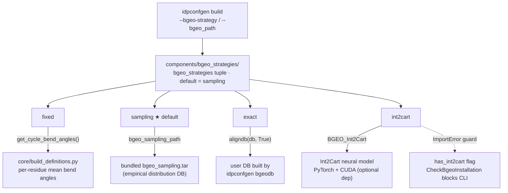
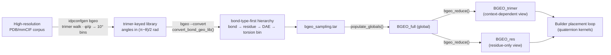

Bond geometry — the planar bond angles (bend angles) and covalent bond lengths that fix local backbone rigidity — is a first-class, *pluggable* concern in IDPConformerGenerator. While torsion angles (φ/ψ) define the conformational freedom sampled from fragment databases, the bond geometry that "fleshes out" those torsions into 3D coordinates is supplied by one of four interchangeable strategies: `fixed`, `sampling` (the default), `exact`, and `int2cart`. This page explains the strategy registry architecture, the internal angle convention that all strategies must honor, the data provenance of each strategy, and how strategy data flows into the multiprocessing builder at runtime. Quaternion-based coordinate placement itself is covered in [Coordinate Geometry & Quaternion Math](7-coordinate-geometry-and-quaternion-math); torsion sampling is covered in [K-mer Torsion Probability Sampling](9-k-mer-torsion-probability-sampling).

Sources: [bgeo_strategies/__init__.py](src/idpconfgen/components/bgeo_strategies/__init__.py#L1-L76), [cli_build.py](src/idpconfgen/cli_build.py#L1-L29)

## Strategy Architecture: A Pluggable Registry

The entire strategy system is concentrated in a single registry module, `components/bgeo_strategies/__init__.py`. It defines the canonical tuple of strategy names, designates `sampling` as the default, exposes `add_bgeo_strategy_arg()` so the `build` CLI (and LDRS clients) attach the `--bgeo-strategy` flag, and pairs it with a `-bgeo_path/--bgeo_path` option for supplying an externally generated bond geometry database. The help text explicitly scopes `--bgeo_path` to the `sampling` and `int2cart` strategies — `exact` obtains its geometry through the main `-db` input instead, and `fixed` needs no database at all.



Dependency gating is handled by an `argparse` action class, `CheckBgeoInstallation`, which wraps the `choices` validation: if the user selects `int2cart` but the external `modelling`/PyTorch stack is absent (`has_int2cart` is `False`), the parser raises a descriptive error pointing to the installation docs rather than failing later at build time. Each strategy is a small package under `components/bgeo_strategies/` exporting a `name` constant that must match the registry tuple exactly — a convention shared with the sidechain-packing plugin system described in [Component Plugin Pattern](20-component-plugin-pattern).

Sources: [bgeo_strategies/__init__.py](src/idpconfgen/components/bgeo_strategies/__init__.py#L17-L50), [bgeo_strategies/__init__.py](src/idpconfgen/components/bgeo_strategies/__init__.py#L53-L76), [int2cart/bgeo_int2cart.py](src/idpconfgen/components/bgeo_strategies/int2cart/bgeo_int2cart.py#L6-L20)

**Strategy comparison at a glance:**

| Strategy | Geometry source | Granularity | External dependency | `--bgeo_path` | Relative cost |
|---|---|---|---|---|---|
| `fixed` | Curated means in `build_definitions.py` | One bend angle per residue type | None | Not applicable | Negligible |
| `sampling` ★ | Bundled `bgeo_sampling.tar` | Distribution per bond-type/residue/torsion-bin | None | Yes | Dict lookups + random draw |
| `exact` | Database from `idpconfgen bgeodb` | Fragment-exact angles **and** bond lengths | bgeodb-generated DB (via `-db`) | No (uses `-db`) | DB alignment step |
| `int2cart` | NVIDIA Int2Cart neural predictor | Predicted d1–d3 lengths, θ1–θ3 angles per torsion | PyTorch + `modelling` pkg + CUDA GPU | Yes | GPU inference |

Sources: [bgeo_strategies/__init__.py](src/idpconfgen/components/bgeo_strategies/__init__.py#L17-L50)

## The (π − θ)/2 Bend Angle Convention

Every bond geometry store in this codebase — the fixed dictionaries, the sampling database, the Int2Cart predictions — expresses bend angles in the same *pre-transformed* unit: **half the planar supplement**, `(π − θ) / 2`, in radians. This is not a stylistic choice. The quaternion-based builder positions each new backbone atom by rotating about a bond axis, and the rotation angle required to land an atom on the planar-angle cone is exactly half the supplement of the planar angle. Storing angles pre-halved removes a per-atom division from the hot building loop and, more importantly, makes every geometry source drop-in compatible with the builder's rotation kernels.

The convention is enforced at three independent points, all of which must agree for a strategy to work: the `bgeo` CLI docstring states that angles are "in sync with the expectations of the `$ idpconfgen build` command" and documents the `(PI - angle) / 2` form; the extraction routine applies `(np.pi - calc_angle_njit(...)) / 2` to each backbone bend before storing it (with `Ca_C_O` stored as `angle / 2` since it is already a plain planar angle in the same family); and the fixed-strategy dictionaries are derived from raw means via the comprehension `{key: (pi - v) / 2}`.

| Backbone bend angle | Registry key (`core.definitions`) | Fixed-strategy dictionary | Ala mean (raw) | σ (raw) | Builder consumption phase |
|---|---|---|---|---|---|
| C(m1)–N–CA | `bgeo_Cm1NCa` | `build_bend_angles_Cm1_N_CA` | 2.118 rad ≈ 121.4° | 0.028 | OMEGA step |
| N–CA–C | `bgeo_NCaC` | `build_bend_angles_N_CA_C` | 1.939 rad ≈ 111.1° | 0.036 | PHI step |
| CA–C–N(p1) | `bgeo_CaCNp1` | `build_bend_angles_CA_C_Np1` | 2.038 rad ≈ 116.8° | 0.022 | PSI step |
| CA–C–O | `bgeo_CaCO` | `build_bend_CA_C_O` (scalar) | 2.102 rad ≈ 120.4° | — | Carbonyl O placement |

A fourth scalar family completes the carbonyl and amide geometry: `build_bend_CA_C_OXT = (π − 2π/3) / 2` for the C-terminal OXT, `build_bend_H_N_C = radians(114) / 2` for the amide hydrogen, plus the fixed distances `distance_C_O`, `distance_C_OXT = 1.27 Å`, and `distance_H_N = 0.9 Å`. Note that the residue-indexed dictionaries carry the *raw* mean under a fraction-like name (`bend_angles_N_CA_C`) while the `(π − v)/2`-transformed counterpart lives under the `build_bend_angles_*` name that strategies actually consume.

> [!TIP]
> Feeding raw planar angles (instead of the half-supplement form) into any bgeo store will silently mirror backbone geometry around each placed atom — the builder never re-transforms. When authoring a custom strategy or converting third-party geometry tables, apply `(pi − θ)/2` at ingestion time, exactly as `read_trimer_torsion_planar_angles` does.

Sources: [cli_bgeo.py](src/idpconfgen/cli_bgeo.py#L26-L63), [libhigherlevel.py](src/idpconfgen/libs/libhigherlevel.py#L824-L846), [build_definitions.py](src/idpconfgen/core/build_definitions.py#L495-L590), [build_definitions.py](src/idpconfgen/core/build_definitions.py#L668-L675)

## Strategy: `fixed` — Curated Per-Residue Means

The `fixed` strategy is the simplest contract in the system: it provides an infinite cycle over the three `build_bend_angles_*` dictionaries in builder-phase order — `build_bend_angles_Cm1_N_CA` for the OMEGA placement, `build_bend_angles_N_CA_C` for PHI, and `build_bend_angles_CA_C_Np1` for PSI. `get_cycle_bend_angles()` returns an `itertools.cycle` over that tuple, so the builder consumes one dictionary per placement step, round and round, for every residue of the template chain. No database, no randomness: every conformer built with `fixed` shares identical bond geometry, differing only through torsion sampling.

The underlying numbers in `core/build_definitions.py` are noteworthy for their representation: each mean is stored as an exact integer ratio (e.g., `8719677895929259 / 4503599627370496`), which reproduces the original float64 bit-for-bit and makes the curated values version-stable across platforms. Comments record the human-readable value and its observed standard deviation across the reference structure set — standard deviations that `fixed` deliberately discards. The per-residue-type spread is chemically meaningful: glycine's N–CA–C angle is the widest (1.977 rad), proline and isoleucine/valine the narrowest (≈1.914–1.968 rad), reflecting ring strain and β-branching respectively.

**Fixed bond lengths** (used alongside the bend angles by the distance iterators `get_cycle_distances_backbone`/`get_cycle_bond_type` from `libbuild.py`) follow the same pattern — per-residue dictionaries plus precomputed `average_distance_*` and `std_distance_*` aggregates:

| Bond | Dictionary | Range over 20 residue types (Å) | Comment on outliers |
|---|---|---|---|
| N–CA | `distances_N_CA` | 1.455 – 1.466 | Proline longest (ring geometry) |
| CA–C | `distances_CA_C` | 1.515 – 1.526 | Glycine shortest (no Cβ) |
| C–N(p1) | `distances_C_Np1` | 1.330 – 1.331 | Peptide bond, essentially invariant |
| C–O / C–OXT / H–N | scalars | 1.234 / 1.27 / 0.9 | Single values, residue-independent |

Sources: [fixed/__init__.py](src/idpconfgen/components/bgeo_strategies/fixed/__init__.py#L9-L22), [build_definitions.py](src/idpconfgen/core/build_definitions.py#L503-L546), [build_definitions.py](src/idpconfgen/core/build_definitions.py#L587-L676)

## Strategy: `sampling` — Empirical Distributions (Default)

`sampling` replaces single means with **observed distributions conditioned on sequence context and backbone torsions**, and it is the registry default. The database ships with the package as `bgeo_sampling.tar` (path exposed as `bgeo_sampling_path`), created from high-resolution PDB structures. The canonical authoring pipeline is the `idpconfgen bgeo` CLI: for every trimer in every input structure, it computes the middle residue's φ/ψ, rounds both to 10° bins, and records the four observed bend angles (`Cm1_N_Ca`, `N_Ca_C`, `Ca_C_Np1`, `Ca_C_O`) under the composite key `'<AAA>':'<phi>,<psi>'`.



After extraction, `idpconfgen bgeo --convert` invokes `convert_bond_geo_lib()` to restructure the library from trimer-first to **bond-type-first hierarchy** — the shape the builder actually queries. The five-level key schema is:

| Level | Example key | Meaning |
|---|---|---|
| 1 — bond type | `N_Ca_C` | Which planar angle (exact-match keys, from `core.definitions` `bgeo_*` constants) |
| 2 — central residue | `A` | 1-letter code of the middle residue |
| 3 — adjacent pair (DAE) | `DE` | Previous/next residue letters flanking the central residue |
| 4 — torsion bin | `'10,-40'` | φ/ψ of the central residue, rounded to 10° |
| 5 — leaf | list of floats | Observed bend angles, already in `(π−θ)/2` rad |

At build time, `populate_globals()` loads the tar into the `BGEO_full` global, then calls `bgeo_reduce()` (from `libhigherlevel.py`) to split it into two query-optimized views, `BGEO_trimer` and `BGEO_res` — both retaining the same first-layer bond-type keys (asserted explicitly), differing in how deep the context hierarchy is retained for lookup. The test fixtures mirror this lifecycle one-to-one: `EXPL_A_bgeo.json` (raw), `EXPL_A_bgeo_converted.json` (post-`convert_bond_geo_lib`), and `EXPL_A_bgeo_trimer.json`/`EXPL_A_bgeo_res.json` (post-`bgeo_reduce`), making the data pipeline directly inspectable without touching the production tar. The extraction kernel itself, `read_trimer_torsion_planar_angles`, walks 7-atom windows labeled `CA C N CA C N CA`, computes φ/ψ via `calc_torsion_angles`, bins with `rrd10_njit`, and validates atom labels at every step — mismatched or non-standard residues are logged and skipped rather than poisoning the statistics.

Sources: [sampling/__init__.py](src/idpconfgen/components/bgeo_strategies/sampling/__init__.py#L1-L12), [cli_bgeo.py](src/idpconfgen/cli_bgeo.py#L1-L63), [libhigherlevel.py](src/idpconfgen/libs/libhigherlevel.py#L725-L846), [libhigherlevel.py](src/idpconfgen/libs/libhigherlevel.py#L849-L883), [cli_build.py](src/idpconfgen/cli_build.py#L864-L881)

## Strategy: `exact` — Fragment-Consistent Geometry

`exact` closes the loop between torsion sampling and bond geometry: instead of re-drawing bend angles from a statistical database, it reads the **bond angles and bond lengths that physically accompanied the selected fragment** in its source structure. The divergence appears in `main()`: when the strategy is `exact`, the fragment database is opened with `aligndb(db, True)`, whose second positional flag extends the returned tuple with `BEND_ANGS` and `BOND_LENS` arrays alongside the usual `ANGLES` — module globals that otherwise stay `None`. This is why `exact` requires a database produced by the dedicated `bgeodb` CLI (the torsions+geometry superset of the plain `torsions` CLI); feeding a torsions-only database triggers an explicit `DATABASE ERROR` message instructing the user to regenerate with `bgeodb`.

The trade-off is representational rather than computational. With `exact`, every built conformer inherits bond geometry that is *self-consistent with its torsion context* — valuable when rebuilding from curated fragment sets or when reproducing specific experimental geometries — but the ensemble loses the intra-context geometric variability that `sampling` provides. Note the asymmetry in global-population: despite needing no `bgeo_path`, `exact` still triggers the `BGEO_full/BGEO_trimer/BGEO_res` load in `populate_globals()` (it shares the condition with `sampling` and `int2cart`), while `are_globals()` treats it like `fixed` — requiring only the atom labels, masks, and energy functions. Strategy-specific residue matching during fragment stitching is delegated to `get_adjacent_angles(...)`, which receives `bgeo_strategy` as a parameter so torsion-adjacency logic can adapt its geometry lookups.

Sources: [cli_build.py](src/idpconfgen/cli_build.py#L612-L633), [cli_build.py](src/idpconfgen/cli_build.py#L130-L133), [exact/__init__.py](src/idpconfgen/components/bgeo_strategies/exact/__init__.py#L1-L4), [cli_build.py](src/idpconfgen/cli_build.py#L864-L866)

## Strategy: `int2cart` — Neural Internal-Coordinate Prediction

`int2cart` delegates geometry prediction to the **Int2Cart** neural network (NVIDIA's `modelling` package): given a sequence and its torsion angles, the model regresses the six internal coordinates per residue — bond lengths `d1, d2, d3` and bend angles `theta1, theta2, theta3` — effectively *learning* the bond geometry distribution rather than tabulating it. The wrapper class `BGEO_Int2Cart` bundles a frozen checkpoint (`model.tar`) and YAML config (`int2cart.yml`) inside the strategy package; its single public method, `get_internal_coords(sequence, torsions)`, runs `predict()` with `units="radian"` and `build=False`, then slices the last-residue predictions (`[0, -1, 0]`) to return the 6-tuple for incremental chain extension.

This is the only strategy with an **optional hard dependency and hardware requirement**. The module guards its imports with `try/except ImportError`, setting `has_int2cart = False` so the rest of the package can import the name safely; the CLI blocks selection early via `CheckBgeoInstallation`; and at runtime `populate_globals()` instantiates the model inside a `try/except RuntimeError`, logging a warning to use CUDA-compatible GPUs if construction fails — the model checkpoint is loaded with `map_location=torch.device('cuda')`, making a GPU effectively mandatory. Because Int2Cart predicts geometry from torsions alone, it consumes the same `BGEO_*` globals as `sampling` (loaded for fallback/contextual use) plus its own `INT2CART` global, as codified in `are_globals()`.

Sources: [int2cart/bgeo_int2cart.py](src/idpconfgen/components/bgeo_strategies/int2cart/bgeo_int2cart.py#L6-L62), [bgeo_strategies/__init__.py](src/idpconfgen/components/bgeo_strategies/__init__.py#L53-L70), [cli_build.py](src/idpconfgen/cli_build.py#L882-L893)

## Runtime Data Flow: Globals, Validation, and Multiprocessing

Strategy selection ultimately resolves into **module-level globals** — the same performance pattern used for atom labels and energy functions, chosen because reading globals is the cheapest data-sharing mechanism across `multiprocessing.Pool` workers (fork inherits them; nothing is pickled per task). The lifecycle is: `main()` determines the strategy → `populate_globals()` materializes its data → `are_globals()` asserts completeness *per strategy* → the pool of `_build_conformers` workers consumes the globals read-only.

```mermaid
sequenceDiagram
    participant M as build main()
    participant PG as populate_globals()
    participant G as module globals
    participant AG as are_globals()
    participant W as Pool workers

    M->>PG: bgeo_strategy, bgeo_path, forcefield
    alt strategy ∈ {sampling, exact, int2cart}
        PG->>PG: read DB (default: bundled bgeo_sampling.tar)
        PG->>G: BGEO_full.update(db)
        PG->>G: BGEO_trimer, BGEO_res ← bgeo_reduce(BGEO_full)
        PG->>PG: assert identical first-layer keys
    end
    alt strategy = int2cart
        PG->>G: INT2CART = BGEO_Int2Cart()  (CUDA; warn on RuntimeError)
    end
    PG->>G: ALL/TEMPLATE_LABELS, MASKS, EFUNC
    M->>AG: bgeo_strategy
    AG-->>M: per-strategy completeness check (AssertionError if partial)
    M->>W: Pool(ncores).imap(_build_conformers ...)
    W->>G: read-only access to BGEO_* / INT2CART per placement step
```

The validation matrix in `are_globals()` makes each strategy's runtime contract explicit and is worth reading as the authoritative spec: `sampling` requires `BGEO_full`, `BGEO_trimer`, `BGEO_res`; `exact` and `fixed` require only the labels/masks/energy-function trio; `int2cart` requires the `BGEO_*` trio *plus* the instantiated `INT2CART` model; and any unrecognized value raises with the registry's formatted `bgeo_error_msg`. In `--long` mode the same preparation runs per fragment, with each fragment's globals snapshot (`SLICEDICT_XMERS`, `XMERPROBS`, `BGEO_*`, labels, masks, energy functions) archived into `LONG_GLOBALS` and swapped in as fragments are processed sequentially.

> [!TIP]
> When debugging a strategy, check `are_globals()` first: a partially populated global set (e.g., `INT2CART` left `None` after a GPU RuntimeError under `int2cart`) fails the `all(...)` check *before* any pool work is dispatched, converting what would be a confusing mid-build worker crash into an immediate, attributable startup error.

Sources: [cli_build.py](src/idpconfgen/cli_build.py#L182-L222), [cli_build.py](src/idpconfgen/cli_build.py#L829-L893), [cli_build.py](src/idpconfgen/cli_build.py#L131-L155), [cli_build.py](src/idpconfgen/cli_build.py#L694-L715)

## Strategy Selection Guide

For production IDP ensemble generation, the default `sampling` strategy offers the best realism-to-cost ratio: context-conditioned geometric variability from high-resolution structures with no external dependencies. Choose `fixed` for debugging the building pipeline itself (geometry ceases to be a random variable) or for extremely fast templated builds where geometric variation is unwanted. Choose `exact` when rebuilding must preserve the bond geometry of specific source fragments — typically with a curated `bgeodb` database. Reserve `int2cart` for GPU-equipped environments where learned geometry generalization (especially around non-canonical torsion regimes) justifies the dependency; note that its quality depends on the bundled checkpoint, and it is the only strategy whose failure mode is environmental (missing CUDA) rather than logical.

All strategies feed the same downstream contract — half-supplement bend angles plus Å-scale bond lengths consumed by the quaternion placement kernels — so switching strategies never changes the builder's control flow, only its numeric sources. That contract, and the full fixed-value tables, are itemized in [Build Definitions Reference](21-build-definitions-reference); the placement math consuming these values is derived in [Coordinate Geometry & Quaternion Math](7-coordinate-geometry-and-quaternion-math); and how sampled torsion contexts select which bgeo entries to query next is covered in [K-mer Torsion Probability Sampling](9-k-mer-torsion-probability-sampling).
