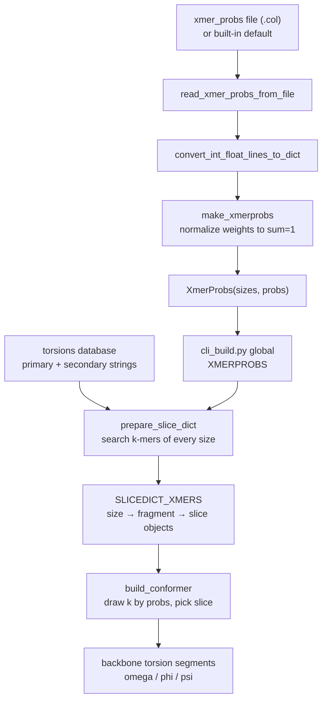
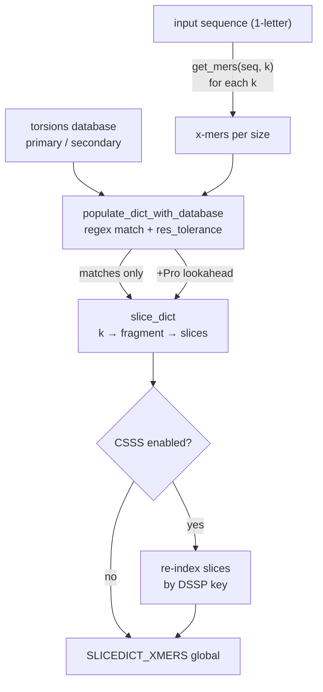

This page explains how IDPConformerGenerator decides **how many residues to grow per sampling step** during conformer construction. Instead of adding one residue at a time, the builder draws backbone torsion segments of variable length — *k*-mers ("x-mers") — from an empirical torsion database, and the probability of each fragment length is governed by a small, self-contained component: `idpconfgen.components.xmer_probs`. We cover the data contract, the input file format, CLI integration, the database-matching pipeline that validates k-mer availability, and the dynamic renormalization that keeps the distribution valid when the database cannot satisfy every requested size.

## Why Fragment Length Is a Random Variable

The `idpconfgen build` command constructs conformers from a torsion-angle database previously generated by `idpconfgen torsions` ([cli_build.py](src/idpconfgen/cli_build.py#L1-L10)). At each growth step, the engine does not commit to a fixed segment size: it selects a fragment of *k* consecutive residues from the input sequence, locates all matching fragments in the database, and samples one of their stored torsion sets. The value of *k* is itself drawn from a weighted distribution, which is exactly what the `XmerProbs` object encodes. The component's docstring states its dual responsibility plainly: *"Define fragment probability distribution for CLI and building"* ([xmer_probs.py](src/idpconfgen/components/xmer_probs.py#L1)).

The shipped default allows fragments of 1 to 5 residues with relative weights `(1, 1, 3, 3, 2)`, meaning trimers and tetramers are three times as likely as monomers or dimers, and pentamers twice as likely ([xmer_probs.py](src/idpconfgen/components/xmer_probs.py#L28-L30)). This bias toward mid-sized fragments reflects a deliberate trade-off between local torsion realism (longer fragments capture residue-to-residue angle correlations) and database coverage (shorter fragments match more often).



Sources: [cli_build.py](src/idpconfgen/cli_build.py#L1-L10), [xmer_probs.py](src/idpconfgen/components/xmer_probs.py#L28-L30)

## The XmerProbs Data Contract

The entire distribution is carried by a two-field namedtuple: `_XmerProbs = namedtuple('XmerProbs', ['sizes', 'probs'])` ([xmer_probs.py](src/idpconfgen/components/xmer_probs.py#L18)). The constructor function `make_xmerprobs(sizes, probs)` copies the sizes into a list and delegates normalization to `make_seq_probabilities(probs, reverse=False)`, which divides every weight by the total so the probabilities sum to exactly 1 ([libcalc.py](src/idpconfgen/libs/libcalc.py#L946-L957)). Weights may be any integers — the help text notes that `10` and `90` become 10% and 90% ([xmer_probs.py](src/idpconfgen/components/xmer_probs.py#L91-L92)).

| API element | Location | Role |
|---|---|---|
| `XmerProbs(sizes, probs)` | [xmer_probs.py](src/idpconfgen/components/xmer_probs.py#L18) | Immutable distribution container |
| `make_xmerprobs(sizes, probs)` | [xmer_probs.py](src/idpconfgen/components/xmer_probs.py#L21-L25) | Validates/normalizes into a distribution |
| `default_XmerProbs` | [xmer_probs.py](src/idpconfgen/components/xmer_probs.py#L28-L30) | Sizes `(1..5)`, weights `(1, 1, 3, 3, 2)` |
| `read_xmer_probs_from_file(fpath)` | [xmer_probs.py](src/idpconfgen/components/xmer_probs.py#L33-L38) | File → dict → distribution |
| `prepare_xmer_probs(value)` | [xmer_probs.py](src/idpconfgen/components/xmer_probs.py#L113-L118) | Type-dispatching adapter for the build engine |
| `compress_xmer_to_bool/_key` | [xmer_probs.py](src/idpconfgen/components/xmer_probs.py#L121-L134) | Restrict sizes & renormalize |
| `make_seq_probabilities(seq)` | [libcalc.py](src/idpconfgen/libs/libcalc.py#L946-L957) | Divide-by-sum normalization |

The file reader is a functional pipeline: `chainf(fpath, read_lines, convert_int_float_lines_to_dict)` streams lines into an ordered `{size: weight}` dict, from which the distribution is assembled and logged ([xmer_probs.py](src/idpconfgen/components/xmer_probs.py#L33-L38)). `prepare_xmer_probs` then acts as the single entry point consumed by the builder: it passes through an existing `XmerProbs` instance (guarded by `is_XmerProbs`), falls back to `default_XmerProbs` for `None`, and otherwise attempts a file read ([xmer_probs.py](src/idpconfgen/components/xmer_probs.py#L52-L62), [xmer_probs.py](src/idpconfgen/components/xmer_probs.py#L112-L118)). Both fallback behaviors are pinned by tests: `prepare_xmer_probs(None)` and `read_xmer_probs_file_or_default(None)` must return the default object *by identity* ([test_xmer_probs.py](tests/test_xmer_probs.py#L46-L55)).

Sources: [libcalc.py](src/idpconfgen/libs/libcalc.py#L946-L957), [test_xmer_probs.py](tests/test_xmer_probs.py#L46-L55)

## Input File Format and CLI Integration

The distribution is configured through `-xp / --xmer-probs`, a two-column text file where the first column is the fragment size and the second its relative probability; `#` starts a comment line ([xmer_probs.py](src/idpconfgen/components/xmer_probs.py#L83-L98)). The repository's test fixture `xmer_prob.col` encodes sizes 1, 2, 5 with weights 2, 4, 6, and the test suite verifies it normalizes identically to `make_xmerprobs([1, 2, 5], [2, 4, 6])` ([test_xmer_probs.py](tests/test_xmer_probs.py#L25-L34)).

```text
# size    weight
1         2
2         4
5         6
```

CLI parsing is handled by `XmerProbsAction`, an `argparse.Action` subclass that eagerly converts the file path into an `XmerProbs` object at parse time and translates failure modes into precise parser errors ([xmer_probs.py](src/idpconfgen/components/xmer_probs.py#L65-L80)):

| Failure | CLI response |
|---|---|
| `ValueError` / `TypeError` (malformed file) | `Not a compatible '<dest>' format.` |
| Missing file | `File <value> not found for parameter <dest>.` |
| Directory passed | `<value> is a directory. We expect a file...` |

This fail-fast design means invalid distributions are rejected before any expensive database preparation begins. The action is attached to the build parser via `add_xmer_arg(ap)` ([cli_build.py](src/idpconfgen/cli_build.py#L352)), itself a functional composition over `add_general_arg` with the flags and kwargs defined in the component ([xmer_probs.py](src/idpconfgen/components/xmer_probs.py#L98-L110)). A test confirms `add_xmer_arg` yields `None` by default and a valid `XmerProbs` when given `-xp <file>` ([test_xmer_probs.py](tests/test_xmer_probs.py#L81-L94)).

> [!TIP]
> Because `XmerProbsAction` validates at *argument-parse* time, you get distribution errors in the CLI usage phase, not minutes later inside the multiprocessing pool — a deliberate placement of the validation boundary as early in the pipeline as possible.

Sources: [xmer_probs.py](src/idpconfgen/components/xmer_probs.py#L65-L80), [test_xmer_probs.py](tests/test_xmer_probs.py#L81-L94)

## Database Matching: `prepare_slice_dict`

A user-requested distribution only matters if the torsion database actually contains fragments of those sizes for the target sequence. This reconciliation happens in `prepare_slice_dict` in [libbuild.py](src/idpconfgen/libs/libbuild.py#L479-L488). Its documented protocol has three stages ([libbuild.py](src/idpconfgen/libs/libbuild.py#L492-L518)):

1. **Enumerate x-mers** — the input sequence is split into every overlapping fragment of each size in `mers_size` ([libbuild.py](src/idpconfgen/libs/libbuild.py#L570-L574)).
2. **Search the database** — for each x-mer, the concatenated `primary` sequence string is searched for all matches, honoring the `res_tolerance` substitution dictionary (e.g., `{"A": "AIL"}` lets Ala match Ile/Leu sites). The search is repeated for the variant where the x-mer is followed by a proline, and only entries with at least one match survive ([libbuild.py](src/idpconfgen/libs/libbuild.py#L499-L509)).
3. **Optional CSSS layer** — when custom secondary-structure sampling is active, surviving slices are re-indexed by their DSSP code from the concatenated `secondary` string, so the builder can sample specific secondary structure per region ([libbuild.py](src/idpconfgen/libs/libbuild.py#L511-L518)).

The returned dictionary is nested: the first key level is the fragment *length*, the second level is the fragment sequence, and the values are slice objects pointing into the torsion database ([libbuild.py](src/idpconfgen/libs/libbuild.py#L555-L566)). Matching is parallelized with `pool_function` across cores, one work unit per x-mer size ([libbuild.py](src/idpconfgen/libs/libbuild.py#L579-L590)). Notably, if the user never requested size 1, a single-residue layer is force-added anyway, guaranteeing the builder always has a maximal-coverage fallback ([libbuild.py](src/idpconfgen/libs/libbuild.py#L592-L599)).



Sources: [libbuild.py](src/idpconfgen/libs/libbuild.py#L492-L518), [libbuild.py](src/idpconfgen/libs/libbuild.py#L570-L599)

## Dynamic Renormalization: Compressing the Distribution

After database matching, some requested sizes may have zero available fragments. The component handles this with two compression functions. `compress_xmer_to_bool` filters an existing `XmerProbs` by a boolean mask over its sizes, while `compress_xmer_to_key` derives that mask by testing which sizes appear in a list of available keys — both re-run `make_xmerprobs` on the survivors, which automatically renormalizes the weights ([xmer_probs.py](src/idpconfgen/components/xmer_probs.py#L121-L134)). This is the implementation of the promise in the CLI help: *"Fragment sizes will be ignored if no matches are found in the database and the probabilities renormalized"* ([xmer_probs.py](src/idpconfgen/components/xmer_probs.py#L95-L96)).

The test suite pins exact numbers. Compressing the default distribution `(1,2,3,4,5)` with weights `(1,1,3,3,2)` down to keys `[3, 4, 5]` yields sizes `[3, 4, 5]` and probabilities `[0.375, 0.375, 0.25]` — the retained raw weights `3, 3, 2` (sum 8) redistributed over the reduced support ([test_xmer_probs.py](tests/test_xmer_probs.py#L108-L114)):

| State | sizes | probs |
|---|---|---|
| Default | `(1, 2, 3, 4, 5)` | `(0.1, 0.1, 0.3, 0.3, 0.2)` |
| After compress to `[3,4,5]` | `[3, 4, 5]` | `(0.375, 0.375, 0.25)` |
| Fixture file (sizes 1,2,5) | `[1, 2, 5]` | `(≈0.167, ≈0.333, ≈0.5)` |

Sources: [xmer_probs.py](src/idpconfgen/components/xmer_probs.py#L121-L134), [test_xmer_probs.py](tests/test_xmer_probs.py#L97-L114)

## Consumption in the Build Engine

Inside [cli_build.py](src/idpconfgen/cli_build.py#L110-L137), the reconciled artifacts live in module-level globals: `ANGLES` holds the torsion database slices, `SLICEDICT_XMERS` the k-mer → slice index, and `XMERPROBS` the (possibly compressed) size distribution. The file explains why these are globals: *"I use global variables to facilitate distributing conformer creation processes across multiple cores... cores can read global variables fast and with non-significant overhead"* ([cli_build.py](src/idpconfgen/cli_build.py#L110-L114)). Worker processes therefore sample a fragment size from `XMERPROBS`, look up candidate slices in `SLICEDICT_XMERS`, and extract the corresponding torsion triplet sequence from `ANGLES`.

The torsion extraction follows the backbone cycle documented in libbuild: bond geometry and distance iterators cycle through N–CA (omega), CA–C (phi), and C–N(+1) (psi) in a fixed, order-synced pattern ([libbuild.py](src/idpconfgen/libs/libbuild.py#L449-L477)). A second lookahead rule, encoded in the CLI help, extends sampling: *"If a Proline residue follows the fragment being built, the extra Proline angles will also be consider regardless of the selected fragment size"* ([xmer_probs.py](src/idpconfgen/components/xmer_probs.py#L93-L94)) — so a drawn k-mer may materialize a k+1-residue torsion segment when proline stacking demands it.

For long disordered chains, the `--long` mode scopes a *separate* set of these globals per 150-residue fragment: `LONG_GLOBALS` enumerates exactly the per-fragment identities, including `SLICEDICT_XMERS` and `XMERPROBS` ([cli_build.py](src/idpconfgen/cli_build.py#L157-L173)). Each fragment thus gets its own database-matched distribution, reflecting that residue windows far apart in a long IDP may have different k-mer coverage in the empirical database.

> [!TIP]
> When debugging sampling behavior, read the log lines emitted by `logxmerprobs` — they print both the *original* and the *"corrected fragment selection probabilities"* ([xmer_probs.py](src/idpconfgen/components/xmer_probs.py#L41-L49), [xmer_probs.py](src/idpconfgen/components/xmer_probs.py#L121-L128). If the corrected sizes differ from your input file, the database simply lacks matches for the missing sizes, not a parsing bug.

Sources: [cli_build.py](src/idpconfgen/cli_build.py#L110-L137), [cli_build.py](src/idpconfgen/cli_build.py#L157-L173), [libbuild.py](src/idpconfgen/libs/libbuild.py#L449-L477)

## Summary and Where to Go Next

K-mer torsion probability sampling is a three-layer design: a **pure data component** (`XmerProbs`) owning normalization and compression; a **database reconciliation layer** (`prepare_slice_dict`) that intersects the requested support with empirically available fragments; and a **consumption layer** of build-engine globals that makes the distribution readable at zero cost from every worker process. The design keeps probability semantics testable in isolation — the entire behavioral surface is pinned by a 115-line test module ([test_xmer_probs.py](tests/test_xmer_probs.py#L1-L115)).

To continue through the building engine:

- See where the sampled torsion segments are consumed end-to-end in [Building Pipeline: Database to Ensemble](6-building-pipeline-database-to-ensemble)
- Understand how per-bond angles/bonds around the sampled torsions are resolved in [Bond Geometry Strategies](8-bond-geometry-strategies)
- Explore the alternative geometry backends (exact/fixed/int2cart/sampling) referenced by the same build globals in [Component Plugin Pattern](20-component-plugin-pattern)
- For the CLI plumbing behind `-xp`, `-db`, and subcommand registration, see [CLI Subcommand System](17-cli-subcommand-system)
- To run the fixtures used in this page (`xmer_prob.col`, `test_xmer_probs.py`), consult [Testing Strategy & Fixtures](22-testing-strategy-and-fixtures)
