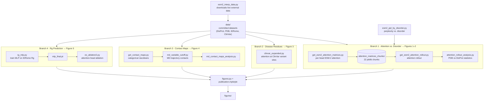

This page introduces **plm_interp**, a research codebase accompanying the paper *"Mechanistic Interpretability of Protein Language Models Reveals Encoded Structural and Functional Properties of Intrinsically Disordered Proteins"* (bioRxiv, 2026), authored by Lauren Naworski, Lydia Good, Rob Scrutton, and Tuomas P. J. Knowles. Here you will learn what the repository investigates, how its scripts are organized into four analysis branches, what software environment it requires, and the engineering conventions that make its results reproducible. No prior experience with protein language models is assumed — every concept is introduced from first principles, with deeper treatment deferred to later pages in this guide.

Sources: [README.md](README.md#L1-L6)

## What Is plm_interp?

Proteins are not always rigid, folded machines. A large class — **intrinsically disordered proteins (IDPs)** — function while remaining structurally flexible, and they are heavily implicated in human disease and cellular organization such as liquid–liquid phase separation. ESM-2 is a pretrained protein language model (specifically the 650M-parameter `esm2_t33_650M_UR50D` variant, with 33 transformer layers and 1280-dimensional embeddings) that learns representations of amino acid sequences from millions of evolutionary sequences. The central question of this repository is whether the *attention patterns* inside ESM-2 — the internal maps showing which amino acid positions the model "looks at" when processing a sequence — encode measurable structural and functional properties of IDPs, such as disorder, contact geometry, compactness, and disease relevance.

Sources: [README.md](README.md#L1-L6), [scripts/get_esm2_attention_matrices.py](scripts/get_esm2_attention_matrices.py#L29-L31)

The repository does not ship a library or package. Instead it provides a collection of standalone, sequentially-run scripts that consume committed datasets, execute GPU-heavy model inference, and emit figures matching those in the publication. A mapping table in the README links each paper figure to its exact reproduction commands, which is the fastest way to understand which scripts belong together.

Sources: [README.md](README.md#L88-L96)

## The Core Idea: Reading the Model's Attention

For a beginner, the key mental model is this: when ESM-2 processes a protein sequence, every attention *head* (there are 20 per layer, across 33 layers) produces an **attention matrix** — an N×N grid where entry (i, j) quantifies how strongly position i attends to position j. The scripts request these matrices directly from the model with `need_head_weights=True` and save them to disk in compressed chunks, because the full set of matrices for hundreds of proteins is far too large to hold in memory at once. A follow-up script condenses the per-head matrices into a single interpretable summary per protein via **attention rollout**, and analysis scripts then compare these summaries between ordered proteins (from the PDB structural database) and disordered proteins (from DisProt).

Sources: [scripts/get_esm2_attention_matrices.py](scripts/get_esm2_attention_matrices.py#L54-L58), [scripts/get_esm2_attention_rollout.py](scripts/get_esm2_attention_rollout.py#L42-L50)

Disorder is quantified with **IUPred2A**, an external third-party tool that predicts per-residue disorder probabilities from sequence alone. It is the one dependency the conda environment cannot install for you: after installing it manually, you must point the `iupred_filepath` variable at your local copy in `scripts/attention_functions.py`. This function library is the shared heart of the codebase — nearly every analysis script imports its attention-loading, rollout, and disorder-extraction helpers from it.

Sources: [README.md](README.md#L18-L18), [scripts/attention_functions.py](scripts/attention_functions.py#L18-L25)

## Repository at a Glance

The project follows a flat layout: all executable code lives in `scripts/`, all input and summary data in `data/`, raw model outputs in `attention_matrices_chunks/` (generated, not committed), and final plots in `figures/` (generated). A single serialized model file, `mlp_final.pt`, holds the trained radius-of-gyration predictor, and `publication.mplstyle` defines the shared plotting theme used by every figure-producing script.

Sources: [README.md](README.md#L22-L32)

```
plm_interp/
├── data/                          # committed inputs + derived summary data
│   ├── protein_input_sets.csv     # master list: ProteinID + Sequence for PDB & DisProt sets
│   ├── pdb_disprot.fasta          # exact filtered sequences used in the study
│   ├── disprot.fasta              # raw DisProt release 2025_06 sequences
│   ├── clinvar_sequences.csv      # disease variant sequences (ClinVar-derived)
│   ├── idrome.fasta / idrome_clustered.fasta  # IDRome ensemble sequences
│   └── ...                        # perplexities, contact-map batch info, CD-HIT cluster files
├── scripts/                       # all analyses (16 standalone scripts)
├── attention_matrices_chunks/     # generated: raw ESM-2 attention tensors (joblib chunks)
├── figures/                       # generated: publication figures
├── environment.yml                # conda environment "torch-gpu"
├── mlp_final.pt                   # trained Rg-predicting MLP
└── publication.mplstyle           # shared matplotlib theme
```

The architecture forms a hub-and-spoke pattern: `attention_functions.py` provides shared utilities, and four largely independent analysis branches fan out from the committed datasets in `data/`. Each branch corresponds to one or two figures in the paper.



> [!TIP]
> The chunking pattern in Branch 1 is the repository's most important engineering idea: attention tensors are written to 22 numbered `joblib` files (chunk size 200 proteins) so that downstream scripts can load and process one chunk at a time with explicit `del` statements — the only practical way to work with hundreds of gigabytes of attention data on a single GPU machine.

Sources: [scripts/get_esm2_attention_matrices.py](scripts/get_esm2_attention_matrices.py#L42-L48), [scripts/get_esm2_attention_rollout.py](scripts/get_esm2_attention_rollout.py#L36-L56)

## The Four Analysis Branches

Each branch tests a different hypothesis about what ESM-2 attention encodes. The table below maps scientific questions to scripts and paper figures, exactly as documented in the README's reproduction table.

| Branch | Hypothesis Tested | Core Scripts | Paper Output |
|---|---|---|---|
| **Attention vs. Disorder** | Attention rollout patterns distinguish ordered (PDB) from disordered (DisProt) proteins | `get_esm2_attention_matrices.py` → `get_esm2_attention_rollout.py` → `attention_rollout_analysis.py` | Figures 1–2 |
| **Disease Residues** | The model attends more strongly to known ClinVar disease-variant positions | `esm2_interp_data.py` → `clinvar_expanded.py` | Figure 3 |
| **Contact Maps** | Categorical Jacobians from ESM-2 predict residue contacts validated against MD trajectories | `get_contact_maps.py` → `md_variable_cutoff.py` → `md_contact_maps_analysis.py` | Figure 4 |
| **Rg Prediction & Ablation** | Attention-derived embeddings can predict radius of gyration; ablating electrostatics-associated heads degrades prediction | `esm2_interp_data.py` → `rg_mlp.py` → `es_ablation2.py` | Figure 5 |

Sources: [README.md](README.md#L88-L96)

Two branches deserve brief unpacking for newcomers. The **Rg branch** trains a small MLP regression head (hidden dimension 512, dropout 0.3) on layer-33 ESM-2 embeddings, using MD-derived Rg values from the IDRome database for training and experimental SAXS measurements as an out-of-sample check; fixed seeds (`SEED = 42`) and deterministic cuDNN flags make retraining bit-reproducible. The **ablation script** then zeroes out up to 50 attention heads identified with electrostatics-related statistics and measures how the MLP's Rg predictions degrade — a causal test of *which* attention heads carry physical meaning.

Sources: [scripts/rg_mlp.py](scripts/rg_mlp.py#L22-L57), [scripts/es_ablation2.py](scripts/es_ablation2.py#L22-L40)

The **contact-map branch** adapts published methodology (credited to Zhang et al., *PNAS* 2024) that perturbs each residue through all 20 amino acid substitutions and measures how output logits respond — producing a *categorical Jacobian* whose high off-diagonal entries indicate residue–residue contacts. The README explicitly flags which functions are adapted third-party code and notes they fall outside the repository's MIT license.

Sources: [scripts/get_contact_maps.py](scripts/get_contact_maps.py#L16-L57), [README.md](README.md#L82-L84)

## Environment and Dependencies

Reproducibility starts with a fully pinned conda environment named `torch-gpu`, created with `conda env create -f environment.yml`. The stack combines GPU-enabled deep learning, scientific Python, and domain-specific IDP tooling:

| Package | Version | Role in This Project |
|---|---|---|
| `torch` | 2.5.1+cu121 | GPU model inference and MLP training |
| `fair-esm` | 2.0.0 | Loads ESM-2 and exposes per-head attention matrices |
| `transformers` | 4.55.2 | Auxiliary masked-LM utilities in analysis scripts |
| `scikit-learn` / `scipy` / `statsmodels` | 1.7.1 / 1.16.1 / 0.14.5 | Statistics: logistic regression, UMAP, correlations, FDR control |
| `matplotlib` / `seaborn` | 3.10.5 / 0.13.2 | Figure generation under `publication.mplstyle` |
| `mdtraj` | 1.11.1 | Parses MD trajectories for contact-map validation |
| `cd-hit` | 4.8.1 | Sequence clustering to remove homologous redundancy |
| `idptools-starling`, `localcider`, `metapredict` | — | IDP sequence analysis tooling |

Sources: [README.md](README.md#L9-L16), [environment.yml](environment.yml#L553-L561), [environment.yml](environment.yml#L486-L495), [environment.yml](environment.yml#L287-L290)

> [!TIP]
> One practical prerequisite trips up most first-time users: the IUPred2A disorder predictor must be installed separately from its academic site, and the hard-coded `iupred_filepath` string at line 25 of `scripts/attention_functions.py` still points to the authors' HPC cluster — you must edit it before any disorder-related script will run.

Sources: [README.md](README.md#L18-L18), [scripts/attention_functions.py](scripts/attention_functions.py#L25-L25)

## Data Philosophy: Committed Derivatives vs. Live Sources

External biological databases (PDB, DisProt, ClinVar, RefSeq, IDRome) are *living* databases — they change constantly, so a naive re-download today will not reproduce the paper. The repository resolves this tension with a deliberate two-track design: the exact filtered sequences used in the study are committed under `data/` (for example `protein_input_sets.csv`, `pdb_disprot.fasta`, `clinvar_sequences.csv`), while `esm2_interp_data.py` documents and automates download of the raw upstream sources for users who want the most current versions. A single boolean flag (`derived = True`) in `clinvar_expanded.py` switches between these two modes. Notably, the massive raw attention tensors are *never* committed — they must be regenerated with the Branch 1 scripts.

Sources: [scripts/esm2_interp_data.py](scripts/esm2_interp_data.py#L1-L34), [scripts/clinvar_expanded.py](scripts/clinvar_expanded.py#L20-L27), [README.md](README.md#L44-L48)

Licensing follows the same care: the code is MIT-licensed, but committed third-party datasets (DisProt under CC BY 4.0, PDB under CC0 1.0, IDRome under GPL-3.0, ClinVar-derived data in the public domain) remain under their original licenses, with a full attribution table in the README.

Sources: [README.md](README.md#L67-L78)

## Shared Engineering Conventions

Three patterns repeat across all sixteen scripts, and recognizing them will make every deep-dive page easier to follow. First, every script anchors its paths with the two-line idiom `SCRIPT_DIR = Path(__file__).resolve().parent` followed by `BASE_PATH = SCRIPT_DIR.parent`, so scripts work regardless of your current working directory. Second, figure-producing scripts activate the shared theme with `plt.style.use(f'{BASE_PATH}/publication.mplstyle')` and use consistent group colors (orange for PDB, steelblue for DisProt), while the dedicated `figures.py` assembles multi-panel layouts on a millimeter-precise 183 × 170 mm canvas matching journal column geometry. Third, GPU-related scripts print device diagnostics and manage memory explicitly (batch size 2 for attention extraction, `save_interval` chunking, aggressive `del` + garbage collection), reflecting the reality that per-head attention tensors dominate the memory budget.

Sources: [scripts/attention_functions.py](scripts/attention_functions.py#L15-L16), [scripts/attention_rollout_analysis.py](scripts/attention_rollout_analysis.py#L32-L33), [scripts/figures.py](scripts/figures.py#L26-L39), [scripts/get_esm2_attention_matrices.py](scripts/get_esm2_attention_matrices.py#L19-L27), [scripts/get_contact_maps.py](scripts/get_contact_maps.py#L13-L14)

## Where to Go Next

The recommended reading order follows the catalog's Get Started track, then descends into the Deep Dive material in pipeline order. If you want hands-on results quickly, go straight to installation and the first run; if you want conceptual grounding first, the biology primer is the gentlest entry point.

1. **[Quick Start](2-quick-start)** — install the `torch-gpu` environment and verify your GPU setup end to end.
2. **[External Data Acquisition](3-external-data-acquisition)** — deep dive into `esm2_interp_data.py` and the derived-vs-live data strategy.
3. **[ESM-2 and IDP Biology Primer](6-esm-2-and-idp-biology-primer)** — the conceptual background for everything above.
4. **[Attention Matrix Extraction](8-attention-matrix-extraction)** — the first stage of Branch 1, where raw attention tensors are born.
5. **[Reproducing Paper Figures](4-reproducing-paper-figures)** — turn the README's command table into actual figure files.

For the intellectually curious, the [Research Questions and Hypotheses](7-research-questions-and-hypotheses) page formalizes the scientific logic connecting the four branches, and [Large Tensor Memory Management](20-large-tensor-memory-management) expands on the chunking strategy highlighted above.