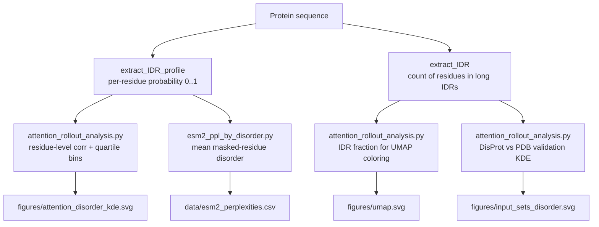
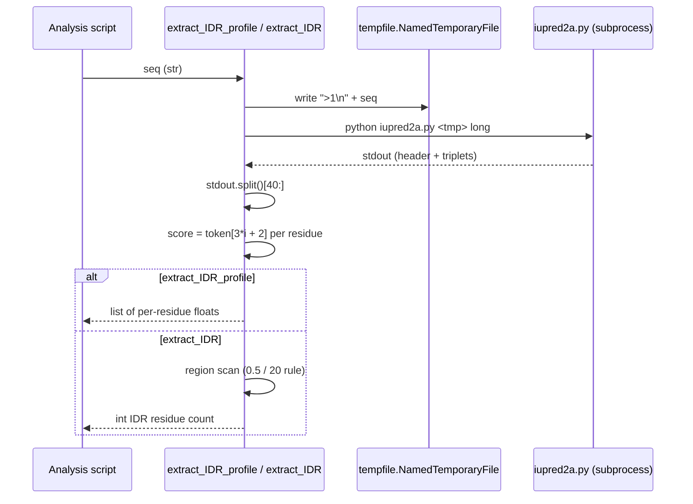
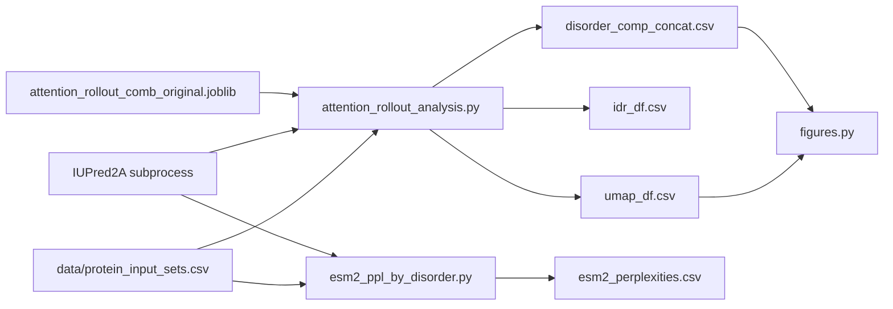

This page explains how the plm_interp repository integrates **IUPred2A** — the external intrinsic disorder predictor — as the quantitative "ground truth" layer that turns raw protein sequences into per-residue disorder probabilities and IDR (Intrinsically Disordered Region) residue counts. Every downstream claim in the attention analysis pipeline (which residues receive attention, whether DisProt proteins differ from PDB proteins, whether perplexity tracks disorder) is conditioned on these scores. Here you will find the dependency configuration, the two scoring functions, their subprocess-based invocation mechanics, the IDR segmentation rule, and a map of every consumer in the codebase.

## Why Disorder Scores Anchor the Attention Pipeline

Attention rollout matrices (produced by the upstream stage described in [Attention Rollout Algorithm](9-attention-rollout-algorithm)) are unlabeled per-residue quantities — the repository needs an independent, biologically grounded signal to interpret them. IUPred2A provides that signal in three distinct roles: **set validation** (confirming the DisProt set is genuinely more disordered than the PDB set), **protein-level stratification** (IDR fraction as a coloring variable in embedding space), and **residue-level correlation** (aligning per-residue disorder probability against per-residue attention received). This division of labor is visible in the concept map below, where the two scoring functions fan out into three separate analysis branches.



The repository deliberately treats IUPred2A as an **external system dependency**, not a pip-installable package: the tool must be obtained separately and wired in by editing one path constant. This keeps the analysis code decoupled from the predictor's lifecycle, but it also makes the integration fragile in specific, knowable ways — covered in the sections below.

Sources: [attention_functions.py](scripts/attention_functions.py#L21-L25), [attention_rollout_analysis.py](scripts/attention_rollout_analysis.py#L339-L370), [esm2_ppl_by_disorder.py](scripts/esm2_ppl_by_disorder.py#L85-L109)

## External Dependency and One-Line Configuration

The README states the requirement explicitly: *"You will need to install Iupred2a https://iupred2a.elte.hu/ to run and update iupred_filepath (line 25) of scripts/attention_functions.py to redirect to your local copy."* In the code, this manifests as a single hardcoded module-level constant pointing to the original author's cluster path — which means any fresh clone fails on first IUPred2A call until you edit it.

| Configuration Item | Location | Default Value | Required Action |
|---|---|---|---|
| `iupred_filepath` | `scripts/attention_functions.py` L25 | `/rds/user/ln399/hpc-work/llps/DeePhase_LN/__PREDICT_LN/tools/iupred2a.py` | Replace with path to your local `iupred2a.py` downloaded from iupred2a.elte.hu |
| Python interpreter | `subprocess.Popen` call sites | `python` | Must resolve to an environment where IUPred2A's dependencies (e.g., BioPython-era stdlib deps) are importable |
| Prediction mode | Hardcoded in both functions | `'long'` | None — long-disorder mode is appropriate for IDP analysis |

Because both scoring functions shell out to `python <iupred2a.py>`, the tool runs in whatever `python` is first on `PATH` at call time — not necessarily the `torch-gpu` conda environment you activated. If IUPred2A fails inside its own interpreter, the error surfaces through `stderr=subprocess.STDOUT` and typically crashes downstream float parsing rather than failing silently.

Sources: [README.md](README.md#L18-L18), [attention_functions.py](scripts/attention_functions.py#L21-L25), [attention_functions.py](scripts/attention_functions.py#L50-L51)

## The Two Scoring Functions: Profile Versus Count

`attention_functions.py` contains two IUPred2A wrappers credited to an external contributor (`https://github.com/kadiliissaar`), each answering a different question about the same sequence. `extract_IDR_profile` answers *"how disordered is each residue?"* and returns a list of float probabilities — one per residue, in sequence order. `extract_IDR` answers *"how much of this protein is in a long disordered region?"* and returns a single integer count of residues qualifying under the segmentation rule described in the next section.

| Dimension | `extract_IDR_profile` | `extract_IDR` |
|---|---|---|
| Return type | `list[float]`, length = seq length | `int` (residue count) |
| Per-residue resolution | Yes — raw IUPred2A scores | No — binary region membership |
| Threshold logic | None (raw passthrough) | TH1 = 0.5, TH2 = 20 |
| Primary consumers | PPL regression, residue-level attention correlation | IDR fraction, DisProt/PDB validation |
| Output artifacts | `disorder_comp_concat.csv`, `esm2_perplexities.csv` | `umap_df.csv`, `idr_df.csv` |

Both functions share an identical invocation skeleton, shown in the interaction diagram: write the sequence into a temporary single-record FASTA, spawn IUPred2A as a subprocess in `long` disorder mode, capture stdout, discard the 40-token header, then parse `(position, amino acid, score)` triplets. The parsing loop extracts every third whitespace-separated token starting at offset 2 — the score column — and casts to `float`.



> [!TIP]
> The `[40:]` header offset is the system's most fragile coupling point: it assumes IUPred2A's stdout preamble is exactly 40 whitespace tokens long for every invocation. If you upgrade to a different IUPred2A release whose header length changes, the triplet alignment breaks and you will get float-cast crashes at best — or silently misaligned scores at worst. Pin your IUPred2A version and verify one output against known residues before trusting bulk runs.

Sources: [attention_functions.py](scripts/attention_functions.py#L79-L99), [attention_functions.py](scripts/attention_functions.py#L39-L77), [attention_functions.py](scripts/attention_functions.py#L41-L43)

## From Scores to IDR Regions: The 0.5/20 Segmentation Rule

`extract_IDR` does not simply count residues with score > 0.5. It implements the canonical definition of a *long* disordered region: scan the probability array left to right, accumulate a run counter while scores exceed `TH1 = 0.5`, and only commit residues to the IDR set when a run exceeds `TH2 = 20` residues. The scan handles the sequence-boundary edge case (a run still active at the final residue is committed with a clamped start index), and resets the counter whenever a run terminates without qualifying. The return value is `len(IDR_residues)` — the total number of residues belonging to *qualifying regions*, not the number of above-threshold residues.

The practical consequence is asymmetry worth internalizing: a 15-residue run of scores at 0.9 contributes **zero** to the IDR count, while a single 21-residue run at 0.51 contributes **21**. This means `extract_IDR` measures *region-scale* disorder (the kind relevant to IDP biology and phase-separation behavior), whereas `extract_IDR_profile` preserves *local-scale* fluctuation. When you see "number of disordered residues" in figures, it is the region-based quantity; when you see a disorder probability axis, it is the raw score.

> [!TIP]
> Downstream percent calculations divide the region-based count by sequence length — e.g., `idr_frac = idr / Sequence_length * 100` and `disorder_frac = tot_idr / seq_len * 100`. Because short disordered stretches are excluded by design, these fractions systematically *underestimate* total above-threshold disorder in proteins with fragmented disorder. If you extend this codebase, decide explicitly whether your new metric wants region-scale or residue-scale semantics and pick the corresponding function.

Sources: [attention_functions.py](scripts/attention_functions.py#L59-L77), [attention_rollout_analysis.py](scripts/attention_rollout_analysis.py#L90-L99), [attention_rollout_analysis.py](scripts/attention_rollout_analysis.py#L367-L367)

## Downstream Consumers and Data Flow

Two analysis scripts call these functions, and both operate on the PDB (ordered-proxy) versus DisProt (disordered) input sets constructed in `define_pdb_disprot_datasets.py` — whose DisProt/PDB provenance and filtering are documented in [Dataset Curation and CD-HIT Clustering](21-dataset-curation-and-cd-hit-clustering). The consumer table below maps every call site to its derived quantity and committed output artifact, all of which flow into final publication rendering via `figures.py`.

| Consumer Script | Function Called | Derived Quantity | Output Artifact |
|---|---|---|---|
| `attention_rollout_analysis.py` (UMAP stage) | `extract_IDR` | `idr`, `idr_frac` per protein | `data/figure_data/umap_df.csv` (`IDR Frac` column) → `figures/umap.svg` |
| `attention_rollout_analysis.py` (set validation) | `extract_IDR` | Per-group IDR count distributions | `data/figure_data/idr_df.csv` → `figures/input_sets_disorder.svg` |
| `attention_rollout_analysis.py` (correlation stage) | `extract_IDR_profile` + `extract_IDR` | Residue-level `idr` + `attn_received`, per-protein Pearson `corr`, quartile `idr_bin` | `data/figure_data/disorder_comp_concat.csv` → `figures/attention_disorder_kde.svg` |
| `esm2_ppl_by_disorder.py` | `extract_IDR_profile` | `mean_masked_residue_disorder` aligned to masked tokens | `data/esm2_perplexities.csv` → OLS regression input |

Notably, `rg_mlp.py` imports from `attention_functions` but pulls only `get_esm2_embeddings` — the Rg predictor pipeline is disorder-score-free, consuming IDRome sequences rather than IUPred2A labels. And `figures.py` re-reads the precomputed CSVs rather than calling IUPred2A directly, which is why re-rendering final figures does not require the tool to be installed — a deliberate separation that supports the workflow described in [Derived Versus Live Data Reproducibility](22-derived-versus-live-data-reproducibility).



Sources: [attention_rollout_analysis.py](scripts/attention_rollout_analysis.py#L90-L99), [attention_rollout_analysis.py](scripts/attention_rollout_analysis.py#L183-L199), [esm2_ppl_by_disorder.py](scripts/esm2_ppl_by_disorder.py#L90-L109), [rg_mlp.py](scripts/rg_mlp.py#L19-L19), [figures.py](scripts/figures.py#L60-L100)

## Residue-Level Disorder–Attention Coupling

The most analytically significant consumer is the **Cor(Disorder, Attn Rollout Received)** section of `attention_rollout_analysis.py`. For every protein in both sets, it computes the per-residue disorder profile and the per-residue attention received (column sum of the rollout matrix), builds a paired residue-level dataframe, and records the Pearson correlation between the two vectors *per protein* as the `corr` column. It also quantizes raw scores into four bins via `pd.cut(bins=4)` — a quartile binning over each protein's own score distribution — and persists the full table to `data/figure_data/disorder_comp_concat.csv`.

```python
idr_profile = extract_IDR_profile(sequence)
tot_idr = extract_IDR(sequence)
attention_received = data['rollout'].sum(dim=0).cpu().numpy()
...
disorder_df['corr'] = np.corrcoef(disorder_df['idr'], disorder_df['attn_received'])[0, 1]
...
disorder_comp_concat['idr_bin'] = pd.cut(disorder_comp_concat['idr'], bins=4)
```

The binned table then feeds a log-scale KDE plot: attention-received distributions rendered separately for each disorder-probability bin (lightest blue = lowest quartile, darkest = highest), producing `figures/attention_disorder_kde.svg` — the direct visual test of whether ESM-2 allocates attention as a function of predicted disorder. This residue-level framing is what connects disorder scoring to the amino-acid-level statistics covered next in [Amino Acid Attention Statistics](11-amino-acid-attention-statsics) and to the group-level comparisons in [Ordered Versus Disordered Comparison](12-ordered-versus-disordered-comparison).

Sources: [attention_rollout_analysis.py](scripts/attention_rollout_analysis.py#L343-L370), [attention_rollout_analysis.py](scripts/attention_rollout_analysis.py#L372-L387), [figures.py](scripts/figures.py#L89-L100)

## Disorder Scores in the Perplexity Regression

In `esm2_ppl_by_disorder.py`, the raw profile gets a sequence-aware transformation: each protein's masked-LM perplexity run produces a per-token mask dataframe, special tokens (`<cls>`, `<eos>`) are stripped, the disorder profile is attached as a `Disorder` column, and the analysis keeps only *masked* positions — collapsing each protein to `mean_masked_residue_disorder`, the average disorder of exactly the residues the language model had to predict. A length guard skips (and logs) any protein where the IUPred2A output length fails to match the tokenized sequence length, preventing silent misalignment between the two per-residue vectors.

This guarded join is the entire feature-construction step for the regression: perplexity (response) versus mean masked-residue disorder (predictor), later fit with OLS under HC1 robust covariance and reported with standardized betas. The statistical machinery itself is the subject of [Perplexity-Disorder Regression](16-perplexity-disorder-regression); the IUPred2A-relevant design point here is that **disorder enters the model as an averaged masked-position quantity**, not as a whole-sequence mean — masking is the only reason the pairing is well-defined.

Sources: [esm2_ppl_by_disorder.py](scripts/esm2_ppl_by_disorder.py#L90-L101), [esm2_ppl_by_disorder.py](scripts/esm2_ppl_by_disorder.py#L111-L141)

## Practical Considerations for Reproducibility

Three operational realities follow from this architecture. **First, throughput:** every sequence triggers a fresh `python` subprocess and a full IUPred2A prediction — there is no batching or caching, so scripts over hundreds of proteins pay process-spawn cost per sequence, and re-running correlation stages re-predicts everything. **Second, alignment by construction:** the parser derives residue count from stdout length rather than validating against the input sequence; the only explicit check exists in the PPL script, so treat profile length as unverified everywhere else. **Third, environment duality:** the analysis code runs in your conda environment while IUPred2A runs in whatever `python` resolves on `PATH`, so dependency problems in the predictor do not manifest as import errors in your session.

The committed `data/figure_data/*.csv` artifacts mitigate the worst of this: `umap_df.csv`, `idr_df.csv`, and `disorder_comp_concat.csv` all persist IUPred2A-derived quantities, so figure regeneration paths avoid the tool entirely. Only stages that recompute disorder (or that you modify) require the configured local installation — consistent with the repo's overall derived-versus-live data strategy referenced in [Derived Versus Live Data Reproducibility](22-derived-versus-live-data-reproducibility).

Sources: [attention_functions.py](scripts/attention_functions.py#L45-L57), [esm2_ppl_by_disorder.py](scripts/esm2_ppl_by_disorder.py#L93-L95), [figures.py](scripts/figures.py#L60-L89)

## Where to Go Next

With the disorder scoring layer understood, the natural progression follows the pipeline order: proceed to [Amino Acid Attention Statistics](11-amino-acid-attention-statistics) to see how per-residue quantities aggregate to amino-acid-level comparisons, then [Ordered Versus Disordered Comparison](12-ordered-versus-disordered-comparison) for the group-level analyses that consume the `idr` and `idr_frac` columns, and finally [Perplexity-Disorder Regression](16-perplexity-disorder-regression) for the full statistical treatment of the `esm2_perplexities.csv` feature table. If you need to rebuild the input sets these scores are computed on first, start from [Dataset Curation and CD-HIT Clustering](21-dataset-curation-and-cd-hit-clustering).
