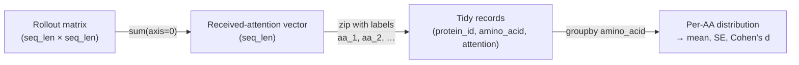
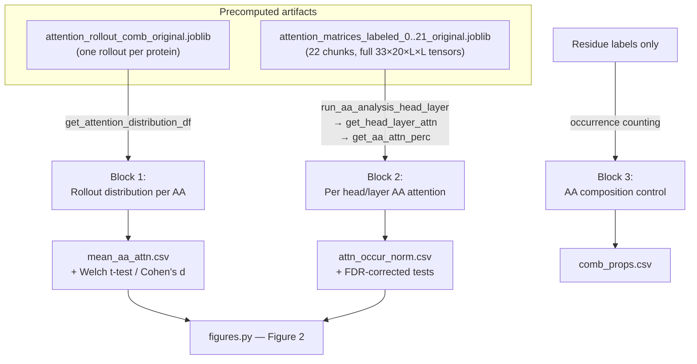
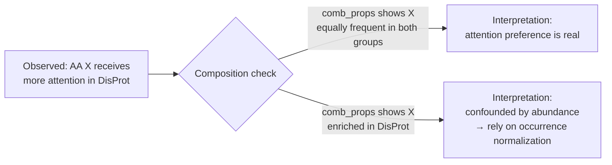

This page explains how the pipeline transforms raw ESM-2 attention tensors into **amino-acid-resolved statistics** — answering the question: *does the model allocate its attention differently depending on residue identity?* The analysis operates at two granularities: a whole-network rollout-level summary and a per-head/per-layer sweep, each with its own aggregation function, normalization strategy, and statistical validation. The implementation is distributed across three files: `attention_functions.py` provides the reusable aggregation primitives, `attention_rollout_analysis.py` orchestrates the three analysis blocks, and `figures.py` renders the publication-grade Figure 2.

Sources: [attention_functions.py](scripts/attention_functions.py#L18-L23), [attention_rollout_analysis.py](scripts/attention_rollout_analysis.py#L26-L30), [figures.py](scripts/figures.py#L137-L139)

## The Core Abstraction: "Attention Received"

Every statistic on this page derives from a single reduction: the **column sum** of an attention matrix. In a matrix of shape `(seq_len, seq_len)`, entry `[i][j]` quantifies how much token `i` attends to token `j`; summing over the row axis (`axis=0`) collapses the "attending side" and yields a vector of length `seq_len` where each element is the total attention *received* by that residue. The row dimension (who attends) is deliberately marginalized out — the analysis only asks who is attended to. In `get_attention_distribution_df`, each residue is labeled as `f"{aa}_{i}"` (identity plus position), the rollout matrix is converted to NumPy, reduced to this received-attention vector, and then exploded into tidy `(protein_id, amino_acid, attention)` records — one row per residue instance, which makes amino-acid identity a first-class grouping key for downstream `groupby` operations.

Sources: [attention_functions.py](scripts/attention_functions.py#L102-L142)

The function exposes two per-protein rescaling options — `standardize` (z-score: subtract mean, divide by std, with a zero-σ fallback) and `normalize` (min-max scaling) — both applied to the received-attention vector *before* the tidy explosion, so scaling happens within a single protein's context. In the production run both flags are `False`, meaning raw summed rollout values feed the statistics unmodified.

Sources: [attention_functions.py](scripts/attention_functions.py#L115-L133), [attention_rollout_analysis.py](scripts/attention_rollout_analysis.py#L206-L207)

## Two Measurement Granularities

The analysis deliberately computes amino-acid statistics at two scales, because they answer different questions. The **rollout-level** view uses one precomputed rollout matrix per protein (loaded from `attention_rollout_comb_original.joblib`, then split into PDB/DisProt dictionaries by filename substring) — it captures network-wide attention flow as propagated through all 33 layers. The **head/layer-resolved** view re-enters the raw per-layer attention tensors and asks where, specifically in the 33×20 grid of (layer, head) positions, each amino acid attracts attention.

| Dimension | Rollout-level | Head/layer-resolved |
|---|---|---|
| Input artifact | One rollout matrix per protein | 22 joblib chunks of raw attention tensors |
| Aggregation function | `get_attention_distribution_df` | `run_aa_analysis_head_layer` → `get_aa_attn_perc` |
| Token filtering | Handled upstream in rollout computation | Explicit `cls`/`eos` strip in `get_head_layer_attn` |
| Output granularity | One value per residue instance | One value per (AA, layer, head, protein) |
| Statistical scope | ~20 tests (one per AA) | up to 20 × 33 × 20 = 13,200 tests |
| Figure output | Grouped bar chart | Cys/Asp head×layer heatmaps |

Sources: [attention_rollout_analysis.py](scripts/attention_rollout_analysis.py#L39-L45), [attention_functions.py](scripts/attention_functions.py#L256-L277)

## Normalization Strategies: Three Modes, One Question

The single most consequential design decision in this pipeline is how per-amino-acid sums are normalized, because raw attention sums are confounded by residue frequency. `get_aa_attn_perc` implements three modes selected by the `normalize` argument, each producing a distinct output column:

| Mode | Computation | Answers | Output column | Trade-off |
|---|---|---|---|---|
| `local` | AA's attention ÷ protein's total attention × 100 | What *share* of a protein's attention budget does each AA type capture? | `attn_percent` | High-frequency AAs dominate by construction |
| `occurrence` | AA's total attention ÷ count of that AA in the sequence | On average, how much attention does a *single instance* of each AA receive? | `attn_occur_norm` | Removes frequency bias; per-protein values noisy for rare AAs |
| `global` | Raw summed attention (optionally rescaled by the full-matrix sum across all heads/layers) | Where is absolute attention mass concentrated? | `sum_attn` / rescaled `attn_percent` | Not comparable across proteins of different length |

Sources: [attention_functions.py](scripts/attention_functions.py#L280-L333)

The production run invokes `run_aa_analysis_head_layer(normalize='occurrence', model='original')` — the occurrence mode is the headline choice for the head/layer analysis precisely because it decouples residue identity from residue abundance. The `global` mode's rescaling variant is handled at the caller level: `run_aa_analysis_head_layer` computes each protein's total attention mass once (flattening the full 33×20 matrix after stripping special tokens) and then divides each per-head result by it, rather than recomputing per slice.

Sources: [attention_rollout_analysis.py](scripts/attention_rollout_analysis.py#L250-L254), [attention_functions.py](scripts/attention_functions.py#L356-L374)

> [!TIP]
> The three normalization modes share a single bottleneck: the column-sum reduction happens once, *before* the mode branch. This means the same received-attention vector feeds all three strategies — switching modes is a pure post-processing choice, so you can re-run all modes from one pass over the attention chunks without recomputing reductions.

## Inside the Head/Layer Sweep: Chunked Iteration with Memory Discipline

`run_aa_analysis_head_layer` must process the full attention tensor stack for every protein — 33 layers × 20 heads × seq_len² per protein, across the entire corpus. It does this by streaming through 22 pre-sharded joblib chunks, using `safe_load` (which forces `gc.collect()` before each `joblib.load`) to reclaim memory between chunks. For each protein it reads `sequence_length` and `sequence` from the chunk metadata, then enters a nested loop over all 33 layers and 20 heads. `get_head_layer_attn` slices out one `(seq_len, seq_len)` matrix while trimming the `<cls>` prefix and `<eos>`/padding suffix (offset 1 through `actual_seq_len + 1`), guaranteeing that special tokens never contaminate amino-acid statistics. Each per-slice result is immediately stamped with `protein`, `layer`, and `head` columns, appended to a list, and explicitly deleted alongside the sliced tensor — the `del head_layer_attn, aa_attn_df` statement inside the innermost loop is load-bearing, not decorative.

Sources: [attention_functions.py](scripts/attention_functions.py#L336-L389), [attention_functions.py](scripts/attention_functions.py#L252-L254)

## Statistical Validation: From Bar Charts to Effect Sizes

Every amino-acid comparison is backed by parametric statistics rather than visual inspection alone. At the rollout level, the script first builds descriptive summaries — `groupby(['amino_acid', 'Group'])` aggregating mean, std, and count, then deriving standard error as `std / √count` — which become the error bars in the grouped bar chart. Effect sizes come from `cohens_d`, which computes pooled standard deviation as `√(((n₁−1)s₁² + (n₂−1)s₂²)/(n₁+n₂−2))` and pairs it with a Welch's t-test (`equal_var=False`), correctly avoiding the homoscedasticity assumption for two biological groups of unequal size.

Sources: [attention_rollout_analysis.py](scripts/attention_rollout_analysis.py#L202-L220), [attention_functions.py](scripts/attention_functions.py#L488-L530)

The head/layer sweep multiplies the testing burden by 660, which motivates `fast_statistical_comparison`'s performance engineering: instead of filtering the DataFrame per combination, it builds a sorted multi-index on `['aa', 'layer', 'head', 'Group']` for O(log n) lookups, then iterates the cartesian product of AAs × 33 layers × 20 heads. A minimum-sample guard (`n < 3` in either group skips the test) prevents degenerate statistics on rare residues in short proteins.

| Statistical component | Scope | Implementation detail | Threshold / correction |
|---|---|---|---|
| Standard error bars | Rollout level, per (AA, group) | `std / √count` after groupby | Descriptive only |
| Welch's t-test | Both levels | `scipy.stats.ttest_ind(..., equal_var=False)` | Raw p-value |
| Cohen's d | Both levels | Pooled-SD formula, guarded against `pooled_std = 0` | Effect-size magnitude |
| FDR correction | Head/layer level only | `scipy.stats.false_discovery_control` | Significant if `p_fdr < 0.05` |

Sources: [attention_functions.py](scripts/attention_functions.py#L431-L485)

After `false_discovery_control` reshapes the ~13,000 raw p-values, significant results are filtered and Cohen's d values are summarized via `groupby('amino_acid').describe()` — reporting how effect size *varies* across head/layer positions per amino acid, not just an aggregate verdict. The oversized intermediate `attn` DataFrame is then explicitly deleted to free memory before plotting begins.

Sources: [attention_rollout_analysis.py](scripts/attention_rollout_analysis.py#L255-L265)

## The Composition Confounder — and Its Explicit Control

There is a subtle trap in any per-amino-acid comparison between protein sets: PDB (ordered) and DisProt (disordered) proteins have genuinely different amino-acid compositions — disordered regions are enriched in polar and charged residues and depleted in hydrophobic ones. Any raw attention sum per AA type therefore confounds *differential attention* with *differential abundance*. The pipeline defends on two fronts. First, the occurrence normalization itself: dividing by per-sequence AA counts converts totals into per-instance means, so a residue type only scores high if its individual instances receive above-average attention. Second, an explicit composition audit (Block 3) computes each AA's proportional frequency within each group — occurrences summed per amino acid, divided by total occurrences per group, expressed as percentages — and saves it as `comb_props.csv` alongside its own grouped bar chart. This lets any observed attention asymmetry be checked against the null hypothesis "it's just composition."

Sources: [attention_rollout_analysis.py](scripts/attention_rollout_analysis.py#L299-L337)

> [!TIP]
> The occurrence computation on line 303–304 uses `transform('count')` — broadcasting per-(AA, protein) counts back onto every residue row — rather than an aggregation. This keeps the tidy frame row-aligned per residue, which is what allows the same DataFrame to serve both the per-instance statistics and the per-type composition sums without a join.

## From figure_data CSVs to Publication Figure 2

The analysis script writes intermediate artifacts to `data/figure_data/`, and `figures.py` treats them as a frozen contract for final rendering — a deliberate producer/consumer split that separates heavy computation from styling (see [Derived Versus Live Data Reproducibility](22-derived-versus-live-data-reproducibility)). Figure 2, titled "AA Attention Allocation," consumes two of these artifacts:

| Artifact | Producer section | Final figure | Visual encoding |
|---|---|---|---|
| `mean_aa_attn.csv` | "Rollout Distr for Each AA" | `mean_aa_attn_received.svg` | Grouped bars per AA (PDB orange / DisProt steelblue), ± SE caps |
| `attn_occur_norm.csv` (filtered to C, D) | "AA Attn Received @ Each Head/Layer" | `asp_cys_heatmaps.svg` | 2×2 grid of head×layer heatmaps, shared color scale |
| `comb_props.csv` | "AA Composition Distributions" | Analysis-stage only (`aa_proportional_frequency.svg`) | Composition bars per group |

Sources: [attention_rollout_analysis.py](scripts/attention_rollout_analysis.py#L222-L243), [figures.py](scripts/figures.py#L142-L159)

A detail worth noting in the heatmap rendering: all four panels (Cys×PDB, Cys×DisProt, Asp×PDB, Asp×DisProt) are computed with a **shared** `vmin`/`vmax` derived from the entire `attn_occur_norm` column, and the panel layout drops tick labels on interior edges for a compact 7.2×3.25-inch canvas. Shared scaling is what makes the cross-panel comparison valid — per-panel scaling would visually exaggerate differences within low-attention panels.

Sources: [figures.py](scripts/figures.py#L161-L207)

Note also that `figures.py` and `attention_rollout_analysis.py` produce *parallel versions* of the same figures: the analysis script emits draft exploratory plots (e.g., `figures/mean_aa_attn_received.svg` with a title and per-panel styling), while `figures.py` regenerates publication variants under `figures/final/` using `publication.mplstyle` constraints (see [Publication Figure Styling](23-publication-figure-styling)). To regenerate everything end-to-end, follow [Reproducing Paper Figures](4-reproducing-paper-figures).

Sources: [figures.py](scripts/figures.py#L26-L29), [attention_rollout_analysis.py](scripts/attention_rollout_analysis.py#L227-L243)

## Relation to the Broader Pipeline

The amino-acid statistics layer sits downstream of raw tensor extraction and upstream of every functional-validation analysis. Its inputs presuppose the rollout algorithm ([Attention Rollout Algorithm](9-attention-rollout-algorithm)) and the chunked attention matrix extraction ([Attention Matrix Extraction](8-attention-matrix-extraction)); its per-residue received-attention vectors are the same quantities later joined with IUPred2A disorder profiles ([Disorder Scoring with IUPred2A](10-disorder-scoring-with-iupred2a)) and with ClinVar variant positions ([ClinVar Disease Residue Attention](13-clinvar-disease-residue-attention)). Where this page asks *which residues* attract attention, the set-level contrast — whether disordered proteins as a class receive different attention than ordered ones — is developed in [Ordered Versus Disordered Comparison](12-ordered-versus-disordered-comparison). For the memory-management rationale behind the chunked sweep design, see [Large Tensor Memory Management](20-large-tensor-memory-management).
