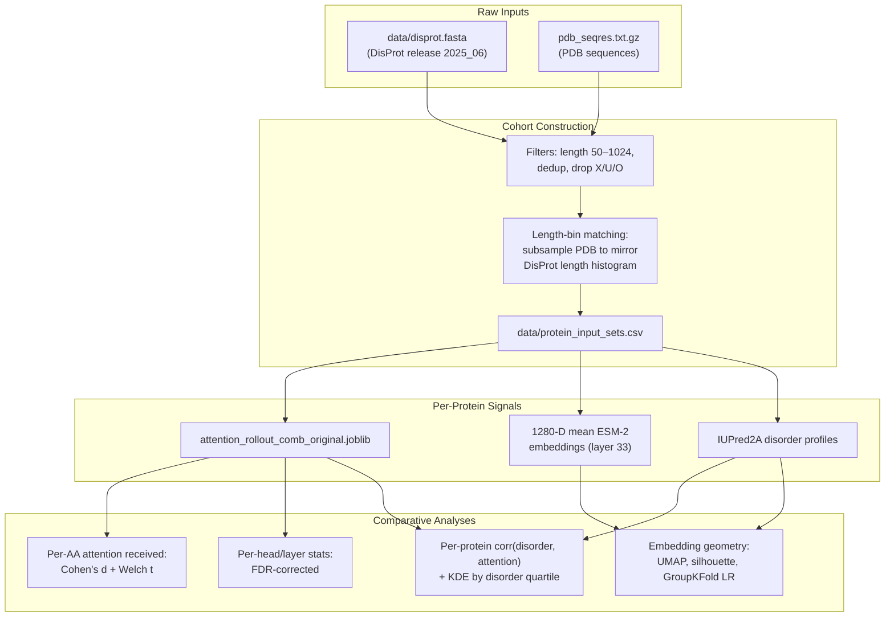
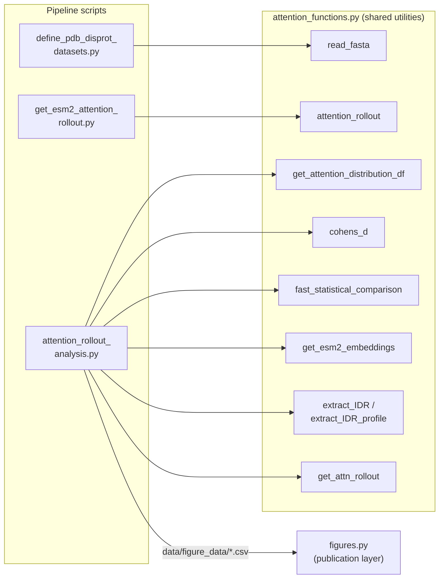

This page explains how the repository operationalizes its central validation question — **does ESM-2 allocate attention differently to ordered versus intrinsically disordered protein regions?** — by constructing length-matched protein cohorts and comparing them across embedding geometry, amino-acid-level attention allocation, head/layer resolution, and residue-level attention–disorder coupling. Rather than a single script, the comparison is a *framework*: one script builds fair cohorts, another computes per-protein signals, a third runs every statistical comparison, and a fourth assembles publication figures. If you have followed [Attention Rollout Algorithm](9-attention-rollout-algorithm) and [Disorder Scoring with IUPred2A](10-disorder-scoring-with-iupred2a), this page shows how those two ingredients are brought together as paired evidence.

The design rests on a deliberate duality: cohorts give **binary ground truth** (PDB = structurally resolved/ordered, DisProt = experimentally characterized disorder), while IUPred2A gives a **continuous per-residue disorder profile**. Comparing both lets the analysis triangulate — if attention tracks disorder, the signal should appear both between cohorts and within each protein along its sequence.

Sources: [attention_rollout_analysis.py](scripts/attention_rollout_analysis.py#L26-L45), [define_pdb_disprot_datasets.py](scripts/define_pdb_disprot_datasets.py#L8-L13)

## Concept Map: How the Comparison Is Organized

The notation below: rounded boxes are data artifacts, sharp boxes are computational steps, arrows show the flow from raw sequences to statistical conclusions. Everything on this page sits inside the "Comparisons" cluster.

The pipeline is strictly ordered: cohort construction must precede everything else because `protein_input_sets.csv` is the single source of protein identity for all downstream analyses; the rollout artifact must exist before `attention_rollout_analysis.py` can split proteins into groups by their ID prefix.

Sources: [define_pdb_disprot_datasets.py](scripts/define_pdb_disprot_datasets.py#L15-L64), [attention_rollout_analysis.py](scripts/attention_rollout_analysis.py#L36-L45)

## Constructing Matched Cohorts

The comparison begins in `define_pdb_disprot_datasets.py`, which loads DisProt sequences via `read_fasta` and PDB sequences from a gzipped `pdb_seqres.txt.gz`. Both cohorts pass through the same length window (50–1024 residues) and deduplication, but the PDB cohort additionally excludes sequences containing ambiguous residues (`X`, `U`, `O`) to keep the amino-acid alphabet standard for tokenization.

| Filter | DisProt (disordered) | PDB (ordered) | Rationale |
|---|---|---|---|
| Source file | `data/disprot.fasta` | `pdb_seqres.txt.gz` | Curated disorder evidence vs. structurally resolved chains |
| Sequence length | 50 < len < 1024 | 50 < len < 1024 | Fit ESM-2 context window and avoid trivially short chains |
| Duplicates | Dropped by sequence | Dropped by sequence | Prevent double-counting identical chains |
| Ambiguous residues | — | Drop `X`/`U`/`O` | Keep canonical 20-AA alphabet |
| Length distribution | Reference histogram | **Subsampled to match** | Eliminate length as a confound |

Sources: [define_pdb_disprot_datasets.py](scripts/define_pdb_disprot_datasets.py#L15-L34)

The length-matching step is the most important methodological decision in the whole page. Without it, any attention difference between groups could simply reflect sequence length (rollout matrices for longer proteins distribute attention differently). The script bins DisProt lengths into 20 bins with `np.digitize`, counts proteins per bin, then samples PDB proteins from the corresponding bins with a fixed `random_state=42` — taking all candidates when a bin has fewer PDB proteins than needed. The result is a PDB cohort whose length histogram mirrors DisProt's, verified visually later by the shared-bin histogram in the analysis script.

Sources: [define_pdb_disprot_datasets.py](scripts/define_pdb_disprot_datasets.py#L39-L58), [attention_rollout_analysis.py](scripts/attention_rollout_analysis.py#L47-L66)

Finally, every protein receives a deterministic ID (`pdb_protein_N`, `disprot_protein_N`) and the union is written to `data/protein_input_sets.csv`. This naming convention is load-bearing: every downstream script infers group membership by substring matching on the ID (`'pdb' in k.lower()`), so the cohort label travels with the protein through every artifact without requiring a separate metadata join.

Sources: [define_pdb_disprot_datasets.py](scripts/define_pdb_disprot_datasets.py#L60-L64), [attention_rollout_analysis.py](scripts/attention_rollout_analysis.py#L36-L45)

## Module Interaction: Who Consumes What

The comparison spans four files with a clean dependency direction — shared utilities at the bottom, orchestration in the middle, publication styling at the top. This diagram shows each script's imports from `attention_functions.py` and the artifact hand-off to `figures.py`:

Note the hand-off pattern: `attention_rollout_analysis.py` performs all statistics and dumps intermediate tidy CSVs into `data/figure_data/`, while `figures.py` re-reads those files to assemble final multi-panel layouts (reloading `umap_df.csv`, `disorder_comp_concat.csv`, `mean_aa_attn.csv`, `attn_occur_norm.csv`, and `si_examples.csv`). This separation means the expensive model inference never re-runs just to restyle a figure.

Sources: [figures.py](scripts/figures.py#L47-L152), [get_esm2_attention_rollout.py](scripts/get_esm2_attention_rollout.py#L36-L56)

The rollout artifact itself is produced by `get_esm2_attention_rollout.py`, which loads the 22 precomputed attention-matrix chunks, computes one rollout per protein (discard ratio 0.9, mean head fusion), and persists everything into a single joblib dictionary keyed by protein ID. This is a pure batch-compute step with no group awareness — the ordered/disordered framing only enters when `attention_rollout_analysis.py` splits the dictionary into `pdb_dict` and `disprot_dict` by key substring.

Sources: [get_esm2_attention_rollout.py](scripts/get_esm2_attention_rollout.py#L26-L56), [attention_rollout_analysis.py](scripts/attention_rollout_analysis.py#L36-L45)

## Four Axes of Comparison

The analysis script compares the cohorts along four independent axes, each answering a slightly different version of the core question. The table below is the map for the rest of this section; the unit of observation column is worth studying — it ranges from whole proteins down to single residues, and this determines how the statistics must be interpreted.

| Axis | Question answered | Unit of observation | Signal | Key statistic | Artifact |
|---|---|---|---|---|---|
| Embedding geometry | Are the cohorts separable in representation space? | Protein | 1280-D mean layer-33 embedding | Silhouette score + GroupKFold logistic regression accuracy | `umap_df.csv` |
| Per-AA attention allocation | Does ESM-2 route more attention to certain amino acids in disorder? | Residue | Rollout column-sum ("attention received") | Cohen's d + Welch's t-test per amino acid | `mean_aa_attn.csv` |
| Head/layer resolution | Where in the 33×20 grid does the difference live? | Residue × head × layer | Occurrence-normalized head attention | Welch's t + FDR across 13,200 tests | `attn_occur_norm.csv` |
| Attention–disorder coupling | Does attention track disorder *within* each protein? | Residue | IUPred2A probability vs. rollout received | Per-protein Pearson correlation + KDE by disorder quartile | `disorder_comp_concat.csv` |

Sources: [attention_rollout_analysis.py](scripts/attention_rollout_analysis.py#L68-L387)

### Axis 1: Embedding Geometry (UMAP, Silhouette, and Leakage-Aware Classification)

Before touching attention at all, the script checks whether the cohorts differ in ESM-2's *representations*. It computes mean-pooled layer-33 embeddings for every protein (1280 dimensions), standardizes them, and projects to 2-D with UMAP, coloring points first by cohort and then by each protein's IDR fraction (percentage of residues in long disordered segments, computed by `extract_IDR` — ≥20 consecutive residues above IUPred2A probability 0.5). The dual-coloring is deliberate: if the second panel's viridis gradient aligns with the first panel's cohort split, disorder content — not cohort identity per se — is the latent structure organizing the space.

Sources: [attention_rollout_analysis.py](scripts/attention_rollout_analysis.py#L68-L132), [attention_functions.py](scripts/attention_functions.py#L39-L77)

Two quantitative separations complement the visual: a silhouette score computed in the original 1280-D space (avoiding UMAP's distortion of distances), and a logistic regression trained to predict cohort labels with **5-fold GroupKFold cross-validation where the groups are CD-HIT clusters at 40% sequence identity**. Homologous proteins share clusters, so no cluster's members can straddle the train/test split — the reported accuracy reflects generalization to *unseen sequence families*, not memorization.

> [!TIP]
> The GroupKFold-over-CD-HIT-clusters design is the difference between a real result and an artifact. A naive k-fold split would let near-identical homologs appear on both sides, letting the classifier succeed by recognizing families rather than disorder. If you adapt this pipeline, preserve the cluster-grouped CV or your accuracy numbers will be silently inflated.

Sources: [attention_rollout_analysis.py](scripts/attention_rollout_analysis.py#L134-L177), [attention_functions.py](scripts/attention_functions.py#L394-L429)

As a sanity check on the cohorts themselves, the script also plots the kernel density of disordered-residue counts per protein for each group — this validates that the labels carry the expected biological signal (DisProt proteins should be far richer in disordered residues than PDB ones) before any attention claims are made.

Sources: [attention_rollout_analysis.py](scripts/attention_rollout_analysis.py#L179-L200)

### Axis 2: Amino-Acid-Level Attention Allocation

Here the comparison moves from proteins to residues. For every protein in both cohorts, `get_attention_distribution_df` sums each column of the rollout matrix — producing a per-residue "attention received" vector — and melts it into a tidy long table of `(protein_id, amino_acid, attention)` rows. Group-wise summary statistics (mean, std, count, standard error) are then computed per amino acid and plotted as paired bar charts, PDB in orange, DisProt in steel blue.

Sources: [attention_functions.py](scripts/attention_functions.py#L101-L141), [attention_rollout_analysis.py](scripts/attention_rollout_analysis.py#L202-L243)

Differences between groups are quantified with the `cohens_d` helper, which for each of the 20 amino acids computes the DisProt-minus-PDB mean difference, a pooled-standard-deviation Cohen's d effect size, and a Welch's t-test (unequal variances assumed). Sorting the output by Cohen's d surfaces which amino acids carry the largest attention-allocation differences — this feeds directly into the amino-acid comparisons detailed in [Amino Acid Attention Statistics](11-amino-acid-attention-statistics).

> [!TIP]
> Note that `cohens_d` counts every *residue* as an observation, not every protein — residues from the same protein are not independent, so the uncorrected p-values are optimistic. This is why the pipeline pairs them with effect sizes and, in the head/layer axis, FDR correction, and why the visual emphasis falls on Cohen's d magnitude rather than raw significance counts.

Sources: [attention_functions.py](scripts/attention_functions.py#L488-L530), [attention_rollout_analysis.py](scripts/attention_rollout_analysis.py#L216-L243)

### Axis 3: Head/Layer Resolution with Multiple-Testing Control

The aggregate amino-acid comparison collapses 33 layers × 20 heads into one rollout number. To localize *where* in the transformer the disorder sensitivity lives, `run_aa_analysis_head_layer(normalize='occurrence')` recomputes per-amino-acid attention at every one of the 660 head/layer positions, normalizing by how many times that amino acid occurs in each sequence (so abundant residues like Leu aren't inflated simply by being common).

Sources: [attention_functions.py](scripts/attention_functions.py#L284-L390), [attention_rollout_analysis.py](scripts/attention_rollout_analysis.py#L246-L254)

This generates up to 20 amino acids × 660 positions = 13,200 group comparisons, handled by `fast_statistical_comparison`. The function's performance design matters at this scale: it builds a sorted multi-index on `(aa, layer, head, Group)` for O(1) lookups, iterates all combinations, guards against cells with fewer than 3 samples per group, and uses Welch's t-test rather than Mann-Whitney (the code comments note this as an explicit speed choice). The script then applies `false_discovery_control` to the full uncorrected p-value vector and flags `p_fdr < 0.05`, and summarizes the significant Cohen's d values per amino acid.

| Statistic | Purpose | Computed in |
|---|---|---|
| Welch's t-test (`equal_var=False`) | Significance of group difference without variance homogeneity assumption | `fast_statistical_comparison`, `cohens_d` |
| Cohen's d (pooled SD) | Effect-size magnitude, comparable across amino acids and head/layer cells | Both |
| Minimum group size n ≥ 3 | Prevents degenerate cells from producing spurious tests | `fast_statistical_comparison` |
| FDR correction | Controls expected false discoveries across 13,200 simultaneous tests | `attention_rollout_analysis.py` |

Sources: [attention_functions.py](scripts/attention_functions.py#L432-L486), [attention_rollout_analysis.py](scripts/attention_rollout_analysis.py#L255-L265)

The surviving results are visualized as head-by-layer heatmaps (batched three amino acids at a time, PDB left, DisProt right), with a separate figure-level heatmap pair for cysteine and aspartate preserved in `attn_occur_norm.csv` — the two residues singled out for the publication figure because their patterns differ most sharply between cohorts.

Sources: [attention_rollout_analysis.py](scripts/attention_rollout_analysis.py#L267-L296), [figures.py](scripts/figures.py#L155-L215)

### Axis 4: Residue-Level Attention–Disorder Coupling

The fourth axis switches from between-cohort to within-protein comparison. For every protein in both dictionaries, the script fetches its IUPred2A per-residue disorder profile (`extract_IDR_profile`), its count of long disordered segments (`extract_IDR`), and its rollout attention-received vector, then computes a Pearson correlation between the two per-residue series with `np.corrcoef`. This yields one correlation coefficient per protein — a direct, sequence-position-resolved measure of whether attention follows disorder inside a single sequence.

Sources: [attention_rollout_analysis.py](scripts/attention_rollout_analysis.py#L339-L363), [attention_functions.py](scripts/attention_functions.py#L79-L99)

The residues from all proteins are pooled and binned by their IUPred2A probability into four quartile bins; a kernel density estimate of attention-received per bin (log-scaled y-axis, since attention values are heavily right-skewed) shows whether higher-disorder residues systematically receive less attention *regardless of which cohort they belong to*. Because the bins pool both cohorts, this analysis tests the continuous disorder signal independent of the binary PDB/DisProt label — the strongest form of the paper's hypothesis.

Sources: [attention_rollout_analysis.py](scripts/attention_rollout_analysis.py#L365-L387)

### The Composition Control

One confound deserves its own subsection: if DisProt proteins simply contain different amino acids than PDB proteins, per-amino-acid attention differences could be composition artifacts rather than attention-allocation differences. The script therefore computes each group's amino-acid usage as proportional frequencies (per-amino-acid counts divided by group totals, expressed as percent) and plots them side by side. Reading this figure alongside the attention-allocation bars lets you disentangle "DisProt has more of residue X" from "residue X receives more attention in DisProt."

Sources: [attention_rollout_analysis.py](scripts/attention_rollout_analysis.py#L299-L337)

## Case-Study Validation: TDP-43 and Friends

Aggregate statistics can hide biology, so the script closes with five single-protein dissections: TDP-43, P53, FUS, MDM2, and APOE. Sequences are hardcoded, ESM-2 is re-loaded with `output_attentions=True`, and each protein gets an on-the-fly rollout via `get_attn_rollout` paired with its IUPred2A profile — producing position-aligned overlay plots of "Attention Received" versus "Disorder" along the sequence.

Sources: [attention_rollout_analysis.py](scripts/attention_rollout_analysis.py#L389-L425), [attention_functions.py](scripts/attention_functions.py#L218-L246)

TDP-43 receives the dedicated treatment because its domain architecture is a textbook mixed-order protein: the script annotates the N-terminal domain (residues 1–103, disordered), both RNA-recognition motifs (104–200 and 191–262, folded), and the low-complexity C-terminal domain (274–413, disordered) as shaded spans. If the aggregate finding is real, attention received should dip over the folded RRM regions and rise over the flanking disordered segments — a single-image falsification test of the whole comparison. The other four proteins are rendered as a stacked multi-panel supplementary figure and exported to `si_examples.csv` for the final layout.

Sources: [attention_rollout_analysis.py](scripts/attention_rollout_analysis.py#L427-L483), [figures.py](scripts/figures.py#L109-L152)

## Design Rationale: What Makes This Comparison Trustworthy

Every confound that could masquerade as a disorder-attention relationship has a specific countermeasure baked into the pipeline. The table below summarizes the threat-to-control mapping — useful as a checklist if you extend the analysis to new cohorts.

| Threat to validity | Countermeasure | Where implemented |
|---|---|---|
| Sequence length differs between cohorts | 20-bin length matching, PDB subsampled to DisProt's histogram | `define_pdb_disprot_datasets.py` |
| Amino-acid composition differs | Proportional-frequency composition comparison shown beside attention results | `attention_rollout_analysis.py` (AA Composition) |
| Homology inflates classification accuracy | CD-HIT 40% identity clusters + GroupKFold CV | `attention_rollout_analysis.py` |
| Abundant residues look attention-rich | Occurrence normalization at head/layer level | `attention_functions.py` (`get_aa_attn_perc`) |
| Thousands of tests inflate false positives | FDR correction across all AA × layer × head comparisons | `attention_rollout_analysis.py` |
| Effect sizes misread from significance alone | Cohen's d reported and sorted alongside every Welch's t | `attention_functions.py` |
| Aggregate statistics hide per-protein behavior | TDP-43 + 4 SI case studies with domain annotations | `attention_rollout_analysis.py` |

Sources: [define_pdb_disprot_datasets.py](scripts/define_pdb_disprot_datasets.py#L39-L58), [attention_rollout_analysis.py](scripts/attention_rollout_analysis.py#L139-L177), [attention_functions.py](scripts/attention_functions.py#L432-L530)

The trade-offs are worth stating plainly. Binary cohort labels are unambiguous and easy to classify, but they conflate disorder with everything else that distinguishes DisProt entries from PDB entries (function, length regime, family composition — partially mitigated by matching). The continuous IUPred2A profile avoids cohort artifacts but imports its own model biases. Running both comparison modes and checking that they agree is the repository's answer: a conclusion is treated as credible only when the binary split, the continuous coupling, and the case studies tell the same story.

Sources: [attention_rollout_analysis.py](scripts/attention_rollout_analysis.py#L179-L200), [attention_rollout_analysis.py](scripts/attention_rollout_analysis.py#L339-L387)

## Where to Go Next

This page established the comparative *scaffolding*. To go deeper along its edges: [Amino Acid Attention Statistics](11-amino-acid-attention-statistics) dissects the per-residue attention distributions introduced in Axis 2; [ClinVar Disease Residue Attention](13-clinvar-disease-residue-attention) replaces cohort labels with disease annotations for a finer-grained validation; [Perplexity-Disorder Regression](16-perplexity-disorder-regression) repeats the comparison using masked-LM perplexity instead of attention; and [MLP Radius of Gyration Predictor](17-mlp-radius-of-gyration-predictor) builds on the observation that disorder correlates with global compaction. For the engineering details of the cohort inputs themselves, see [Dataset Curation and CD-HIT Clustering](21-dataset-curation-and-cd-hit-clustering).
