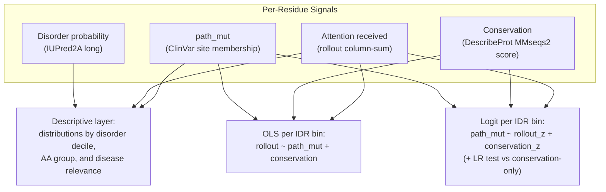
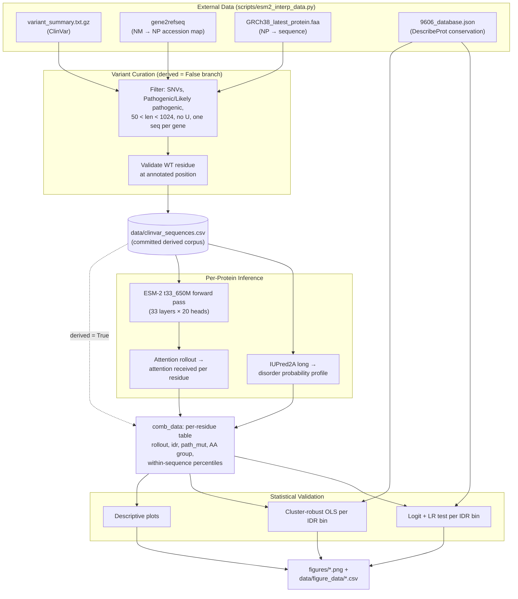

This page explains how `scripts/clinvar_expanded.py` uses ClinVar pathogenic missense variants as a functional ground truth to test whether ESM-2 attention rollout is enriched at disease-relevant residues — and whether that enrichment persists after controlling for evolutionary conservation, stratified by disorder level. This analysis produces Figure 3 of the paper and is the first entry in the *Functional Validation Analyses* group. It builds directly on the rollout machinery from [Attention Rollout Algorithm](9-attention-rollout-algorithm) and the disorder scoring from [Disorder Scoring with IUPred2A](10-disorder-scoring-with-iupred2a).
Sources: [README.md](README.md#L97-L105), [clinvar_expanded.py](scripts/clinvar_expanded.py#L24-L34)

## The Hypothesis: Attention as a Functional Probe
The core question is behavioral, not mechanistic: if ESM-2's attention budget is meaningfully allocated, residues harboring known pathogenic mutations should receive disproportionately high attention compared with the other residues of the same proteins. ClinVar is used as the probe because it provides clinically curated, position-resolved labels — the script extracts the wild-type amino acid, the mutated position, and the mutant amino acid from each variant annotation, converting them into a binary per-residue `path_mut` flag. The design is deliberately confounded-aware: disease sites are typically evolutionarily conserved, so the analysis jointly models attention alongside DescribeProt conservation scores to ask whether attention carries signal *beyond* conservation rather than merely re-encoding it.

Sources: [clinvar_expanded.py](scripts/clinvar_expanded.py#L44-L57), [clinvar_expanded.py](scripts/clinvar_expanded.py#L294-L297), [clinvar_expanded.py](scripts/clinvar_expanded.py#L357-L375)

## Pipeline Architecture
The script is a single end-to-end pipeline with two major stages: corpus construction and attention-based statistical validation. The first stage either loads the committed ClinVar corpus or rebuilds it from raw NCBI downloads; the second stage forwards every unique protein sequence through ESM-2 once, computes per-residue attention received and IUPred2A disorder profiles, then runs descriptive visualizations and per-bin regressions.

Sources: [clinvar_expanded.py](scripts/clinvar_expanded.py#L20-L22), [clinvar_expanded.py](scripts/clinvar_expanded.py#L150-L178), [clinvar_expanded.py](scripts/clinvar_expanded.py#L299-L391), [esm2_interp_data.py](scripts/esm2_interp_data.py#L47-L66)

## Curating the Disease Variant Corpus
When `derived = False`, the script rebuilds `data/clinvar_sequences.csv` from three NCBI resources fetched by [External Data Acquisition](3-external-data-acquisition): the ClinVar `variant_summary.txt.gz`, `gene2refseq` (read in 100k-row chunks, filtered to human tax_id 9606, to map mRNA `NM_` accessions to protein `NP_` accessions), and the GRCh38 protein FASTA (parsed with Biopython's `SeqIO` to map `NP_` accessions to sequences). Variants are then reduced to a clean missense corpus through a chain of deterministic filters, summarized below.

| Filter | Implementation | Rationale |
|---|---|---|
| Variant type | `Type == 'single nucleotide variant'` | Restricts to point mutations (clinvar_expanded.py#L68) |
| Clinical significance | `{Pathogenic, Likely pathogenic, Pathogenic/Likely pathogenic}` | High-confidence disease labels only (clinvar_expanded.py#L69-L70) |
| Sequence length | `50 < len < 1024` | Fits ESM-2's token budget; drops trivially short proteins (clinvar_expanded.py#L102-L104) |
| Noncanonical residues | Drop sequences containing `U` | Avoids selenocysteine ambiguity in the model vocabulary (clinvar_expanded.py#L105) |
| Gene-level uniqueness | Drop genes mapped to >1 unique sequence | Guarantees unambiguous sequence↔gene correspondence (clinvar_expanded.py#L108-L111) |
| Mutation parsing | Regex `\(p\.([A-Za-z]{3})(\d+)([A-Za-z]{3})\)` on the `Name` column, 3-letter→1-letter mapping | Extracts WT AA, position, mutant AA; unparseable codes (e.g., `Ter`) dropped (clinvar_expanded.py#L44-L49, L116-L125) |
| WT validation | `get_seq_wt` compares `seq[pos-1]` to the annotated WT AA | QA gate: mismatches trigger an `ISSUE: Some sequences do not align` warning (clinvar_expanded.py#L51-L57, L127-L132) |

One subtlety worth noting for auditors: the WT-validation step flags mismatches via a console warning rather than dropping the offending rows — the enforced exclusions are the earlier filters plus the drop of rows whose annotation codes failed to map. The validated corpus is persisted with `to_csv`, which is exactly the artifact committed as `data/clinvar_sequences.csv` (clinvar_expanded.py#L131-L133).
Sources: [clinvar_expanded.py](scripts/clinvar_expanded.py#L63-L133), [README.md](README.md#L56-L60)

## From Sequence to Per-Residue Attention Signal
The inference stage loads `facebook/esm2_t33_650M_UR50D` with `output_attentions=True` and iterates over **unique sequences** rather than variant rows — a protein with multiple pathogenic variants is forwarded through the model only once (clinvar_expanded.py#L143-L156). For each sequence, two per-residue signals are computed: `get_attn_rollout` returns the column-sum of the rollout matrix (attention received), and `extract_IDR_profile` shells out to IUPred2A in `long` mode for per-residue disorder probabilities (attention_functions.py#L220-L249, L79-L99). Residues are labeled `f"{aa}_{i}"` with 1-based indexing so that variant positions align directly with sequence positions, and `path_mut` is set via membership of each position in that protein's variant-position set (clinvar_expanded.py#L157-L162).

> [!TIP]
> Interpret the attention vector directionally: `get_attn_rollout` computes `rollout.sum(dim=0)`, summing over the *source* dimension so each entry quantifies total attention flowing **into** a residue — the "attention received" convention used throughout this repo (attention_functions.py#L246-L248). This matters when comparing with per-head analyses in [Amino Acid Attention Statistics](11-amino-acid-attention-statistics), which use the same column-sum semantics.

The assembled per-residue table `comb_data` adds feature engineering layers that make cross-protein comparison statistically sound: each residue receives a **within-sequence percentile rank** for both attention (`attn_perc`) and disorder (`idr_perc`) via `groupby("seq").rank(pct=True)`, which neutralizes protein-level differences in overall attention magnitude and disorder content (clinvar_expanded.py#L165-L175). Residues are also grouped into biochemical classes — Hydrophobic, Polar, Cation, Anion, Aromatic — where phenylalanine's duplicate membership in both Hydrophobic and Aromatic resolves to **Aromatic** because later dict entries overwrite earlier ones (clinvar_expanded.py#L166-L173). The final table, including ten within-protein disorder-percentile deciles (`idr_perc_bin`) and human-readable `Disease-Relevant` / `Non-Disease-Relevant` labels, is written to `data/figure_data/comb_data.csv` (clinvar_expanded.py#L176-L178).

Sources: [attention_functions.py](scripts/attention_functions.py#L144-L218), [attention_functions.py](scripts/attention_functions.py#L220-L249), [clinvar_expanded.py](scripts/clinvar_expanded.py#L143-L178)

## Descriptive Analyses
Before any regression, the script quantifies and visualizes the raw enrichment. It prints the median and interquartile range of attention percentile separately for disease-relevant and non-disease-relevant residues — the headline enrichment numbers — and renders four figures. The two-panel histogram contrasts the attention-percentile distributions of the two groups; the decile boxplot conditions the comparison on disorder level by plotting attention percentile across the ten within-protein disorder deciles with paired orange/steelblue boxes per class; the amino-acid panel produces one subplot per biochemical group with subplot widths proportional to group sizes and amino acids ordered by median attention, so within-class confounds (e.g., charged residues attracting attention regardless of disease status) become visible; and a bar chart shows the amino-acid composition of disease-relevant wild-type residues as a composition sanity check (clinvar_expanded.py#L184-L292).

This descriptive layer is where the two binning philosophies of the script diverge: the descriptive analysis uses **within-protein percentile deciles** of disorder, enabling apples-to-apples comparison across proteins with wildly different disorder content, whereas the regression stage switches to **absolute IUPred2A probability bins** so that results can be interpreted as disorder regimes rather than relative positions (clinvar_expanded.py#L177 vs L344-L346).
Sources: [clinvar_expanded.py](scripts/clinvar_expanded.py#L184-L210), [clinvar_expanded.py](scripts/clinvar_expanded.py#L213-L292)

## Attention Versus Evolutionary Conservation
The regression stage is the causal-style core of the analysis and proceeds in three steps. First, conservation is attached per residue: the script streams `data/9606_database.json` line by line (stripping JSON array punctuation), matches full sequence strings against the ClinVar corpus, parses the comma-separated `MMseq2_conservation_score` field with `NULL` → `NaN`, and merges on `(seq, pos, AA)` (clinvar_expanded.py#L299-L338). Second, data are split into three absolute disorder bins — `[0, 0.25)`, `[0.25, 0.75)`, `[0.75, 1.0]` — so every model answers the question separately for ordered, intermediate, and disordered regions (clinvar_expanded.py#L344-L346). Third, two complementary model families are fit per bin, both with **cluster-robust standard errors clustered by sequence**, which correctly accounts for the strong within-protein correlation of the ~20 residues-per-protein observations (clinvar_expanded.py#L355).

| Model family | Formula per IDR bin | Question answered | Key statistics |
|---|---|---|---|
| OLS | `rollout ~ path_mut + conservation` (plus single-predictor models) | Does disease relevance explain attention *beyond* conservation? | Partial R² for `path_mut` = (R²full − R²cons) / (1 − R²cons); unadjusted vs conservation-adjusted betas (clinvar_expanded.py#L357-L365) |
| Logistic | `path_mut_int ~ rollout_z + conservation_z` (plus single-predictor models) | Does attention predict disease status *beyond* conservation? | Adjusted rollout/conservation coefficients; likelihood-ratio test `−2(llf_cons − llf_both)` against χ²(1) for whether rollout adds predictive power (clinvar_expanded.py#L369-L375) |

Note the deliberate reversal of the response variable between the two families — attention as outcome in OLS, disease status as outcome in logit — which lets the paper claim the enrichment from both explanatory and predictive directions. Predictors enter the logit z-scored within each bin, making the adjusted coefficients directly comparable on a standard-deviation scale. Results are persisted to `data/figure_data/ols_df.csv` and `log_df.csv`, and visualized as per-bin bar charts: adjusted logit betas with the LR test alongside (`figures/clinvar_log_reg.png`) and OLS betas before/after conservation adjustment (`figures/ols_clinvar.png`) (clinvar_expanded.py#L388-L448).
Sources: [clinvar_expanded.py](scripts/clinvar_expanded.py#L294-L391), [clinvar_expanded.py](scripts/clinvar_expanded.py#L393-L448)

## Reproducibility Modes and Runtime Requirements
The script's dual-mode design is governed by the `derived` flag at the top of the file and mirrors the repo-wide philosophy documented in [Derived Versus Live Data Reproducibility](22-derived-versus-live-data-reproducibility).

| Aspect | `derived = True` (default) | `derived = False` |
|---|---|---|
| Variant corpus input | Committed `data/clinvar_sequences.csv` (Feb 3, 2026 snapshot) | Raw `variant_summary.txt.gz` + `gene2refseq` + `GRCh38_latest_protein_copy.faa` |
| External downloads needed for variants | None | `python esm2_interp_data.py` (ClinVar, gene2refseq, GRCh38 sections) |
| Manual download required | `data/9606_database.json` (DescribeProt, for the regression stage) | Same |
| Use case | Exact paper reproduction | Fresh ClinVar state |

> [!TIP]
> The DescribeProt conservation file is opened **unconditionally** at the regression stage — even in `derived = True` mode, a missing `data/9606_database.json` will crash the script after all plots up to the amino-acid count have completed. Download it manually per the instructions in `esm2_interp_data.py` before running (esm2_interp_data.py#L62-L66, clinvar_expanded.py#L299-L301).

Runtime requirements follow from the dependencies: IUPred2A must be installed locally with the hardcoded `iupred_filepath` at line 25 of `attention_functions.py` updated to your copy, as noted in the README installation section (attention_functions.py#L25, README.md#L18). The ESM-2 checkpoint is loaded with `local_files_only=True`, so the `facebook/esm2_t33_650M_UR50D` weights must already be present in your HuggingFace cache — typically populated by a prior run of [Attention Matrix Extraction](8-attention-matrix-extraction); a cold cache will raise a lookup error rather than silently downloading. To reproduce the paper's Figure 3 end-to-end: run `python esm2_interp_data.py` for external data, then `python clinvar_expanded.py`.
Sources: [README.md](README.md#L56-L60), [README.md](README.md#L97-L105), [esm2_interp_data.py](scripts/esm2_interp_data.py#L20-L27), [esm2_interp_data.py](scripts/esm2_interp_data.py#L142-L190), [clinvar_expanded.py](scripts/clinvar_expanded.py#L143-L147)

## Output Artifacts Reference
All artifacts are generated at runtime into `data/figure_data/` and `figures/`; none are committed to the repository.

| Artifact | Producer lines | Content |
|---|---|---|
| `data/figure_data/comb_data.csv` | clinvar_expanded.py#L178 | Per-residue table: rollout, idr, position, AA/AA-group, `path_mut`, within-sequence percentiles, decile bins |
| `data/figure_data/ols_df.csv` | clinvar_expanded.py#L389 | Per-IDR-bin OLS: R² (full/each predictor), partial R², adjusted/unadjusted betas |
| `data/figure_data/log_df.csv` | clinvar_expanded.py#L391 | Per-IDR-bin logit: z-scored coefficients (adjusted/unadjusted), LR statistic, n |
| `figures/clinvar_expanded_attention_percentile_distr.png` | clinvar_expanded.py#L209 | Disease vs non-disease attention-percentile histograms |
| `figures/clinvar_expanded_attention_percentile_by_idr_percentile_bins.png` | clinvar_expanded.py#L234 | Attention percentile across ten disorder deciles, grouped by disease relevance |
| `figures/clinvar_expanded_attn_percentile_by_aa_group.png` | clinvar_expanded.py#L277 | Attention percentile per amino acid within biochemical groups |
| `figures/clinvar_expanded_disease_aa_count.png` | clinvar_expanded.py#L291 | Wild-type amino-acid composition of disease residues |
| `figures/clinvar_log_reg.png` | clinvar_expanded.py#L426 | Adjusted logit betas + LR test per IDR bin |
| `figures/ols_clinvar.png` | clinvar_expanded.py#L447 | OLS betas on disease relevance, unadjusted vs adjusted |

Sources: [clinvar_expanded.py](scripts/clinvar_expanded.py#L178-L447)

## Position in the Validation Sequence and Next Steps
This analysis answers "does attention concentrate at known functional sites?" using a labeled external benchmark — the first of the four *Functional Validation Analyses*. It shares the rollout primitive with [Attention Rollout Algorithm](9-attention-rollout-algorithm) and the IUPred2A integration with [Disorder Scoring with IUPred2A](10-disorder-scoring-with-iupred2a), but unlike the PDB/DisProt comparisons in [Ordered Versus Disordered Comparison](12-ordered-versus-disordered-comparison), it operates on single human proteins with residue-level ground truth. To continue through the functional validation track, proceed to [Categorical Jacobian Contact Maps](14-categorical-jacobian-contact-maps), which shifts from *where attention lands* to *what attention implies about inter-residue structure*; the regression methodology here (cluster-robust fitting, conservation adjustment) also sets up the statistical conventions reused in [Electrostatics Hypothesis Testing](19-electrostatics-hypothesis-testing).