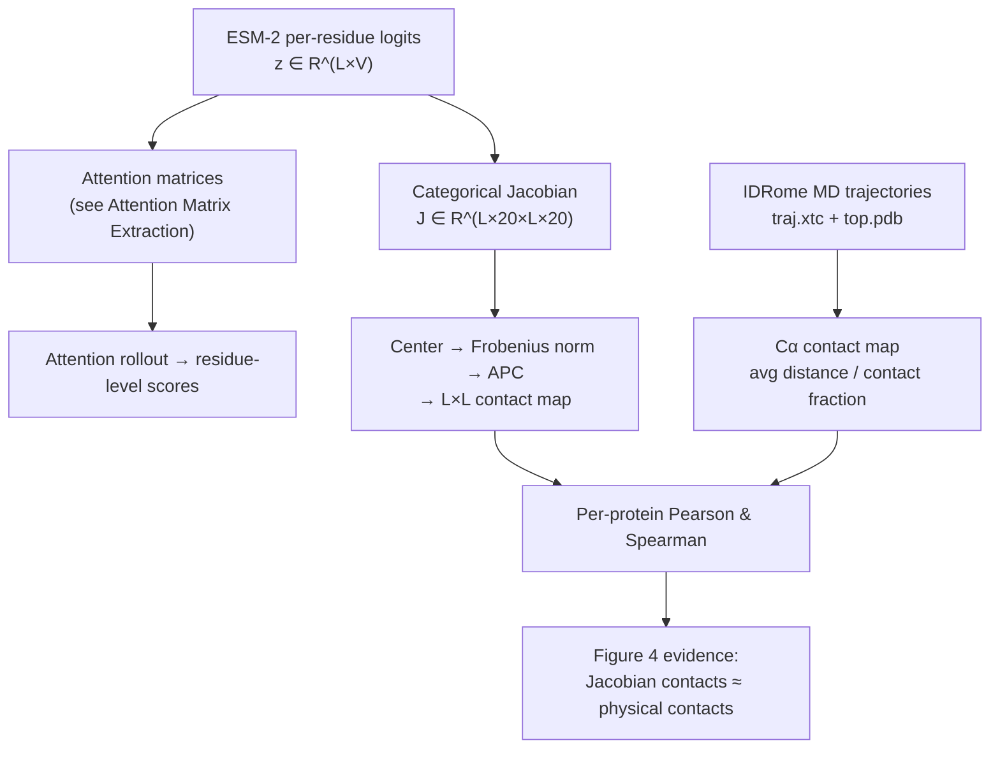
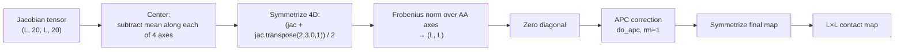
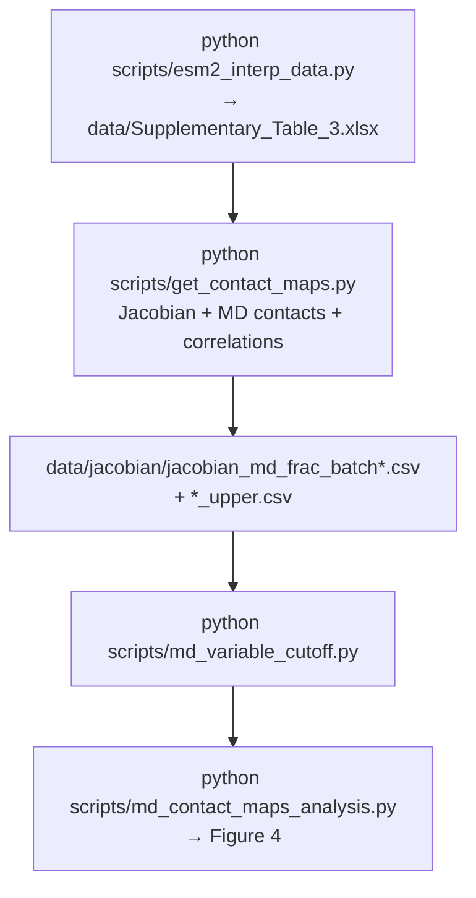

This page explains how `plm_interp` derives inter-residue **contact maps** from the **categorical Jacobian** of ESM-2 — a first-order measure of how the model's per-residue amino-acid logits respond when every input residue is systematically substituted — and how those model-intrinsic maps are quantitatively validated against physics-based molecular-dynamics (MD) contacts from the IDRome dataset. The scope covers the mathematical definition, the two implementations (notebook-reference and memory-optimized), the Jacobian→contact-map reduction pipeline, MD ground-truth construction, per-protein correlation scoring, and the batched output artifacts. The entire analysis lives in a single script, `scripts/get_contact_maps.py`, which generates the contact evidence underlying Figure 4 of the paper.

Sources: [README.md](README.md#L88-L96), [get_contact_maps.py](scripts/get_contact_maps.py#L16-L21)

## Conceptual Role: A Derivative-Based Probe of Latent Structure

The attention-based analyses in this repository interrogate where the model *looks*; the categorical Jacobian asks a complementary question: *if residue `i` were replaced by any other amino acid, how would the predicted residue distribution at position `j` change?* A strong response between positions `i` and `j` implies that ESM-2's output representation treats those two residues as functionally coupled — an intrinsic structural signal that requires no external predictor. For intrinsically disordered proteins, which lack a stable native fold and therefore lack ground-truth structural annotations, this derivative-based probe provides independently derived contact evidence that can be benchmarked against simulated ensembles rather than static crystal structures.

The overall validation architecture routes two independent views of each protein — model-derived Jacobian contacts and MD-derived physical contacts — into a per-protein correlation score:



Sources: [get_contact_maps.py](scripts/get_contact_maps.py#L16-L21), [README.md](README.md#L56-L58)

## Defining the Categorical Jacobian

The implementation realizes the Jacobian via **in-silico saturation mutagenesis**: for a sequence of length `L`, the tensor `J[i, a, j, b]` stores the finite-difference change in logit `b` at position `j` when residue `i` is mutated to amino-acid token `a`. Concretely, the model is evaluated once on the wild-type sequence to obtain `fx`, then every position is mutated to all 20 residue tokens, producing a four-dimensional response tensor of shape `(L, 20, L, 20)`:

```python
f = lambda x: model(x)["logits"][..., 1:(ln+1), 4:24].cpu().numpy()
fx = f(x.to(device))[0]
x = torch.tile(x, [20, 1])
for n in range(ln):
    x_h = torch.clone(x)
    x_h[:, n+1] = torch.arange(4, 24)   # mutate to all 20 aa
    fx_h[n] = f(x_h)
return fx_h - fx
```

Two indexing conventions from the ESM-2 tokenizer govern every slice in this function and must be understood to read the code correctly:

| Quantity | Code expression | Meaning |
|---|---|---|
| Tokenized input | `alphabet.get_batch_converter()([("seq", seq)])[-1]` | token sequence with `<cls>` occupying index 0 |
| Logit position slice | `1:(ln+1)` | the `L` real residues (skipping the `<cls>` row) |
| Amino-acid logit columns | `4:24` | the 20 residue token IDs |
| Mutated token index | `n+1` | position offset compensating for `<cls>` |
| Substitution values | `torch.arange(4, 24)` | all 20 residue tokens |

Sources: [get_contact_maps.py](scripts/get_contact_maps.py#L42-L54)

## Reference vs. Memory-Optimized Implementation

The repository ships two implementations with identical mathematics but very different execution profiles. `get_categorical_jacobian` is the notebook-faithful version: it runs **one forward pass per position** (batch of 20 tiled copies each), yielding `L` passes total. The production path, `get_categorical_jacobian_ln`, processes positions in **chunks of 150**: it repeats the tokenized input `chunk_len × 20` times, computes all mutation coordinates with vectorized tensor indexing, and issues only `⌈L/150⌉` forward passes with batches of up to 3,000 sequences. Both return the same `(L, 20, L, 20)` array via broadcast subtraction of the wild-type logits, and both run under `torch.no_grad()`; the main loop invokes the optimized variant with the default chunk size.

| Property | `get_categorical_jacobian` | `get_categorical_jacobian_ln` |
|---|---|---|
| Forward passes per protein | `L` (one per position) | `⌈L/150⌉` |
| Batch size per pass | 20 | `chunk_len × 20` (3,000 at a full chunk) |
| Mutation application | per-position loop, `x_h[:, n+1] = arange(4,24)` | vectorized `x_chunk[arange, positions] = mutations` |
| Mutant row layout | implicit (loop-major) | row `r = k·20 + m` → position `start+k`, token `4+m` |
| Result shape | `(L, 20, L, 20)` | `(L, 20, L, 20)` — identical |
| Chunk size | — | 150 (default parameter) |

> [!TIP]
> The mutation layout is the load-bearing detail of the optimized variant: `positions = arange(start, end).repeat_interleave(20) + 1` paired with `mutations = arange(4, 24).repeat(chunk_len)` guarantees that row `r = k·20 + m` corresponds to *position `start+k` mutated to residue token `4+m`* — exactly the axis semantics that `reshape(chunk_len, 20, ln, 20)` assumes. The `+ 1` offset exists because `<cls>` occupies token index 0.

Sources: [get_contact_maps.py](scripts/get_contact_maps.py#L42-L54), [get_contact_maps.py](scripts/get_contact_maps.py#L56-L74), [get_contact_maps.py](scripts/get_contact_maps.py#L202)

## Reducing the 4D Jacobian to a 2D Contact Map

The raw Jacobian is a response tensor, not a contact map; `get_contacts` performs the reduction. Each of the four axes is **mean-centered** (removing per-axis average structure), then the two amino-acid axes are collapsed with a **Frobenius norm**, `j_fn[i, j] = sqrt(Σₐ Σᵦ J[i,a,j,b]²)`, described in the code as the "overall strength of functional coupling between residue i and residue j". The diagonal is zeroed (no self-interactions), the result passes through the **Average Product Correction (APC)**, and the final map is symmetrized. APC itself, implemented in `do_apc`, subtracts the rank-one outer product of row and column sums, `y = x − (a1·a2)/x.sum()` — a standard suppression of large global components shared across rows and columns that would otherwise dominate the map. `do_apc` also exposes two alternative modes: `rm=0` bypasses correction entirely, and `rm ≥ 2` instead removes the top `rm` eigenvectors via SVD (`s[rm:] * u[:,rm:] @ v[rm:,:]`).



A subtle but deliberate ordering exists in the production loop: after `get_categorical_jacobian_ln` returns, the loop *first* centers each of the four axes and *then* symmetrizes the 4D tensor via `(jac + jac.transpose(2,3,0,1))/2` — only afterwards calling `get_contacts`, which centers the four axes once more and re-symmetrizes the resulting 2D map. The effective sequence is therefore: center 4D → symmetrize 4D → center 4D again → Frobenius → zero diagonal → APC → symmetrize 2D.

> [!TIP]
> Centering *before* symmetrization is not redundant bookkeeping: symmetrizing an already-centered tensor enforces exchange symmetry `i ↔ j` on the coupling structure itself, so the Frobenius-norm map inherits symmetry by construction rather than by the final averaging step. The second centering inside `get_contacts` is inherited from the original notebook and is intentionally left in place.

Sources: [get_contact_maps.py](scripts/get_contact_maps.py#L76-L86), [get_contact_maps.py](scripts/get_contact_maps.py#L23-L40), [get_contact_maps.py](scripts/get_contact_maps.py#L202-L213)

## MD Ground Truth: IDRome Contact Maps

Validation requires physical contact maps, which the script obtains per protein from the IDRome database. Sequences come from `data/Supplementary_Table_3.xlsx`, filtered to **≤ 160 residues** to bound compute time; the workload is enumerated by `data/jac_batch_directory.csv`, which assigns roughly 20,000 IDRome residue-range entries (`{UniProtID}_{res_start}_{res_end}`) to numbered batches that the main loop iterates independently. For each entry the script reconstructs IDRome's three-level sharded directory path from the UniProt ID, downloads `traj.xtc` and `top.pdb` from the SID archive into temporary files, loads them with MDTraj, and computes Cα–Cα distances via `md.compute_contacts(traj, scheme='ca')` followed by `md.geometry.squareform`.

The trajectory is aggregated into a single map under one of two modes controlled by `md_method` (the active configuration is `'frac'`, with threshold `0.65`; MDTraj reports distances in nanometers, so this corresponds to 6.5 Å):

| Mode | Aggregation | Uncomputed pairs | Output column |
|---|---|---|---|
| `avg` | mean Cα distance across all frames | retained as-is | `Distance` |
| `frac` (active) | fraction of frames with distance < 0.65 | masked `NaN` via `computed_mask` | `Frac` |

The `frac` branch is the more careful of the two: MDTraj only computes distances for a subset of residue pairs, so a `computed_mask` is built from the `contacts` array, pairs are binarized against the threshold, uncomputed pairs are set to `NaN` *before* aggregation, and `np.nanmean` across frames yields a true per-pair contact probability without contaminating statistics from missing pairs. The `Supplementary_Table_3.xlsx` input itself is fetched by the repository's data-acquisition script, which pins the static IDRome supplementary download.

Sources: [get_contact_maps.py](scripts/get_contact_maps.py#L101-L110), [get_contact_maps.py](scripts/get_contact_maps.py#L117-L156), [get_contact_maps.py](scripts/get_contact_maps.py#L158-L181), [esm2_interp_data.py](scripts/esm2_interp_data.py#L193-L200), [esm2_interp_data.py](scripts/esm2_interp_data.py#L232), [jac_batch_directory.csv](data/jac_batch_directory.csv#L1-L3), [README.md](README.md#L56-L58)

## Correlation Scoring and Output Artifacts

Each protein produces two long-format tables that are joined on the residue-pair key: the Jacobian map is melted into `Residue_i / Residue_j / ContactStrength` rows, while the MD map contributes either `Distance` or `Frac`. The merged frame is restricted to the **upper triangle** (`Residue_i < Residue_j`) and `dropna()` removes pairs the MD computation never evaluated, after which two rank-sensitive and one linear statistic are computed per protein: **Pearson** and **Spearman** correlation between Jacobian contact strength and MD contact evidence. Each protein contributes a results row of `seq_name, sequence, pearson_corr, spearman_corr`, and its full upper-triangle pair table is retained for downstream figure generation.

Persistence is engineered for long-running, resumable execution. The base output path is `data/jacobian/jacobian_md_frac.csv`, but results are written per batch with a `_batch{batch}.csv` suffix, flushed to disk **every 500 proteins** (`save_every`), using append mode with conditional headers; upper-triangle tables are flushed separately to `_batch{batch}_upper.csv`. Within each iteration, all large intermediates — trajectory objects, distance arrays, the Jacobian tensor, merged frames — are explicitly `del`-eted and `gc.collect()` is invoked, so peak memory is governed by a single protein rather than the batch.

| Artifact | Direction | Contents |
|---|---|---|
| `data/jac_batch_directory.csv` | input | ~20K `seq_name → batch_num` assignments driving the loop |
| `data/Supplementary_Table_3.xlsx` | input | IDRome sequences + metadata (downloaded, ≤160-residue filter applied) |
| `data/jacobian/jacobian_md_frac_batch{N}.csv` | output | per-protein `pearson_corr`, `spearman_corr` |
| `data/jacobian/jacobian_md_frac_batch{N}_upper.csv` | output | upper-triangle pairs: `Residue_i`, `Residue_j`, `ContactStrength`, `Frac`, `seq_name` |

Sources: [get_contact_maps.py](scripts/get_contact_maps.py#L200-L223), [get_contact_maps.py](scripts/get_contact_maps.py#L229-L236), [get_contact_maps.py](scripts/get_contact_maps.py#L239-L264)

## Provenance and Licensing

Three of the four mathematical building blocks — `do_apc`, `get_categorical_jacobian`, and `get_contacts` — are explicitly credited in the script's docstring to the `zzhangzzhang/pLMs-interpretability` notebook (Zhang et al., *PNAS* 2024). The README's third-party code section states that these adapted functions carry no upstream license and are therefore **excluded from this repository's MIT license**; the chunked `get_categorical_jacobian_ln` variant is this repo's own memory optimization. Any reuse of this pipeline should respect that provenance boundary.

Sources: [get_contact_maps.py](scripts/get_contact_maps.py#L16-L21), [README.md](README.md#L82-L84)

## Running the Analysis

The analysis is step two of the Figure 4 reproduction chain. The only prerequisite input that is not committed to the repository is the IDRome supplementary table, which the data-acquisition script downloads automatically; model weights for `esm2_t33_650M_UR50D` are fetched on first load, and MD trajectories are pulled per protein from the SID archive at runtime. GPU execution is selected automatically when CUDA is available.



Runtime is dominated by two per-protein costs: the Jacobian forward passes (bounded to `⌈L/150⌉ ≤ 2` heavy batched passes for the 160-residue cap) and the trajectory downloads. Note that the `(L, 20, L, 20)` Jacobian array is allocated via `np.zeros` in float64, so a single protein at the 160-residue cap already occupies ≈82 MB before the Frobenius reduction collapses it to `L × L` — one of several reasons the per-iteration `del`/`gc` discipline and the batched flush design matter. If a long run is interrupted, completed batches remain on disk and the loop structure over `directory.batch_num.unique()` allows re-entry at a chosen batch.

Sources: [README.md](README.md#L88-L96), [esm2_interp_data.py](scripts/esm2_interp_data.py#L217-L233), [get_contact_maps.py](scripts/get_contact_maps.py#L92-L99), [get_contact_maps.py](scripts/get_contact_maps.py#L103-L110), [get_contact_maps.py](scripts/get_contact_maps.py#L112)

## Key Takeaways and Next Steps

The categorical Jacobian pipeline establishes, quantitatively, that ESM-2's *input-sensitivity structure* — not just its attention routing — encodes inter-residue contact information for disordered proteins, benchmarked residue-pair-by-residue-pair against IDRome simulation ground truth. The three ideas to retain are: (1) the Jacobian is built by exhaustive saturation mutagenesis over `(position × amino acid)`, yielding an `(L, 20, L, 20)` response tensor; (2) the contact map is a *constructed* reduction — centering, Frobenius aggregation, APC — not a raw model output; and (3) validation is correlation-based against `frac`-mode MD contact probabilities, persisted per batch for resumability.

Where to go next in the catalog:

- [MD Trajectory Contact Validation](15-md-trajectory-contact-validation) — the downstream cutoff-sweep and population-level analysis that turns these per-protein correlations into Figure 4
- [Large Tensor Memory Management](20-large-tensor-memory-management) — deeper treatment of the memory patterns (`chunked forwards`, `del`/`gc`, periodic flush) used here
- [Derived Versus Live Data Reproducibility](22-derived-versus-live-data-reproducibility) — how the IDRome/SID dependencies interact with the repo's reproducibility strategy
- [External Data Acquisition](3-external-data-acquisition) — full walkthrough of `esm2_interp_data.py`, including the Supplementary Table 3 download
- [Attention Matrix Extraction](8-attention-matrix-extraction) — the attention-based counterpart probe, for contrast with the Jacobian approach
- [Reproducing Paper Figures](4-reproducing-paper-figures) — the complete Figure 4 command chain in context
