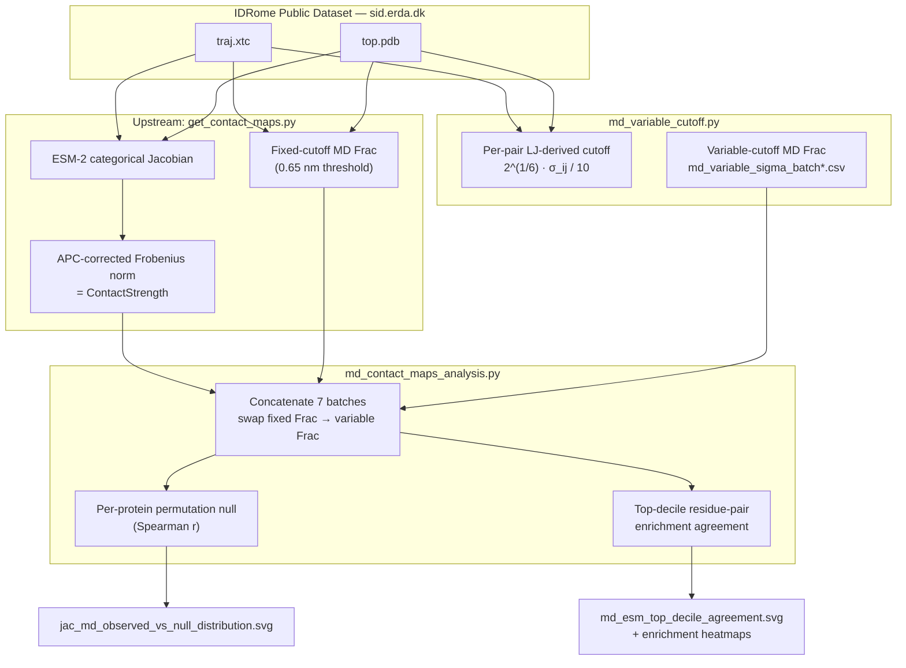
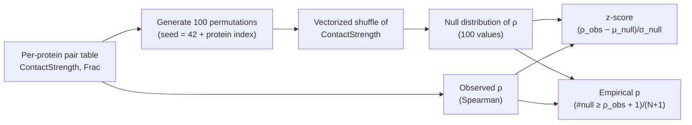
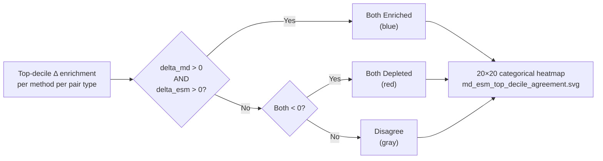

This page explains how the repository validates ESM-2 Jacobian-derived contact predictions against an independent physical ground truth: molecular dynamics (MD) trajectories from the IDRome dataset. The validation lives in two dedicated scripts — `md_variable_cutoff.py`, which converts XTC trajectories into per-pair contact frequencies using amino-acid-specific distance thresholds, and `md_contact_maps_analysis.py`, which statistically tests whether Jacobian contact strength correlates with MD contact occupancy beyond a permuted null. Whereas [Categorical Jacobian Contact Maps](14-categorical-jacobian-contact-maps) covers how the model-side contact signal is *produced*, this page covers how that signal is *audited* against simulation data.

Sources: [md_contact_maps_analysis.py](/scripts/md_contact_maps_analysis.py#L17-L19), [md_variable_cutoff.py](/scripts/md_variable_cutoff.py#L14-L17)

## Role in the Validation Architecture

The validation chain is deliberately staged so that expensive computation (GPU Jacobians, trajectory downloads) is separated from statistical analysis (CPU-only, parallelized). `get_contact_maps.py` is the shared upstream producer: for every protein it computes both the ESM-2 categorical Jacobian contact map and a fixed-cutoff MD contact map, persisting the merged upper-triangle data in seven batch files. `md_variable_cutoff.py` then recomputes *only* the MD side under a refined, per-residue-pair cutoff model. Finally, `md_contact_maps_analysis.py` joins all three artifacts and runs two complementary validations: a per-protein permutation test on the Spearman correlation, and a top-decile residue-pair enrichment comparison.



The data contracts between modules are pure CSV files with a shared join key of `(seq_name, Residue_i, Residue_j)`. The protein universe is defined once in `data/jac_batch_directory.csv` — 19,961 IDRome entries partitioned into 7 batches — and both producer scripts iterate this directory identically, guaranteeing key compatibility at merge time.

Sources: [get_contact_maps.py](/scripts/get_contact_maps.py#L92-L110), [md_contact_maps_analysis.py](/scripts/md_contact_maps_analysis.py#L67-L77), [md_variable_cutoff.py](/scripts/md_variable_cutoff.py#L50-L55), [jac_batch_directory.csv](/data/jac_batch_directory.csv#L1-L10)

## The IDRome Data Interface

Both MD-consuming scripts resolve trajectories through the same convention: each `seq_name` (e.g., `A0A024RBG1_145_181`) encodes a UniProt accession plus a residue range, and the accession is split into a three-level path prefix (`p1/p2/p3/`) following standard UniProt directory sharding, with any overflow characters folded into the third level. The scripts then construct direct-download URLs against the IDRome ERDA share (`https://sid.erda.dk/share_redirect/AVZAJvJnCO/IDRome/`), fetch `traj.xtc` and `top.pdb` via `requests`, and stage them in `tempfile.NamedTemporaryFile` objects that are deleted immediately after `mdtraj.load()` succeeds.

Sources: [md_variable_cutoff.py](/scripts/md_variable_cutoff.py#L63-L94), [get_contact_maps.py](/scripts/get_contact_maps.py#L121-L151)

Two defensive patterns matter for reproduction. First, the sequence universe is restricted to `seqlen <= 160` from the IDRome supplementary table — an explicit compute-time bound, since Jacobian computation scales as O(L·20) forward passes and contact matrices scale as O(L²). Second, trajectory loads are wrapped in a bare `try/except` with `continue`, so a corrupted or missing remote file silently skips a protein rather than aborting a multi-hour batch run; the merge-time `drop_duplicates()` call downstream acts as the deduplication safety net if a protein were ever reprocessed.

Sources: [md_variable_cutoff.py](/scripts/md_variable_cutoff.py#L44-L47), [md_variable_cutoff.py](/scripts/md_variable_cutoff.py#L87-L90), [md_contact_maps_analysis.py](/scripts/md_contact_maps_analysis.py#L76-L77)

## Variable Cutoff Contact Detection

The methodological core of `md_variable_cutoff.py` is a rejection of the uniform 0.65 nm distance threshold used upstream in favor of a pairwise, chemistry-aware cutoff borrowed from a published PLOS Computational Biology protocol. Each of the 20 amino acids carries a `sigma` parameter (in Å), and the cutoff for pair *(i, j)* is computed as the Lennard-Jones contact minimum scaled and converted to nm:

```
sigma_ij    = (σ_i + σ_j) / 2          # arithmetic mean of residue sigmas
cutoff_ij   = 2^(1/6) · sigma_ij / 10  # LJ r_min, Å → nm
```

| AA | σ (Å) | AA | σ (Å) | AA | σ (Å) | AA | σ (Å) |
|----|-------|----|-------|----|-------|----|-------|
| A | 5.04 | E | 5.92 | L | 6.18 | S | 5.18 |
| R | 6.56 | G | 4.50 | K | 6.36 | T | 5.62 |
| N | 5.68 | H | 6.08 | M | 6.18 | W | 6.78 |
| D | 5.58 | I | 6.18 | F | 6.36 | Y | 6.46 |
| C | 5.48 | P | 5.56 | V | 5.86 | Q | 6.02 |

The σ range spans 4.50 Å (Glycine) to 6.78 Å (Tryptophan), meaning a Gly–Trp pair and a Trp–Trp pair are judged against cutoffs differing by over 1 Å — a significant correction when contact occupancy is the measured quantity. `sigma_ij` is built as a broadcast outer-mean (`sigmas[:, None] + sigmas[None, :]) / 2.0`), yielding an L×L cutoff matrix aligned with the contact map axes.

> [!TIP]
> The factor `2^(1/6)` is not arbitrary: it is the location of the potential-energy minimum of a Lennard-Jones 12-6 potential, *r*<sub>min</sub> = 2<sup>1/6</sup>σ. The `/10.0` converts Ångströms to nanometers, matching `mdtraj`'s native distance units — omitting either factor would shift every cutoff by a constant or unit-dependent amount.

Sources: [md_variable_cutoff.py](/scripts/md_variable_cutoff.py#L15-L40), [md_variable_cutoff.py](/scripts/md_variable_cutoff.py#L96-L98), [get_contact_maps.py](/scripts/get_contact_maps.py#L92-L94)

Contact extraction uses Cα atoms exclusively (`md.compute_contacts(traj, scheme='ca')`), which returns a frame-wise distance array for the pairs MDTraj deemed geometrically computable. The script then converts this into a per-pair **contact occupancy fraction**: binary indicators (`distance < cutoff_ij`) are averaged across all trajectory frames, producing a `Frac` value in [0, 1] per residue pair.

| Aspect | Fixed cutoff (upstream) | Variable cutoff (this pipeline) |
|---|---|---|
| Threshold | Uniform 0.65 nm | Pair-specific 2<sup>1/6</sup>·σ<sub>ij</sub>/10 |
| Source of σ | — | PLOS CBiol protocol (per-AA table) |
| Output metric | `Frac` (frames in contact) | `Frac` (frames in contact) |
| Storage | `jacobian_md_frac_batch*_upper.csv` | `md_variable_sigma_batch*.csv` |
| Rationale | Simplicity | Chemistry-aware geometry |

Sources: [md_variable_cutoff.py](/scripts/md_variable_cutoff.py#L100-L118), [get_contact_maps.py](/scripts/get_contact_maps.py#L155-L180)

A subtle correctness detail: `md.compute_contacts` only reports pairs within a hard internal cutoff, so residues separated by sequence proximity or geometry may be *absent* from the pairs list entirely. The script constructs a boolean `computed_mask` from the returned `contacts` array, sets uncomputed cells to `NaN`, and averages with `np.nanmean` — this cleanly distinguishes "never in contact" (Frac = 0.0) from "never evaluated" (Frac = NaN). The upper-triangle export then drops NaN rows, so the statistical merge downstream only ever sees physically evaluated pairs.

Sources: [md_variable_cutoff.py](/scripts/md_variable_cutoff.py#L102-L117), [md_variable_cutoff.py](/scripts/md_variable_cutoff.py#L134-L136)

## Ground-Truth Correlation Under a Permutation Null

The statistical question `md_contact_maps_analysis.py` answers is: *for each protein, does the rank ordering of Jacobian contact strengths predict the rank ordering of MD contact occupancies better than chance?* The script loads all seven `jacobian_md_frac_batch*_upper.csv` files, concatenates and deduplicates them, then — under the `variable_sigma = True` flag — drops the fixed-cutoff `Frac` column and inner-merges the variable-cutoff replacement on `(Residue_i, Residue_j, seq_name)`. A built-in integrity check compares row counts before and after the merge, printing `No loss` or an explicit `Original : N | Merged : M` diagnostic if any Jacobian contacts lacked an MD counterpart.

Sources: [md_contact_maps_analysis.py](/scripts/md_contact_maps_analysis.py#L64-L93)

The per-protein test itself is a Monte Carlo permutation test on Spearman's ρ. Because the traditional parametric significance test for a correlation requires distributional assumptions that contact data violate, the script instead shuffles the `ContactStrength` vector *within each protein* — destroying any genuine coupling with MD `Frac` while preserving each vector's marginal structure — and recomputes ρ. The implementation is vectorized where it matters: a single seeded `np.random.default_rng(seed)` generates all permutation index matrices at once (`contact_strengths[perm_indices]`), and the per-protein jobs are dispatched across 8 workers via `joblib.Parallel`. Proteins with fewer than 10 contact pairs are excluded as statistically untestable.



Sources: [md_contact_maps_analysis.py](/scripts/md_contact_maps_analysis.py#L22-L58), [md_contact_maps_analysis.py](/scripts/md_contact_maps_analysis.py#L90-L100)

> [!TIP]
> Note the `+ 1` in the p-value formula `(np.sum(null_corrs >= observed_corr) + 1) / (n_permutations + 1)` — this standard rank-fix guarantees the empirical p-value can never be exactly zero under finite permutation sampling, which would otherwise overstate significance at the extreme tail. Also note the effective permutation count is **100 per protein** (set at the call site, line 98), not the function's 1000 default — a deliberate runtime compromise echoed in the figure title.

The aggregate summary reports a layered statistical profile across the protein cohort: the observed correlation distribution (median, IQR, mean ± σ), the null expectation, the fraction of proteins reaching p < 0.05 with a median z-score, and an effect size expressed both as a raw ρ difference from null and as an R² (squared mean correlation, interpreted as variance explained). Observed and null distributions are exported to `data/figure_data/combined_data.csv` and visualized as overlapping histograms against a zero-reference line in `figures/jac_md_observed_vs_null_distribution.svg`.

| Statistic | Definition | Interpretation |
|---|---|---|
| `observed_r` | Spearman ρ(ContactStrength, Frac), per protein | Model–physics rank agreement |
| `null_mean` / `null_std` | Mean/σ of permuted ρ | Chance-level baseline per protein |
| `z_score` | (ρ_obs − μ_null) / σ_null | Standardized departure from chance |
| `p_value` | Empirical permutation tail, (k+1)/(N+1) | Conservative significance |
| `effect_size` | mean(ρ_obs) − mean(ρ_null) | Cohort-level signal above chance |
| `R²` | mean(ρ_obs)² | Approximate shared variance |

Sources: [md_contact_maps_analysis.py](/scripts/md_contact_maps_analysis.py#L105-L140), [md_contact_maps_analysis.py](/scripts/md_contact_maps_analysis.py#L142-L167)

## Top-Decile Residue-Pair Enrichment and Agreement

The correlation test establishes that the two contact maps agree *within* proteins; the second analysis asks *which physical residue-pair chemistries* drive that agreement. Every upper-triangle row is annotated with actual amino-acid identities (resolved by indexing each protein's sequence from `Supplementary_Table_3.xlsx`), and the pair label is canonicalized — `"K-E"` and `"E-K"` collapse to a single sorted token — so that aggregation counts are direction-invariant.

Sources: [md_contact_maps_analysis.py](/scripts/md_contact_maps_analysis.py#L169-L179)

Within this canonicalized space, the script independently selects the strongest contacts from each method at the 90th percentile of its own score distribution (`ContactStrength` quantile for ESM-2 Jacobian, `Frac` quantile for MD). Because the two quantile cuts naturally yield different subset sizes, both lists are truncated to the minimum length before comparison — an equal-power design that prevents the MD side from dominating the count statistics purely by subset size. For each of the 210 unordered residue-pair types, the analysis computes a **delta enrichment**: the percentage of that pair type within a method's top decile, minus its percentage in the full contact population.



The classification is implemented compactly with `np.select` over the sign conditions, and the resulting 20×20 agreement grid is rendered as a categorical heatmap using a `ListedColormap` (blue = both enriched, red = both depleted, gray = disagreement). Two companion magnitude heatmaps — one per method, on an `RdBu` diverging scale — expose the signed Δ values so a reader can distinguish "weak mutual enrichment" from strong concordant signal. All comparison rows persist to `data/figure_data/comparison.csv`, and the signed heatmaps to `figures/esm2_top_decile_enrichment.svg` and `figures/md_top_decile_enrichment.svg`.

Sources: [md_contact_maps_analysis.py](/scripts/md_contact_maps_analysis.py#L181-L199), [md_contact_maps_analysis.py](/scripts/md_contact_maps_analysis.py#L203-L224), [md_contact_maps_analysis.py](/scripts/md_contact_maps_analysis.py#L227-L293)

The scientific payoff of this design is interpretability at the chemistry level: if ESM-2's Jacobian genuinely recovers physical contacts, its top-decile residue-pair types (e.g., charge-pair enrichments) should overlap the MD-derived ones, and the categorical heatmap should show dominant blue regions with disagreement confined to pairs whose MD occupancy is dominated by solvent effects the model cannot see.

## Engineering Considerations for Reproduction

Running the full validation requires `mdtraj` (pinned at 1.11.1) alongside the scientific stack, and the batch conventions are strict: `md_variable_cutoff.py` flushes accumulated DataFrames to `md_variable_sigma_batch{N}.csv` every 500 proteins with append-mode headers handled manually, mirroring the identical flush protocol in `get_contact_maps.py`. Both MD-producing loops aggressively release per-protein memory (`del` on trajectory and distance arrays plus `gc.collect()`), since a 160-residue contact map expanded to long-form rows is materialized per protein and any accumulation would exhaust RAM across ~20,000 proteins. Explicit per-protein RNG seeding (`seed = 42 + i`) makes the null distributions bit-reproducible even under parallel dispatch.

| Artifact | Producer | Consumer | Role |
|---|---|---|---|
| `jacobian_md_frac_batch*_upper.csv` | `get_contact_maps.py` | `md_contact_maps_analysis.py` | Jacobian strengths + fixed-cutoff Frac |
| `md_variable_sigma_batch*.csv` | `md_variable_cutoff.py` | `md_contact_maps_analysis.py` | Variable-cutoff Frac replacement |
| `data/figure_data/combined_data.csv` | `md_contact_maps_analysis.py` | Figure tooling | Observed vs null histogram data |
| `data/figure_data/comparison.csv` | `md_contact_maps_analysis.py` | Figure tooling | Per-pair delta enrichment + agreement |
| `figures/*.svg` | `md_contact_maps_analysis.py` | Publication pipeline | Final validation figures |

Note that the external IDRome supplementary table (`data/Supplementary_Table_3.xlsx`) and the ERDA-hosted trajectories are *live* remote dependencies, not versioned artifacts — a provenance consideration discussed in [Derived Versus Live Data Reproducibility](22-derived-versus-live-data-reproducibility). The memory-management patterns shared with the Jacobian producer are documented in [Large Tensor Memory Management](20-large-tensor-memory-management), and figure-level styling conventions in [Publication Figure Styling](23-publication-figure-styling).

Sources: [environment.yml](/environment.yml#L290), [md_variable_cutoff.py](/scripts/md_variable_cutoff.py#L139-L158), [md_contact_maps_analysis.py](/scripts/md_contact_maps_analysis.py#L96-L100), [get_contact_maps.py](/scripts/get_contact_maps.py#L239-L264)

## Where This Fits

The MD validation closes the loop on the interpretability claim established in [Categorical Jacobian Contact Maps](14-categorical-jacobian-contact-maps): a pLM-derived contact signal is shown to carry residue-level physical information that survives a permutation null and reproduces chemistry-aware enrichment patterns from explicit-solvent simulation. To see this validated signal used in a causal (rather than correlational) role, continue to [Attention Head Ablation Study](18-attention-head-ablation-study); to regenerate the figures end-to-end, follow [Reproducing Paper Figures](4-reproducing-paper-figures).
