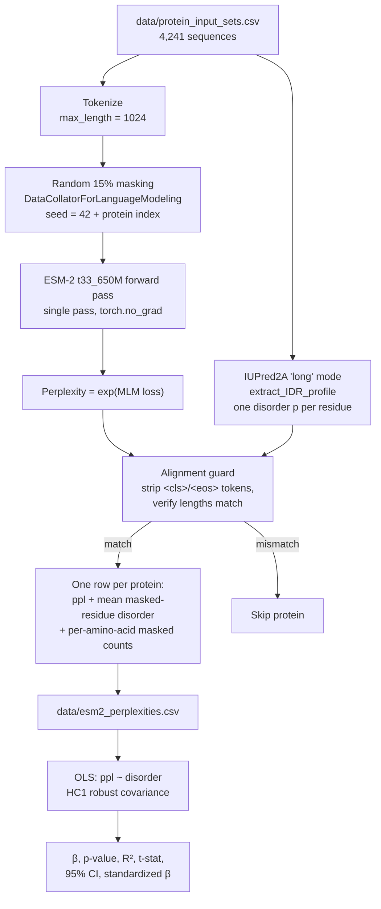
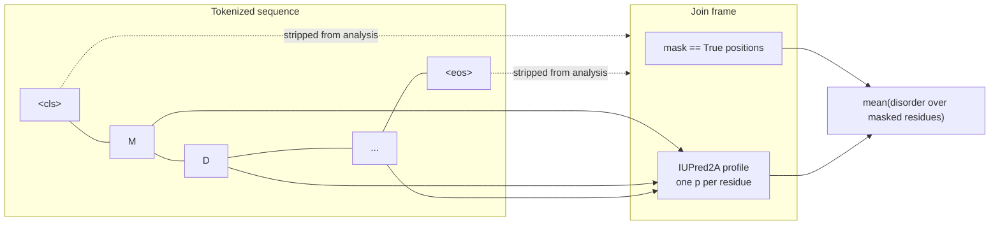

This page explains how the repository tests a single, focused hypothesis: **does ESM-2 find intrinsically disordered protein (IDP) sequences harder to predict than ordered ones?** The entire experiment lives in one script, `scripts/esm2_ppl_by_disorder.py`, which computes a masked-language-model perplexity per protein, aligns each protein with its per-residue disorder probability from IUPred2A, and fits a heteroskedasticity-robust linear regression of perplexity on disorder. It is the quantitatively simplest analysis in the repository — no attention matrices, no rollout — which makes it an ideal entry point into the "Functional Validation Analyses" chapter.

Sources: [esm2_ppl_by_disorder.py](scripts/esm2_ppl_by_disorder.py#L14-L18)

## Research Question: Does ESM-2 "Struggle" More with Disorder?

Perplexity measures a language model's surprise: the lower the perplexity, the better the model anticipates each token given context. The working hypothesis here is that residues inside intrinsically disordered regions — which lack the local structural regularities of folded domains — should be less predictable to ESM-2, yielding higher perplexity. The script operationalizes this by regressing each protein's perplexity against the **mean IUPred2A disorder probability of exactly the residues that were masked** during the perplexity measurement. This coupling of measurement and covariate is the central design decision: the disorder score is computed over the same residue subset that the model was asked to reconstruct, not over the whole sequence.

Sources: [esm2_ppl_by_disorder.py](scripts/esm2_ppl_by_disorder.py#L85-L101)

## End-to-End Pipeline Architecture

The analysis is a four-stage pipeline executed top-to-bottom in a single script run:

Stages 1–3 build the per-protein dataset; stage 4 is pure statistics. The pipeline is deterministic end-to-end: the masking randomness is seeded per protein, and the committed output file `data/esm2_perplexities.csv` (4,240 protein rows) allows the regression to be re-inspected without re-running the model.

Sources: [esm2_ppl_by_disorder.py](scripts/esm2_ppl_by_disorder.py#L24-L30), [protein_input_sets.csv](data/protein_input_sets.csv#L1), [esm2_perplexities.csv](data/esm2_perplexities.csv#L1)

## Stage 1 — Deterministic Masked Perplexity

The script loads `facebook/esm2_t33_650M_UR50D` as a `MaskedLM` model with `local_files_only=True` and moves it to GPU when available. For each unique protein, `get_individual_ppl` tokenizes the sequence with `truncation=True, max_length=1024`, then applies Hugging Face's `DataCollatorForLanguageModeling` at `mlm_probability=0.15` — the same masking regime used in ESM-2 pretraining. Critically, the function seeds both `torch` and `numpy` with `42 + protein_index` *before* masking, so the random 15% mask is fully reproducible per protein. One forward pass under `torch.no_grad()` yields the mean masked cross-entropy loss, and perplexity is simply `math.exp(loss)`.

It is worth being precise about what this measures. Classical MLM *pseudo*-perplexity masks and predicts every residue exhaustively; this implementation instead takes **one random 15% masking pass per protein** — a single-pass approximation that trades exhaustive coverage for a 1/L reduction in forward passes.

| Aspect | This implementation | Classical pseudo-perplexity |
|---|---|---|
| Masking scheme | One random 15% pass (HF collator) | Each residue masked exhaustively |
| Forward passes per protein | 1 | L (sequence length) |
| Determinism | Seeded, `seed = 42 + idx` | Deterministic by construction |
| Cost for the full dataset | O(N) | O(N·L) |
| Loss basis | Mean CE over randomly masked residues | Mean CE over all residues |

Sources: [esm2_ppl_by_disorder.py](scripts/esm2_ppl_by_disorder.py#L24-L30), [esm2_ppl_by_disorder.py](scripts/esm2_ppl_by_disorder.py#L40-L83)

## Stage 2 — Aligning Disorder Scores with Masked Residues

The disorder covariate comes from `extract_IDR_profile` in the shared `attention_functions.py` module — the same IUPred2A wrapper used across the attention analyses (covered in detail on the [Disorder Scoring with IUPred2A](10-disorder-scoring-with-iupred2a) page). The function writes the sequence to a temp FASTA, invokes the IUPred2A executable via `subprocess` in **`long` disorder mode**, parses the output, and returns one disorder probability per residue. IUPred2A requires a local installation; the path is hardcoded and must be edited per environment.

The alignment step is where the two measurement streams are joined, and it has two guards worth understanding:

First, special tokens (`<cls>`, `<eos>`) are dropped from the mask dataframe so token positions map 1:1 onto residues. Second, if the stripped dataframe length does not equal the IUPred2A profile length, the protein is skipped with a printed diagnostic. Because tokenization truncates at 1024 tokens, any protein whose disorder profile exceeds the token frame fails this check and is excluded — which is why the committed output holds 4,240 rows against the 4,241 input sequences.

> [!TIP]
> Reproduction of the exact n = 4,240 depends on this length guard: `truncation=True, max_length=1024` at tokenization silently shortens long proteins, and the mismatch check then drops them. If you raise `max_length` or change the tokenizer, expect the row count — and therefore every regression statistic — to shift.

Sources: [esm2_ppl_by_disorder.py](scripts/esm2_ppl_by_disorder.py#L89-L98), [attention_functions.py](scripts/attention_functions.py#L79-L99), [attention_functions.py](scripts/attention_functions.py#L21-L25), [README.md](README.md#L18)

## Stage 3 — The Per-Protein Feature Table

Each surviving protein contributes one row to `data/esm2_perplexities.csv`. Beyond the two variables used in the regression, the script also records per-amino-acid counts restricted to the masked residue set:

| Column | Type | Meaning |
|---|---|---|
| `seq` | string | Full amino-acid sequence |
| `ProteinID` | string | Identifier from `data/protein_input_sets.csv` (e.g., `disprot_protein1`) |
| `ppl` | float | `exp(MLM loss)` — the protein's single-pass masked perplexity |
| `mean_masked_residue_disorder` | float | Mean IUPred2A disorder probability across the 15% masked residues |
| `seq_len` | int | Sequence length |
| `A` … `Y` (20 columns) | int | Count of each amino acid among the masked residues |

The amino-acid counts make the CSV a reusable feature table: they are the raw material for controlled regressions (e.g., does perplexity track disorder *after* adjusting for composition such as proline or charged-residue fraction?), even though the committed script currently uses only `mean_masked_residue_disorder` as the sole regressor.

Sources: [esm2_ppl_by_disorder.py](scripts/esm2_ppl_by_disorder.py#L101-L109), [esm2_perplexities.csv](data/esm2_perplexities.csv#L1)

## Stage 4 — Robust OLS Regression

The final block refits the regression in memory from the freshly built dataframe. The model is ordinary least squares with an intercept via `sm.add_constant`, but the fit is called with `cov_type="HC1"` — White's heteroskedasticity-robust covariance. This matters because per-protein perplexity variance plausibly scales with sequence length and masked-set composition; HC1 keeps the standard errors valid under that heteroskedasticity rather than assuming constant error variance.

| Statistic | Source in code | Interpretation |
|---|---|---|
| `beta` | `model.params` | Change in perplexity per unit increase in mean masked-residue disorder |
| `CI_lower` / `CI_upper` | `conf_int(alpha=0.05)` | 95% confidence interval under HC1 covariance |
| `p_value` | `model.pvalues` | Formatted in scientific notation (`{p:.1e}`) |
| `r2` | `model.rsquared` | Fraction of perplexity variance explained by disorder |
| `t_stat` | `model.tvalues` | Significance of the disorder coefficient |
| `beta_std` | manual formula (line 138) | β × (σ_X / σ_y) — scale-free effect size |

The script rounds β and CI bounds to two decimals, prints the full coefficient table plus the standardized β, and stops — the regression results are **printed to console only**; the persisted artifact is the perplexity CSV. Rerunning the statistics on the committed CSV is a one-liner pandas/statsmodels job, which is the intended workflow when only the analysis (not the GPU pass) needs to change.

> [!TIP]
> The `beta_std` formula standardizes with raw standard deviations (σ_X/σ_y), not the pooled correlation-based convention — it is a standardized regression coefficient, equivalent to what you would get by z-scoring both variables and refitting without HC1. Use it to state the effect size in "SDs of perplexity per SD of disorder" language, and quote the HC1-based β/CI/p for inference.

Sources: [esm2_ppl_by_disorder.py](scripts/esm2_ppl_by_disorder.py#L112-L141)

## Practical Notes for Reproduction

Running the full pipeline requires the `torch-gpu` conda environment plus a local IUPred2A installation whose path is set in `attention_functions.py`. The GPU cost is modest relative to the attention-extraction scripts — 4,241 single forward passes — but the IUPred2A subprocess calls dominate wall time, as one OS process is spawned per protein. The input protein set is the curated DisProt/PDB collection produced by the repository's clustering pipeline, so this analysis inherits its dataset hygiene decisions; those are documented on [Dataset Curation and CD-HIT Clustering](21-dataset-curation-and-cd-hit-clustering). Because the output CSV is committed, you can also treat this page's artifact as an example of the [Derived Versus Live Data Reproducibility](22-derived-versus-live-data-reproducibility) pattern: derived statistics shipped, live computation optional.

Sources: [README.md](README.md#L9-L18), [attention_functions.py](scripts/attention_functions.py#L79-L99), [protein_input_sets.csv](data/protein_input_sets.csv#L1-L4)

## Where This Fits and Where to Go Next

Within the catalog's narrative, this analysis answers a coarse-grained question — *does the model encode disorder as unpredictability?* — before the repository zooms into *which* attention heads and residues carry that signal. The disorder scoring machinery is shared with the attention analyses described in [Ordered Versus Disordered Comparison](12-ordered-versus-disordered-comparison), and the biological framing is set out in [ESM-2 and IDP Biology Primer](6-esm-2-and-idp-biology-primer). To continue the Functional Validation chapter, proceed to [MLP Radius of Gyration Predictor](17-mlp-radius-of-gyration-predictor), which upgrades the target variable from a sequence-level scalar (perplexity) to a physically grounded one (radius of gyration).
