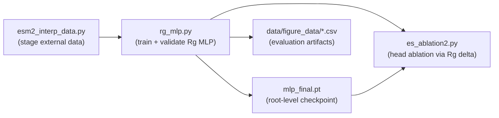
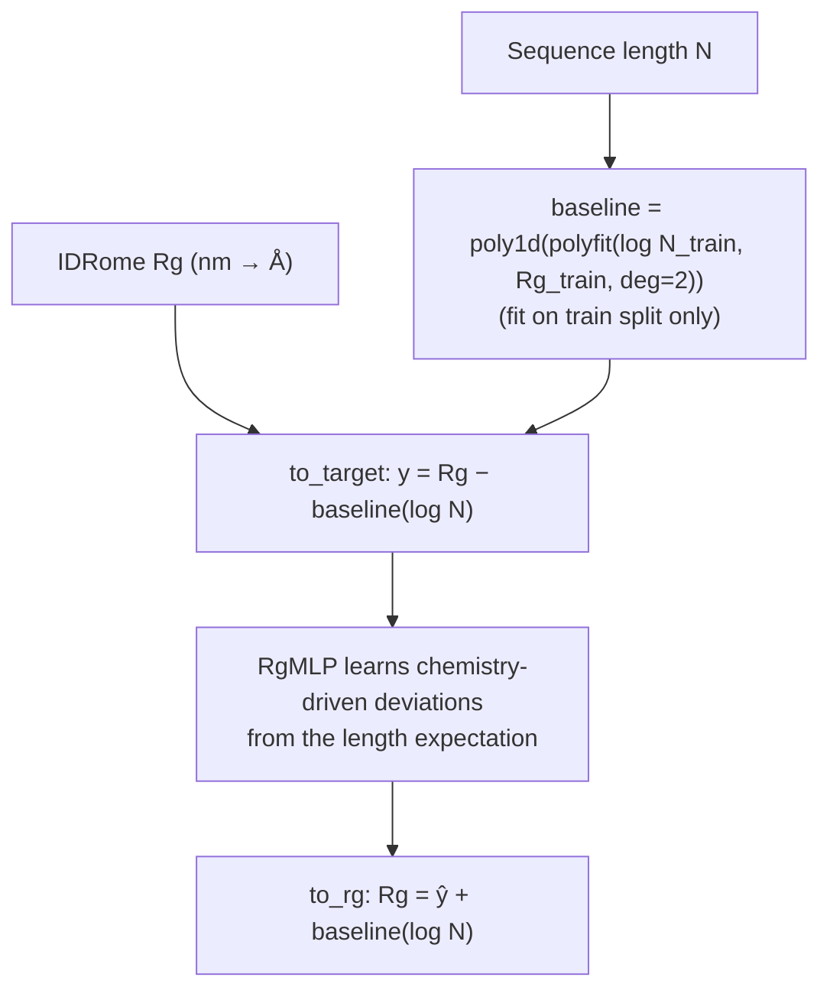
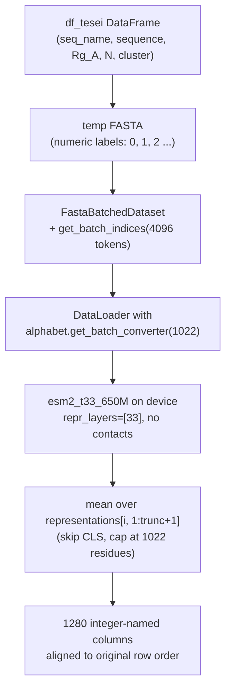
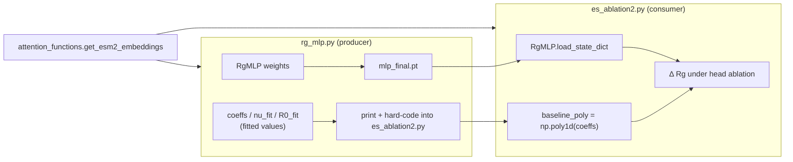

This page dissects `scripts/rg_mlp.py`, the component that converts ESM-2 sequence embeddings into a quantitative predictor of the **radius of gyration (Rg)** for intrinsically disordered proteins (IDPs). Rg measures a chain's spatial extent, making it the canonical scalar readout of IDP conformational state — compact versus expanded. The script trains an MLP regressor on IDRome molecular-dynamics-derived Rg values, validates it against experimental SAXS measurements, and emits the pretrained checkpoint `mlp_final.pt` that sits at the repository root and feeds the causal ablation studies downstream.

Sources: [rg_mlp.py](scripts/rg_mlp.py#L22-L32), [README.md](README.md#L21-L31)

## Position in the Analysis Pipeline

Within the paper's Figure 5 workflow, `rg_mlp.py` is the middle stage of a strict three-step sequence. It consumes external data staged by `esm2_interp_data.py` (IDRome database CSV, IDRome Supplementary Table 3, SAXS comparison data), trains and evaluates the Rg regressor, and produces both the model checkpoint and the Flory-normalized evaluation artifacts that `es_ablation2.py` then reuses to measure how ablating electrostatics-associated attention heads perturbs Rg predictions.

The coupling is bidirectional in a subtle way: `rg_mlp.py` writes artifacts *forward*, but `es_ablation2.py` cannot independently re-derive the length-baseline coefficients — it must trust values exported from this stage (detailed in the contract section below).

Sources: [README.md](README.md#L86-L93), [es_ablation2.py](scripts/es_ablation2.py#L22-L26)

## Why Rg Residuals Instead of Raw Rg

The core modeling decision is that the MLP never predicts Rg directly. Raw Rg scales strongly with chain length N (the Flory relation Rg ≈ R₀·N^ν), which would let the model "cheat" by learning length rather than sequence chemistry. Instead, the script fits a quadratic baseline `polyfit(log N, Rg, deg=2)` **on the training split only** and defines the learning target as the residual: `Rg − baseline(log N)`. Two inverse helpers enforce this convention everywhere — `to_target` converts raw Rg into residuals for training, and `to_rg` reconstructs physical Rg (in Ångströms) from a prediction given chain length.

A second, related scaling appears at evaluation time: **Flory normalization**, where every Rg (true, predicted, SAXS-measured, or STARLING-predicted) is divided by `R0_fit · N^ν_fit` with the Flory exponent ν and amplitude R₀ obtained from a log-log linear regression (`linregress`) fitted on training data only. This collapses the length dependence entirely, enabling fair cross-length and cross-source comparison.

> [!TIP]
> The baseline quadratic and the Flory pair (ν, R₀) are three fitted constants that downstream code consumes verbatim. Re-running `rg_mlp.py` with different data can change them silently and desynchronize `es_ablation2.py`, which hard-codes `nu_fit=0.533, R0_fit=2.420, coeffs=[5.18129864, -31.57633081, 63.38468187]`. Any retraining must be followed by propagating these values.

Sources: [rg_mlp.py](scripts/rg_mlp.py#L205-L221), [rg_mlp.py](scripts/rg_mlp.py#L88-L95), [es_ablation2.py](scripts/es_ablation2.py#L32-L40)

## Model Architecture and Configuration

`RgMLP` is a four-layer fully connected network mapping the 1280-dimensional mean-pooled ESM-2 embedding to a single scalar residual. Every hidden block follows the same modern pattern — **Linear → LayerNorm → GELU → Dropout** — with width halving at each stage, and the final projection squeezes to shape `[batch]` for direct MSE comparison.

| Block | Input → Output dim | Components |
|---|---|---|
| Block 1 | 1280 → 512 | Linear, LayerNorm, GELU, Dropout(0.3) |
| Block 2 | 512 → 256 | Linear, LayerNorm, GELU, Dropout(0.3) |
| Block 3 | 256 → 128 | Linear, LayerNorm, GELU, Dropout(0.3) |
| Head | 128 → 1 | Linear, `squeeze(-1)` |

The training configuration is deliberately conservative and fully deterministic — global seeds (Python, NumPy, CUDA), `cudnn.deterministic=True`, and `benchmark=False` guarantee bitwise-reproducible runs on identical hardware.

| Constant | Value | Role |
|---|---|---|
| `SEED` | 42 | All RNG seeding |
| `BATCH_SIZE` | 256 | MLP minibatch (over precomputed embeddings) |
| `TOKENS_PER_BATCH` | 4096 | ESM-2 token-budget batching during embedding extraction |
| `EPOCHS` / `PATIENCE` | 200 / 20 | Max epochs / early-stopping patience |
| `LR` / `WEIGHT_DECAY` | 1e-3 / 1e-4 | AdamW settings |
| `HIDDEN_DIM` / `DROPOUT` | 512 / 0.3 | Architecture width / regularization |
| `REPR_LAYER` / `SEQ_LENGTH` / `EMB_DIM` | 33 / 1022 / 1280 | ESM-2 layer, token cap, embedding width |

Sources: [rg_mlp.py](scripts/rg_mlp.py#L97-L125), [rg_mlp.py](scripts/rg_mlp.py#L35-L56)

## Data Provenance and Leakage-Safe Splitting

Training targets come from the IDRome database (Tesei et al., MD-derived Rg in nm, converted to Å by ×10), joined with sequences from IDRome Supplementary Table 3 by `seq_name`, with duplicates and NaNs dropped. The merged sequences are written back out as `data/idrome.fasta`, then clustered **externally** with CD-HIT at 40% identity (`cd-hit -i idrome.fasta -o idrome_clustered.fasta -c 0.4 -n 2`); the script parses the resulting `.clstr` file to recover a cluster label per sequence and flags unmapped entries. This grouping is what makes the split leakage-safe.

Splitting proceeds in two `GroupShuffleSplit` rounds — 80/20 into train+val versus test, then 90/10 within train+val — with `groups=` always set to cluster labels. No two sequences sharing ≥40% identity can straddle the train/test boundary, preventing near-homolog inflation of performance metrics. CD-HIT 4.8.1 is pinned in the conda environment, and the clustering workflow is covered in depth on [Dataset Curation and CD-HIT Clustering](21-dataset-curation-and-cd-hit-clustering).

| Input | Origin | Role in training |
|---|---|---|
| `IDRome_DB.csv` | KULL-Centre `_2023_Tesei_IDRome` GitHub | MD-derived Rg targets (Rg/nm × 10 → Å), chain lengths N |
| `data/Supplementary_Table_3.xlsx` | IDRome Nature supplementary (via `esm2_interp_data.py`) | Sequence strings joined by `seq_name` |
| `data/idrome.fasta` | Regenerated locally by this script | Input for external CD-HIT clustering |
| `data/idrome_clustered.fasta.clstr` | Committed CD-HIT output (c=0.4, n=2) | Cluster labels for grouped splitting |
| `data/all_comparison_data_WITH_STARTING.csv` | Holehouse-lab STARLING 2026 supporting data | SAXS ground truth + STARLING baselines for external validation |

Sources: [rg_mlp.py](scripts/rg_mlp.py#L147-L181), [rg_mlp.py](scripts/rg_mlp.py#L183-L203), [environment.yml](environment.yml#L56), [README.md](README.md#L72-L76)

## The Embedding Extraction Interface

Rather than reimplementing inference, `rg_mlp.py` imports `get_esm2_embeddings` from `attention_functions.py` — the shared embedding utility used across the interpretability analyses. The function materializes the DataFrame's sequences into a temporary FASTA file with numeric IDs, then uses the official `FastaBatchedDataset` machinery to batch by **token budget** (`tokens_per_batch=4096`), which keeps GPU memory bounded for heterogeneous sequence lengths (see [Large Tensor Memory Management](20-large-tensor-memory-management)).

Inference runs `esm2_t33_650M_UR50D` with `repr_layers=[33]` and `return_contacts=False`, then mean-pools the final-layer representations per protein. Two slicing details matter for correctness: pooling spans indices `1 : truncate_len+1`, which **excludes the `<cls>` token** at position 0, and `truncate_len = min(1022, len(seq))` silently **caps proteins at the 1022-residue ESM-2 context window** — longer chains contribute embeddings from their first 1022 residues only. Results are re-aligned to the original DataFrame row order and returned as the input DataFrame concatenated with 1280 integer-named embedding columns, which `rg_mlp.py` selects via `isinstance(c, int)` column filtering.

Sources: [attention_functions.py](scripts/attention_functions.py#L391-L429), [rg_mlp.py](scripts/rg_mlp.py#L223-L238)

> [!TIP]
> The `1:` start index and the 1022-residue cap are easy to miss and have asymmetric consequences: skipping `<cls>` keeps the pooled vector purely residue-derived, while the cap means predictions for chains >1022 residues are extrapolations from partial-sequence embeddings — relevant when interpreting SAXS validation, which includes long sequences.

## Training Procedure

Training follows a standard-but-hardened PyTorch loop: `EmbeddingDataset` tensors are loaded with `batch_size=256`, `num_workers=4`, and worker-level re-seeding (`seed_worker`) so DataLoader shuffling is deterministic too. Optimization uses AdamW with cosine annealing over 200 epochs, MSE loss, mixed-precision (`torch.cuda.amp`) with a `GradScaler`, gradient-norm clipping at 1.0, and early stopping after 20 epochs without validation improvement. Crucially, the checkpoint is saved **on best validation loss** to `mlp_final.pt` at the repository root — the exact file committed for reuse.

Note the two distinct batching regimes coexisting in this script: the ESM-2 forward passes batch by token count (4096), while the MLP consumes fixed-size embedding rows (256 per batch). After training, loss curves are melted into long format, exported to `data/figure_data/training_curve_long.csv`, and plotted with the best-epoch marker to `figures/mlp_final_curves.svg`, following the shared styling conventions of [Publication Figure Styling](23-publication-figure-styling).

| Mechanism | Implementation | Guard it provides |
|---|---|---|
| Determinism | Global seeds + `cudnn.deterministic` + `PYTHONHASHSEED` | Bitwise-reproducible runs |
| Checkpointing | `torch.save` on validation improvement → `mlp_final.pt` | Best model, not last model, persists |
| AMP | `autocast` + `GradScaler` with `unscale_` before clipping | Speed without breaking grad clipping |
| Early stopping | Patience counter vs. best val loss | Protection against late overfitting |

Sources: [rg_mlp.py](scripts/rg_mlp.py#L247-L293), [rg_mlp.py](scripts/rg_mlp.py#L48-L56), [rg_mlp.py](scripts/rg_mlp.py#L296-L314)

## Evaluation and External SAXS Validation

Evaluation reloads the best checkpoint and predicts residuals on the held-out test split, reconstructing physical Rg via `to_rg`. A deliberate integrity check — `assert np.allclose(true_raw, true_raw_check)` against the original `rg_lookup` — verifies the residual round-trip introduced no bookkeeping error before any metric is reported. Predictions and ground truth are then Flory-normalized and persisted to `data/figure_data/df_eval.csv`.

The second half of the script tests **out-of-distribution generalization**: SAXS experimental Rg values from the Holehouse-lab STARLING 2026 dataset, grouped by unique sequence with per-assay averages, are embedded, predicted, Flory-normalized, and benchmarked against two STARLING predictor variants (`starling_mps`, `starling_cuda`). The final figure is a three-panel comparison — IDRome-MLP, SAXS-MLP, and SAXS-STARLING — each annotated with Pearson and Spearman correlations, saved to `figures/rg_mlp.svg`. This framing positions the ESM-2 MLP as a lightweight sequence-only alternative to a dedicated IDP ensemble predictor.

| Panel | X axis | Y axis | Purpose |
|---|---|---|---|
| IDRome-MLP | Tesei MD Rg (Flory-norm) | MLP Rg (Flory-norm) | In-distribution held-out accuracy |
| SAXS-MLP | Experimental SAXS Rg (Flory-norm) | MLP Rg (Flory-norm) | Experimental transfer |
| SAXS-STARLING | Experimental SAXS Rg (Flory-norm) | STARLING CUDA Rg (Flory-norm) | Dedicated-model baseline |

| Output artifact | Path | Consumer |
|---|---|---|
| Model checkpoint | `mlp_final.pt` (repo root) | `es_ablation2.py`, future inference |
| Per-protein test predictions | `data/figure_data/df_eval.csv` | Figure generation / inspection |
| SAXS predictions + baselines | `data/figure_data/saxs_proteins.csv` | Figure generation |
| Loss curves | `data/figure_data/training_curve_long.csv`, `figures/mlp_final_curves.svg` | Paper figure assembly |
| Final 3-panel benchmark | `figures/rg_mlp.svg` | Paper Figure 5 |

Sources: [rg_mlp.py](scripts/rg_mlp.py#L316-L342), [rg_mlp.py](scripts/rg_mlp.py#L344-L380), [rg_mlp.py](scripts/rg_mlp.py#L382-L415)

## The mlp_final.pt Contract for Causal Ablation

`mlp_final.pt` is not a standalone deliverable — it is the **measurement instrument** for the causal ablation studies. `es_ablation2.py` re-declares an architecture-identical `RgMLP` class, loads the checkpoint's state dict, and measures how perturbing ESM-2 attention heads shifts predicted Rg. Because the baseline and Flory constants cannot be serialized inside the checkpoint (they live as module-level NumPy state in `rg_mlp.py`), the ablation script hard-codes them: identical coefficients, `nu_fit=0.533`, `R0_fit=2.420`. The only sanctioned divergence between the two scripts is `TOKENS_PER_BATCH` (8192 in the ablation versus 4096 here), a pure memory-throughput knob that does not alter semantics.

Sources: [es_ablation2.py](scripts/es_ablation2.py#L22-L40), [es_ablation2.py](scripts/es_ablation2.py#L47-L60), [rg_mlp.py](scripts/rg_mlp.py#L287)

## Reproducibility Notes and Data Boundaries

A precise reading of this script reveals the repository's derived-versus-live data strategy in miniature (elaborated on [Derived Versus Live Data Reproduibility](22-derived-versus-live-data-reproducibility)). The IDRome FASTA files and cluster files are committed, but the SAXS CSV and Supplementary Table 3 are fetched by `esm2_interp_data.py` per instructions in [External Data Acquisition](3-external-data-acquisition). One documentation drift is visible in-source: the header docstring cites `all_comparison_data.csv`, while the code reads `all_comparison_data_WITH_STARTING.csv` — the "WITH_STARTING" variant is the reproducibility-pinned file, and the docstring points at the live upstream URL.

| Data class | Handling | Implication for re-runs |
|---|---|---|
| Committed inputs (`idrome.fasta`, `.clstr`) | In-repo | Deterministic split recovery via `SEED=42` |
| Downloaded inputs (Supp Table 3, SAXS CSV) | Via `esm2_interp_data.py` | Upstream DB drift possible; pin files for exact reproduction |
| Derived outputs (`figure_data/*.csv`, SVGs) | Regenerated by `rg_mlp.py` | Not committed; regenerate for [Reproducing Paper Figures](4-reproducing-paper-figures) |
| Baseline/Flory constants | Fitted, then hard-coded in `es_ablation2.py` | Manual propagation required after retraining |

Sources: [rg_mlp.py](scripts/rg_mlp.py#L31-L32), [rg_mlp.py](scripts/rg_mlp.py#L356), [README.md](README.md#L72-L76)

## Where to Go Next

To understand the biological and architectural substrate this model builds on, read [ESM-2 and IDP Biology Primer](6-esm-2-and-idp-biology-primer); for how this script connects to the rest of the codebase, see [Script Pipeline Architecture](5-script-pipeline-architecture). The immediate downstream consumer is covered in [Attention Head Ablation Study](18-attention-head-ablation-study), with the hypothesis it tests in [Electrostatics Hypothesis Testing](19-electrostatics-hypothesis-testing). For the surrounding engineering context, consult [Large Tensor Memory Management](20-large-tensor-memory-management), [Dataset Curation and CD-HIT Clustering](21-dataset-curation-and-cd-hit-clustering), and [Publication Figure Styling](23-publication-figure-styling); end-to-end reproduction instructions live in [Reproducing Paper Figures](4-reproducing-paper-figures).