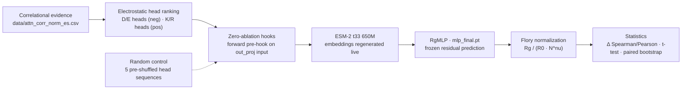
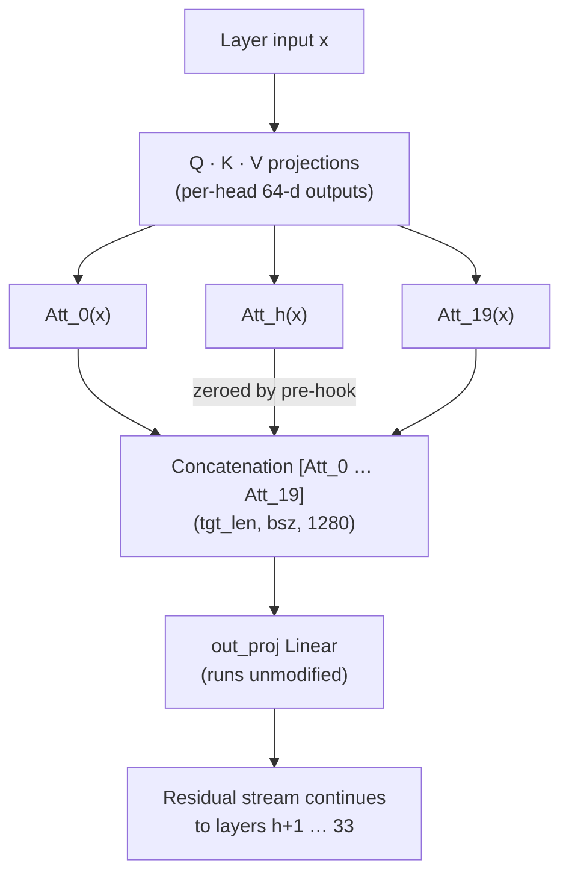
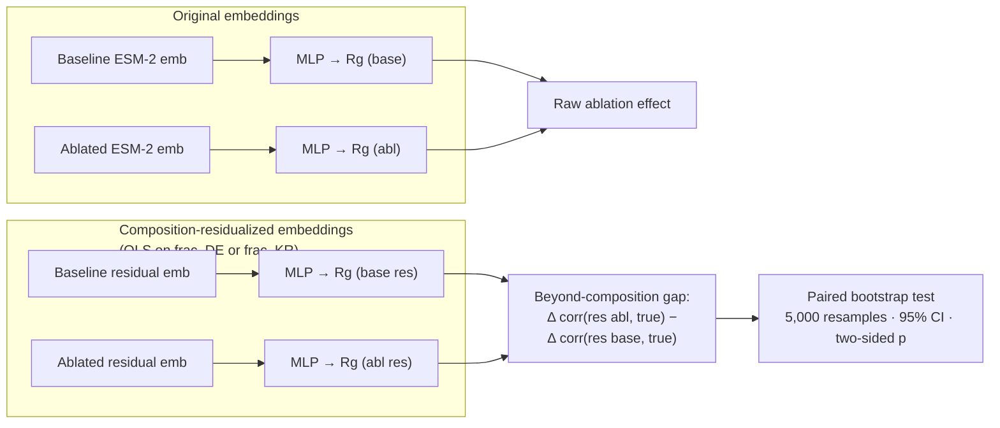

This page documents the causal arm of the repository's interpretability program: `scripts/es_ablation2.py`, the experiment that converts the *correlational* findings of [Amino Acid Attention Statistics](11-amino-acid-attention-statistics) into a *causal* test. The script identifies ESM-2 attention heads most strongly associated with charged residues (D, E, K, R), surgically silences them during inference via forward hooks, and measures whether the frozen Rg predictor (from [MLP Radius of Gyration Predictor](17-mlp-radius-of-gyration-predictor)) degrades more than under matched random ablation. The study spans two benchmarks (IDRome and experimental SAXS), a cumulative 50-head sweep, snapshot evaluations, and a composition-residualization protocol that separates head-specific signal from trivial amino acid composition effects.

Sources: [es_ablation2.py](scripts/es_ablation2.py#L30-L33), [rg_mlp.py](scripts/rg_mlp.py#L10-L17)

## From Correlation to Causation

Upstream analyses in this repository established that certain layer/head positions receive disproportionate attention from charged amino acids, but correlation alone cannot tell you whether those heads *carry* the electrostatic compaction signal or merely co-occur with it. The ablation study closes this gap with an intervention: the script's own docstring states its purpose — "Ablate Heads of ESM-2 likely to be associated with electrostatics and evaluate ablation effect on MLP Rg prediction" ([es_ablation2.py](scripts/es_ablation2.py#L30-L33)). The causal logic is asymmetric-degradation: if electrostatic heads are load-bearing, ablating them should hurt Rg prediction accuracy significantly more than ablating the same number of random heads, because random ablation controls for raw capacity loss while targeted ablation removes hypothesized *specific* information. The full experiment is a chain of five stages, each isolated in the script: ranking, hooking, embedding regeneration, prediction, and statistics.

The two-headed hypothesis distinguishes **negative** residues (D/E, negatively charged) from **positive** residues (K/R, positively charged), ablating each family's top-ranked heads independently. This matters because IDRome proteins show distinct compaction behavior under net-negative versus net-positive charge regimes; if only one polarity's heads degrade prediction, the electrostatic encoding is polarity-specific rather than generic charge sensitivity.

Sources: [es_ablation2.py](scripts/es_ablation2.py#L30-L33), [es_ablation2.py](scripts/es_ablation2.py#L131-L143)

## Experimental Design at a Glance

The design is a three-condition comparison evaluated across two independent benchmarks. Each condition ablates heads cumulatively or at a fixed snapshot, always against an unablated baseline prediction computed on the same frozen model pair (ESM-2 → MLP). The five random control runs pre-shuffle candidate head sequences *once*, excluding all targeted heads from the candidate pool, so random runs never dilute the targeted conditions with electrostatic heads — a subtle but important exclusion that keeps conditions statistically independent.

| Condition | Head pool | Pool size | Runs | Purpose |
|---|---|---|---|---|
| Negative (D/E) | Top-50 `heads_neg_ranked` by mean D/E attention | 50 | 1 cumulative sweep | Test negative-charge head causality |
| Positive (K/R) | Top-50 `heads_pos_ranked` by mean K/R attention | 50 | 1 cumulative sweep | Test positive-charge head causality |
| Random | 5 seeded permutations of all non-targeted heads | 900 candidates | 5 cumulative sweeps | Capacity-loss null distribution |
| Baseline | None (unmodified model) | 0 | 1 per benchmark | Reference for all Δ metrics |

Sources: [es_ablation2.py](scripts/es_ablation2.py#L263-L291)

## Electrostatic Head Ranking

The ranking input is a *derived* artifact, `data/attn_corr_norm_es.csv`, containing occurrence-normalized attention statistics for exactly four amino acids (D, E, K, R) at every layer/head pair (2,640 rows = 33 layers × 20 heads × 4 residues). Its provenance is recorded in a commented block at the top of the head-selection section: it was produced by `run_aa_analysis_head_layer(normalize='occurrence', model='original')` from [Attention Matrix Extraction](8-attention-matrix-extraction) chunks, meaning the ranking reflects the *original pretrained* ESM-2, not a finetuned variant ([es_ablation2.py](scripts/es_ablation2.py#L131-L135)). The `occurrence` normalization is defined in `attention_functions.py` as per-residue attention summed across the sequence, then divided by that amino acid's count in the sequence — so a head scores high only if it attends strongly to charged residues *per occurrence*, not merely because the protein is compositionally rich ([attention_functions.py](scripts/attention_functions.py#L313-L323)).

From this table the script computes two rankings: `mean_pos` averages `attn_occur_norm` over K/R rows per (head, layer), and `mean_neg` does the same over D/E rows; each is sorted descending to yield `heads_pos_ranked` and `heads_neg_ranked` ([es_ablation2.py](scripts/es_ablation2.py#L136-L143)). Before ablation, the script emits diagnostic visualizations: a 2×2 grid of layer-by-head heatmaps (one per residue) saved to `figures/DEKR_heatmaps.svg`, and pairwise Pearson correlations between the D/E/K/R heatmap surfaces, which quantify whether charge-polarity attention patterns are redundant (D~E, K~R high) or complementary ([es_ablation2.py](scripts/es_ablation2.py#L145-L186)). These diagnostics justify treating D/E and K/R as coherent head families rather than independent residue-level signals.

| Ranking artifact | Rows | Selection rule | Consumed by |
|---|---|---|---|
| `attn_corr_norm_es.csv` | 2,640 | D/E/K/R only, occurrence-normalized, original model | Ranking computation |
| `heads_neg_ranked` | Top-50 used | Mean D/E attention, descending | Negative ablation |
| `heads_pos_ranked` | Top-50 used | Mean K/R attention, descending | Positive ablation |

Sources: [es_ablation2.py](scripts/es_ablation2.py#L131-L143), [attention_functions.py](scripts/attention_functions.py#L336-L389)

## True Zero-Ablation Hook Mechanism

The core engineering contribution is `register_esm_ablation_hooks`, which implements what the docstring calls "true zero-ablation": setting the head's output function `Att_h(x) → 0` without re-implementing attention internals ([es_ablation2.py](scripts/es_ablation2.py#L194-L207)). The function exploits PyTorch's `nn.MultiheadAttention` structure: each head's 64-dimensional output exists as a *contiguous slice* of the tensor fed into `out_proj`, but only at that exact point — after `out_proj`'s linear mixing, individual head contributions are algebraically entangled and cannot be cleanly separated. The hook is therefore a `register_forward_pre_hook` on `out_proj` itself, intercepting the concatenated per-head vector `[Att_0(x), …, Att_19(x)]`, zeroing the `h*64 : (h+1)*64` slice for each ablated head, and returning the modified tuple so `out_proj` runs normally on the censored input.

Three implementation details make this robust for a 33-layer sweep. First, hooks are grouped per layer — one hook handles all heads ablated in that layer — avoiding redundant registrations ([es_ablation2.py](scripts/es_ablation2.py#L208-L226)). Second, the hook clones its input (`args[0].clone()`) before mutation, preventing in-place corruption of tensors that autograd or downstream consumers may reference. Third, every ablation call site wraps registration in `try/finally` with `remove_hooks(handles)`, guaranteeing the next condition (positive, random, or baseline) always runs on a clean model ([es_ablation2.py](scripts/es_ablation2.py#L296-L318)).

> [!TIP]
> The surgical precision of this hook placement is what separates true ablation from approximate ablation: zeroing *post*-out_proj activations would also zero the contributions of surviving heads wherever the projection matrix has cross-head mixing terms, contaminating the control conditions. The pre-hook on `out_proj` input is the unique point where head identity is still exactly recoverable from tensor geometry (fixed 64-dim slices), so ablated heads are silenced without perturbing anyone else.

Sources: [es_ablation2.py](scripts/es_ablation2.py#L194-L226), [es_ablation2.py](scripts/es_ablation2.py#L296-L318)

## Datasets, Flory Normalization, and Metrics

Evaluation runs on two benchmarks with different ground-truth provenance. `load_idrome()` reconstructs the *held-out test split* used to train the MLP: it merges the IDRome database (downloaded live from the KULL-Centre GitHub) with `data/Supplementary_Table_3.xlsx`, converts Rg from nm to Å, attaches CD-HIT cluster labels parsed from `data/idrome_clustered.fasta.clstr`, and applies `GroupShuffleSplit(test_size=0.2, random_state=42)` — the identical seeded, cluster-grouped split from [MLP Radius of Gyration Predictor](17-mlp-radius-of-gyration-predictor), ensuring ablation is scored on proteins the MLP never saw and that cluster-redundant sequences cannot straddle the split ([es_ablation2.py](scripts/es_ablation2.py#L87-L117), [rg_mlp.py](scripts/rg_mlp.py#L34-L47)). `load_saxs()` provides an orthogonal experimental check: SAXS-measured Rg values, deduplicated by sequence and averaged, so each unique protein contributes once ([es_ablation2.py](scripts/es_ablation2.py#L119-L127)).

All Rg comparisons use **Flory-normalized** units to remove trivial length dependence: true and predicted values are divided by the polymer scaling law `R0 · N^ν` with `ν=0.533`, `R0=2.420`, and the MLP's own length residual is added back via a degree-2 polynomial baseline in `log(N)` before normalization ([es_ablation2.py](scripts/es_ablation2.py#L36-L49), [es_ablation2.py](scripts/es_ablation2.py#L232-L239)). This means the evaluation metric — Spearman ρ, Pearson r, and MAE on normalized Rg — measures whether the model captures *compaction state relative to ideal-chain scaling*, not absolute size, which would otherwise be dominated by sequence length. Note one environment deviation from training: the ablation script batches inference at `TOKENS_PER_BATCH=8192` (versus 4096 during training) since no gradients are needed — a memory/throughput tradeoff discussed further in [Large Tensor Memory Management](20-large-tensor-memory-management).

| Benchmark | Source | Split | Ground truth | Sequences used |
|---|---|---|---|---|
| IDRome | IDRome_DB.csv + Supplementary Table 3 | Held-out 20%, grouped by CD-HIT cluster, seed 42 | MD-derived Rg (Å) | Test partition only |
| SAXS | `all_comparison_data_WITH_STARTING.csv` | All (evaluation only) | Experimental Rg | Unique sequences, mean-aggregated |

Sources: [es_ablation2.py](scripts/es_ablation2.py#L87-L127), [es_ablation2.py](scripts/es_ablation2.py#L232-L245)

## The Cumulative Head Sweep

`run_sweep` is the dose-response experiment: for each `n` from 1 to 50, it ablates the top-*n* negative heads, the top-*n* positive heads, and the first-*n* heads of each of five pre-built random sequences, re-running full ESM-2 inference and MLP prediction at every step ([es_ablation2.py](scripts/es_ablation2.py#L291-L346)). The random sequences are constructed once before the loop: five `rng.choice` permutations (seeded at 42) of `candidate_heads` — every (layer, head) pair except the 100 targeted ones — so each random run is a coherent *consecutive prefix* ablation rather than resampling heads at every step, which would make the random curve non-cumulative and incomparable to the targeted curves ([es_ablation2.py](scripts/es_ablation2.py#L274-L289)). At each dose the script records Δ Spearman and Δ Pearson against baseline for all three conditions, including the random mean and standard deviation across the five runs. Because a full sweep is expensive, results checkpoint to CSV every 10 heads, and the final long-form DataFrame gains a random-condition ± standard-error band (`delta_upper`/`delta_lower`) before plotting the headline figure `figures/head_ablation_sweep_.svg` with red (negative), blue (positive), and gray-banded (random) trajectories ([es_ablation2.py](scripts/es_ablation2.py#L343-L377)).

A reading-the-code caveat: in the current committed state, the IDRome sweep call is **commented out** at the run block (`#run_sweep(idrome_proteins, ...)`), so executing the script as-is runs only the snapshot evaluations and the residualization analysis described below — re-enable that line to regenerate the dose-response curve ([es_ablation2.py](scripts/es_ablation2.py#L432-L441)).

Sources: [es_ablation2.py](scripts/es_ablation2.py#L263-L380)

## Snapshot Evaluation and Per-Protein Significance

Where the sweep asks *how much* damage accrues with dose, `run_eval` asks *what kind* of damage at the full 50-head dose. It computes baseline and ablated predictions per protein, then derives four per-protein quantities: the fraction of D/E and K/R residues (`frac_DE`, `frac_KR`), the MAE change `delta_mae` (ablated minus baseline error), and the signed prediction shift `bigger_or_smaller` (ablated minus baseline normalized Rg), all persisted to `data/figure_data/` as eight CSVs covering both head polarities on both benchmarks ([es_ablation2.py](scripts/es_ablation2.py#L386-L424), [es_ablation2.py](scripts/es_ablation2.py#L441-L450)). Significance is tested with a one-sample t-test of `delta_mae` against zero — asking whether mean per-protein error change differs from noise — supplemented by a "worse vs. better" tally, since a significant mean shift driven by a minority of proteins tells a different mechanistic story than a uniform degradation ([es_ablation2.py](scripts/es_ablation2.py#L418-L422)). The `frac_DE`/`frac_KR` columns are deliberately carried into the outputs: they feed the composition-confound analysis below and any downstream regression of ablation damage on charge content.

Sources: [es_ablation2.py](scripts/es_ablation2.py#L386-L424)

## Residualization: Isolating Signal Beyond Composition

The final analysis confronts the study's central confound: D/E-attention heads are selected *because* they respond to charge composition, so any degradation they cause could reflect nothing more than the MLP having lost access to raw composition counts. The script's residualization protocol (its design is spelled out in a block comment: regress embedding on DEKR, residualize, re-predict, and attribute any residual gap to "some other electrostatics" beyond composition — [es_ablation2.py](scripts/es_ablation2.py#L452-L460)) works as follows. Each of the 1,280 embedding dimensions is separately regressed via OLS on `frac_DE` (for negative heads) or `frac_KR` (for positive heads), producing *residualized* baseline and ablated embeddings with linear composition dependence removed ([es_ablation2.py](scripts/es_ablation2.py#L512-L525)). Four prediction conditions then enter a 2×2 matrix — baseline/ablated × original/residualized — and the quantity of interest is the **beyond-composition gap**: the difference between ablated-residual and baseline-residual prediction quality, which cannot be explained by composition since composition has been regressed out of both.

Significance of the gap uses `bootstrap_gap_test`, a *paired* bootstrap over proteins: 5,000 resamples draw protein indices once and apply the identical resample to both baseline-residual and ablated-residual predictions, so the gap distribution reflects sampling variance in proteins rather than mismatched samples; the 95% CI comes from percentiles and the p-value is two-sided on the sign of the observed gap ([es_ablation2.py](scripts/es_ablation2.py#L462-L489)). The analysis runs for both Pearson and Spearman, for both negative and positive head sets on IDRome ([es_ablation2.py](scripts/es_ablation2.py#L553-L560)). A gap that survives residualization with tight bootstrap intervals is the strongest evidence this study can offer that electrostatic heads encode structured charge *relationships* (e.g., sequence-position-dependent interactions), not just residue frequencies.

> [!TIP]
> The pairing in the bootstrap is not decorative: because both prediction vectors are evaluated on the same resampled proteins, between-protein heterogeneity (length, composition outliers) cancels in the gap statistic. An unpaired test would inflate variance by the full between-protein spread, likely washing out a real but modest beyond-composition effect.

Sources: [es_ablation2.py](scripts/es_ablation2.py#L452-L460), [es_ablation2.py](scripts/es_ablation2.py#L462-L560)

## Running the Study and Its Artifacts

Executing `python scripts/es_ablation2.py` requires: the committed `mlp_final.pt` and `data/attn_corr_norm_es.csv`, the IDRome supplementary table plus live network access to the IDRome database CSV, and the SAXS comparison file (external data acquisition is covered in [External Data Acquisition](3-external-data-acquisition)); a CUDA device is selected automatically when available. Inference regenerates embeddings live for every condition through `get_esm2_embeddings`, which mean-pools layer-33 representations over the true residue range (skipping `<cls>`, truncating at 1,022 tokens) ([attention_functions.py](scripts/attention_functions.py#L391-L420)). All result artifacts land in `data/figure_data/` and `figures/`, following the derived-data conventions described in [Derived Versus Live Data Reproducibility](22-derived-versus-live-data-reproducibility).

| Artifact | Type | Producer |
|---|---|---|
| `figures/DEKR_heatmaps.svg` | Layer×head attention heatmap (D, E, K, R) | Ranking diagnostics |
| `figures/head_ablation_sweep_.svg` | Dose-response curves + random ±SE band | `run_sweep` |
| `es_ablation_sweep_df_{label}_random_consecutive.csv` | Sweep results (+ checkpoint every 10 heads) | `run_sweep` |
| `results_df.csv` / `results_df_pos.csv` | IDRome snapshot: per-protein deltas, `frac_DE/KR` | `run_eval` |
| `saxs_results_df.csv` / `saxs_results_df_pos.csv` | SAXS snapshot, same schema | `run_eval` |
| Stdout: beyond-composition gap | 4-condition evaluation + bootstrap CI/p | `run_eval_residual` |

Sources: [es_ablation2.py](scripts/es_ablation2.py#L432-L450), [attention_functions.py](scripts/attention_functions.py#L391-L420)

## Where This Fits in the Pipeline

The ablation study is the hinge between the repository's observational and hypothesis-testing arms. Its head-ranking input inherits directly from [Amino Acid Attention Statistics](11-amino-acid-attention-statistics); its frozen predictor is documented in [MLP Radius of Gyration Predictor](17-mlp-radius-of-gyration-predictor); and its findings feed the interpretive synthesis in [Electrostatics Hypothesis Testing](19-electrostatics-hypothesis-testing), which situates these causal results alongside the polarity-specific compaction behavior of IDRome sequences. For the memory-management implications of running 100+ full-model inference passes, see [Large Tensor Memory Management](20-large-tensor-memory-management).
