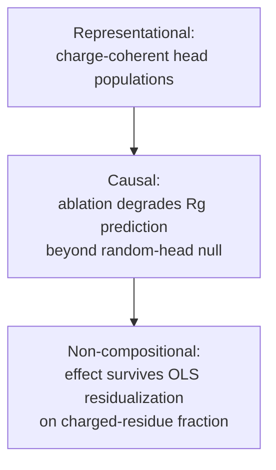
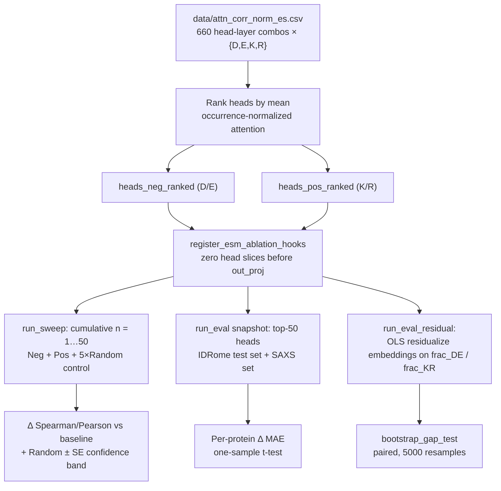
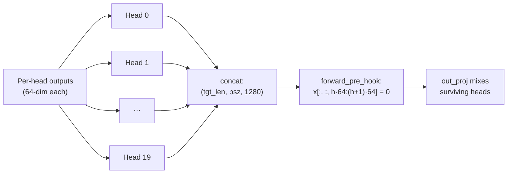
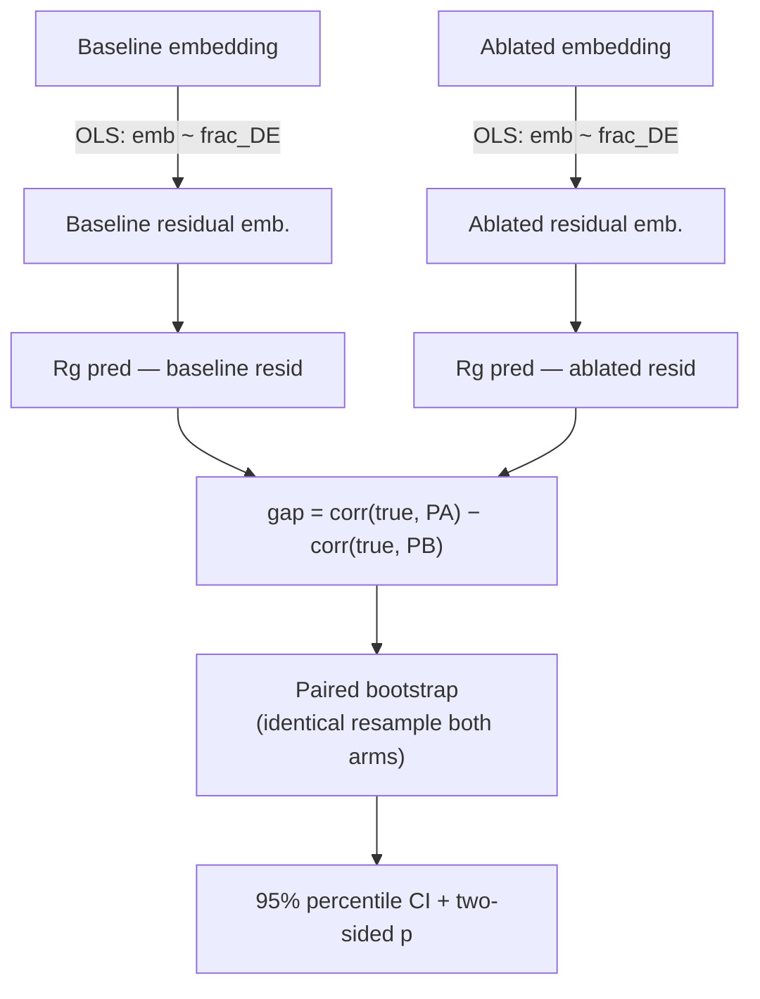

This page documents the electrostatics hypothesis testing pipeline implemented in `scripts/es_ablation2.py`, the final causal-validation stage of the interpretability project. The script takes the observation that certain ESM-2 heads allocate disproportionate, occurrence-normalized attention to charged residues (D, E, K, R) and asks three nested questions: are those heads **charge-coherent** (do heads reading aspartate also read glutamate)? Are they **causal** (does zeroing them degrade MLP radius-of-gyration prediction beyond a random-head null)? And is that effect **more than composition** (does it survive when the linear contribution of charged-residue fraction is regressed out of the embeddings)? The script's own docstring states the intent directly: *"Ablate Heads of ESM-2 likely to be associated with electrostatics and evaluate ablation effect on MLP Rg prediction."*

Sources: [es_ablation2.py](/scripts/es_ablation2.py#L12-L16)

## The Hypothesis Under Test

The analysis encodes a two-part hypothesis. The **representational claim** holds that ESM-2 maintains head populations specialized for charge sign — measurable as high correlation between (layer, head) attention heatmaps of same-charge residue pairs (D–E, K–R) and comparatively lower correlation across opposite-charge pairs (D–K, D–R, K–E, R–E). The **causal claim** holds that if these heads carry electrostatic information relevant to IDR dimensionality, removing their outputs should measurably shift Rg predictions, with the degradation pattern differing between charge signs. The critical confound is composition: IDRome sequences vary widely in D/E and K/R fraction, so any attention effect might simply re-encode `frac_DE`/`frac_KR` counts rather than electrostatic *interactions*. Stage 5 (residualization) exists precisely to separate these.

Sources: [es_ablation2.py](/scripts/es_ablation2.py#L164-L177), [es_ablation2.py](/scripts/es_ablation2.py#L452-L460)

## Pipeline Architecture

The script executes five sequential stages, each consuming the artifacts of the previous one. Note that in the current committed state, the expensive `run_sweep` call is commented out (line 438) — re-running the script as-is executes the snapshot evaluations and the residualization analyses, while the full sweep requires uncommenting.

| Stage | Function | Input heads | Output artifacts |
|---|---|---|---|
| Head identification | top-level ranking | `attn_corr_norm_es.csv` | `figures/DEKR_heatmaps.svg`, console correlations |
| Zero-ablation | `register_esm_ablation_hooks` | ranked lists | in-memory model hooks |
| Cumulative sweep | `run_sweep` | top-50 neg + pos | `data/figure_data/es_ablation_sweep_df_{label}_random_consecutive.csv`, `figures/head_ablation_sweep_.svg` |
| Snapshot evaluation | `run_eval` | top-50 neg / pos | `results_df.csv`, `saxs_results_df.csv` (+ `_pos` variants) |
| Residualization | `run_eval_residual` | top-50 neg / pos | console statistics (gap, CI, p) |

Sources: [es_ablation2.py](/scripts/es_ablation2.py#L432-L450), [es_ablation2.py](/scripts/es_ablation2.py#L559-L560)

## Stage 1 — Locating Charge-Specific Heads

The entry point is a **derived dataset**: `data/attn_corr_norm_es.csv` holds 2,640 rows — 33 layers × 20 heads × 4 charged amino acids — with columns `layer, head, aa, attn_occur_norm`. The commented-out block above the load shows its provenance: it was produced by `run_aa_analysis_head_layer(normalize='occurrence', model='original')`, which walks 22 precomputed attention-matrix chunks and, for every (layer, head) pair, sums attention received by each amino acid type and divides by that residue's occurrence count in each sequence (the *occurrence* normalization mode). This is the same statistical machinery documented in [Amino Acid Attention Statistics](11-amino-acid-attention-statistics); this page treats the CSV as a frozen input rather than recomputing it.

Sources: [es_ablation2.py](/scripts/es_ablation2.py#L118-L134), [data/attn_corr_norm_es.csv](/data/attn_corr_norm_es.csv#L1-L10), [attention_functions.py](/scripts/attention_functions.py#L313-L323)

From this table the script constructs two rankings. `mean_pos` averages `attn_occur_norm` over positively charged residues (R, K) per (head, layer); `mean_neg` does the same for negatively charged residues (D, E). Sorting descending yields `heads_pos_ranked` and `heads_neg_ranked` — ordered lists of the heads most attuned to each charge sign. These two lists are the entire "hypothesis-driven" selection mechanism; everything downstream is conditional on them.

Sources: [es_ablation2.py](/scripts/es_ablation2.py#L125-L134)

Before any ablation, the script produces **descriptive evidence** for the charge-coherence claim. A 2×2 figure grid renders one (layer × head) heatmap per amino acid (D, E, K, R) on a shared color scale, saved as `figures/DEKR_heatmaps.svg`. Then six Pearson correlations over the pivoted heatmap vectors quantify pattern similarity: `corr_DE` and `corr_KR` (same-charge pairs, expected high), versus `corr_DK`, `corr_DR`, `corr_KE`, `corr_RE` (opposite-charge pairs). The comparison logic is deliberate — same-sign pairs sharing a spatial attention pattern while cross-sign pairs diverge would indicate sign-selective, rather than generically "charged residue"-selective, heads.

| Correlation pair | Charge relationship | Coherence interpretation |
|---|---|---|
| D–E, K–R | Same sign | Shared (layer, head) pattern → sign-selective heads |
| D–K, D–R, K–E, R–E | Opposite sign | Decorrelated pattern → distinct populations per sign |

Sources: [es_ablation2.py](/scripts/es_ablation2.py#L136-L177)

## Stage 2 — True Zero-Ablation Mechanics

The causal test requires removing a head's contribution from the live forward pass without disturbing the other 19. The script achieves this with a forward *pre*-hook on `self_attn.out_proj`, and the docstring is explicit about why this placement matters: the hook fires on the hook module's **input**, which is the concatenated per-head output `[Att_0(x), …, Att_19(x)]` *before* `out_proj` mixes heads together. Zeroing the h-th 64-dimensional slice (`h * head_dim` to `(h + 1) * head_dim`, with `HEAD_DIM = embed_dim / num_heads = 1280 / 20 = 64`) sets that head's output exactly to zero while every other head's slice passes through untouched, and the output projection then combines the surviving heads normally.

Sources: [es_ablation2.py](/scripts/es_ablation2.py#L197-L226)

Engineering details worth noting: heads are grouped by layer into one hook per affected layer (so a 50-head target spanning many layers installs at most 33 hooks); the hook clones the input tensor before mutation (`args[0].clone()`); and `remove_hooks` strips every handle in a `finally` block, guaranteeing the model returns to its unmodified state even if embedding extraction raises. Hooks are never left installed across experimental conditions — each ablated embedding pass registers, extracts, and deregisters.

> [!TIP]
> Hooking `out_proj`'s *input* (a `register_forward_pre_hook`) rather than post-processing attention weights is what makes this a "true zero-ablation": the zeroed slice propagates through the nonlinearity of every subsequent layer, so downstream layers recompute in the actual ablated regime — unlike attention-map masking, which only reweights a post-hoc analysis.

Sources: [es_ablation2.py](/scripts/es_ablation2.py#L208-L230), [es_ablation2.py](/scripts/es_ablation2.py#L296-L300)

## Stage 3 — Cumulative Sweep with a Random-Head Null

`run_sweep` is the dose-response experiment. For each cumulative head count `n` from 1 to `MAX_HEADS_ABLATE = 50`, it ablates the top-*n* negative heads, the top-*n* positive heads, and — critically — the first *n* heads from each of five **pre-shuffled random sequences**. The random control is constructed carefully: candidate heads exclude the entire targeted set (the union of top-50 neg and top-50 pos), each of the `N_RANDOM_RUNS = 5` permutations is drawn once up front from a seeded RNG (`SEED = 42`), and each run's prefix of length *n* is ablated — making the random condition cumulative and consecutive, exactly matched in structure to the targeted conditions at every `n`.

| Condition | Head source | Runs per *n* | Role |
|---|---|---|---|
| Negative (D/E) | `heads_neg_ranked[:n]` | 1 | Hypothesis arm: heads reading acidic residues |
| Positive (K/R) | `heads_pos_ranked[:n]` | 1 | Complementary arm: basic-residue heads |
| Random | shuffled non-targeted heads | 5 | Empirical null; mean ± SE band |

Sources: [es_ablation2.py](/scripts/es_ablation2.py#L263-L291), [es_ablation2.py](/scripts/es_ablation2.py#L310-L326)

Every ablated model state is evaluated through the identical measurement funnel: `get_esm2_embeddings` writes sequences to a temporary FASTA, batches them via `FastaBatchedDataset`, runs the (possibly hooked) ESM-2 forward pass, and mean-pools layer-33 representations per residue token (`representations[i, 1:truncate_len + 1].mean(0)`); `predict_rg` feeds these to the frozen `mlp_final.pt` MLP, applies the polynomial baseline correction, and Flory-normalizes both prediction and truth by `R₀·N^ν` (ν = 0.533, R₀ = 2.420); `evaluate` reduces each arm to Spearman ρ, Pearson r, and MAE. The sweep records **deltas against the un-ablated baseline** for all three conditions and persists results every 10 heads (`*_checkpoint_random_consecutive.csv`) so long GPU sweeps survive interruption.

Sources: [attention_functions.py](/scripts/attention_functions.py#L391-L429), [es_ablation2.py](/scripts/es_ablation2.py#L232-L245), [es_ablation2.py](/scripts/es_ablation2.py#L343-L350)

The final figure plots ΔSpearman versus number of heads ablated for all three conditions, with the random condition additionally drawn as a shaded ±SE band (`delta_spearman_random_se = std/√5`). The visual claim structure: a targeted curve falling below the random band at moderate *n* indicates the ablated heads matter more than equivalent volumes of arbitrary heads — the causal signature. The final sweep table is saved as `data/figure_data/es_ablation_sweep_df_{label}_random_consecutive.csv` for both `idrome` and `saxs` datasets.

Sources: [es_ablation2.py](/scripts/es_ablation2.py#L348-L379)

## Stage 4 — Fixed-Set Snapshot Evaluation

Where the sweep traces degradation curves, `run_eval` produces a **deep characterization at one operating point**: the top `OVERWRITE_NUM_HEADS = 50` heads of each ranking. It re-establishes baseline predictions, applies the ablation, and builds a per-protein results frame with `rg_true_scaled`, `rg_baseline_scaled`, `rg_ablated_scaled`, the charged-residue fractions (`frac_DE`, `frac_KR` via regex counting), and two derived columns: `delta_mae` (per-protein MAE increase from ablation) and `bigger_or_smaller` (signed prediction shift). Statistical support comes from a one-sample t-test of `delta_mae` against zero, plus the proportion of proteins made worse vs. better.

Sources: [es_ablation2.py](/scripts/es_ablation2.py#L386-L424)

The run block executes this four ways — negative-head and positive-head ablations, each on both evaluation sets: the IDRome held-out test split and the SAXS ensemble. The IDRome test proteins are the 20% cluster-grouped holdout from `GroupShuffleSplit(test_size=0.2, random_state=SEED)` over CD-HIT clusters, ensuring the ablation is scored on proteins never seen during MLP training; the SAXS set is deduplicated by averaging `saxs` values per unique sequence. Results are persisted as `results_df.csv`, `saxs_results_df.csv`, and their `_pos` counterparts under `data/figure_data/`.

Sources: [es_ablation2.py](/scripts/es_ablation2.py#L74-L113), [es_ablation2.py](/scripts/es_ablation2.py#L432-L450)

## Stage 5 — Residualization: Separating Composition from Electrostatic Structure

The most methodologically distinctive stage addresses the composition confound head-on. The design comment in the script lays out the inference chain explicitly: residualize the baseline embedding against charged fraction, residualize the ablated embedding the same way, predict Rg from both residual embeddings — then *"any gap between them is NOT attributed to DEKR so has to come from some other electrostatics."* In other words, Stage 4's degradation could be trivially explained if the ablated heads merely tracked how many D/E residues a sequence has; Stage 5 asks what remains of the ablation effect once that linear count signal is subtracted.

Sources: [es_ablation2.py](/scripts/es_ablation2.py#L452-L460), [es_ablation2.py](/scripts/es_ablation2.py#L491-L525)

Implementation is compact: for both the baseline and ablated mean-pooled embeddings (all 1,280 dimensions), `run_eval_residual` fits `sm.OLS(embedding, sm.add_constant(frac_col)).fit()` — one regression per embedding dimension, with `frac_KR` as the covariate for the positive-head condition and `frac_DE` for the negative-head condition — and keeps `model.resid` as the composition-orthogonalized embedding. The analysis then produces four Rg predictions (baseline, baseline-residual, ablated, ablated-residual), reports the **beyond-composition gap** (`abl_res_spearman − base_res_spearman` and its Pearson analogue), and subjects the gap to `bootstrap_gap_test`.

Sources: [es_ablation2.py](/scripts/es_ablation2.py#L512-L555)

The significance test is a **paired bootstrap**: 5,000 resamples of protein indices draw *the same* resample for both residual predictions in each iteration, compute `r_abl − r_base` per resample, and derive a two-sided p-value by checking which side of zero the bootstrap gaps fall on (with the direction chosen by the sign of the observed gap), plus a 95% percentile CI. Pairing is the statistically important choice — resampling both arms identically cancels protein-sampling variance shared between them, isolating the ablation-attributable difference. The test runs under both `pearson` and `spearman` correlation, and is executed for both the negative and positive head sets on IDRome.

> [!TIP]
> Because one OLS residualization is fit per embedding dimension on a single covariate, the residual embeddings retain any *nonlinear* relationship between charged composition and the representation — the procedure removes only the linear projection onto `frac_DE`/`frac_KR`. That is exactly the right null for "heads merely count charged residues," but a headline "beyond-composition" gap should still be read as *linear-composition-independent*, not composition-independent in general.

Sources: [es_ablation2.py](/scripts/es_ablation2.py#L462-L489), [es_ablation2.py](/scripts/es_ablation2.py#L559-L560)

## Reading the Outcomes

The script's outputs are designed so that the hypothesis is adjudicated by three independent statistical instruments, each guarding a different failure mode. Use this decision matrix when interpreting a run:

| Observation | Instrument | Interpretation |
|---|---|---|
| Same-charge correlations ≫ cross-charge correlations | Stage 1 `corr_DE/KR` vs `corr_DK/DR/KE/RE` | Heads are sign-selective, not generically charged-residue-selective |
| Targeted ΔSpearman drops below the Random ± SE band | Stage 3 sweep plot | Ablated heads carry non-redundant, above-null information |
| `delta_mae` t-test p < 0.05 with majority of proteins worse | Stage 4 per-protein t-test | Degradation is protein-wide, not driven by outliers |
| Bootstrap gap CI excludes 0 | Stage 5 paired bootstrap | Effect persists after linear composition removal → interaction-level electrostatic encoding |
| Residual gap CI contains 0 | Stage 5 paired bootstrap | Ablation effect is fully explained by charged-residue counts; no interaction evidence |

Sources: [es_ablation2.py](/scripts/es_ablation2.py#L164-L177), [es_ablation2.py](/scripts/es_ablation2.py#L418-L422), [es_ablation2.py](/scripts/es_ablation2.py#L550-L555)

A practical asymmetry also exists between the two charge arms: the negative (D/E) and positive (K/R) rankings are independent head lists, and the positive condition uses `frac_KR` for residualization — so the two arms can in principle yield different conclusions, which is itself informative about which charge sign ESM-2 encodes more structurally. The `cohen_d` helper (pooled-SD effect size) is available in the script for effect-size reporting alongside the significance tests.

Sources: [es_ablation2.py](/scripts/es_ablation2.py#L491-L496), [es_ablation2.py](/scripts/es_ablation2.py#L247-L257)

## Artifacts, Seeds, and Reproducibility

Every stochastic element is pinned to `SEED = 42`: the cluster-grouped IDRome test split, the five random head permutations, and the bootstrap resampler all draw from seeds derived from it. Deterministic artifacts — the DEKR heatmap SVG, sweep CSVs with checkpoint variants, and the eight snapshot result frames — land under `figures/` and `data/figure_data/`. Runtime inputs not regenerated by this script include the derived `attn_corr_norm_es.csv` (reproducible via the commented `run_aa_analysis_head_layer` call, which requires the 22 attention-matrix chunks from [Attention Matrix Extraction](8-attention-matrix-extraction)) and the two Rg ground-truth sources (`Supplementary_Table_3.xlsx` and the remote IDRome DB CSV), which follow the acquisition flow described in [External Data Acquisition](3-external-data-acquisition).

| Artifact | Producing call | Contents |
|---|---|---|
| `figures/DEKR_heatmaps.svg` | Stage 1 plotting | Per-AA (layer × head) attention heatmaps |
| `es_ablation_sweep_df_{label}_random_consecutive.csv` | `run_sweep` | Δρ/Δr per n, random mean/std/SE |
| `figures/head_ablation_sweep_.svg` | `run_sweep` | Three-condition degradation curves + null band |
| `results_df.csv` / `saxs_results_df.csv` (+ `_pos`) | `run_eval` | Per-protein scaled predictions, `delta_mae`, `frac_DE/KR` |

Sources: [es_ablation2.py](/scripts/es_ablation2.py#L20-L33), [es_ablation2.py](/scripts/es_ablation2.py#L118-L123)

## Where to Go Next

This page is the payoff of a chain built across the Deep Dive section: the head-ranking input derives from [Amino Acid Attention Statistics](11-amino-acid-attention-statistics); the MLP being ablated is trained in [MLP Radius of Gyration Predictor](17-mlp-radius-of-gyration-predictor); the general ablation methodology (head selection variants and non-electrostatic controls) is covered in [Attention Head Ablation Study](18-attention-head-ablation-study); and the memory-management techniques that make 50-head × full-dataset sweeps feasible on GPU are treated in [Large Tensor Memory Management](20-large-tensor-memory-management). To regenerate the publication-quality versions of the sweep plots, follow the rendering pipeline in [Reproducing Paper Figures](4-reproducing-paper-figures).
