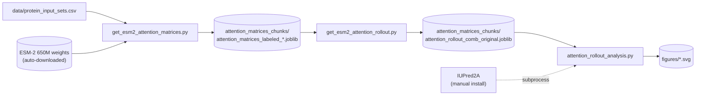
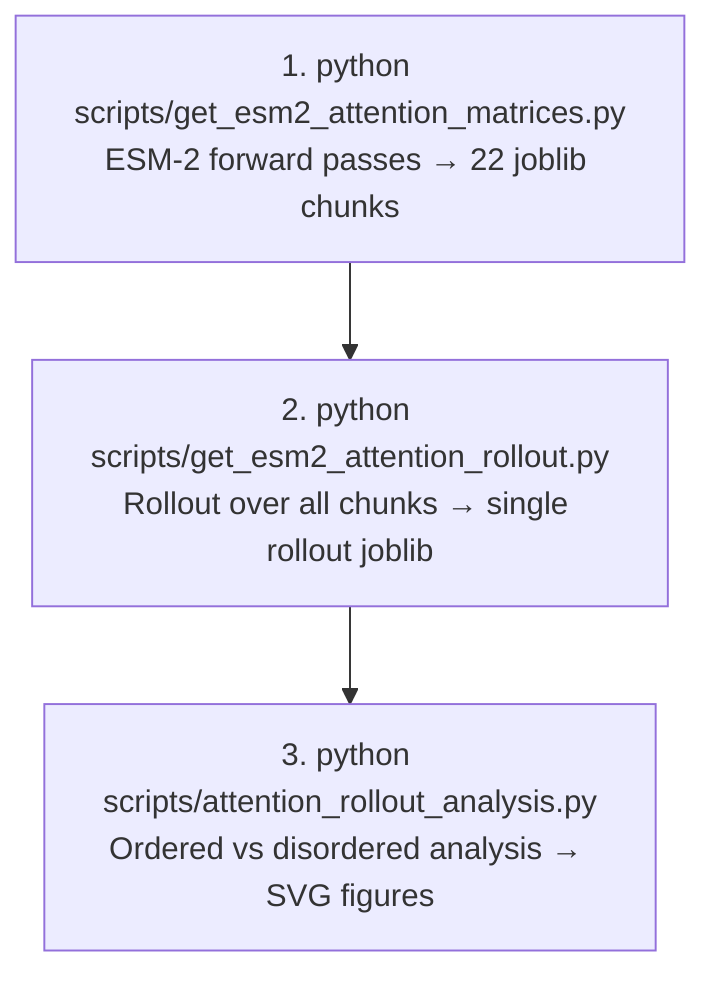

This page takes you from a fresh clone to your first complete ESM-2 attention analysis. `plm_interp` is the companion codebase for the paper *Mechanistic Interpretability of Protein Language Models Reveals Encoded Structural and Functional Properties of Intrinsically Disordered Proteins*: it extracts per-head attention matrices from ESM-2, compresses them via attention rollout, and compares the resulting signals between ordered (PDB-derived) and disordered (DisProt-derived) protein sets. By the end of this guide you will have a working `torch-gpu` environment, the single required manual configuration (IUPred2A), and the three-stage "Figure 1" workflow running end to end.

Sources: [README.md](README.md#L1-L6)

## The Pipeline You Are About to Run

Everything in the Quick Start revolves around one core data path. A single CSV of protein IDs and sequences feeds ESM-2 (the 650M-parameter `esm2_t33_650M_UR50D` checkpoint), which emits raw attention tensors; those are chunk-saved to disk, rolled out into per-protein summary matrices, and finally analyzed as ordered-vs-disordered sets with figures written as SVGs. Two auxiliary dependencies hang off this path: the IUPred2A disorder predictor (invoked as a subprocess during analysis) and the ESM-2 weights (auto-downloaded on first run).



Sources: [get_esm2_attention_matrices.py](scripts/get_esm2_attention_matrices.py#L29-L36), [get_esm2_attention_rollout.py](scripts/get_esm2_attention_rollout.py#L36-L56), [attention_rollout_analysis.py](scripts/attention_rollout_analysis.py#L40-L64)

## Prerequisites and Hardware

Before touching the terminal, confirm you have the following. The environment pins PyTorch `2.5.1+cu121` (CUDA 12.1 wheels), so an NVIDIA GPU with compatible drivers is strongly recommended; the scripts do fall back to CPU automatically, but per-protein attention extraction over the full committed dataset is GPU-bound work. Python 3.11 is the pinned interpreter (`cpython=3.11.13`).

| Requirement | Details | Why It Matters |
|---|---|---|
| Conda (Anaconda/Miniconda) | Any recent distribution | `environment.yml` is a conda env spec, not pip-only |
| NVIDIA GPU + CUDA driver | Drives pinned for CUDA 12.1 (`torch==2.5.1+cu121`) | Matrices script prints GPU name/memory at startup; CPU fallback exists but is slow |
| IUPred2A | Separate download from `https://iupred2a.elte.hu/` | Disorder segmentation; the only manual code edit in this guide |
| Internet access | For ESM-2 weights + external databases | Model checkpoint downloads on first forward pass; external datasets via download script |
| Disk headroom | Raw attention tensors are large | 22 joblib chunks (up to 200 proteins each) plus the rollout artifact |

Sources: [environment.yml](environment.yml#L1-L7), [environment.yml](environment.yml#L553), [get_esm2_attention_matrices.py](scripts/get_esm2_attention_matrices.py#L23-L27), [README.md](README.md#L18)

## Step 1 — Install the Environment

Three commands reproduce the authors' exact runtime. The environment is named `torch-gpu` and pulls from five channels (`conda-forge`, `bioconda`, `nvidia`, `defaults`, `pytorch`), mixing conda packages with a pip layer that carries the GPU-enabled PyTorch build and `fair-esm` (the package providing `esm.pretrained.esm2_t33_650M_UR50D`).

```bash
git clone https://github.com/lnaworsk/plm_interp.git
cd plm_interp
conda env create -f environment.yml
conda activate torch-gpu
```

Key packages resolved by this spec:

| Package | Version | Role |
|---|---|---|
| `python` | 3.11.13 | Interpreter |
| `torch` (pip) | 2.5.1+cu121 | Tensor engine with CUDA 12.1 |
| `fair-esm` (pip) | 2.0.0 | ESM-2 model loading and batch tokenization |
| `transformers` | 4.55.2 | HuggingFace models used by the analysis stage |
| `biopython` | 1.85 | FASTA parsing (`SeqIO`) |
| `cd-hit` | 4.8.1 | Sequence clustering (via bioconda) |

Sources: [README.md](README.md#L9-L16), [environment.yml](environment.yml#L1-L7), [environment.yml](environment.yml#L486), [environment.yml](environment.yml#L553)

## Step 2 — Configure IUPred2A (The One Manual Edit)

This is the step beginners most often miss. The shared utility module `scripts/attention_functions.py` shells out to IUPred2A via `subprocess` to compute per-residue disorder probabilities, and the path to the predictor is a **hardcoded absolute path** pointing to one of the authors' HPC home directories — it will not resolve on your machine. Download IUPred2A from `https://iupred2a.elte.hu/`, then edit line 25:

| | `scripts/attention_functions.py`, line 25 |
|---|---|
| **Before (as committed)** | `iupred_filepath = '/rds/user/ln399/hpc-work/llps/DeePhase_LN/__PREDICT_LN/tools/iupred2a.py'` |
| **After (your machine)** | `iupred_filepath = '/home/<you>/tools/iupred2a.py'` (wherever you unpacked IUPred2A) |

The functions that consume this path, `extract_IDR` and `extract_IDR_profile`, invoke `python <iupred_filepath> <tmp_fasta> long` as a subprocess — so both the path *and* a working `python` on your `PATH` are required at call time.

> [!TIP]
> Because every pipeline stage imports from `attention_functions.py` (`get_esm2_attention_rollout.py` imports `safe_load`/`attention_rollout`; `attention_rollout_analysis.py` uses a wildcard import), fixing line 25 **once** repairs the entire pipeline. The import itself is harmless — the path is only resolved when disorder-extraction functions actually execute.

Sources: [attention_functions.py](scripts/attention_functions.py#L18-L25), [attention_functions.py](scripts/attention_functions.py#L45-L51), [get_esm2_attention_rollout.py](scripts/get_esm2_attention_rollout.py#L10), [attention_rollout_analysis.py](scripts/attention_rollout_analysis.py#L8), [README.md](README.md#L18)

## Step 3 — Create Output Directories and Fetch External Data

Two runtime directories are referenced by the scripts but are **not present in the cloned repository** (they are excluded from git because they hold large generated artifacts). Both stages write files directly into these paths with no `os.makedirs` call, so the first run will crash on a missing directory unless you create them first:

```bash
mkdir -p attention_matrices_chunks figures
```

For input data, the repository uses a **two-tier data model**: derived datasets used by the paper are already committed under `data/` (e.g. `protein_input_sets.csv`, `pdb_disprot.fasta`, `clustered_input.fasta`), while large external downloads (NCBI gene2refseq, GRCh38 RefSeq proteome, IDRome tables, experimental SAXS data) are fetched on demand:

```bash
python scripts/esm2_interp_data.py
```

| Data Tier | Examples | How You Get It |
|---|---|---|
| Committed (derived) | `data/protein_input_sets.csv`, `pdb_disprot.fasta`, `clinvar_sequences.csv` | Already in your clone |
| Downloaded (live) | `gene2refseq`, `GRCh38_latest_protein_copy.faa`, IDRome DB | `python scripts/esm2_interp_data.py` |
| Never committed (regenerable) | Attention matrices, rollout matrices, figures | Produced by the pipeline below |

> [!TIP]
> The scripts resolve all data paths via `BASE_PATH = SCRIPT_DIR.parent`, so they work regardless of your current working directory — but the *output* directories are assumed to pre-exist. If you ever see `FileNotFoundError` on a `.joblib` dump or a figure `.svg` save, the cause is an absent `attention_matrices_chunks/` or `figures/` folder, not a code bug.

Sources: [get_esm2_attention_matrices.py](scripts/get_esm2_attention_matrices.py#L9-L10), [get_esm2_attention_matrices.py](scripts/get_esm2_attention_matrices.py#L76-L87), [attention_rollout_analysis.py](scripts/attention_rollout_analysis.py#L64), [README.md](README.md#L36-L48)

## Step 4 — Run Your First Analysis (the Figure 1 Workflow)

This is the minimal end-to-end run recommended in the README's *Reproducing Results* table for Figures 1–2. Execute the commands in order; each stage consumes the previous stage's joblib output.



What each stage actually does:

| Stage | Script | Behavior to Expect |
|---|---|---|
| 1. Attention extraction | `get_esm2_attention_matrices.py` | Loads ESM-2 650M to GPU, reads all proteins from `data/protein_input_sets.csv`, runs batches of 2 with `need_head_weights=True`, prints progress indices, saves a compressed `.joblib` chunk every 200 proteins |
| 2. Attention rollout | `get_esm2_attention_rollout.py` | Streams chunks 0–21, computes rollout per protein with `discard_ratio=0.9` and `head_fusion="mean"`, writes `attention_rollout_comb_original.joblib` |
| 3. Analysis | `attention_rollout_analysis.py` | Loads the rollout artifact, applies `publication.mplstyle`, splits proteins into PDB (ordered) vs DisProt (disordered) sets by ID substring, and saves figures (e.g. `figures/input_sets_seqlen_distribution.svg`) |

Sources: [README.md](README.md#L88-L96), [get_esm2_attention_matrices.py](scripts/get_esm2_attention_matrices.py#L36-L55), [get_esm2_attention_rollout.py](scripts/get_esm2_attention_rollout.py#L36-L56), [attention_rollout_analysis.py](scripts/attention_rollout_analysis.py#L32-L45)

## What Success Looks Like

After the three stages complete, your repository gains the artifacts below alongside the committed files. Stage 1's chunks are named `attention_matrices_labeled_{chunk}_{model_type}.joblib` where `model_type` is always `'original'`; the rollout stage expects exactly chunks 0 through 21, matching the committed dataset size at a save interval of 200.

```
plm_interp/
├── attention_matrices_chunks/        # ← you created this
│   ├── attention_matrices_labeled_0_original.joblib
│   ├── ...
│   ├── attention_matrices_labeled_21_original.joblib
│   └── attention_rollout_comb_original.joblib
├── data/                             # committed inputs + downloaded externals
├── figures/                          # ← you created this; SVG outputs land here
│   └── input_sets_seqlen_distribution.svg
├── scripts/                          # all analysis code
├── environment.yml
├── mlp_final.pt                      # pretrained Rg predictor (used by rg_mlp.py)
└── publication.mplstyle              # matplotlib style, auto-applied by analysis
```

Sources: [get_esm2_attention_matrices.py](scripts/get_esm2_attention_matrices.py#L78-L87), [get_esm2_attention_rollout.py](scripts/get_esm2_attention_rollout.py#L56), [attention_rollout_analysis.py](scripts/attention_rollout_analysis.py#L64), [README.md](README.md#L23-L32)

## Tuning Knobs and Troubleshooting

The pipeline exposes a small set of hardcoded-but-editable constants. For beginners, `batch_size` is the one worth knowing first — the authors' own comment marks it as a memory-budget dial.

| Knob | Default | Location | Effect |
|---|---|---|---|
| `batch_size` | 2 | `get_esm2_attention_matrices.py` (line 45) | Proteins per forward pass; raise if GPU memory allows, lower if you hit OOM |
| `save_interval` | 200 | `get_esm2_attention_matrices.py` (line 42) | Proteins per joblib chunk; changing it breaks the rollout stage's fixed 22-chunk loop |
| `discard_ratio` | 0.9 | `get_esm2_attention_rollout.py` (line 48) | Fraction of lowest-attention tokens dropped during rollout |
| `head_fusion` | `"mean"` | `get_esm2_attention_rollout.py` (line 48) | How per-head attention is combined before rollout |
| `device` | auto | both GPU scripts | `cuda` if available, else `cpu` |

Common first-run failures and fixes:

| Symptom | Cause | Fix |
|---|---|---|
| `FileNotFoundError` when dumping `attention_matrices_labeled_*.joblib` | `attention_matrices_chunks/` missing | `mkdir -p attention_matrices_chunks figures` (Step 3) |
| Script hangs or errors inside `extract_IDR` | IUPred2A path still points to the authors' HPC | Edit `iupred_filepath`, line 25 of `scripts/attention_functions.py` (Step 2) |
| `torch.cuda.is_available()` prints `False` | CPU-only torch build or missing CUDA 12.1 driver | Verify driver supports CUDA 12.1; the pinned wheels are `torch==2.5.1+cu121` |
| CUDA out of memory during stage 1 | Batch too large or long sequences | Reduce `batch_size` (line 45); the script already calls `torch.cuda.empty_cache()` each batch |
| Rollout stage fails loading chunk *i* | Stage 1 interrupted mid-run, or `save_interval` changed | Re-run stage 1 unchanged; chunk indices 0–21 must all exist |

Sources: [get_esm2_attention_matrices.py](scripts/get_esm2_attention_matrices.py#L42-L45), [get_esm2_attention_rollout.py](scripts/get_esm2_attention_rollout.py#L48), [environment.yml](environment.yml#L553)

## Where to Go Next

With the Figure 1 workflow verified on your machine, follow the natural reading order of this documentation set:

- [External Data Acquisition](3-external-data-acquisition) — a deep guide to `esm2_interp_data.py` and the committed-vs-live data trade-offs, including how to pin the exact paper datasets for reproducibility.
- [Reproducing Paper Figures](4-reproducing-paper-figures) — command sequences for Figures 3–5 (ClinVar residues, contact maps, the Rg predictor with `mlp_final.pt`).
- [Script Pipeline Architecture](5-script-pipeline-architecture) — how the fourteen scripts in `scripts/` relate and share state.
- [Attention Matrix Extraction](8-attention-matrix-extraction) — the internals of stage 1 you just ran: tokenization, `need_head_weights`, and chunked serialization.
- [Attention Rollout Algorithm](9-attention-rollout-algorithm) — the math behind `discard_ratio=0.9` and `head_fusion="mean"` from stage 2.
- [Disorder Scoring with IUPred2A](10-disorder-scoring-with-iupred2a) — why the line-25 edit in Step 2 matters biologically.