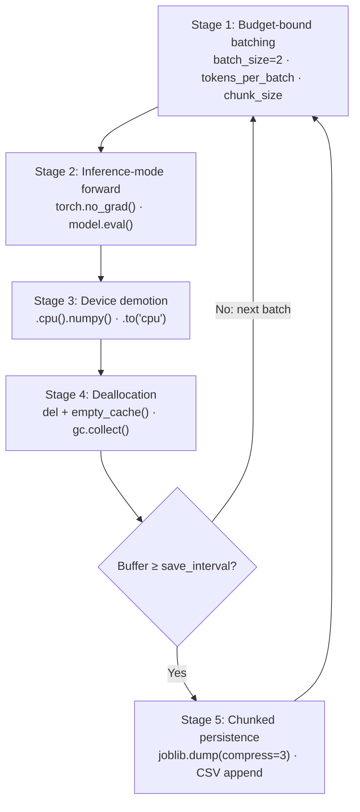
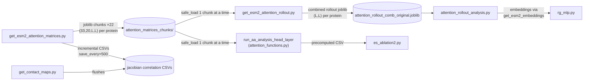

Every analysis stage in this repository materializes tensors whose sizes scale quadratically — or worse — with protein length: full attention tensors across 33 layers × 20 heads, categorical Jacobians of shape (L, 20, L, 20), and L×L rollout matrices held for thousands of proteins. Left unchecked, these artifacts would exhaust GPU memory within a single batch and exceed host RAM within a few hundred proteins. This page documents the *memory discipline* that makes the pipeline feasible on commodity hardware: a repeatable lifecycle of budget-bound batching, inference-mode guards, device demotion, explicit unbinding, and chunked disk persistence. It explains the engineering substrate beneath the scientific methods described in [Attention Matrix Extraction](8-attention-matrix-extraction), [Attention Rollout Algorithm](9-attention-rollout-algorithm), and [Categorical Jacobian Contact Maps](14-categorical-jacobian-contact-maps).

Sources: [get_esm2_attention_matrices.py](scripts/get_esm2_attention_matrices.py#L40-L45), [get_contact_maps.py](scripts/get_contact_maps.py#L56-L74)

## The Tensor Arithmetic That Motivates Everything

The single number that governs this codebase's design is the size of a per-protein attention tensor. With `need_head_weights=True`, ESM-2 returns all layer-head matrices for a batch, and the extraction script immediately slices out each protein's (33, 20, L_pad, L_pad) matrix before moving it to host memory. At the model's 1022-residue context limit (padded to 1024), that single float32 array is 660 × 1024² × 4 bytes ≈ 2.8 GB — so even a batch of two saturates a modest GPU card, and 200 such proteins cannot coexist in RAM. The table below quantifies each artifact class; note how the Jacobian would grow to ~3.3 GB per protein at full length, which is precisely why the contact-map pipeline caps inputs at 160 residues.

| Artifact | Shape (per protein) | Dtype | Size @ L=160 | Size @ L=1022 | Producer |
|---|---|---|---|---|---|
| Raw attention tensor | (33, 20, L_pad, L_pad) | float32 | ~68 MB | ~2.8 GB | [get_esm2_attention_matrices.py](scripts/get_esm2_attention_matrices.py#L54-L66) |
| Categorical Jacobian | (L, 20, L, 20) | float64 | ~82 MB | ~3.3 GB | [get_contact_maps.py](scripts/get_contact_maps.py#L57-L74) |
| Contact map | (L, L) | float64 | ~0.2 MB | ~8.4 MB | [get_contact_maps.py](scripts/get_contact_maps.py#L76-L86) |
| Attention rollout | (L, L) | float32 | ~0.1 MB | ~4.2 MB | [attention_functions.py](scripts/attention_functions.py#L156-L218) |
| Mean-pooled embedding | (1280,) | float32 | ~0.5 KB | ~5.1 KB | [attention_functions.py](scripts/attention_functions.py#L419-L423) |

Sources: [get_esm2_attention_matrices.py](scripts/get_esm2_attention_matrices.py#L45-L57), [get_contact_maps.py](scripts/get_contact_maps.py#L95-L107)

The architecture follows directly from this table: the pipeline never holds the full corpus of attention matrices in memory. Instead, each stage produces a *derived, compressed artifact* that downstream stages consume in bounded slices — the full-attention tensors (gigabytes per protein) exist only transiently and are reduced to rollouts and per-head statistics (megabytes) before any cross-protein analysis runs.

Sources: [get_esm2_attention_rollout.py](scripts/get_esm2_attention_rollout.py#L38-L56), [attention_functions.py](scripts/attention_functions.py#L350-L386)

## The Five-Stage Memory Lifecycle

All heavy scripts converge on the same five-stage discipline, executed once per batch: (1) tokenize under a budget, (2) forward under `torch.no_grad()`, (3) demote results from GPU to host, (4) unbind and collect, and (5) persist in chunks. The extraction script is the canonical implementation — every line of the loop maps to one stage of the lifecycle.

This lifecycle is *composable*: the rollout stage re-enters it at stage 1 with joblib chunks as its input budget, and the MLP training loop applies a variant of it with a `DataLoader` over precomputed embeddings. The invariant across all instantiations is that no single stage ever materializes more than one batch's worth of unreduced GPU state.

Sources: [get_esm2_attention_matrices.py](scripts/get_esm2_attention_matrices.py#L47-L87), [get_esm2_attention_rollout.py](scripts/get_esm2_attention_rollout.py#L36-L54)

## GPU-Side Budgeting: The Four Knobs

The repository controls peak GPU memory through four independent knobs, each tuned to its workload's tensor shape. The extraction script fixes a sequence-count budget (`batch_size = 2` — annotated "Or whatever fits your memory budget") because attention tensors scale with the *longest* sequence in the batch. Embedding extraction instead uses a *token-count* budget (`tokens_per_batch`) via `FastaBatchedDataset.get_batch_indices`, which packs length-sorted sequences into batches of bounded total tokens — far more efficient when the corpus has mixed lengths. The Jacobian stage adds a third knob, `chunk_size`, that bounds how many mutated copies of a sequence enter one forward pass. The ablation sweep raises the token budget to 8192 because its per-protein output is only a mean-pooled 1280-dim vector, leaving ample headroom.

| Knob | Value(s) | Location | Bounds what |
|---|---|---|---|
| `batch_size` | 2 sequences | [get_esm2_attention_matrices.py](scripts/get_esm2_attention_matrices.py#L45) | (33, 20, L_pad, L_pad) attention tensors |
| `tokens_per_batch` | 4096 / 8192 tokens | [attention_functions.py](scripts/attention_functions.py#L383-L401), [es_ablation2.py](scripts/es_ablation2.py#L22) | transformer activations during embedding forward passes |
| `chunk_size` | 150 positions | [get_contact_maps.py](scripts/get_contact_maps.py#L57) | mutated-copy batches for Jacobian computation |
| Input length caps | ≤ 160 (Jacobian) · 1022 (embeddings) · 1024 (perplexity) | [get_contact_maps.py](scripts/get_contact_maps.py#L95-L107), [rg_mlp.py](scripts/rg_mlp.py#L32-L44), [esm2_ppl_by_disorder.py](scripts/esm2_ppl_by_disorder.py#L43-L68) | asymptotic size of every derived tensor |

Sources: [attention_functions.py](scripts/attention_functions.py#L401-L408), [es_ablation2.py](scripts/es_ablation2.py#L296-L318)

### Case Study: Chunking the Categorical Jacobian

The contact-map script contains a documented evolution from a memory-naive to a memory-aware implementation, and the delta illustrates the chunked-compute pattern in its purest form. The original `get_categorical_jacobian` tiles the tokenized sequence into 20 copies and loops over every residue position, issuing **one forward pass per position** — L sequential GPU round-trips, each cloning the tiled input. The optimized `get_categorical_jacobian_ln(seq, chunk_size=150)` instead precomputes wild-type logits once, then for each chunk constructs a (chunk_len × 20)-sequence batch via `x.repeat(chunk_len * 20, 1)` and scatters all point mutations simultaneously using advanced indexing before a single forward pass, reshaping the logits back into the preallocated host array `fx_h`.

| | Original `get_categorical_jacobian` | Optimized `get_categorical_jacobian_ln` |
|---|---|---|
| Forward passes per protein | L (one per residue) | ⌈L / 150⌉ |
| Peak GPU batch | 20 sequences × L passes | chunk_len × 20 sequences, transient |
| Host array | grown per-position (`fx_h[n] = f(x_h)`) | preallocated once, filled per-chunk |
| Transfer pattern | repeated small CPU↔GPU round-trips | one block per chunk: `.detach().cpu().numpy().reshape(chunk_len, 20, ln, 20)` |

> [!TIP]
> The chunked Jacobian is a deliberate memory-throughput trade: it reduces passes from L to ⌈L/150⌉ but inflates the transient GPU batch to 3,000 padded sequences per chunk (~486,000 tokens for L=160). Raising `chunk_size` beyond 150 trades host-array fill efficiency for quadratic activation growth inside the 33-layer forward pass — the default is the sweet spot for the pipeline's ≤160-residue cap.

Sources: [get_contact_maps.py](scripts/get_contact_maps.py#L33-L54), [get_contact_maps.py](scripts/get_contact_maps.py#L56-L74)

## Host-Side Hygiene: Demotion, Unbinding, and Collection

Once a batch's results exist, the pipeline moves them off the GPU immediately and never round-trips them back. Demotion is consistently expressed as `.cpu().numpy()` (attention slices, Jacobian chunks, wild-type logits) or `.to("cpu")` (per-layer representations), so the GPU frees its copy at the earliest possible moment and only plain NumPy arrays accumulate on the host. Extraction of scalar results follows the same principle — the perplexity script collapses the masked-LM loss via `outputs.loss.item()` inside `torch.no_grad()`, releasing the graph-free tensor as soon as the float is extracted.

Sources: [get_esm2_attention_matrices.py](scripts/get_esm2_attention_matrices.py#L61-L66), [get_contact_maps.py](scripts/get_contact_maps.py#L60-L72), [attention_functions.py](scripts/attention_functions.py#L409-L417), [esm2_ppl_by_disorder.py](scripts/esm2_ppl_by_disorder.py#L64-L68)

Deallocation is performed in three complementary layers, because PyTorch's caching allocator and Python's cyclic GC each hold memory the others cannot see. First, explicit `del` unbinds batch-scope names (`results`, `attentions`, `batch_tokens`, and per-iteration objects like `traj`, `jac`, `md_df`). Second, `torch.cuda.empty_cache()` returns the freed blocks to the CUDA driver rather than hoarding them in PyTorch's cache. Third, `gc.collect()` runs at chunk boundaries — after joblib dumps, and crucially inside `safe_load`, which wraps every joblib load in the streaming consumers so that garbage from the *previous* chunk is swept before the next multi-gigabyte file is read.

| Layer | API | Scope of effect | Where used |
|---|---|---|---|
| Name unbinding | `del obj` | drops last reference → frees host tensor | [get_contact_maps.py](scripts/get_contact_maps.py#L263-L270), [get_esm2_attention_rollout.py](scripts/get_esm2_attention_rollout.py#L49-L54) |
| Allocator release | `torch.cuda.empty_cache()` | returns cached GPU blocks to driver | [get_esm2_attention_matrices.py](scripts/get_esm2_attention_matrices.py#L74) |
| Cycle collection | `gc.collect()` | breaks reference cycles across interpreter | [get_esm2_attention_matrices.py](scripts/get_esm2_attention_matrices.py#L82), [attention_functions.py](scripts/attention_functions.py#L249-L253) |

> [!TIP]
> The extraction script's deletion loop iterates `for obj in [...]: del locals()[obj]`. This only works because the script runs at *module scope*, where `locals()` returns the live module `__dict__` (i.e., globals) — deletion genuinely unbinds the name. Inside a function body, `locals()` returns a snapshot dict and this idiom would silently free nothing; use plain `del name` statements there instead.

Sources: [get_esm2_attention_matrices.py](scripts/get_esm2_attention_matrices.py#L70-L82), [get_contact_maps.py](scripts/get_contact_maps.py#L263-L276), [attention_functions.py](scripts/attention_functions.py#L249-L253)

## Chunked Persistence and Streaming Consumers

Because no single process can hold the corpus, persistence itself is chunked at production time: the extraction script flushes its in-memory `all_results` dictionary to `attention_matrices_chunks/attention_matrices_labeled_{n}_original.joblib` (with `compress=3` — essential, since a chunk of 200 full-length proteins would occupy hundreds of gigabytes uncompressed) every `save_interval = 200` proteins, then resets the buffer and increments the chunk counter. The contact-map pipeline applies the same idea to tabular results with `save_every = 500`: correlation rows and upper-triangle contact frames are appended to per-batch CSVs with explicit header/mode logic, then the buffers are `.clear()`ed so Python's small-object arenas stay bounded.

Sources: [get_esm2_attention_matrices.py](scripts/get_esm2_attention_matrices.py#L42-L43), [get_esm2_attention_matrices.py](scripts/get_esm2_attention_matrices.py#L76-L87), [get_contact_maps.py](scripts/get_contact_maps.py#L240-L262)

The chunk layout defines the consumption contract for every downstream stage. `get_esm2_attention_rollout.py` iterates `range(0, 22)` — 22 chunks × 200 proteins ≈ 4,400 proteins — loading exactly one joblib file at a time through `safe_load`, converting each protein's matrix to a CPU tensor, computing its (L, L) rollout, and deleting per-protein and per-chunk references as it goes. The result shrinks the corpus from gigabytes-per-protein to megabytes-per-protein, which is why the final combined rollout file can be loaded in one shot by the figure-generation stage. Per-head amino-acid statistics follow the identical streaming protocol over the same chunks, deleting both the loaded chunk and each of the 33 × 20 = 660 per-head slices as they are consumed.

Sources: [get_esm2_attention_rollout.py](scripts/get_esm2_attention_rollout.py#L36-L56), [attention_functions.py](scripts/attention_functions.py#L362-L386), [attention_rollout_analysis.py](scripts/attention_rollout_analysis.py#L39-L40)

Two supporting hygiene practices complete the picture. Embedding extraction writes sequences to a `NamedTemporaryFile` FASTA and removes it in a `try/finally` block, and the contact-map script deletes downloaded trajectory temp files immediately after `md.load` — so scratch storage, like tensors, follows a strict allocate-consume-release lifecycle. Meanwhile, the rollout math itself defaults to `device='cpu'`, keeping 33 sequential L×L matmuls off the GPU entirely; since rollout output is two orders of magnitude smaller than its input, this placement avoids competing with the extraction job's GPU budget.

Sources: [attention_functions.py](scripts/attention_functions.py#L383-L401), [attention_functions.py](scripts/attention_functions.py#L421-L426), [attention_functions.py](scripts/attention_functions.py#L156-L218)

## Pattern Trade-offs

The four memory patterns are not interchangeable — each buys bounded memory by spending something else, and the pipeline's correctness depends on pairing each workload with the right pattern. Understanding the exchange rates below is what allows the knobs in the table earlier to be retuned safely on different hardware.

| Pattern | Buys | Costs | Failure mode if abused |
|---|---|---|---|
| Budget-bound batching (`batch_size`, `tokens_per_batch`) | O(batch) peak GPU memory | launch overhead per small batch | OOM on long-sequence batches if budget raised blindly |
| Chunked compute (`chunk_size=150`) | bounded transient Jacobian batch | redundant prefix computations per chunk; repeated host↔GPU transfers | activation blow-up if chunk exceeds forward-pass capacity |
| Chunked persistence (`save_interval=200`, `compress=3`) | recovery points; bounded resident corpus | CPU compression time; N-file load orchestration downstream | RAM exhaustion if consumers load all chunks eagerly |
| Eager demotion + `del`/`empty_cache`/`gc.collect()` | earliest-possible release on both devices | minor CPU-sync latency; code verbosity | stale references keep GPU blocks cached after "freeing" |

Sources: [get_esm2_attention_matrices.py](scripts/get_esm2_attention_matrices.py#L45-L87), [get_contact_maps.py](scripts/get_contact_maps.py#L56-L74)

## Tuning Guidance and Pitfalls

When porting this pipeline to new hardware, retune in a fixed order: start with the input length caps (they set asymptotic bounds no other knob can recover), then the batch/token budgets (verify against the GPU memory the script itself prints at startup), and only then the chunk intervals (they trade RAM against file count). Three pitfalls recur in practice. First, watch *padded* length, not sequence length — attention tensors are sized by the batch's padded dimension, so one 1022-residue protein dominates a batch's cost regardless of its partner. Second, respect dtype: the Jacobian array is NumPy float64 by default, doubling every footprint in the arithmetic table, while PyTorch outputs are float32. Third, remember that `np.copy` guards in `do_apc`/`get_contacts` and the `args[0].clone()` in ablation hooks are deliberate — in-place aliasing across those transformations would silently corrupt downstream statistics.

The natural next readings are [Attention Head Ablation Study](18-attention-head-ablation-study) for how hook-based mutation interacts with this budget (the `try/finally` around every ablated forward pass guarantees hook cleanup even when a pass OOMs), and [Derived Versus Live Data Reproducibility](22-derived-versus-live-data-reproducibility) for why the ablation sweep consumes a precomputed attention CSV rather than re-running the 660-slice-per-protein analysis live.

Sources: [get_esm2_attention_matrices.py](scripts/get_esm2_attention_matrices.py#L19-L32), [get_contact_maps.py](scripts/get_contact_maps.py#L76-L86), [es_ablation2.py](scripts/es_ablation2.py#L296-L318)

## Where to Go Next

This page covered the *how* of memory-bound engineering; the *what* and *why* live elsewhere in the catalog. For the scientific content flowing through these tensors, proceed to [Attention Matrix Extraction](8-attention-matrix-extraction) and [Attention Rollout Algorithm](9-attention-rollout-algorithm), then [Categorical Jacobian Contact Maps](14-categorical-jacobian-contact-maps) and [MLP Radius of Gyration Predictor](17-mlp-radius-of-gyration-predictor) for the two consumers that define the Jacobian and embedding memory contracts. For the adjacent engineering practice of keeping the corpus lean in the first place — which directly reduces the number of chunks the lifecycle must process — see [Dataset Curation and CD-HIT Clustering](21-dataset-curation-and-cd-hit-clustering).