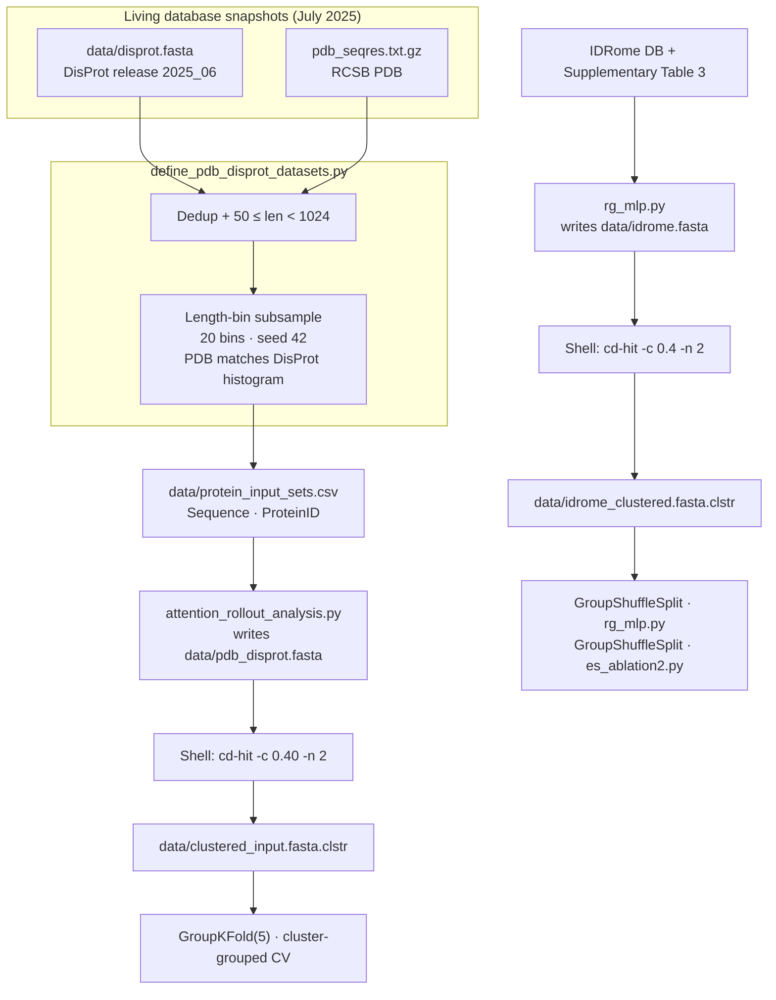

This page explains the engineering practices that turn raw database dumps into statistically defensible input sets for the `plm_interp` analyses. It covers two coupled mechanisms: **rule-based dataset curation** in `define_pdb_disprot_datasets.py` (deduplication, length filtering, length-distribution matching) and **sequence-similarity clustering via CD-HIT**, which is executed externally and whose `.clstr` output files drive leakage-safe, cluster-grouped train/test splits in the attention, Rg prediction, and ablation pipelines. For how the curated sequences feed into embeddings and attention extraction, see [Attention Matrix Extraction](8-attention-matrix-extraction); for the raw-download mechanics, see [External Data Acquisition](3-external-data-acquisition).

## Why Curation Exists: The Homology Leakage Problem

Both protein databases used in this repo are *living databases*: PDB sequences are updated weekly and DisProt has no version-pinned URL, so a download performed today will not match the July 2025 snapshots used in the paper. The repo's answer is to commit the **derived** sequence files (`data/protein_input_sets.csv`, `data/pdb_disprot.fasta`, `data/clustered_input.fasta`, `data/clustered_input.fasta.clstr`) so that reproduction never depends on re-deriving from a moving target. The curation scripts remain in the repo so you can audit every transformation between the raw dump and the committed artifact.

Sources: [esm2_interp_data.py](/scripts/esm2_interp_data.py#L8-L27), [README.md](/README.md#L55-L66)

The second motivation is subtler: protein databases are full of near-duplicate homologs, fragments, and isoforms. If two 95%-identical sequences land one in training and one in testing, a model or statistical test can score well by memorizing family-level signatures rather than learning generalizable structure. CD-HIT clustering at a **40% sequence identity threshold** partitions sequences into homolog families, and those cluster labels become the *grouping key* for every split in the repo — sequences from the same cluster are never separated across a split boundary.

Sources: [attention_rollout_analysis.py](/scripts/attention_rollout_analysis.py#L168-L177), [rg_mlp.py](/scripts/rg_mlp.py#L190-L203)

## Stage 1: Rule-Based Curation in `define_pdb_disprot_datasets.py`

The curation script applies a parallel filter chain to the disordered (DisProt) and ordered (PDB) sets so that downstream group comparisons are not confounded by trivial artifacts. DisProt sequences are loaded via the `read_fasta` helper, deduplicated on the exact sequence string, and restricted to the 50–1023 residue window (1024 is ESM-2's positional limit including special tokens). The PDB branch adds one extra rule: sequences containing ambiguous or non-canonical residues (`X`, `U`, `O`) are dropped, since these tokens are unrepresentable in ESM-2's vocabulary.

| Filter | DisProt branch | PDB branch |
|---|---|---|
| Source | `data/disprot.fasta` (release 2025_06) | `pdb_seqres.txt.gz` (RCSB derived data) |
| Deduplication | `drop_duplicates(subset='Sequence')` | `drop_duplicates(subset='sequence')` |
| Length window | `50 < seq_len < 1024` | `50 < seq_len < 1024` |
| Residue alphabet | — | Drop sequences matching `X\|U\|O` |
| Group label | `'Disprot'` | `'PDB'` |

Sources: [define_pdb_disprot_datasets.py](/scripts/define_pdb_disprot_datasets.py#L16-L35), [attention_functions.py](/scripts/attention_functions.py#L28-L37)

The most consequential step is **length-distribution matching**. Disordered proteins skew long, so a naive comparison of PDB vs DisProt attention could just be measuring sequence-length effects. The script bins DisProt lengths into 20 equal-width bins spanning the DisProt range, assigns each PDB sequence to a bin via `np.digitize`, then subsamples PDB per bin — sampling with `random_state=42` when supply exceeds demand, taking all candidates otherwise — until the ordered set mirrors the disordered length histogram. Every curated sequence then receives a synthetic identifier (`disprot_protein{i}` / `pdb_protein{i}`) that permanently replaces database IDs; all later scripts and outputs key off these `ProteinID` strings.

Sources: [define_pdb_disprot_datasets.py](/scripts/define_pdb_disprot_datasets.py#L37-L64)

> [!TIP]
> The length-matching loop iterates over `bin_counts.items()` — the *DisProt* bin occupancy — not the PDB bins. This asymmetry is deliberate: DisProt defines the target distribution, PDB is subsampled to match it, so any cross-group difference in attention statistics cannot be explained by length composition.

## Stage 2: External CD-HIT Clustering and the `.clstr` Contract

CD-HIT is never invoked from Python — both pipelines write a plain FASTA file, pause with a comment showing the exact shell command, and expect the operator to run it externally. The PDB/DisProt branch writes `data/pdb_disprot.fasta` inside `attention_rollout_analysis.py`; the IDRome branch writes `data/idrome.fasta` inside `rg_mlp.py`. Both use identical parameters: `-c 0.40` (identity threshold) and `-n 2` (word size).

| Invocation site | Input FASTA | Cluster output | Command |
|---|---|---|---|
| `attention_rollout_analysis.py` | `data/pdb_disprot.fasta` | `data/clustered_input.fasta` + `.clstr` | `cd-hit -i pdb_disprot.fasta -o clustered_input.fasta -c 0.40 -n 2` |
| `rg_mlp.py` | `data/idrome.fasta` | `data/idrome_clustered.fasta` + `.clstr` | `cd-hit -i idrome.fasta -o idrome_clustered.fasta -c 0.4 -n 2` |

Sources: [attention_rollout_analysis.py](/scripts/attention_rollout_analysis.py#L139-L147), [rg_mlp.py](/scripts/rg_mlp.py#L161-L165)

The Python side consumes only the `.clstr` file, and the parsing logic (duplicated verbatim in three scripts) encodes CD-HIT's output grammar: a `>Cluster N` header switches the current cluster, then each member line carries the member index, its length in `aa`, the FASTA ID wrapped in `>` and `...`, and either `*` for the cluster representative or `at XX.XX%` for the identity to that representative. The parser extracts the ID by splitting on whitespace, stripping the leading `>` and trailing `...`, and builds a flat `seq_id → cluster` dictionary.

| `.clstr` line fragment | Meaning |
|---|---|
| `>Cluster 7` | Cluster identifier header |
| `2    956aa, >disprot_protein1124... *` | Representative (centroid) sequence, 956 aa |
| `1    162aa, >disprot_protein1967... at 43.21%` | Member at 43.21% identity to representative |
| `1    405aa, >disprot_protein1123... at 100.00%` | Member identical over the aligned region |

Sources: [clustered_input.fasta.clstr](/data/clustered_input.fasta.clstr#L1-L40), [attention_rollout_analysis.py](/scripts/attention_rollout_analysis.py#L150-L163)

> [!TIP]
> Although `define_pdb_disprot_datasets.py` already deduplicated exact sequences, the committed `.clstr` still contains members at `100.00%` — these are sequences identical over a shared region but of different lengths (e.g., a 69 aa fragment inside a 929 aa protein). The 40% threshold is precisely what catches these containment relationships that exact-string dedup cannot.

> [!TIP]
> The `-n 2` word size is not optional tuning: CD-HIT's documentation requires word size 2 for identity thresholds in the 40–50% band. Using the default `-n 5` (for ≥80% thresholds) at 40% identity would shatter clusters and silently reintroduce homolog leakage into every grouped split downstream.

## Stage 3: Cluster Labels as Grouping Keys in Downstream Splits

Three independent analyses consume the cluster dictionaries, each translating them into a different scikit-learn grouping strategy:

| Consumer script | Cluster file | Split mechanism | Purpose |
|---|---|---|---|
| `attention_rollout_analysis.py` | `clustered_input.fasta.clstr` | `GroupKFold(n_splits=5)` with `groups=cluster` | Leakage-safe 5-fold CV for the ordered-vs-disordered logistic classifier |
| `rg_mlp.py` | `idrome_clustered.fasta.clstr` | Two nested `GroupShuffleSplit`s (80/20, then 90/10) | Cluster-disjoint train/val/test for the Rg MLP |
| `es_ablation2.py` | `idrome_clustered.fasta.clstr` | `GroupShuffleSplit(test_size=0.2)` | Cluster-disjoint hold-out set for head-ablation evaluation |

Sources: [attention_rollout_analysis.py](/scripts/attention_rollout_analysis.py#L165-L177), [rg_mlp.py](/scripts/rg_mlp.py#L166-L199), [es_ablation2.py](/scripts/es_ablation2.py#L93-L116)

In the attention analysis, the parsed clusters are merged back onto the embedding frame via `ProteinID` and cast to integers, then passed as the `groups` argument to `cross_val_score` with `GroupKFold` — the printed summary explicitly reports accuracy "over N clusters" to make the effective sample size transparent. In the Rg pipeline, the same cluster column feeds a two-stage split: an outer 80/20 train-holdout split followed by an inner 90/10 train-validation split, both grouped by cluster, so no homolog family ever straddles a boundary while the MLP trains on mean-pooled ESM-2 embeddings.

Sources: [attention_rollout_analysis.py](/scripts/attention_rollout_analysis.py#L165-L177), [rg_mlp.py](/scripts/rg_mlp.py#L185-L203)

## The Full Curation-to-Clustering Architecture

Sources: [define_pdb_disprot_datasets.py](/scripts/define_pdb_disprot_datasets.py#L16-L64), [attention_rollout_analysis.py](/scripts/attention_rollout_analysis.py#L139-L177), [rg_mlp.py](/scripts/rg_mlp.py#L156-L199)

## Re-running Curation Versus Using the Committed Sets

Because the raw sources drift weekly, the repo supports two workflows. To reproduce paper numbers, skip `define_pdb_disprot_datasets.py` entirely and use the committed derived files (`data/protein_input_sets.csv`, `data/pdb_disprot.fasta`, both `.clstr` files) — this is the default path, and `clinvar_expanded.py` exposes the analogous `derived=True` flag for its dataset. To refresh the datasets against current database contents, download the raw dumps via `esm2_interp_data.py`, re-run curation, re-run CD-HIT with the documented parameters, and commit the new derived artifacts as a snapshot. The trade-off between these modes — and the snapshot-vs-live decision framework — is treated in depth in [Derived Versus Live Data Reproducibility](22-derived-versus-live-data-reproducibility).

Sources: [esm2_interp_data.py](/scripts/esm2_interp_data.py#L20-L34), [esm2_interp_data.py](/scripts/esm2_interp_data.py#L240-L246), [README.md](/README.md#L25-L29)

## Where to Go Next

The curated, clustered sets are the substrate for every analysis in this repo: the attention matrices are extracted from `protein_input_sets.csv` in [Attention Matrix Extraction](8-attention-matrix-extraction); the cluster-grouped classifier that consumes `clustered_input.fasta.clstr` is analyzed in [Ordered Versus Disordered Comparison](12-ordered-versus-disordered-comparison); the cluster-split Rg MLP is detailed in [MLP Radius of Gyration Predictor](17-mlp-radius-of-gyration-predictor), with its cluster-hold-out evaluation extended in [Attention Head Ablation Study](18-attention-head-ablation-study).