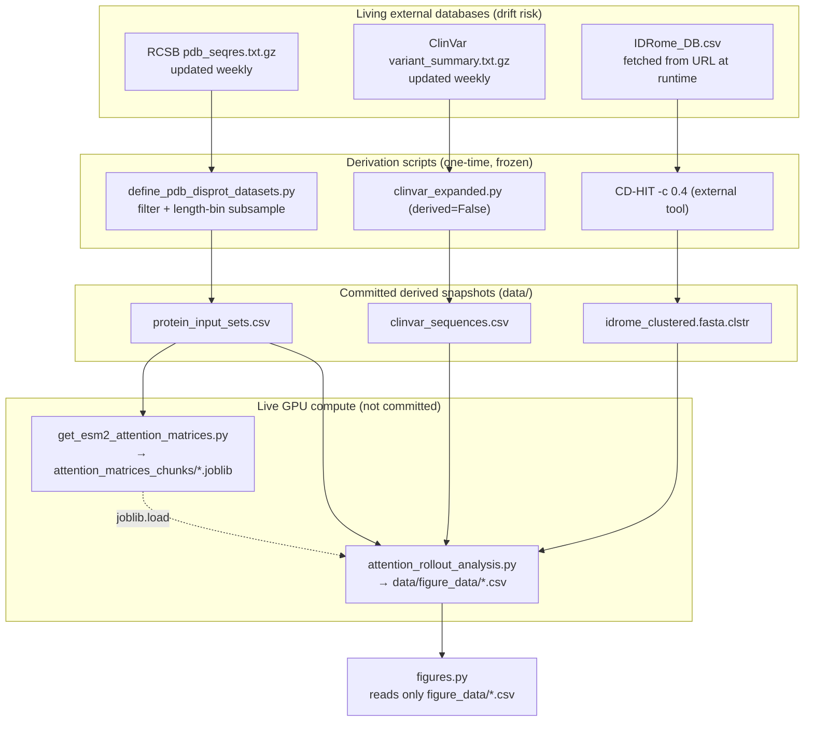

Every scientific repository faces a tension: committing data makes results reproducible but bloats the repository, while fetching data live keeps the repo lean but exposes results to upstream drift. `plm_interp` resolves this tension with an explicit, two-regime architecture: **derived snapshots** are frozen into the repo at filter boundaries, while everything downstream of expensive GPU compute or unstable external sources remains **live** and must be recomputed. This page explains how that split is implemented, where the runtime switch points live, and how to choose the correct reproduction path for your goals.

## The Two Data Regimes

The repository's `data/` directory serves a dual role, stated directly in the README: it holds raw data inputs to analyses *as well as* summary data generated by scripts. The critical architectural insight is that not all committed files are equal — some are **frozen provenance snapshots** (the exact filtered sequences used in the paper), some are **staging buffers** for runtime intermediates, and some raw inputs only materialize after running the download orchestrator. Meanwhile, the highest-volume artifacts — attention matrices serialized as joblib chunks — are categorically excluded from version control and must be regenerated on GPU hardware.

Sources: [README.md](/README.md#L18-L19), [README.md](/README.md#L29-L34), [README.md](/README.md#L44-L46)

The codebase organizes every data artifact into one of four tiers, each with distinct guarantees:

| Tier | Examples | Committed? | Reproducibility guarantee |
|---|---|---|---|
| **Frozen derived snapshot** | `protein_input_sets.csv`, `clinvar_sequences.csv`, `pdb_disprot.fasta`, `idrome_clustered.fasta.clstr` | Yes | Byte-identical inputs to the paper |
| **Raw external source** | `variant_summary.txt.gz`, `pdb_seqres.txt.gz`, `Supplementary_Table_3.xlsx` | No | Drifts with upstream updates (weekly for PDB/ClinVar) |
| **Live compute output** | `attention_matrices_chunks/*.joblib`, `mlp_final.pt` | No | Deterministic given seeds + fixed inputs, but requires GPU re-run |
| **Runtime intermediate** | `data/figure_data/*.csv`, `data/idrome.fasta` | No | Regenerated by analysis scripts before figure rendering |

Sources: [README.md](/README.md#L18-L19), [esm2_interp_data.py](/scripts/esm2_interp_data.py#L2-L34), [get_esm2_attention_matrices.py](/scripts/get_esm2_attention_matrices.py#L76-L78)

## The Derivation Dependency Graph

Understanding reproducibility in this repo means understanding the direction of data flow. Raw external databases flow through **derivation scripts** (filtering, length-binning, clustering) to produce the committed snapshots; the snapshots then flow into **analysis scripts**, which consume both committed inputs and live-computed tensors to emit the runtime intermediates that `figures.py` finally renders. Notice the asymmetry: attention matrices flow from live compute *sideways* into analysis, never through a committed boundary.

Sources: [define_pdb_disprot_datasets.py](/scripts/define_pdb_disprot_datasets.py#L16-L64), [clinvar_expanded.py](/scripts/clinvar_expanded.py#L63-L137), [attention_rollout_analysis.py](/scripts/attention_rollout_analysis.py#L36-L101), [figures.py](/scripts/figures.py#L56-L145)

The cleanest illustration of this separation is the figure-rendering stage: `figures.py` contains no computation of scientific quantities at all. It reads pre-aggregated CSVs from `data/figure_data/` (`umap_df.csv` at line 60, `disorder_comp_concat.csv` at line 89, `si_examples.csv` at line 113, `mean_aa_attn.csv` at line 142) and handles only matplotlib layout. This means the expensive, nondeterminism-prone pipeline can be separated from the cheap, purely deterministic figure assembly.

Sources: [figures.py](/scripts/figures.py#L56-L145)

> [!TIP]
> Notice that `data/figure_data/` does not appear in the repository tree — it is created by `attention_rollout_analysis.py` at runtime. If you clone the repo and run `figures.py` directly, it will fail. The correct order is: run the analysis scripts first (they write the intermediates), then render figures.

## The `derived` Flag: A Runtime Switch Between Regimes

The ClinVar pipeline implements the derived-versus-live boundary as an explicit boolean at the top of the script. When `derived = True`, the script skips all gathering and filtering and simply loads the committed snapshot; when `derived = False`, it reads raw external downloads (`variant_summary.txt.gz`, `gene2refseq`, `GRCh38_latest_protein_copy.faa`), applies the full filtering cascade — single nucleotide variants only, pathogenic classifications only, length bounds of 50–1024 residues, ambiguity-character exclusion, and genes mapping to multiple sequences — and then **overwrites** `data/clinvar_sequences.csv` with the freshly derived set.

Sources: [clinvar_expanded.py](/scripts/clinvar_expanded.py#L20-L22), [clinvar_expanded.py](/scripts/clinvar_expanded.py#L63-L137)

| Aspect | `derived = False` (live) | `derived = True` (frozen) |
|---|---|---|
| Input | Raw NCBI downloads in `data/` | `data/clinvar_sequences.csv` (committed) |
| Compute cost | Full filter cascade (~6 stages) | Single CSV read |
| Output stability | Matches today's ClinVar release | Matches paper exactly |
| Side effect | Overwrites committed snapshot | Read-only |
| Use case | Extending the study to new data | Exact paper reproduction |

Sources: [clinvar_expanded.py](/scripts/clinvar_expanded.py#L20-L22), [clinvar_expanded.py](/scripts/clinvar_expanded.py#L63-L137)

The PDB/DisProt pipeline encodes the same choice structurally rather than via a flag. `define_pdb_disprot_datasets.py` is the *only* producer of `data/protein_input_sets.csv`: it deduplicates both sources, applies the same 50–1024 length bounds, excludes ambiguous residues from PDB, then performs the scientifically critical step — subsampling ordered proteins per length bin so that the PDB set mirrors the DisProt length distribution, using `random_state=42` for reproducible sampling. The docstring-level contract in `esm2_interp_data.py` states that if you wish to reproduce the paper, you skip this script entirely and use the committed snapshot instead.

Sources: [define_pdb_disprot_datasets.py](/scripts/define_pdb_disprot_datasets.py#L16-L59), [esm2_interp_data.py](/scripts/esm2_interp_data.py#L20-L27)

## Living Databases and the Snapshot Policy

The download orchestrator opens with a blunt warning: five of its sources are "living databases with no version pinned in the URL," and files downloaded today *will* differ from those used in the study. PDB and ClinVar update weekly; `GRCh38_latest` is explicitly not version-pinned; DisProt is release-based. The script documents an access date for each source (PDB: July 16, 2025; ClinVar/gene2refseq/GRCh38: Feb 3, 2026; DisProt: July 28, 2025) and annotates which committed derived file each raw download feeds into.

Sources: [esm2_interp_data.py](/scripts/esm2_interp_data.py#L8-L34), [esm2_interp_data.py](/scripts/esm2_interp_data.py#L120-L151)

| Source | Update cadence | Snapshot date | Committed fallback |
|---|---|---|---|
| PDB sequences | Weekly | July 16, 2025 | `protein_input_sets.csv`, `pdb_disprot.fasta` |
| ClinVar | Weekly | Feb 3, 2026 | `clinvar_sequences.csv` |
| gene2refseq | Regular | Feb 3, 2026 | embedded in `clinvar_sequences.csv` (via NM→NP mapping already resolved) |
| GRCh38 latest protein | Not version-pinned | Feb 3, 2026 | embedded in `clinvar_sequences.csv` |
| DisProt | Release-based | release 2025_06 | `disprot.fasta`, `protein_input_sets.csv` |
| IDRome Supplementary Table 3 | Static | stable | — (fetched fresh, deemed safe) |
| STARLING/SAXS CSV | Static | stable | — (fetched fresh, deemed safe) |

Sources: [esm2_interp_data.py](/scripts/esm2_interp_data.py#L38-L76), [esm2_interp_data.py](/scripts/esm2_interp_data.py#L193-L214)

The main block of the orchestrator encodes this risk assessment as executable policy: the four volatile downloaders (`download_pdb`, `download_clinvar`, `download_gene2refseq`, `download_grch38`) are **commented out**, while the two stable ones (`download_idrome_supplementary`, `download_starling`) run by default. This means a default invocation of `python scripts/esm2_interp_data.py` only fetches data whose drift risk is negligible, and deliberately does not tempt you into silently replacing the frozen snapshots.

Sources: [esm2_interp_data.py](/scripts/esm2_interp_data.py#L219-L233)

> [!TIP]
> One residual live dependency survives the snapshot policy: both `rg_mlp.py` (line 156) and `es_ablation2.py` (line 89) fetch `IDRome_DB.csv` directly from a GitHub raw URL at runtime, with no caching or committed copy. Because this URL serves a versioned research dataset from the KULL-Centre repo it is treated as stable, but if it ever moves, the Rg pipeline breaks at data-load time — the failure mode is immediate and obvious rather than silent.

## Determinism Controls for Live Compute

For the tier of data that *must* be recomputed, the repository applies a layered determinism strategy. The most voluminous live artifact — attention rollout for the full input set — is produced by `get_esm2_attention_matrices.py` from the committed `protein_input_sets.csv` and serialized in 200-protein chunks. Since ESM-2 inference in `eval()` mode is deterministic for fixed weights and inputs, and the input set is frozen, re-running this step on the same hardware class converges to the same tensors.

Sources: [get_esm2_attention_matrices.py](/scripts/get_esm2_attention_matrices.py#L34-L55), [get_esm2_attention_matrices.py](/scripts/get_esm2_attention_matrices.py#L76-L80)

Downstream of model inference, every nondeterministic consumer pins its random state explicitly. `attention_rollout_analysis.py` sets `SEED = 42` across `random`, `numpy`, and `torch` (CPU and all CUDA devices), and additionally disables cuDNN autotuning and TF32 matmuls before UMAP and downstream statistics — the operations whose results genuinely vary run-to-run without these guards. `rg_mlp.py` applies the identical seed block at import time and threads `random_state=SEED` into both `GroupShuffleSplit` calls, ensuring the cluster-grouped train/val/test partition is stable. `esm2_ppl_by_disorder.py` goes one level finer, re-seeding inside the per-sequence perplexity function because masked-LM perplexity involves stochastic masking.

Sources: [attention_rollout_analysis.py](/scripts/attention_rollout_analysis.py#L72-L80), [rg_mlp.py](/scripts/rg_mlp.py#L51-L56), [rg_mlp.py](/scripts/rg_mlp.py#L190-L199), [esm2_ppl_by_disorder.py](/scripts/esm2_ppl_by_disorder.py#L40-L42)

Two further pinning mechanisms protect against *silent* rather than *statistical* drift. The perplexity script loads ESM-2 weights from Hugging Face with `local_files_only=True`, refusing to pull a potentially-updated checkpoint from the hub; and `es_ablation2.py` consumes the Rg predictor not by retraining but by loading the committed `mlp_final.pt` state dict — meaning the trained model itself is treated as a frozen derived artifact, with training weights persisted by `rg_mlp.py` whenever validation loss improves.

Sources: [esm2_ppl_by_disorder.py](/scripts/esm2_ppl_by_disorder.py#L24-L29), [es_ablation2.py](/scripts/es_ablation2.py#L79-L82), [rg_mlp.py](/scripts/rg_mlp.py#L285-L288)

## Choosing Your Reproduction Path

The README's "Reproducing Results" table distills all of this into per-figure command chains. Interpreting those chains through the derived-versus-live lens clarifies what each command actually contributes: the Figure 3 chain begins with `esm2_interp_data.py` only because the ClinVar conservation regression needs the manually-provided `9606_database.json`; the Figure 5 chain needs it only for the two static downloads. The committed snapshots short-circuit the volatile stages in both chains.

Sources: [README.md](/README.md#L66-L84), [esm2_interp_data.py](/scripts/esm2_interp_data.py#L237-L247)

| Your goal | Strategy | What you run | What you skip |
|---|---|---|---|
| Reproduce paper figures exactly | Frozen path | Analysis scripts reading committed snapshots | `define_pdb_disprot_datasets.py`, `clinvar_expanded.py` re-derivation, raw DB downloads |
| Re-derive from current databases | Live path | `esm2_interp_data.py` (uncomment volatile downloaders) → derivation scripts with `derived = False` | Expect results to differ from the paper |
| Reproduce attention analyses | Live compute + frozen inputs | `get_esm2_attention_matrices.py` → `get_esm2_attention_rollout.py` → `attention_rollout_analysis.py` | Nothing (GPU required; matrices never committed) |
| Render figures from existing analysis | Intermediate path | `figures.py` alone | All analysis — but only if `data/figure_data/` already exists on your machine |
| Retrain Rg predictor | Live compute + frozen clusters | `rg_mlp.py` (re-saves `mlp_final.pt`) → `es_ablation2.py` | CD-HIT clustering (committed `.clstr` file is read, not regenerated) |

Sources: [README.md](/README.md#L66-L84), [rg_mlp.py](/scripts/rg_mlp.py#L161-L167), [figures.py](/scripts/figures.py#L56-L145)

One subtlety deserves emphasis: running `rg_mlp.py` regenerates `data/idrome.fasta` on every invocation and expects the CD-HIT output `idrome_clustered.fasta.clstr` to already exist — the script documents the exact external command (`cd-hit -i idrome.fasta -o idrome_clustered.fasta -c 0.4 -n 2`) in a comment but deliberately does not shell out to it. External binary-tool artifacts are frozen into the repo rather than re-executed, because tool version differences would alter clusters and thus the grouped train/test splits.

Sources: [rg_mlp.py](/scripts/rg_mlp.py#L161-L167)

This tiered design trades repository size for a precise, documented reproducibility contract: sequences are frozen because they define *what was studied*, model checkpoints are frozen because they define *what was learned*, and everything voluminous or upstream-volatile is recomputed under explicit seed control. To understand how these inputs were constructed in detail, continue to [Dataset Curation and CD-HIT Clustering](21-dataset-curation-and-cd-hit-clustering); for the mechanics of regenerating the largest live artifacts, see [Large Tensor Memory Management](20-large-tensor-memory-management); for how the derived intermediates become publication-ready visuals, see [Publication Figure Styling](23-publication-figure-styling).