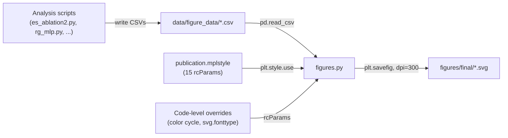
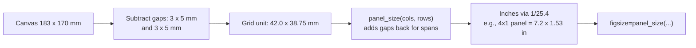
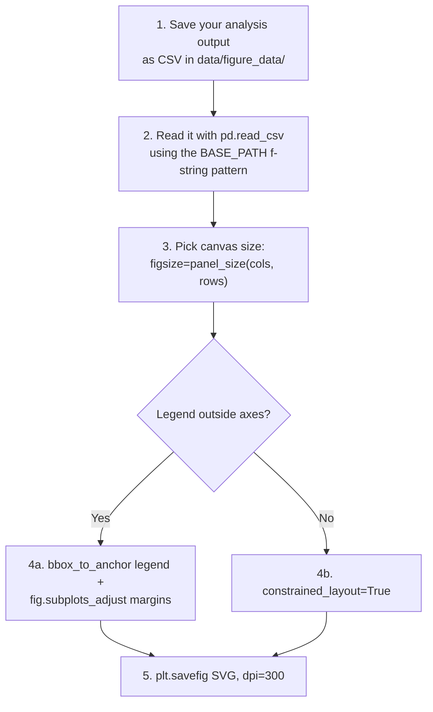

This page explains how `plm_interp` turns raw analysis numbers into journal-ready vector figures. The entire styling system lives in two places: a 15-line matplotlib style sheet at the repository root (`publication.mplstyle`) and a short "theme" block at the top of `scripts/figures.py` that loads it and adds project-specific conventions. Everything downstream — every panel in the paper — inherits from these two files, so if you are a beginner, understanding them is the fastest way to make your own plots look identical to the published ones. We will cover the theming architecture, the color strategy, a millimeter-based panel sizing system, layout discipline for fixed canvases, vector output conventions, and finally a step-by-step recipe for building a new figure.

Sources: [publication.mplstyle](/publication.mplstyle#L1-L15), [figures.py](/scripts/figures.py#L22-L53)

## Why a Separate Styling Layer Exists

The repository follows a strict separation between **analysis** and **presentation**. Analysis scripts (for example `es_ablation2.py` and `rg_mlp.py`) compute statistics and write tidy CSV files into `data/figure_data/`; they import matplotlib but never load the style sheet and never produce final artwork. Only `figures.py` reads those CSVs, applies the shared theme, and writes SVGs into `figures/final/`. This means the look of every paper figure is controlled in exactly one file — change the theme once, and every figure changes with it.



Sources: [figures.py](/scripts/figures.py#L59-L62), [figures.py](/scripts/figures.py#L85), [es_ablation2.py](/scripts/es_ablation2.py#L1-L21), [es_ablation2.py](/scripts/es_ablation2.py#L460-L557)

## The Two-Layer Theming Architecture

Styling is applied in two layers with clear precedence. Layer one is the declarative style sheet `publication.mplstyle`, loaded with `plt.style.use(f'{BASE_PATH}/publication.mplstyle')`, where `BASE_PATH` is derived from the script's own location so the style loads correctly no matter which directory you run from. Layer two is a small set of code-level overrides applied immediately after, which handle things a style sheet cannot: the categorical color cycle and the SVG text handling. Later settings always win, so the code overrides take precedence over the file.

Sources: [figures.py](/scripts/figures.py#L6-L7), [figures.py](/scripts/figures.py#L26-L28), [publication.mplstyle](/publication.mplstyle#L1-L15)

The style sheet itself is deliberately tiny — it only contains settings that every single figure should share. Here is what each line means for someone new to matplotlib:

| Setting | Value | Plain-language meaning |
|---|---|---|
| `pdf.fonttype` | `42` | Embed TrueType fonts in PDFs so text stays editable (not converted to outlines) |
| `font.family` | `Arial` | The sans-serif font most journals expect |
| `font.size` | `6` | 6 pt base font — small, because figures are designed at true print size (see panel sizing below) |
| `axes.linewidth` | `0.5` | Thin 0.5 pt axis lines |
| `axes.spines.top` / `.right` | `False` | Remove the top and right box borders (the "open" scientific look) |
| `xtick.major.width` / `ytick.major.width` | `0.5` | Thin 0.5 pt tick marks |
| `xtick.major.size` / `ytick.major.size` | `2` | Short 2 pt tick marks |
| `xtick.labelsize` / `ytick.labelsize` | `6` | 6 pt tick labels |
| `legend.fontsize` | `6` | 6 pt legend text |
| `legend.frameon` | `False` | No box drawn around legends |
| `lines.linewidth` | `1` | Default 1 pt line width for plotted curves |

Sources: [publication.mplstyle](/publication.mplstyle#L1-L15)

The code-level overrides add three things the style file cannot express. First, the default categorical color cycle is replaced with a **colorblind-safe palette** (the hex codes `#56B4E9`, `#E69F00`, `#CC79A7`, `#009E73`, `#F0E442`, `#0072B2`, `#D55E00`, `#000000` — the widely used Okabe–Ito scheme), so any plot that uses matplotlib's automatic color rotation is readable by color-vision-deficient readers. Second, `mpl.rcParams['svg.fonttype'] = 'none'` tells matplotlib to keep text as real `<text>` elements in SVG output rather than converting glyphs to paths — essential when a journal asks you to edit labels in Illustrator or Inkscape. Third, the `group_color_map` dictionary establishes the project's core semantic colors used by many figures.

Sources: [figures.py](/scripts/figures.py#L26-L29)

> [!TIP]
> Because `publication.mplstyle` is loaded by absolute path built from `Path(__file__).resolve().parent`, the figures never depend on your current working directory. If you copy this pattern into a new repo, keep the style sheet at the repo root and recompute `BASE_PATH` the same way.

## Color Strategy: A Default Cycle Plus Semantic Maps

The project uses two complementary color mechanisms. The **default cycle** (the Okabe–Ito palette above) handles "whatever colors matplotlib picks automatically." **Semantic color maps**, by contrast, are plain Python dictionaries that assign a fixed meaning to each category, so a reader can compare colors across different figures in the paper. The main examples, all defined as module-level dictionaries in `figures.py`:

| Dictionary | Mapping | Used for |
|---|---|---|
| `group_color_map` | `PDB` → orange, `DisProt` → steelblue | Every ordered-vs-disordered comparison |
| `line_color_map` | `Attention Received` → steelblue, `Disorder` → orange | Per-residue line traces (e.g., TDP-43 panel) |
| `dataset_color_map` | `Training` → steelblue, `Validation` → orange | MLP training/validation loss curves |
| `agreement_color_map` | `Both Enriched` → `#2166ac`, `Both Depleted` → `#d6604d`, `Disagree` → `#d3d3d3` | Categorical agreement matrices |
| `color_scale` (ablations) | Negative (D/E) → `#E8300C`, Positive (K/R) → `#2367B0`, Random → `#999999` | Head-ablation sweep lines |

Notice the deliberate reuse: `steelblue` and `orange` recur across maps, tying "DisProt / observed / validation / attention" and "PDB / disorder / training" threads together visually throughout the paper. When you add a new figure, extend these dictionaries rather than inventing new colors.

Sources: [figures.py](/scripts/figures.py#L29), [figures.py](/scripts/figures.py#L390), [figures.py](/scripts/figures.py#L492), [figures.py](/scripts/figures.py#L645)

For continuous (non-categorical) data, the project standardizes on a small set of colormaps with consistent rules. Sequential `Blues` is used for attention-quantity heatmaps, and when several heatmap panels share the same quantity, a single `vmin`/`vmax` computed from the whole dataset is passed to every `imshow` call so the panels are directly comparable. Diverging `RdBu` is used for enrichment deltas, with the symmetric range anchored at the maximum absolute value so zero maps to white. For genuinely categorical matrices, a `ListedColormap` is built from the semantic dictionary, and `cmap.set_bad(color='white')` renders the masked upper triangle as blank.

Sources: [figures.py](/scripts/figures.py#L172-L187), [figures.py](/scripts/figures.py#L423-L445), [figures.py](/scripts/figures.py#L400-L412)

## The Millimeter-Based Panel Sizing System

This is the most distinctive convention in the repository, and it exists for one reason: **figures are designed at true print size**. The constants define a full-page canvas of 183 × 170 mm (the text-block size of a typical journal page), divided into a 4 × 4 grid of panels separated by 5 mm gaps. Each grid unit is therefore 42.0 mm wide and 38.75 mm tall. Because matplotlib's `figsize` expects inches, the `panel_size(cols, rows)` helper multiplies the millimeter footprint by `MM_TO_IN = 1/25.4` and rounds to two decimals.

Sources: [figures.py](/scripts/figures.py#L30-L45)



The reference table below is exactly what `figures.py` prints to the console when it runs (the loop over `(cols, rows)` pairs), giving you a copy-paste menu of legal `figsize` values. The 4×1 row confirms the math: `(4 × 42 + 3 × 5) = 183 mm = 7.2 inches`, and you can see that same value hard-coded in Figure 1's UMAP panel call.

| Grid span (cols × rows) | Millimeters | `figsize` (inches) |
|---|---|---|
| 1 × 1 | 42.0 × 38.75 | `(1.65, 1.53)` |
| 2 × 1 | 89.0 × 38.75 | `(3.50, 1.53)` |
| 1 × 2 | 42.0 × 82.5 | `(1.65, 3.25)` |
| 2 × 2 | 89.0 × 82.5 | `(3.50, 3.25)` |
| 3 × 1 | 136.0 × 38.75 | `(5.35, 1.53)` |
| 4 × 1 | 183.0 × 38.75 | `(7.20, 1.53)` |
| 4 × 2 | 183.0 × 82.5 | `(7.20, 3.25)` |
| 4 × 4 | 183.0 × 170.0 | `(7.20, 6.69)` |

Sources: [figures.py](/scripts/figures.py#L41-L53), [figures.py](/scripts/figures.py#L62), [figures.py](/scripts/figures.py#L447)

The payoff of designing at print size is that the 6 pt fonts in the style sheet render at exactly 6 pt on paper — no shrinking surprises at submission time. It also explains the numerous tiny explicit `fontsize=` values (4.5, 5, 5.5) you will see sprinkled through the script: those are deliberate downgrades for dense panels, applied on top of the 6 pt default, not arbitrary magic numbers.

Sources: [figures.py](/scripts/figures.py#L297-L302), [figures.py](/scripts/figures.py#L504-L507), [figures.py](/scripts/figures.py#L691-L700)

## Layout Discipline: Fixed Canvases and External Legends

Many figures in this paper put their legends **outside** the axes, anchored with `bbox_to_anchor=(1.02, 1)` or centered on the figure edge. Matplotlib's automatic layout engines (`tight_layout`, `constrained_layout`) would normally resize the axes to make room — which would silently change the exported canvas away from the journal-mandated dimensions. The repository solves this with an explicit comment-and-margin pattern: place the legend outside, then manually reserve space with `fig.subplots_adjust(...)` so the figure stays at its exact `figsize`. The code comment states the intent directly: *"Reserve room for the legend WITHIN the fixed 7.2 x 1.53 canvas instead of letting tight_layout() or the legend itself resize the figure."*

```python
# BEFORE (legend would resize the canvas):
ax.legend(title="Disorder Probability Bin", bbox_to_anchor=(1.02, 1),
          loc='upper left', borderaxespad=0)
plt.tight_layout()

# AFTER (canvas stays fixed; right 22% reserved for the legend):
ax.legend(title="Disorder Probability Bin", bbox_to_anchor=(1.02, 1),
          loc='upper left', borderaxespad=0)
fig.subplots_adjust(left=0.09, right=0.78, top=0.82, bottom=0.28)
```

Sources: [figures.py](/scripts/figures.py#L105-L108), [figures.py](/scripts/figures.py#L229-L231), [figures.py](/scripts/figures.py#L254-L256)

The repository actually uses two layout modes, and knowing when each applies will save you hours of fiddling:

| Layout mode | Where used | How it works | When to choose |
|---|---|---|---|
| Manual `fig.subplots_adjust` | Main-text figures with external legends | Fractional margins set by hand; canvas size guaranteed | Legend sits outside the axes, or you need exact final dimensions |
| `constrained_layout=True` (+ optional padding tuning) | Heatmap grids and simple appendix histograms | Matplotlib auto-fits labels/colorbars inside the figure | All legends/labels live inside the axes; simpler panels |

When `constrained_layout` is used, the script sometimes fine-tunes inter-panel padding through the layout engine, e.g. `fig.get_layout_engine().set(w_pad=0.15, h_pad=0.15)`.

Sources: [figures.py](/scripts/figures.py#L174), [figures.py](/scripts/figures.py#L524), [figures.py](/scripts/figures.py#L537-L538), [figures.py](/scripts/figures.py#L556-L557)

A few recurring micro-conventions complete the layout toolkit. Scatter panels that compare predicted versus true values call `ax.set_box_aspect(1)` to force square axes and draw a dashed identity line for reference. For overlaid dense scatter groups, z-order and alpha are explicitly controlled (background group drawn first at full opacity, foreground group last at low alpha) so nothing is visually swallowed. Shared-y panel rows use `sharey=True` with per-panel `width_ratios` proportional to the number of categories each panel contains, keeping bar spacing honest across panels.

Sources: [figures.py](/scripts/figures.py#L65-L73), [figures.py](/scripts/figures.py#L439-L445), [figures.py](/scripts/figures.py#L284-L286)

## Vector Output Conventions

Every final figure is saved twice-conventionally: as **SVG** (via `plt.savefig(.../figures/final/<name>.svg, dpi=300)`) with `dpi=300` governing any rasterized elements, and with fonts kept editable through the two settings you already met — `pdf.fonttype: 42` in the style file and `svg.fonttype: 'none'` in the code. Filenames follow a stable `figures/final/<descriptive_name>.svg` scheme tied to the figure they belong to (e.g., `umap.svg`, `asp_cys_heatmaps.svg`, `rg_mlp.svg`, `head_ablation_sweep_.svg`), so regeneration is idempotent. Colorbars also follow fixed recipes: attached colorbars use `make_axes_locatable` with a 5%-width strip, heatmap colorbars use the `fraction=0.046, pad=0.04` sizing trick, and the one densely packed multi-panel appendix figure places its colorbar with a hand-computed `fig.add_axes([0.88, 0.15, 0.03, 0.65])` rectangle.

Sources: [figures.py](/scripts/figures.py#L28), [figures.py](/scripts/figures.py#L80-L85), [figures.py](/scripts/figures.py#L620-L634), [figures.py](/scripts/figures.py#L702-L705)

## Recipe: Building Your Own Publication Figure

Armed with the conventions above, a new figure is a five-step process. Follow the flowchart, then the template:



```python
import pandas as pd
# figures.py already applied the theme at import time:
# publication.mplstyle + Okabe-Ito cycle + svg.fonttype='none'

df = pd.read_csv(f'{BASE_PATH}/data/figure_data/my_results.csv')

w, h = panel_size(cols=2, rows=1)          # exact journal panel footprint
fig, ax = plt.subplots(figsize=(w, h), dpi=300)

for label, color in group_color_map.items():      # reuse semantic colors
    sub = df[df['Group'] == label]
    ax.plot(sub['x'], sub['y'], color=color, label=label)

ax.set_xlabel('Position'); ax.set_ylabel('Value')
ax.legend(frameon=False, bbox_to_anchor=(1.02, 1), loc='upper left')
fig.subplots_adjust(left=0.12, right=0.78, top=0.85, bottom=0.28)  # reserve legend room
plt.savefig(f'{BASE_PATH}/figures/final/my_figure.svg', dpi=300)
plt.show()
```

A compact troubleshooting table for the two problems beginners hit most often with this setup:

| Symptom | Cause | Fix |
|---|---|---|
| Legend clipped at figure edge | External legend without reserved margin | Add `fig.subplots_adjust(..., right=<lower value>)`; target ≈ 0.72–0.80 when the legend sits to the right |
| Text too large after export / figure "shrinks" at submission | Canvas designed in default matplotlib size, not print size | Always size with `panel_size()`; keep per-element fonts in the 4.5–6 pt range |
| Heatmap panels not comparable | Each `imshow` auto-scaled its own colors | Pass one shared `vmin`/`vmax` (from the full dataset) to every panel |
| Fonts became outlines in the SVG, can't edit text | `svg.fonttype` reset to default `'path'` | Re-apply `mpl.rcParams['svg.fonttype'] = 'none'` after any style reset |

Sources: [figures.py](/scripts/figures.py#L59-L110), [figures.py](/scripts/figures.py#L423-L445)

## Where This Fits in the Documentation

The styling layer is the last step of the pipeline: it consumes the derived CSVs described in [Reproducing Paper Figures](4-reproducing-paper-figures) and depends on the script-to-CSV handoff explained in [Script Pipeline Architecture](5-script-pipeline-architecture). To understand what the figures actually depict — attention rollout, ClinVar enrichments, ablation sweeps — continue with the Deep Dive chapters such as [Attention Rollout Algorithm](9-attention-rollout-algorithm), [ClinVar Disease Residue Attention](13-clinvar-disease-residue-attention), and [Attention Head Ablation Study](18-attention-head-ablation-study). For a fresh entry point into the repository, return to the [Overview](1-overview) or [Quick Start](2-quick-start).
