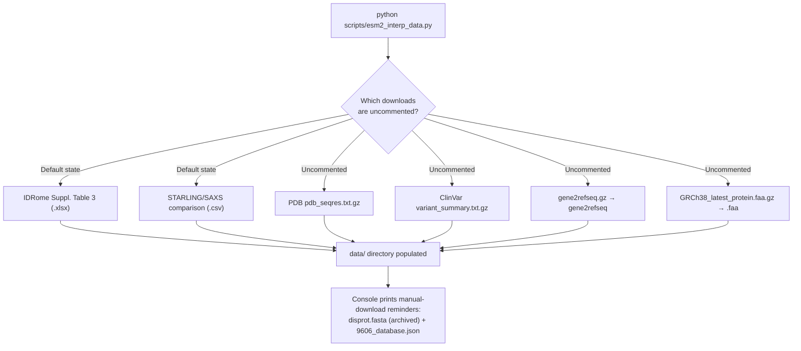
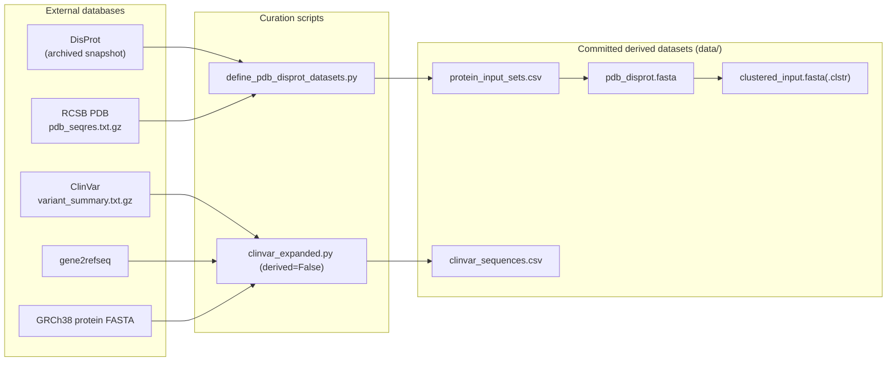

This page explains how `plm_interp` obtains every external dataset used in the paper — where each source lives, which downloads are automated, which are manual, and how raw downloads become the curated files committed to `data/`. Because this repository studies proteins drawn from public biology databases, data acquisition is the first practical step for anyone reproducing the analyses, and it is deliberately designed around one central script: `scripts/esm2_interp_data.py`.

## The Two-Track Data Philosophy: Committed Snapshots vs. Living Databases

The repository's foundational design decision is captured in a warning at the top of `esm2_interp_data.py`: sources like PDB, ClinVar, gene2refseq, GRCh38, and DisProt are **living databases** with no version pinned in their URLs, so a file downloaded today *will* differ from the version used in the study (PDB snapshot July 16, 2025; DisProt July 28, 2025; ClinVar/NCBI files February 3, 2026). The script's docstring therefore lays out two explicit paths: use the **exact sequences committed to the repo** to reproduce results, or pull fresh data knowing downstream outputs will drift.

Sources: [esm2_interp_data.py](scripts/esm2_interp_data.py#L6-L17), [README.md](README.md#L42)

This duality shows up in every downstream consumer as a single switch. In `clinvar_expanded.py`, the `derived = True` flag (the default) reads the committed `data/clinvar_sequences.csv` snapshot; setting it to `False` instead loads freshly downloaded ClinVar and NCBI files and regenerates that CSV from scratch. The same pattern applies to the PDB/DisProt side, where the committed `protein_input_sets.csv` and `pdb_disprot.fasta` let you skip the filtering steps entirely.

Sources: [clinvar_expanded.py](scripts/clinvar_expanded.py#L17-L19), [esm2_interp_data.py](scripts/esm2_interp_data.py#L19-L27)

| Aspect | Derived track (default) | Live track |
|---|---|---|
| What you use | Committed snapshots in `data/` | Fresh downloads from external DBs |
| Reproducibility | Exact match to paper | Approximate (databases update weekly) |
| Required action | None — clone and run | Run `esm2_interp_data.py`, flip `derived = False` |
| Curation step | Skipped | Must re-run filtering/regeneration |

Sources: [esm2_interp_data.py](scripts/esm2_interp_data.py#L19-L35), [README.md](README.md#L36-L42)

## The Complete Source Inventory

The docstring of `esm2_interp_data.py` doubles as the canonical catalog of external data: each entry names the source, its access date, the download URL, and the exact file path where it must land in `data/`. The table below consolidates that catalog along with the acquisition method for each source — a distinction that matters because some files download automatically, some require browser interaction, and some are already committed.

Sources: [esm2_interp_data.py](scripts/esm2_interp_data.py#L36-L76), [README.md](README.md#L44-L63)

| Source | Snapshot accessed | Saved as | Method | Stability |
|---|---|---|---|---|
| RCSB PDB sequences | July 16, 2025 | `data/pdb_seqres.txt.gz` | Automatic | Living DB, updated weekly |
| NCBI ClinVar variants | Feb 3, 2026 | `data/variant_summary.txt.gz` | Automatic | Living DB, updated weekly |
| NCBI gene2refseq | Feb 3, 2026 | `data/gene2refseq` (decompressed TSV) | Automatic + gzip decompress | Updated regularly |
| NCBI GRCh38 latest protein | Feb 3, 2026 | `data/GRCh38_latest_protein_copy.faa` | Automatic + gzip decompress | Unpinned "latest" release |
| DisProt release 2025_06 | July 28, 2025 | `data/disprot.fasta` | Committed to repo | Archived snapshot |
| DescribeProt (human, 9606) | Feb 3, 2026 | `data/9606_database.json` | **Manual** browser download | Server-side resource |
| IDRome Supplementary Table 3 | Static | `data/Supplementary_Table_3.xlsx` | Automatic | Stable file |
| STARLING/SAXS comparison | Static | `data/all_comparison_data_WITH_STARTING.csv` | Automatic | Stable GitHub file |
| IDRome DB (MD-derived Rg) | — | Referenced by `rg_mlp.py` | Documented in README | GitHub-hosted CSV |

Sources: [esm2_interp_data.py](scripts/esm2_interp_data.py#L38-L76), [README.md](README.md#L60-L63), [rg_mlp.py](scripts/rg_mlp.py#L21-L30)

Within the `data/` directory, the committed snapshots and the to-be-downloaded raw files sit side by side:

```
data/
├── disprot.fasta                        # Committed DisProt snapshot (2025_06)
├── pdb_disprot.fasta                    # Derived: curated PDB + DisProt set
├── protein_input_sets.csv               # Derived: filtered ID + sequence pairs
├── clustered_input.fasta(.clstr)        # Derived: CD-HIT clustered inputs
├── clinvar_sequences.csv                # Derived: validated ClinVar variants
├── idrome.fasta / idrome_clustered.fasta(.clstr)   # IDRome sequence snapshots
├── attn_corr_norm_es.csv / esm2_perplexities.csv   # Script-generated summaries
├── jac_batch_directory.csv
├── pdb_seqres.txt.gz                    # ↓ Auto-downloaded
├── variant_summary.txt.gz               # ↓ Auto-downloaded
├── gene2refseq                          # ↓ Auto-downloaded + decompressed
├── GRCh38_latest_protein_copy.faa       # ↓ Auto-downloaded + decompressed
├── 9606_database.json                   # ↓ Manual browser download
├── Supplementary_Table_3.xlsx           # ↓ Auto-downloaded
└── all_comparison_data_WITH_STARTING.csv# ↓ Auto-downloaded
```

Sources: [esm2_interp_data.py](scripts/esm2_interp_data.py#L43-L76), [README.md](README.md#L44-L46)

## Inside the Acquisition Hub: `scripts/esm2_interp_data.py`

The script's architecture is a thin orchestration layer over two reusable helpers. `download_file()` performs a streaming HTTP request with a 120-second timeout, validates the response with `raise_for_status()`, and writes the body in 8192-byte chunks while a `tqdm` progress bar tracks bytes against the reported `content-length`. `decompress_gz()` then expands gzip archives (used for `gene2refseq.gz` and `GRCh38_latest_protein.faa.gz`) with a streamed `shutil.copyfileobj` copy.

Sources: [esm2_interp_data.py](scripts/esm2_interp_data.py#L93-L115)

On top of these helpers sit six purpose-named download functions — `download_pdb()`, `download_clinvar()`, `download_gene2refseq()`, `download_grch38()`, `download_idrome_supplementary()`, and `download_starling()` — each wrapped in print statements that restate the access date and warn when the target is a living database. The intent is that a beginner can read the console output and immediately understand the provenance of every file landing in `data/`.

Sources: [esm2_interp_data.py](scripts/esm2_interp_data.py#L124-L214)

> [!TIP]
> When you run `python scripts/esm2_interp_data.py`, only two downloads execute by default: `download_idrome_supplementary()` and `download_starling()`. The four NCBI/RCSB download calls in the `__main__` block are **commented out** — you must uncomment them if you intend to run the live ClinVar or PDB/DisProt pipelines rather than the committed snapshots.

Sources: [esm2_interp_data.py](scripts/esm2_interp_data.py#L228-L233)

The end-to-end flow when you run the script looks like this:



Sources: [esm2_interp_data.py](scripts/esm2_interp_data.py#L219-L249)

## Manual Downloads and the IUPred2A Tool Dependency

Two data files cannot be fetched by the script and require manual action. The first is **`data/9606_database.json`** — the DescribeProt evolutionary conservation database for *Homo sapiens*, which you download through the VCU biomine server by selecting the human (taxon 9606) row and saving the raw data; the script's closing console message repeats these instructions after the automatic downloads finish.

Sources: [esm2_interp_data.py](scripts/esm2_interp_data.py#L62-L67), [esm2_interp_data.py](scripts/esm2_interp_data.py#L237-L247)

The second is **DisProt itself**: rather than pointing at a live DisProt URL, the script instructs you to use the archived `release_2025_06 with_ambiguous_evidences` snapshot already committed as `data/disprot.fasta`, preserving the exact disorder-annotation provenance of the study.

Sources: [esm2_interp_data.py](scripts/esm2_interp_data.py#L38-L44), [esm2_interp_data.py](scripts/esm2_interp_data.py#L240-L242)

Beyond data, one **external tool** must be acquired before attention analyses can run: IUPred2A, the intrinsic-disorder predictor, which you install manually from `https://iupred2a.elte.hu/` and then register by updating `iupred_filepath` near the top of `scripts/attention_functions.py` (it currently points to the authors' HPC path, so it will not resolve on your machine). This is the only configuration edit the README explicitly requires post-installation.

Sources: [README.md](README.md#L17-L19), [attention_functions.py](scripts/attention_functions.py#L23-L25)

## From Raw Downloads to Derived Datasets

The raw files above are not consumed directly by the analyses — two curation scripts transform them into the compact derived datasets committed to the repo. On the PDB/DisProt side, `define_pdb_disprot_datasets.py` reads the DisProt FASTA and the PDB `pdb_seqres.txt.gz`, applies symmetric quality filters (deduplicate sequences, keep lengths between 50 and 1024 residues, drop PDB sequences containing non-canonical characters `X|U|O`), and then bin-matches the ordered PDB set to the DisProt length distribution across 20 length bins (using `random_state=42` for reproducibility) before writing `data/protein_input_sets.csv`.

Sources: [define_pdb_disprot_datasets.py](scripts/define_pdb_disprot_datasets.py#L14-L50), [define_pdb_disprot_datasets.py](scripts/define_pdb_disprot_datasets.py#L51-L56)

> [!TIP]
> The repeated length ceiling of **1024 residues** across both curation scripts is not arbitrary — it aligns with ESM-2's usable context window (the Rg training script pins `SEQ_LENGTH = 1022`). Filtering at acquisition time guarantees no sequence silently exceeds what the model can embed later.

Sources: [define_pdb_disprot_datasets.py](scripts/define_pdb_disprot_datasets.py#L17-L18), [clinvar_expanded.py](scripts/clinvar_expanded.py#L108-L110), [rg_mlp.py](scripts/rg_mlp.py#L34-L35)

On the ClinVar side, running `clinvar_expanded.py` with `derived = False` executes the full live pipeline: it filters `variant_summary.txt.gz` to pathogenic single-nucleotide variants, maps mRNA (NM) accessions to protein (NP) accessions by streaming `gene2refseq` in 100,000-row chunks and keeping only human taxon 9606, joins sequences from the GRCh38 protein FASTA via BioPython's `SeqIO`, enforces the same 50–1024 length window, drops ambiguous residues, removes genes mapping to multiple sequences, and finally validates that each parsed mutation's wild-type amino acid actually appears at the stated position before regenerating `data/clinvar_sequences.csv`.

Sources: [clinvar_expanded.py](scripts/clinvar_expanded.py#L70-L119), [clinvar_expanded.py](scripts/clinvar_expanded.py#L120-L140)

The complete acquisition-to-analysis data flow looks like this:



Sources: [define_pdb_disprot_datasets.py](scripts/define_pdb_disprot_datasets.py#L9-L12), [clinvar_expanded.py](scripts/clinvar_expanded.py#L22-L33)

If you stay on the derived track (the default), you can skip both curation scripts entirely and go straight to analysis — which is why the README's reproduction table shows `esm2_interp_data.py` as step 1 only for Figure 3 (ClinVar) and Figure 5 (Rg/SAXS), where genuinely external files are mandatory inputs.

Sources: [esm2_interp_data.py](scripts/esm2_interp_data.py#L19-L27), [README.md](README.md#L88-L97)

## Licensing and Redistribution Boundaries

Because this repository redistributes snapshots of third-party biological data, the README is explicit that the MIT license covers **code only**: the committed DisProt files are CC BY 4.0, PDB-derived entries are CC0 1.0, IDRome sequences are GPL-3.0, and ClinVar-derived data is public domain, each with its citation listed in a dedicated table. Critically, anything you download via `esm2_interp_data.py` is *not* redistributed here and remains under its provider's terms.

Sources: [README.md](README.md#L67-L78)

A parallel note covers **third-party code**: the contact-map functions adapted from the `pLMs-interpretability` project carry no stated license and are explicitly excluded from this repo's MIT coverage — worth knowing if you plan to reuse `get_contact_maps.py` in your own work.

Sources: [README.md](README.md#L82-L84)

## Where to Go Next

With data acquisition understood, a natural progression is to see how these inputs feed the analyses. Continue in order with [Reproducing Paper Figures](4-reproducing-paper-figures) to run the full figure pipeline, then move into the Deep Dive with [Script Pipeline Architecture](5-script-pipeline-architecture) for the execution graph. When you want the deeper treatment of topics touched lightly here, see [Dataset Curation and CD-HIT Clustering](21-dataset-curation-and-cd-hit-clustering) for the clustering stage that produces `clustered_input.fasta`, [Derived Versus Live Data Reproducibility](22-derived-versus-live-data-reproducibility) for the snapshot strategy in depth, and the consumer analyses [Ordered Versus Disordered Comparison](12-ordered-versus-disordered-comparison) and [ClinVar Disease Residue Attention](13-clinvar-disease-residue-attention) that sit immediately downstream of the files this page helps you acquire.