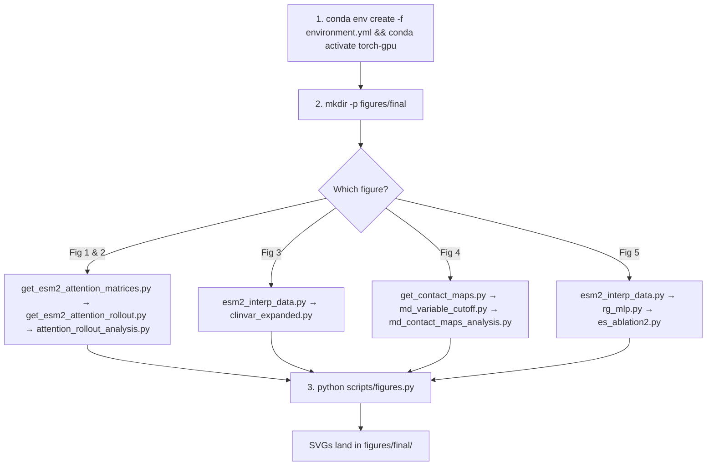

This page is your operational guide to regenerating every figure from the paper *Mechanistic Interpretability of Protein Language Models Reveals Encoded Structural and Functional Properties of Intrinsically Disordered Proteins*. The reproduction layer consists of exactly two files at the repository root: **`scripts/figures.py`** — a single script that draws all main-text figures (1–5) and appendix figures (A1–A5) — and **`publication.mplstyle`** — a matplotlib stylesheet that enforces the journal's visual language. Crucially, `figures.py` does not compute any analysis itself; it is a pure *rendering stage* that reads pre-computed summary CSVs and turns them into final SVG files. Understanding this "plots-from-CSV" design is the key to reproducing results without re-running expensive GPU analyses unnecessarily.

Sources: [figures.py](/scripts/figures.py#L1-L53), [publication.mplstyle](/publication.mplstyle#L1-L15), [README.md](/README.md#L88-L96)

## The Two-File Reproduction Layer

The repository separates *computation* from *presentation*. The upstream analysis scripts (attention extraction, ClinVar analysis, contact maps, MLP training) do the heavy lifting and persist their results as small summary tables. `figures.py` then acts as a single consolidated rendering pass over those tables. The full data flow looks like this:

```mermaid
flowchart LR
    subgraph RAW["Stage 1 — Raw inputs (committed in data/)"]
        R1["protein_input_sets.csv"]
        R2["attn_corr_norm_es.csv"]
        R3["FASTA / ClinVar / IDRome sources"]
    end
    subgraph PIPE["Stage 2 — Analysis pipeline (scripts/)"]
        S1["get_esm2_attention_matrices.py"]
        S2["get_esm2_attention_rollout.py"]
        S3["clinvar_expanded.py"]
        S4["md_contact_maps_analysis.py"]
        S5["rg_mlp.py / es_ablation2.py"]
    end
    subgraph DERIVED["Stage 3 — Summary tables (data/figure_data/)"]
        C1["umap_df.csv"]
        C2["comb_data.csv"]
        C3["comparison.csv"]
        C4["df_eval.csv, ols_df.csv, ..."]
    end
    subgraph RENDER["Stage 4 — Rendering layer"]
        F["figures.py"]
        ST["publication.mplstyle"]
    end
    OUT["figures/final/*.svg (300 dpi)"]

    RAW --> PIPE
    PIPE --> DERIVED
    DERIVED --> F
    ST --> F
    F --> OUT
```

A few foundational facts anchor this architecture. First, `figures.py` resolves all paths relative to the repository root via `SCRIPT_DIR`/`BASE_PATH`, so it must be run from a normal clone — not a flattened copy. Second, every plot block applies the shared stylesheet (`plt.style.use(...)`) plus a colorblind-safe Okabe–Ito color cycle, and configures SVG output so that text stays as live text rather than being rasterized into paths. Third, each figure block is self-contained: it loads its own CSVs, draws, and saves, which means the blocks execute sequentially with no shared state between figures.

Sources: [figures.py](/scripts/figures.py#L6-L29), [attention_rollout_analysis.py](/scripts/attention_rollout_analysis.py#L33-L41), [es_ablation2.py](/scripts/es_ablation2.py#L17-L18)

> [!TIP]
> **The summary directory `data/figure_data/` is *not* committed to this repository.** The committed `data/` folder contains only raw inputs (e.g., `protein_input_sets.csv`, `attn_corr_norm_es.csv`). Running `python scripts/figures.py` on a fresh clone will fail at its very first `pd.read_csv` call. You must first run the upstream pipeline for the figure(s) you want — the command chains are in the README's "Reproducing Results" table — which generate the summary CSVs that `figures.py` consumes.

Sources: [README.md](/README.md#L25-L48), [figures.py](/scripts/figures.py#L60-L60)

## End-to-End Reproduction Workflow

The practical workflow follows the same three phases regardless of which figure you target: prepare the environment, run the figure-specific analysis pipeline, then render. Note that the most computationally expensive steps (ESM-2 forward passes on GPU) live entirely in the pipeline stage — `figures.py` itself needs only pandas, NumPy, SciPy, and matplotlib.

The README's "Reproducing Results" table is the authoritative mapping between paper figures and pipeline commands (all commands run from inside the `scripts/` directory):

| Paper Figure | Pipeline Command Chain |
|---|---|
| Figure 1 | `get_esm2_attention_matrices.py` → `get_esm2_attention_rollout.py` → `attention_rollout_analysis.py` |
| Figure 2 | `get_esm2_attention_matrices.py` → `get_esm2_attention_rollout.py` → `attention_rollout_analysis.py` |
| Figure 3 | `esm2_interp_data.py` → `clinvar_expanded.py` |
| Figure 4 | `get_contact_maps.py` → `md_variable_cutoff.py` → `md_contact_maps_analysis.py` |
| Figure 5 | `esm2_interp_data.py` → `rg_mlp.py` → `es_ablation2.py` |

Two constraints from the README deserve emphasis for beginners: the raw attention-matrix and rollout artifacts are large and are explicitly *not* committed to GitHub, so Figures 1 and 2 always require a GPU re-run of the extraction scripts; and external databases (ClinVar, IDRome, SAXS datasets) are downloaded via `esm2_interp_data.py`, which should be run before Figures 3, 4, and 5.

Sources: [README.md](/README.md#L9-L16), [README.md](/README.md#L44-L48), [README.md](/README.md#L88-L96)

## The Complete Figure Inventory

`figures.py` is organized top-to-bottom as one commented block per paper figure. Each block reads its specific inputs from `data/figure_data/` and writes SVGs to `figures/final/` at 300 dpi. This table is your map for locating — and selectively editing — any panel:

| Figure | Panels Rendered | Input CSVs (`data/figure_data/`) | Output SVGs (`figures/final/`) | Code Lines |
|---|---|---|---|---|
| Fig 1 — Attention Analysis | UMAP (grouped + IDR-fraction colored), disorder-bin KDE, TDP-43 annotation track | `umap_df.csv`, `disorder_comp_concat.csv`, `si_examples.csv` | `umap.svg`, `attn_kde.svg`, `tdp43.svg` | L56–135 |
| Fig 2 — AA Attention Allocation | Mean attention-by-amino-acid bars; Cys/Asp head×layer heatmaps (PDB vs DisProt) | `mean_aa_attn.csv`, `attn_occur_norm.csv` | `mean_aa_attn_received.svg`, `asp_cys_heatmaps.svg` | L137–207 |
| Fig 3 — Pathogenicity | ClinVar attention-percentile histograms, boxplots by disorder bin, disease AA counts, AA-group boxplots, logistic + OLS betas | `comb_data.csv`, `log_df.csv`, `ols_df.csv` | `clinvar_expanded_*.svg`, `clinvar_log_reg.svg`, `ols_clinvar.svg` | L211–363 |
| Fig 4 — Contact Maps | Observed-vs-null Spearman distribution; ESM/MD enrichment agreement matrix | `combined_data.csv`, `comparison.csv` | `jac_md_observed_vs_null_distribution.svg`, `md_esm_top_decile_agreement.svg` | L365–413 |
| Fig 5 — Rg MLP | Parity plots (Tesei/SAXS/STARLING); head-ablation sweep with random-ablation band | `df_eval.csv`, `saxs_proteins.csv`, `es_ablation_sweep_df_idrome_random_consecutive.csv` | `rg_mlp.svg`, `head_ablation_sweep_.svg` | L415–510 |
| Fig A1 — Dataset Profiles | Sequence-length histogram, IDR-count histogram, AA frequency bars | `protein_input_sets.csv` (committed, at `data/`), `idr_df.csv`, `comb_props.csv` | `input_sets_seqlen_distribution.svg`, `input_sets_disorder.svg`, `aa_proportional_frequency.svg` | L513–570 |
| Fig A2 — SI Examples | Per-protein attention/disorder line tracks | `si_examples.csv` | `si_examples.svg` | L574–598 |
| Fig A3 — Enrichment Heatmaps | ESM-2 Jacobian and MD top-decile enrichment matrices | `comparison.csv` | `esm2_top_decile_enrichment.svg`, `md_top_decile_enrichment.svg` | L601–637 |
| Fig A4 — MLP Training | Train/validation MSE learning curves with best-epoch marker | `training_curve_long.csv` | `mlp_final_curves.svg` | L639–660 |
| Fig A5 — DEKR Heatmaps | Per-amino-acid head×layer attention grids (20 amino acids) | `attn_corr_norm_es.csv` | `DEKR_heatmaps.svg` | L662–706 |

Because the script is monolithic with no command-line arguments, it executes every block in order on each run. If you only need, say, Figure 4, the pragmatic beginner strategy is to comment out the blocks above it — each block fails independently if its CSV is missing, so partial runs are best done by selective commenting rather than expecting graceful skipping.

Sources: [figures.py](/scripts/figures.py#L56-L135), [figures.py](/scripts/figures.py#L211-L363), [figures.py](/scripts/figures.py#L415-L510), [figures.py](/scripts/figures.py#L513-L706)

## The Publication Styling System

Every figure inherits its look from `publication.mplstyle`, a 15-line stylesheet loaded once at the top of `figures.py`. The settings encode standard journal-figure conventions: Arial at 6 pt, hairline axes (0.5 pt) with top/right spines removed, borderless legends, and thin data lines. Two entries are especially meaningful for downstream editing: `pdf.fonttype: 42` embeds TrueType glyphs so PDF text remains selectable, and the companion rcParam `svg.fonttype: 'none'` set in code keeps SVG text as editable `<text>` elements rather than converting labels to outlines.

| Style Setting | Value | Visual Effect |
|---|---|---|
| `font.family` / `font.size` | Arial / 6 | Compact journal typography |
| `axes.spines.top` / `.right` | False | Open, minimal frame |
| `axes.linewidth` | 0.5 | Hairline axis frame |
| `xtick/ytick.major.width` / `.size` | 0.5 / 2 | Fine, unobtrusive ticks |
| `legend.frameon` | False | Borderless legends |
| `lines.linewidth` | 1 | Thin data series |
| `pdf.fonttype` | 42 | Editable TrueType text in PDFs |

Beyond the stylesheet, `figures.py` implements a **modular panel grid** for multi-panel composition. The canvas is defined as 183 × 170 mm (183 mm being the standard double-column width of major scientific journals), divided into a 4 × 4 grid of 42 × 38.75 mm units separated by 5 mm gaps. The `panel_size(cols, rows)` helper converts any grid footprint into matplotlib's `figsize` in inches — so `panel_size(cols=4, rows=1)` yields exactly (7.2, 1.53), the wide strip used for Figure 1's TDP-43 track and Figure 5's parity plots, while `panel_size(cols=2, rows=2)` yields the square used for heatmap panels. A reference table at module load even prints the `figsize` call for all eight used grid shapes, as an aid when collating panels in a vector editor.

Color semantics are also centralized: PDB proteins render in orange and DisProt in steelblue via `group_color_map`, disease-relevant residues swap to orange in Figure 3, the head-ablation sweep uses a fixed red/blue/gray scale, and the base color cycle is the colorblind-safe Okabe–Ito palette.

Sources: [publication.mplstyle](/publication.mplstyle#L1-L15), [figures.py](/scripts/figures.py#L26-L45), [figures.py](/scripts/figures.py#L49-L53), [figures.py](/scripts/figures.py#L29-L29)

> [!TIP]
> **SVG text stays editable by design.** The combination of `svg.fonttype: 'none'` and `pdf.fonttype: 42` means axis labels, legends, and titles survive into vector editors (Illustrator, Inkscape) as real text — this is intentional so figures can be collated and annotated for the paper. If you convert these SVGs through rasterizing tools, you will destroy that editability; keep them as vectors.

## Relationship to the Exploratory Pipeline Plots

A subtle point worth understanding: the analysis scripts already produce their own plots as they run, but these are *exploratory* drafts saved to `figures/` — for example, `attention_rollout_analysis.py` saves an intermediate sequence-length distribution to `figures/input_sets_seqlen_distribution.svg`, and `es_ablation2.py` saves an exploratory D/E/K/R heatmap to `figures/DEKR_heatmaps.svg`. The versions in `figures.py` are the *final* publication rebuilds, re-drawn from the persisted summary CSVs into `figures/final/` with refined layout, panel sizing, and legend placement. This two-tier pattern means you can iterate on final figure aesthetics cheaply (just re-run `figures.py`) without ever touching the GPU-bound analysis stage.

Sources: [attention_rollout_analysis.py](/scripts/attention_rollout_analysis.py#L51-L66), [es_ablation2.py](/scripts/es_ablation2.py#L136-L172)

## Troubleshooting Guide

| Symptom | Root Cause | Fix |
|---|---|---|
| `FileNotFoundError` on `data/figure_data/umap_df.csv` (first block) | `figure_data/` is a derived directory, not committed | Run the upstream pipeline chain for your target figure (see README table), then re-run `figures.py` |
| `FileNotFoundError` when saving to `figures/final/` | Neither `figures.py` nor pipeline scripts create directories | Run `mkdir -p figures/final` before first execution |
| Figure A5 fails on `attn_corr_norm_es.csv` in `figure_data/` | `figures.py` reads it from `data/figure_data/`, but the committed copy lives at `data/attn_corr_norm_es.csv` (as read by `es_ablation2.py`) | Copy `data/attn_corr_norm_es.csv` into `data/figure_data/` |
| Matplotlib warning about missing Arial | Linux containers typically lack MS core fonts | Install `ttf-mscorefonts-installer` (or accept the DejaVu fallback; layout will shift slightly) |
| Script re-runs everything on every execution | `figures.py` is a sequential, argument-free script | Comment out blocks above the figure you need; each block is self-contained |
| "Do I need a GPU for figures.py?" | Confusion with the pipeline stage | No — `figures.py` only uses pandas/NumPy/SciPy/matplotlib; GPU work happens in `get_esm2_attention_matrices.py` and friends |

Sources: [figures.py](/scripts/figures.py#L60-L60), [figures.py](/scripts/figures.py#L85-L85), [es_ablation2.py](/scripts/es_ablation2.py#L136-L136), [README.md](/README.md#L88-L96)

## Where to Go Next

Once you can regenerate the figures, the natural next steps deepen both your engineering and scientific understanding of this repository:

- **[Script Pipeline Architecture](5-script-pipeline-architecture)** — how the upstream scripts connect end-to-end, and why the two-tier (pipeline → render) split exists.
- **[Publication Figure Styling](23-publication-figure-styling)** — a deep dive into `publication.mplstyle`, the panel grid system, and vector-output conventions.
- **[Derived Versus Live Data Reproducibility](22-derived-versus-live-data-reproducibility)** — the rationale behind committing raw inputs but regenerating `data/figure_data/` and attention artifacts.
- For the science behind individual figures, proceed to **[Attention Rollout Algorithm](9-attention-rollout-algorithm)** (Figures 1–2), **[ClinVar Disease Residue Attention](13-clinvar-disease-residue-attention)** (Figure 3), **[Categorical Jacobian Contact Maps](14-categorical-jacobian-contact-maps)** and **[MD Trajectory Contact Validation](15-md-trajectory-contact-validation)** (Figure 4), and **[MLP Radius of Gyration Predictor](17-mlp-radius-of-gyration-predictor)** plus **[Attention Head Ablation Study](18-attention-head-ablation-study)** (Figure 5).

If you have not yet set up the environment, start with **[Quick Start](2-quick-start)**; the external databases needed by the Figure 3–5 pipelines are covered in **[External Data Acquisition](3-external-data-acquisition)**.