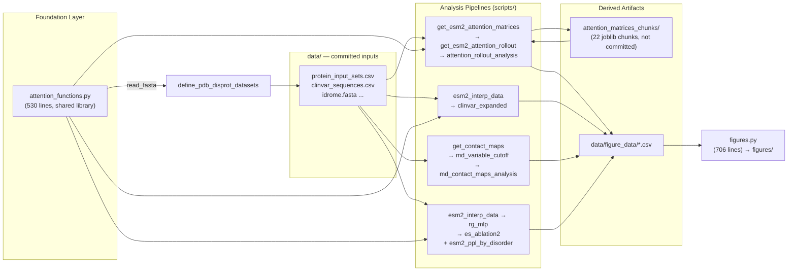
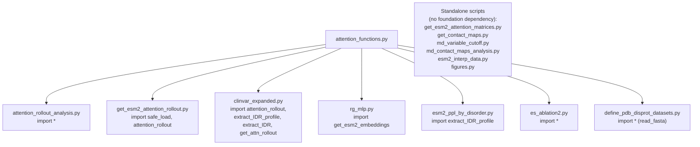
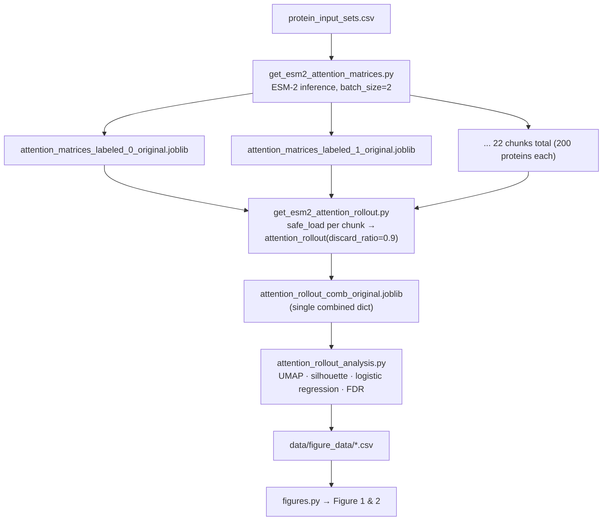

This page explains how the fourteen Python scripts in `scripts/` are organized as a research codebase: the shared foundation module, the four independently reproducible analysis pipelines that each produce one paper figure, and the cross-cutting engineering patterns (path resolution, chunked serialization, memory management) that hold the system together. This is an architecture-level explanation — algorithm internals are deferred to their dedicated pages in the Deep Dive catalog.

## Layered Architecture: Foundation, Pipelines, and Presentation

The codebase follows a three-layer architecture despite being a flat directory of scripts. At the bottom sits `attention_functions.py`, a 530-line library containing every reusable routine — FASTA parsing, disorder prediction, attention rollout, embedding extraction, and statistical comparison. Above it, ten executable analysis scripts are arranged into four independent pipelines, each corresponding to one figure of the paper. At the top, `figures.py` acts as a pure presentation layer that consumes CSV intermediates under `data/figure_data/` and renders publication-quality output using the committed `publication.mplstyle` stylesheet.

The critical insight is that **data flows through files, not function calls**: scripts communicate only through serialized artifacts (`joblib` chunks, CSV files, FASTA files), which makes every stage independently interruptible and re-runnable. This decoupling is what allows the README to express the entire study as five short command sequences in its "Reproducing Results" table, where each figure maps to a linear chain of script invocations.

Sources: [README.md](README.md#L88-L97), [attention_functions.py](scripts/attention_functions.py#L1-L25), [figures.py](scripts/figures.py#L26-L60)

## The Shared Foundation Module

`attention_functions.py` is the only module imported by other scripts, and it never imports from them — a strict one-directional dependency that prevents circular imports entirely. Six of the fourteen scripts import from it, with varying selectivity: three use wildcard imports (`from attention_functions import *`), while the others import named functions, signaling which capabilities each pipeline actually consumes.

The module's functions cluster into five cohesive concerns, each mapping to a different analytical stage:

| Function | Lines | Concern | Primary Consumer |
|---|---|---|---|
| `read_fasta` | L28–L37 | FASTA → DataFrame ingestion | `define_pdb_disprot_datasets.py` |
| `extract_IDR` / `extract_IDR_profile` | L39–L99 | IUPred2A disorder scoring (subprocess) | `clinvar_expanded.py`, `esm2_ppl_by_disorder.py` |
| `attention_rollout` / `get_attn_rollout` | L144–L249 | Attention fusion across layers/heads | `get_esm2_attention_rollout.py`, `clinvar_expanded.py` |
| `get_esm2_embeddings` | L391–L429 | Mean-pooled layer-33 embeddings | `rg_mlp.py` |
| `get_head_layer_attn` / `get_aa_attn_perc` / `run_aa_analysis_head_layer` | L256–L389 | Per-head/per-layer amino-acid statistics | `attention_rollout_analysis.py` |
| `fast_statistical_comparison` / `cohens_d` | L431–L530 | Welch t-tests + Cohen's d effect sizes | `attention_rollout_analysis.py` |

Two design details deserve attention. First, the disorder functions shell out to an external IUPred2A installation via `subprocess.Popen` against a hardcoded `iupred_filepath` (L25) — a documented external dependency that every user must reconfigure locally, as the README installation notes instruct. Second, `safe_load` (L252–L254) is a deceptively simple wrapper that calls `gc.collect()` before every `joblib.load`; because the chunk files can be gigabytes, forcing garbage collection *before* the new allocation prevents the old and new chunks from coexisting in memory. This is the module's most load-bearing function, invoked in the rollout loop for all 22 chunks.

Sources: [attention_functions.py](scripts/attention_functions.py#L252-L254), [attention_rollout_analysis.py](scripts/attention_rollout_analysis.py#L8), [get_esm2_attention_rollout.py](scripts/get_esm2_attention_rollout.py#L10), [clinvar_expanded.py](scripts/clinvar_expanded.py#L6), [rg_mlp.py](scripts/rg_mlp.py#L19), [esm2_ppl_by_disorder.py](scripts/esm2_ppl_by_disorder.py#L8), [es_ablation2.py](scripts/es_ablation2.py#L11), [define_pdb_disprot_datasets.py](scripts/define_pdb_disprot_datasets.py#L5)

## The Attention Pipeline: A Chunked Producer–Consumer Contract

The Figure 1/2 pipeline is the repository's architectural centerpiece, and its robustness comes from an explicit **file-format contract** between producer and consumer. `get_esm2_attention_matrices.py` (89 lines) loads ESM-2 (`esm2_t33_650M_UR50D` via the fairseq interface, L29), reads `data/protein_input_sets.csv` (L36), and runs inference with `need_head_weights=True` at `batch_size=2` (L45, L55). Each protein is stored as a dictionary with exactly three keys — `sequence`, `attention_matrix` (a NumPy array of shape 33 layers × 20 heads × L × L), and `sequence_length` (L63–L67).

The producer never holds the full dataset in memory. Every 200 proteins (`save_interval = 200`, L42), it flushes accumulated results to a compressed joblib chunk named `attention_matrices_labeled_{chunk_num}_{model_type}.joblib` with `compress=3` (L78), resets its buffer, and forces garbage collection (L82). The result is 22 chunks on disk.

The consumer, `get_esm2_attention_rollout.py` (57 lines), is deliberately thin: it iterates `range(0, 22)` (L36), loads each chunk through `safe_load`, computes rollout per protein with `discard_ratio=0.9, head_fusion="mean"` (L48), and accumulates everything into a single dictionary that it saves as one combined joblib file. The downstream `attention_rollout_analysis.py` (483 lines) then loads that single file (L40), splits it into PDB/DisProt dictionaries by ID substring matching (L44–L45), and runs the statistical suite — UMAP embedding, silhouette scoring, GroupKFold logistic regression, and false-discovery-rate control (L9–L16).

This contract has a practical consequence for reproducibility: attention matrices are the only major dataset not committed to the repository (README L47), so this three-script chain is mandatory before any Figure 1/2 analysis. The algorithmic details of the rollout computation itself are covered in [Attention Rollout Algorithm](9-attention-rollout-algorithm), and the memory-pressure reasoning behind chunk sizing in [Large Tensor Memory Management](20-large-tensor-memory-management).

Sources: [get_esm2_attention_matrices.py](scripts/get_esm2_attention_matrices.py#L42-L88), [get_esm2_attention_rollout.py](scripts/get_esm2_attention_rollout.py#L36-L53), [attention_rollout_analysis.py](scripts/attention_rollout_analysis.py#L36-L45), [README.md](README.md#L44-L48)

## The Three Validation Pipelines

The remaining pipelines validate ESM-2's encoded knowledge against external ground truth, and each reveals a different architectural decision.

**ClinVar pipeline (Figure 3).** `clinvar_expanded.py` (448 lines) is the largest consumer of the foundation module, importing four functions spanning both concerns — rollout (`attention_rollout`, `get_attn_rollout`) and disorder (`extract_IDR`, `extract_IDR_profile`). Its most architecturally significant feature is the `derived = True` flag (L22): when set, the script reads the committed `data/clinvar_sequences.csv` snapshot instead of downloading live NCBI databases. This flag-based reproducibility switch is documented extensively in `esm2_interp_data.py` (L18–L27), which serves as both a downloader and an in-file data provenance manual — its first 60 lines are documentation about living-database version drift, embedded as code comments.

**Contact map / MD validation pipeline (Figure 4).** This branch is the only one that is *fully standalone* — `get_contact_maps.py` (276 lines) computes categorical Jacobians and contains the `do_apc`, `get_categorical_jacobian`, and `get_contacts` functions adapted from external prior work (Zhang et al., per the README's third-party code notice, L82–L84). It is followed by `md_variable_cutoff.py` (161 lines), which encodes a per-amino-acid distance threshold table (`sigma_map`, L19–L40) sourced from published geometry, and `md_contact_maps_analysis.py` (293 lines), which validates correlations via 1000-permutation null distributions with a fixed seed (L22–L36). The three-stage structure — generate, threshold-tune, statistically validate — mirrors the classic compute/calibrate/test separation.

**Rg prediction and causal ablation pipeline (Figure 5).** `rg_mlp.py` (415 lines) trains a radius-of-gyration predictor on mean-pooled ESM-2 embeddings obtained through `get_esm2_embeddings`, with a constants block at the top (L36–L47) that fully specifies the training regime: `SEED=42`, `EPOCHS=200`, `HIDDEN_DIM=512`, `REPR_LAYER=33`. The model weights are committed as `mlp_final.pt` at the repository root. Its counterpart `es_ablation2.py` (562 lines) ablates attention heads to test causality — and here the architecture shows its research-code tradeoff: the script *duplicates* the `RgMLP` class (L47–L50) and the hyperparameter constants (L35–L36) rather than importing them from `rg_mlp.py`, keeping both scripts independently runnable at the cost of literal code duplication. A supplementary fourth analysis, `esm2_ppl_by_disorder.py` (141 lines), runs perplexity-versus-disorder regression using the HuggingFace model interface and imports only `extract_IDR_profile` from the foundation.

| Pipeline | Scripts (in execution order) | Foundation Imports | Standalone? | Output Consumer |
|---|---|---|---|---|
| Attention (Fig 1–2) | matrices → rollout → analysis | 3 of 3 scripts | No | `figures.py` |
| ClinVar (Fig 3) | interp_data → clinvar_expanded | Yes (4 functions) | No | `figures.py` |
| Contact/MD (Fig 4) | contact_maps → cutoff → analysis | None | **Fully standalone** | `figures.py` |
| Rg/Ablation (Fig 5) | interp_data → rg_mlp → ablation | 2 of 3 scripts | No | `figures.py` |

Sources: [clinvar_expanded.py](scripts/clinvar_expanded.py#L20-L34), [esm2_interp_data.py](scripts/esm2_interp_data.py#L7-L34), [get_contact_maps.py](scripts/get_contact_maps.py#L16-L21), [md_variable_cutoff.py](scripts/md_variable_cutoff.py#L14-L40), [md_contact_maps_analysis.py](scripts/md_contact_maps_analysis.py#L22-L36), [rg_mlp.py](scripts/rg_mlp.py#L35-L47), [es_ablation2.py](scripts/es_ablation2.py#L32-L50)

## Cross-Cutting Engineering Patterns

Three conventions are replicated verbatim across all fourteen scripts, forming the codebase's implicit style contract.

**Path resolution idiom.** Every script begins with the same two lines: `SCRIPT_DIR = Path(__file__).resolve().parent` followed by `BASE_PATH = SCRIPT_DIR.parent`. All file access then flows through these anchors — inputs from `{BASE_PATH}/data/`, derived tensors to `{BASE_PATH}/attention_matrices_chunks/` — making scripts location-independent regardless of the working directory from which they are launched.

**Dual model interfaces.** The codebase deliberately uses two different ESM-2 APIs depending on the analysis type: the fairseq `esm.pretrained.esm2_t33_650M_UR50D()` interface for raw attention tensors (matrices script, L29) and Jacobian contact maps, versus HuggingFace `AutoModelForMaskedLM` for perplexity computation (`esm2_ppl_by_disorder.py`, L24–L29) and attention extraction within the ClinVar branch (`clinvar_expanded.py`, L9). Each interface exposes what the other lacks — `need_head_weights` for per-head tensors versus `output_attentions` for transformer-native lists — and the choice is dictated purely by the shape of the tensor each analysis needs.

**Explicit GPU memory hygiene.** Computationally heavy scripts follow an identical release discipline: delete tensor references (`del`), call `torch.cuda.empty_cache()`, and force `gc.collect()` inside the batch loop (matrices script, L70–L82), combined with the `safe_load` pre-collection pattern from the foundation module. For an intermediate developer, the lesson generalizes well: when per-item artifacts are large (33×20 attention matrices for proteins up to 1022 residues), *file-level checkpointing with explicit cache eviction* beats clever batching for correctness and resumability.

| Pattern | Mechanism | Benefit | Tradeoff |
|---|---|---|---|
| Flat peer imports | Scripts run from `scripts/` dir, import `attention_functions` directly | Zero package scaffolding | Breaks if run from repo root without path setup |
| Chunked joblib contract | 22 files × 200 proteins, `compress=3`, fixed key schema | Resumable, memory-bounded | 22 disk round-trips per full pass |
| `derived` flag | Snapshot CSV vs. live download switch | Bit-exact reproducibility | Two code paths to maintain |
| Constants duplication | `es_ablation2.py` re-declares `RgMLP` + hyperparameters | Scripts remain independent | Divergence risk between trainer and ablator |

Sources: [get_esm2_attention_matrices.py](scripts/get_esm2_attention_matrices.py#L9-L10), [get_esm2_attention_matrices.py](scripts/get_esm2_attention_matrices.py#L70-L82), [esm2_ppl_by_disorder.py](scripts/esm2_ppl_by_disorder.py#L24-L29), [clinvar_expanded.py](scripts/clinvar_expanded.py#L9-L22), [es_ablation2.py](scripts/es_ablation2.py#L35-L50)

## The Presentation Layer

`figures.py` (706 lines) is the terminal consumer of all four pipelines and is architecturally pure: it performs no model inference, reads only from `data/figure_data/*.csv`, and writes only to `figures/`. It establishes the visual identity centrally — `plt.style.use(f'{BASE_PATH}/publication.mplstyle')` (L26) plus a colorblind-safe palette (L27) — and implements a millimeter-based panel layout system (a 183 mm canvas grid with a `panel_size()` helper, L31–L53) so that multi-panel figures assemble at exact journal column widths. Its file is organized into commented sections, one per paper figure ("Figure 1 - Attention Analysis" at L56), making the script a literal table of contents for the paper's visual output. The styling system itself is examined further in [Publication Figure Styling](23-publication-figure-styling).

> [!TIP]
> The chunk contract (22 joblib files with the `{sequence, attention_matrix, sequence_length}` schema) is the load-bearing interface of the entire repository: if you regenerate attention matrices with modified code, downstream rollout and analysis scripts will silently accept any dict with those keys — verify chunk count matches the consumer's hardcoded `range(0, 22)` before running long jobs.

## Navigating the Deep Dive

With the architectural map established, the natural progression is to descend into each pipeline's internals. For the attention chain, continue with [Attention Matrix Extraction](8-attention-matrix-extraction) and [Attention Rollout Algorithm](9-attention-rollout-algorithm); for disorder scoring used across multiple pipelines, see [Disorder Scoring with IUPred2A](10-disorder-scoring-with-iupred2a); for the validation branches, proceed to [ClinVar Disease Residue Attention](13-clinvar-disease-residue-attention), [Categorical Jacobian Contact Maps](14-categorical-jacobian-contact-maps), and [MLP Radius of Gyration Predictor](17-mlp-radius-of-gyration-predictor). The engineering patterns summarized here are expanded in [Large Tensor Memory Management](20-large-tensor-memory-management) and [Derived Versus Live Data Reproducibility](22-derived-versus-live-data-reproducibility).
