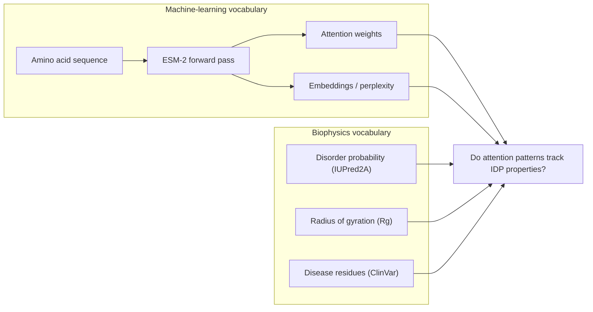
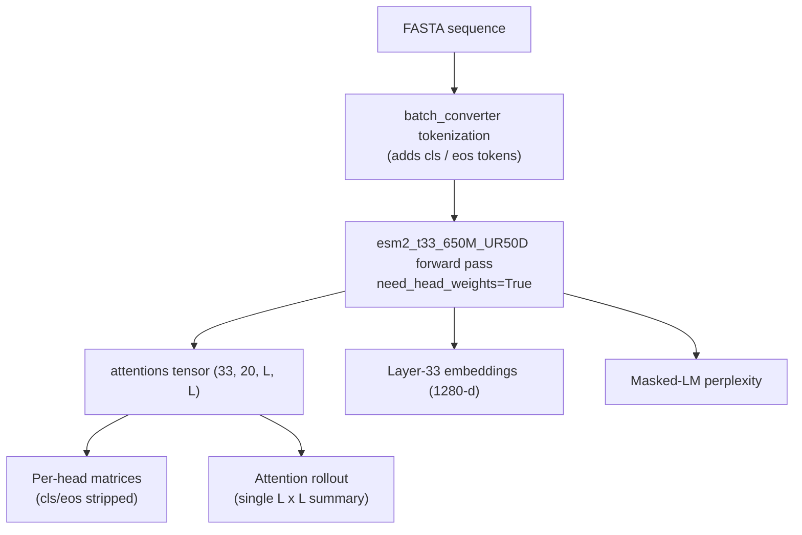
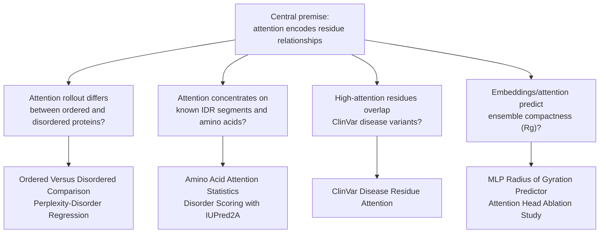

This page is the conceptual gateway to the *Interpretability Foundations* section. Everything downstream — attention rollout, disorder comparisons, Rg prediction — rests on two vocabularies: how the **ESM-2 protein language model** works as it is *concretely instantiated* in this repository, and what **intrinsically disordered proteins (IDPs)** are as *operationally measured* by this repository's scripts. No prior machine-learning or biophysics background is assumed; every claim below is anchored to code and committed data you can inspect yourself.

## Why One Research Question Needs Two Vocabularies

The repository exists to answer a single question, stated in its own paper title: does mechanistic interpretability of ESM-2 reveal structural and functional properties that the model has *encoded* about intrinsically disordered proteins? To follow any analysis in this repo, you must constantly translate between two kinds of quantities: **machine-learning quantities** (attention weights, embeddings, perplexity) and **biophysics quantities** (disorder probability, IDR segment length, radius of gyration). The code performs this translation on nearly every line, so building both vocabularies up front prevents confusion later.

The two subgraphs above are not parallel universes — the entire repo is the arrow labeled "Do attention patterns track IDP properties?" The rest of this page defines each node precisely.

Sources: [README.md](/README.md#L3-L6)

## ESM-2: The Protein Language Model as Instantiated Here

For beginners, the core idea is simple: proteins are strings written in a 20-letter alphabet (`ACDEFGHIKLMNPQRSTVWY`), and ESM-2 is a **transformer** trained on millions of natural protein sequences to predict letters that have been deliberately hidden. During that training it must learn which residues *depend* on which other residues — and the repo's bet is that this learned dependency structure is visible in the model's attention weights. The 20-letter alphabet is explicit in the code's amino acid list [esm2_ppl_by_disorder.py](/scripts/esm2_ppl_by_disorder.py#L38).

This repository uses one specific checkpoint throughout: `esm2_t33_650M_UR50D`. The name encodes the architecture — **t33** means 33 transformer layers, **650M** means ~650 million parameters, **UR50D** refers to the UniRef50 sequence database it was trained on. The table below summarizes every architecture constant as it appears in the code, so you can map each number to its definition when you read the analysis scripts.

| Property | Value in this repo | Where it is set |
|---|---|---|
| Model checkpoint | `esm2_t33_650M_UR50D` | [get_esm2_attention_matrices.py](/scripts/get_esm2_attention_matrices.py#L29-L32), [esm2_ppl_by_disorder.py](/scripts/esm2_ppl_by_disorder.py#L24-L30) |
| Transformer layers | 33 | [attention_functions.py](/scripts/attention_functions.py#L149) |
| Attention heads per layer | 20 | [attention_functions.py](/scripts/attention_functions.py#L160) |
| Embedding dimension | 1280 | [rg_mlp.py](/scripts/rg_mlp.py#L47) |
| Max residues per sequence | 1022 (1024 tokens incl. special tokens) | [rg_mlp.py](/scripts/rg_mlp.py#L45), [esm2_ppl_by_disorder.py](/scripts/esm2_ppl_by_disorder.py#L45) |
| Representation layer used for embeddings | 33 (final layer) | [rg_mlp.py](/scripts/rg_mlp.py#L44) |
| Loading APIs | fairseq `esm.pretrained` (attention), HuggingFace `AutoModelForMaskedLM` (perplexity) | both files above |

> [!TIP]
> The same model weights are loaded through **two different libraries** in this repo: the fairseq-style `esm.pretrained.esm2_t33_650M_UR50D()` for raw per-head attention, and HuggingFace's `AutoModelForMaskedLM` for masked-language-model perplexity. They are the identical checkpoint — do not treat the two loading paths as different models when comparing analyses.

Sources: [get_esm2_attention_matrices.py](/scripts/get_esm2_attention_matrices.py#L29-L32), [esm2_ppl_by_disorder.py](/scripts/esm2_ppl_by_disorder.py#L24-L38), [rg_mlp.py](/scripts/rg_mlp.py#L35-L48)

### From Sequence to Attention Tensor

Before a sequence enters the model, it is **tokenized**: each residue becomes a token, and two special tokens are added — a `<cls>` token at the start and an `<eos>` token at the end. This matters enormously for interpreting attention matrices, because the raw model output includes rows and columns for these special tokens; the downstream helper `get_head_layer_attn` explicitly slices them off with `[1:actual_seq_len+1, 1:actual_seq_len+1]` before any biological interpretation [attention_functions.py](/scripts/attention_functions.py#L273-L277).

The attention output itself is what a beginner most often visualizes incorrectly. When the extraction script calls the model with `need_head_weights=True`, the returned `attentions` tensor is **4-dimensional**: `(33 layers, 20 heads, L, L)`, where L is the padded sequence length. One 2-D slice of this — layer `i`, head `j` — is an L×L matrix in which cell `(row, col)` answers: *"how much did residue `row`'s representation draw on residue `col`'s information?"* The repository's own docstring states this shape requirement verbatim [attention_functions.py](/scripts/attention_functions.py#L148-L153), and the per-head extraction confirms it by indexing `[layer_idx, head_idx]` to pull a single `(seq_len, seq_len)` slice [attention_functions.py](/scripts/attention_functions.py#L256-L277).

> [!TIP]
> The attention tensor is **(33, 20, L, L)** — not a single L×L matrix. With 33 layers × 20 heads, there are **660 distinct attention matrices per protein**. Every analysis in this repo is fundamentally a strategy for deciding *which* of those 660 slices (or which summary of them) to compare against biology.

Sources: [get_esm2_attention_matrices.py](/scripts/get_esm2_attention_matrices.py#L45-L58), [attention_functions.py](/scripts/attention_functions.py#L148-L160), [attention_functions.py](/scripts/attention_functions.py#L256-L277)

## The Three Signals the Repo Extracts from ESM-2

Every interpretability analysis in this catalog consumes one of three derived signals, and knowing their names now makes the rest of the catalog legible. First, **per-head attention matrices** are the raw 4-D tensor saved in chunks to disk — the most detailed, least summarized view [get_esm2_attention_matrices.py](/scripts/get_esm2_attention_matrices.py#L57-L67). Second, **attention rollout** collapses all 33 layers and 20 heads into a single L×L matrix meant to approximate *total* information flow between residue pairs; the algorithm mean-fuses heads within each layer, discards the lowest 90% of attention values, blends in the identity matrix to account for residual connections, then multiplies the per-layer matrices together [attention_functions.py](/scripts/attention_functions.py#L159-L218), with fusion and discard parameters set at the call site [get_esm2_attention_rollout.py](/scripts/get_esm2_attention_rollout.py#L48). Third, **embeddings and perplexity** probe what the model *knows* rather than where it *looks*: 1280-dimensional layer-33 vectors feed a compactness (Rg) predictor [rg_mlp.py](/scripts/rg_mlp.py#L99-L104), while perplexity measures prediction surprise under 15% random masking [esm2_ppl_by_disorder.py](/scripts/esm2_ppl_by_disorder.py#L49-L83).

| Signal | Shape / form | Intuition | Consumed by (catalog page) |
|---|---|---|---|
| Per-head attention | `(33, 20, L, L)` tensor | Which residue pairs each of 660 heads links | [Attention Matrix Extraction](8-attention-matrix-extraction), [Amino Acid Attention Statistics](11-amino-acid-attention-statistics) |
| Attention rollout | `L × L` matrix | Net information flow across all layers, all heads | [Attention Rollout Algorithm](9-attention-rollout-algorithm) |
| Embeddings / perplexity | 1280-d vector / scalar per protein | What the model encodes / how predictable a sequence is | [MLP Radius of Gyration Predictor](17-mlp-radius-of-gyration-predictor), [Perplexity-Disorder Regression](16-perplexity-disorder-regression) |

Sources: [get_esm2_attention_matrices.py](/scripts/get_esm2_attention_matrices.py#L57-L67), [attention_functions.py](/scripts/attention_functions.py#L159-L218), [get_esm2_attention_rollout.py](/scripts/get_esm2_attention_rollout.py#L48), [esm2_ppl_by_disorder.py](/scripts/esm2_ppl_by_disorder.py#L49-L83), [rg_mlp.py](/scripts/rg_mlp.py#L99-L104)

## IDP Biology: Proteins Without a Single Fixed Fold

The classical structure–function paradigm says a protein sequence folds into one stable 3D shape, and that shape determines function. **Intrinsically disordered proteins (IDPs)** — and the **intrinsically disordered regions (IDRs)** within larger proteins — break this rule: they exist as a dynamic *ensemble* of interconverting conformations with no single stable fold, yet they are common and functional, especially in signaling and regulation. The repo studies both poles of this spectrum side by side, which is why its core input dataset pairs **DisProt** sequences (curated disordered proteins) with **PDB** sequences (experimentally solved, folded structures) [README.md](/README.md#L44-L46).

| Property | Ordered (folded) proteins | Intrinsically disordered proteins |
|---|---|---|
| Conformation | Single stable 3D fold | Dynamic ensemble of many conformations |
| Representative data in repo | PDB sequences | DisProt sequences, IDRome MD ensembles |
| Compactness measure | Well-defined structure | Radius of gyration (Rg) describes ensemble spread |
| Sequence character | Hydrophobic-core forming | Enriched in charged/polar residues |
| How the repo quantifies it | Serves as the "ordered" control group | IUPred2A probability scores, MD-derived Rg |

Sources: [README.md](/README.md#L44-L46), [README.md](/README.md#L56-L63)

### How "Disorder" Becomes a Number

Biology alone cannot be compared to attention matrices — it must be **operationalized**. This repository uses **IUPred2A** (run in `long` disorder mode), which assigns every residue a disorder probability between 0 and 1 [attention_functions.py](/scripts/attention_functions.py#L50-L57). Crucially, the code does not treat any residue scoring above 0.5 as disordered; it defines an IDR as a stretch of **more than 20 consecutive residues** each with probability **greater than 0.5** (constants `TH1 = 0.5`, `TH2 = 20`) [attention_functions.py](/scripts/attention_functions.py#L59-L77). This two-threshold rule is what turns a fuzzy biological concept into a countable quantity — the number of IDR residues — that can be regressed against attention statistics.

> [!TIP]
> When this documentation says a protein is "disordered," it means **disordered by this specific operational definition** (IUPred2A long-mode probability > 0.5 sustained over > 20 consecutive residues) — not an absolute biological verdict. The same sequence's disorder status can differ under other predictors or thresholds, which is why the exact thresholds are hardcoded at [attention_functions.py](/scripts/attention_functions.py#L59-L60).

Sources: [attention_functions.py](/scripts/attention_functions.py#L39-L77)

### Radius of Gyration: Measuring Ensemble Spread

The second operational quantity is the **radius of gyration (Rg)** — intuitively, the characteristic spatial size of the chain: a compact, collapsed ensemble has small Rg; an extended, expanded ensemble has large Rg, measured in Ångströms. The repo's Rg analyses draw on **IDRome**, a database of molecular-dynamics simulations of thousands of disordered regions that yields MD-derived Rg values, plus experimental SAXS-measured Rg for validation [rg_mlp.py](/scripts/rg_mlp.py#L22-L33), [README.md](/README.md#L60-L63). One subtlety worth knowing early: the prediction target is not raw Rg but the **residual** of Rg relative to a length baseline that scales with `log(N)` — because longer chains are trivially larger, the interesting signal is whether a chain is more or less compact *than its length predicts* [rg_mlp.py](/scripts/rg_mlp.py#L90-L96).

Sources: [rg_mlp.py](/scripts/rg_mlp.py#L22-L33), [rg_mlp.py](/scripts/rg_mlp.py#L90-L96), [README.md](/README.md#L60-L63)

## Where the Two Worlds Meet

The research premise that unifies this catalog is: **if ESM-2's attention weights encode which residues "matter" to which other residues, then those weights should leave measurable fingerprints on IDP biology**. Concretely, the repo tests whether attention statistics differ between disordered and ordered proteins, whether high-attention residues overlap disease-associated variants from ClinVar, whether attention-derived summaries predict ensemble size (Rg), and whether the model finds disordered sequences intrinsically less predictable (higher perplexity).

This is not just a hypothesis — a first hint is already visible in the repository's committed data. The file `data/esm2_perplexities.csv` pairs each protein's masked-LM perplexity with its mean masked-residue disorder score, and the trend is striking: a compact, cytochrome-c-like sequence has perplexity **≈ 2.35** at mean disorder **0.37**, while highly disordered sequences reach perplexity **≈ 9–15.8** at disorder scores of **0.46–0.73**. Disordered sequences are genuinely *harder for ESM-2 to predict* — exactly the kind of signal the downstream regression analyses formalize.

Sources: [esm2_perplexities.csv](/data/esm2_perplexities.csv#L1-L5), [README.md](/README.md#L3-L6)

### The Datasets Behind the Concepts

Each biological concept above is grounded in a committed dataset with its own provenance and license. Knowing which file encodes which concept will save you significant navigation time across the catalog.

| Dataset file | Biological concept | Role in the repo |
|---|---|---|
| `data/disprot.fasta` | Curated disordered proteins | Disordered group for attention comparisons |
| PDB-derived entries (`data/protein_input_sets.csv`, `data/pdb_disprot.fasta`) | Experimentally solved (ordered) structures | Ordered control group |
| `data/idrome.fasta` / IDRome DB | MD ensembles of disordered regions | Source of MD-derived Rg targets |
| `data/clinvar_sequences.csv` | Disease-associated human variants | Tests whether attention marks pathogenic residues |
| `data/esm2_perplexities.csv` | Perplexity + disorder per protein | Derived data for the perplexity regression |

Sources: [README.md](/README.md#L44-L54), [protein_input_sets.csv](/data/protein_input_sets.csv#L1-L5), [esm2_perplexities.csv](/data/esm2_perplexities.csv#L1-L5)

## Key Terms at a Glance

| Term | One-line definition for this repo |
|---|---|
| **ESM-2** | 33-layer, 20-head transformer (`esm2_t33_650M_UR50D`) trained to predict masked amino acids |
| **Attention head** | One of 660 per-protein L×L matrices of residue-to-residue information flow |
| **Attention rollout** | Single L×L summary matrix collapsing all layers and heads, including residual connections |
| **`<cls>` / `<eos>` tokens** | Special start/end tokens included in raw attention output; stripped before biological interpretation |
| **Embedding** | 1280-dimensional per-residue (or mean-pooled) vector from layer 33 |
| **Perplexity** | `exp(loss)` under 15% masking — how surprised ESM-2 is by a sequence's true residues |
| **IDP / IDR** | Protein/region lacking a single stable fold; operationalized as IUPred2A p > 0.5 over > 20 residues |
| **IUPred2A** | External tool producing per-residue disorder probability (0–1), run in `long` mode |
| **Rg (radius of gyration)** | Spatial size of the chain's conformational ensemble; modeled as residual from a `log(N)` length baseline |
| **IDRome** | MD-simulation database of thousands of disordered regions providing Rg values |

Sources: [attention_functions.py](/scripts/attention_functions.py#L59-L77), [attention_functions.py](/scripts/attention_functions.py#L148-L160), [esm2_ppl_by_disorder.py](/scripts/esm2_ppl_by_disorder.py#L40-L83), [rg_mlp.py](/scripts/rg_mlp.py#L90-L104)

## Reading Path Forward

With both vocabularies in place, the natural next step is the framing of what the pipeline is actually testing. Continue in this section with **[Research Questions and Hypotheses](7-research-questions-and-hypotheses)**, then follow the attention analysis chain: **[Attention Matrix Extraction](8-attention-matrix-extraction)** shows how the `(33, 20, L, L)` tensors are produced and stored, **[Attention Rollout Algorithm](9-attention-rollout-algorithm)** dissects the collapse-to-L×L math, and **[Disorder Scoring with IUPred2A](10-disorder-scoring-with-iupred2a)** details the operational disorder definition introduced above. If you prefer to start from the quantitative surprise signal, jump directly to **[Perplexity-Disorder Regression](16-perplexity-disorder-regression)**; if the structure side interests you more, **[MLP Radius of Gyration Predictor](17-mlp-radius-of-gyration-predictor)** builds directly on the 1280-dimensional embeddings described here.