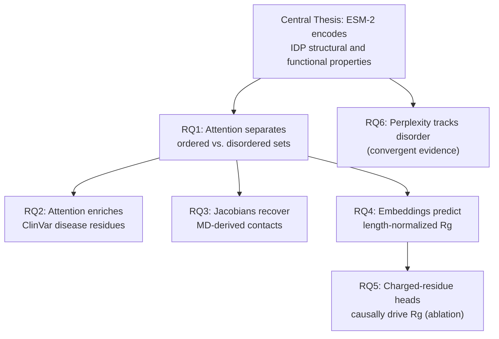

This page is the conceptual bridge between the biological background ([ESM-2 and IDP Biology Primer](6-esm-2-and-idp-biology-primer)) and the implementation deep dives that follow. Rather than describing *how* the code works (that is the job of the pipeline pages), it formalizes *why* each script exists: the specific questions the `plm_interp` authors posed about ESM-2 (`esm2_t33_650M_UR50D`), the falsifiable hypotheses attached to each question, and the statistical machinery that converts raw attention tensors into defensible evidence. Every downstream page in this catalog implements exactly one link in this hypothesis chain.

## The Central Thesis: One Claim, Six Testable Questions

The repository is organized around a single central thesis, stated in the paper title: *mechanistic interpretability of protein language models reveals encoded structural and functional properties of intrinsically disordered proteins*. Rather than testing this as one monolithic claim, the codebase decomposes it into six research questions arranged along a **causal ladder** — starting with purely correlational observations and climbing toward explicit causal intervention. Each question has a dedicated script and maps onto a numbered figure in the paper's reproduction table.

| ID | Research Question | H₀ (Null Hypothesis) | H₁ (Alternative Hypothesis) | Primary Script(s) | Figure |
|---|---|---|---|---|---|
| RQ1 | Does attention distinguish ordered from disordered proteins? | Attention is identical between PDB and DisProt sets | Attention distributions differ systematically | `attention_rollout_analysis.py` | 1–2 |
| RQ2 | Is attention enriched at disease-relevant residues? | Pathogenic and non-pathogenic residues receive equal attention | Pathogenic residues receive more attention | `clinvar_expanded.py` | 3 |
| RQ3 | Do Jacobians recover IDP contact structure? | Jacobian contacts are unrelated to MD ensemble contacts | Jacobian contacts correlate with transient MD contacts | `get_contact_maps.py`, `md_contact_maps_analysis.py` | 4 |
| RQ4 | Do embeddings encode ensemble-level physics? | Embeddings cannot predict radius of gyration beyond length scaling | Embeddings predict length-normalized Rg | `rg_mlp.py` | 5 |
| RQ5 | Which attention heads are *causally* responsible? | No specific head contributes to Rg prediction | Charged-residue-enriched heads are causal for Rg | `es_ablation2.py` | 5 |
| RQ6 | Does predictive uncertainty track disorder? | Perplexity is independent of disorder fraction | Perplexity rises with disorder | `esm2_ppl_by_disorder.py` | Supporting |

Sources: [README.md](README.md#L3-L6), [README.md](README.md#L86-L97), [attention_rollout_analysis.py](scripts/attention_rollout_analysis.py#L22-L25)

The dependency structure matters: RQ2–RQ4 are only interpretable if RQ1 establishes that attention carries *some* order/disorder signal, and RQ5 is the causal audit of the correlational result in RQ4.

Sources: [README.md](README.md#L86-L97)

## RQ1 — Do Attention Patterns Distinguish Ordered from Disordered Proteins?

The first hypothesis is tested on two deliberately contrasted input sets: PDB-derived sequences (labeled `pdb`) and DisProt-derived sequences (labeled `disprot`), assigned to groups purely by string matching on `ProteinID` and split into separate dictionaries holding their precomputed attention rollout matrices. The embeding-space version of the hypothesis is probed with UMAP of mean-pooled layer-33 representations colored by group and by IDR fraction, then quantified three ways: a silhouette score computed in the full 1280-dimensional ESM-2 space, a density comparison of per-sequence disordered-residue counts, and a logistic regression classifier evaluated under 5-fold `GroupKFold` cross-validation where groups are CD-HIT clusters at 40% sequence identity — a design choice that prevents near-identical homologs from leaking between train and test folds.

Sources: [attention_rollout_analysis.py](scripts/attention_rollout_analysis.py#L27-L38), [attention_rollout_analysis.py](scripts/attention_rollout_analysis.py#L63-L96), [attention_rollout_analysis.py](scripts/attention_rollout_analysis.py#L134-L179)

The residue-level refinement asks a sharper question: *after controlling for how often each amino acid appears*, do specific residue types receive systematically different attention in disordered versus ordered contexts? The analysis normalizes attention by per-sequence amino acid occurrence (one of three available schemes: `local`, `occurrence`, `global`), then runs the full statistical battery — Welch's t-test with `equal_var=False` plus Cohen's d with pooled standard deviation — for every combination of 20 amino acids × 33 layers × 20 heads (~13,200 comparisons), correcting with Benjamini-Hochberg FDR and keeping only results below 0.05.

Sources: [attention_functions.py](scripts/attention_functions.py#L294-L332), [attention_functions.py](scripts/attention_functions.py#L430-L530), [attention_rollout_analysis.py](scripts/attention_rollout_analysis.py#L208-L280)

A dedicated confound check plots the proportional amino-acid frequency of each set side by side, because a difference in mean attention per residue could otherwise simply reflect that disordered proteins are compositionally enriched in certain residues — the code treats composition as a rival explanation to be ruled out, not an assumption.

Sources: [attention_rollout_analysis.py](scripts/attention_rollout_analysis.py#L295-L345)

## RQ1b — Is Attention Spatially Aligned with Disorder Within Proteins?

Between RQ1 and RQ2 sits a positional hypothesis: attention received by a residue should track that residue's *local* disorder probability, not just the protein's global class. For every protein the code computes the IUPred2A long-disorder profile (residues are called disordered when probability exceeds 0.5 within stretches longer than 20) and correlates it residue-by-residue with the attention-rollout-received vector, then visualizes the resulting attention distributions stratified by disorder-probability quartile. Five single-protein case studies — TDP-43 (with NTD/RRM1/RRM2/CTD annotated regions), p53, FUS, MDM2, and APOE — overlay the two signals to make the alignment inspectable by eye.

Sources: [attention_functions.py](scripts/attention_functions.py#L26-L94), [attention_rollout_analysis.py](scripts/attention_rollout_analysis.py#L347-L380), [attention_rollout_analysis.py](scripts/attention_rollout_analysis.py#L383-L430)

## RQ2 — Does Attention Concentrate on Disease-Relevant Residues?

RQ2 upgrades "attention correlates with disorder" to "attention correlates with *function*", using pathogenicity as a functional ground truth. The cohort is built from ClinVar single-nucleotide variants only, filtered to Pathogenic / Likely pathogenic / Pathogenic-Likely pathogenic labels, then aggressively quality-controlled: sequences restricted to 50–1024 residues, sequences containing `U` removed, genes mapping to more than one RefSeq protein dropped entirely, and — most importantly — every annotated wild-type amino acid cross-validated against the residue actually retrieved from NCBI at that position, discarding mismatches.

Sources: [clinvar_expanded.py](scripts/clinvar_expanded.py#L25-L38), [clinvar_expanded.py](scripts/clinvar_expanded.py#L69-L74), [clinvar_expanded.py](scripts/clinvar_expanded.py#L100-L124)

The unit of analysis is deliberately the **within-protein attention percentile** (`attn_perc`, a per-sequence `rank(pct=True)`), not raw attention — this absorbs any protein-level differences in attention magnitude. The hypothesis is then tested at three stratification levels: the overall disease-vs-non-disease percentile distribution, the same comparison within ten disorder-percentile bins (to test whether enrichment is uniform or disorder-dependent), and within amino-acid chemistry groups (Hydrophobic, Polar, Cation, Anion, Aromatic — to test whether it is merely a chemistry artifact). IUPred2A profiles are computed alongside rollout for every unique sequence so disorder is always available as a covariate.

Sources: [clinvar_expanded.py](scripts/clinvar_expanded.py#L154-L181), [clinvar_expanded.py](scripts/clinvar_expanded.py#L199-L247)

## RQ3 — Do Model Derivatives Recover IDP Contact Structure?

This question moves from scalars to matrices. The instrument is the **categorical Jacobian** — the derivative of the 20 amino-acid logits at every position with respect to every possible 20-substitution at every other position (a `ln × 20 × ln × 20` tensor, extracted via logits slice `4:24`), followed by Average Product Correction to strip dominant eigen-component artifacts. The implementation credit is explicit: `do_apc`, `get_categorical_jacobian`, and `get_contacts` are adapted from Zhang et al.'s pLMs-interpretability work. The hypothesis is notably ambitious: IDPs lack fixed structure, so the test is whether Jacobian-derived contact scores still correspond to *transient* contacts in molecular dynamics ensembles.

Sources: [get_contact_maps.py](scripts/get_contact_maps.py#L13-L19), [get_contact_maps.py](scripts/get_contact_maps.py#L21-L56)

Validation against MD is treated as a formal hypothesis test, not a visual comparison. For each protein, the observed statistic is the Spearman correlation between MD contact strength and Jacobian contact fraction; the null distribution is generated by 1,000 random permutations of the contact-strength vector (seeded, vectorized), yielding a z-score and a one-sided empirical p-value of `(count(null ≥ observed) + 1) / (1001)`. A companion sweep (`md_variable_cutoff.py`) re-derives the MD contact definition under variable distance cutoffs so the conclusion is not an artifact of one arbitrary σ.

Sources: [md_contact_maps_analysis.py](scripts/md_contact_maps_analysis.py#L17-L42), [md_contact_maps_analysis.py](scripts/md_contact_maps_analysis.py#L44-L70)

## RQ4 — Do Embeddings Encode Ensemble-Level Physics?

The physical quantity chosen is the radius of gyration (Rg), the canonical scalar summary of an IDP ensemble size. Ground truth comes from two independent sources: IDRome MD-derived Rg values (Tesei et al.) and experimental SAXS Rg. The critical design decision is that the MLP (1280 → 512 → 256 → 128 → 1, with LayerNorm/GELU/Dropout 0.3) does *not* predict raw Rg — it predicts the **residual over a polymer-scaling baseline**, then the final prediction is reconstructed as residual + `baseline_poly(log N)` and evaluated as reduced Rg, `Rg / (R0 · N^ν)` with fitted constants ν = 0.533, R₀ = 2.420.

> [!TIP]
> Predicting the residual over the length-scaling law is what makes RQ4 falsifiable: a model that only memorized sequence length would score exactly zero on this target, so any nonzero Spearman correlation is attributable to sequence-encoding content beyond trivial size scaling.

Sources: [rg_mlp.py](scripts/rg_mlp.py#L14-L34), [es_ablation2.py](scripts/es_ablation2.py#L26-L32), [es_ablation2.py](scripts/es_ablation2.py#L197-L199), [es_ablation2.py](scripts/es_ablation2.py#L239-L253)

## RQ5 — Which Heads Are Causally Responsible? (The Electrostatics Hypothesis)

RQ5 is the repository's causal capstone, stated verbatim in the script docstring: ablate heads likely associated with electrostatics and evaluate the effect on MLP Rg prediction. Head *selection* is correlational — heads are ranked by mean occurrence-normalized attention to positively charged residues (K, R) and negatively charged residues (D, E), read from the committed `data/attn_corr_norm_es.csv` — and the circuit-level hypothesis is probed by computing pairwise correlations between the D/E and K/R head-attention heatmaps across all 660 layer-head units.

Sources: [es_ablation2.py](scripts/es_ablation2.py#L22-L24), [es_ablation2.py](scripts/es_ablation2.py#L127-L137), [es_ablation2.py](scripts/es_ablation2.py#L183-L199)

The *intervention* is a true zero-ablation: forward pre-hooks registered on `out_proj`'s **input** zero the 64-dimensional slice of the concatenated per-head output before the output projection mixes heads, setting `Att_h(x) = 0` while every other head passes through untouched. Cumulative ablation sweeps (up to 50 heads) are run for the targeted charged-residue rankings and compared against 5 seeded random-ablation control runs, with degradation measured as ΔSpearman / ΔPearson / ΔMAE on normalized Rg for both the IDRome test split (held out by `GroupShuffleSplit` over CD-HIT clusters) and the SAXS set.

> [!TIP]
> The hook targets `out_proj`'s *input*, not its output — zeroing after the output projection would contaminate neighboring heads via the projection matrix, silently invalidating the causal claim. This placement is the difference between a clean single-head lesion and a leaked multi-head lesion.

Sources: [es_ablation2.py](scripts/es_ablation2.py#L202-L253), [es_ablation2.py](scripts/es_ablation2.py#L276-L280)

## RQ6 — Does Predictive Uncertainty Track Disorder?

The final hypothesis uses a completely different lens on the same question: if IDPs sit outside the evolutionary statistics ESM-2 absorbed during training, the model's masked-LM perplexity should be elevated on them. The script computes per-protein perplexity under standard 15% random masking and runs an OLS regression of perplexity on disorder (using the same IUPred2A machinery), providing convergent, attention-independent evidence for the central thesis.

Sources: [esm2_ppl_by_disorder.py](scripts/esm2_ppl_by_disorder.py#L13-L15), [esm2_ppl_by_disorder.py](scripts/esm2_ppl_by_disorder.py#L36-L43)

## The Shared Statistical Doctrine

The six hypotheses are disciplined by a common control vocabulary. This is the single most important table on this page: every potential confounder identified in the analysis design has a named, code-level countermeasure.

| Threat to Validity | Countermeasure | Implementation |
|---|---|---|
| Homolog leakage inflating classifier/probe accuracy | CD-HIT 40%-identity clusters as CV groups | `GroupKFold` / `GroupShuffleSplit` over `.clstr` files |
| Amino-acid composition confound | Occurrence-normalized attention + explicit composition plots | `get_aa_attn_perc(normalize='occurrence')`, `comb_props` |
| Multiple comparisons (~13,200 t-tests) | Benjamini-Hochberg FDR at α = 0.05 | `false_discovery_control`, `multipletests` |
| Unequal variances between groups | Welch's t-test (`equal_var=False`) | `fast_statistical_comparison`, `cohens_d` |
| Arbitrary contact-map cutoff | Variable distance-cutoff sweep + permutation nulls | `md_variable_cutoff.py`, `compute_null_distribution_for_protein` |
| Protein-level attention scale differences | Within-protein percentile ranking | `rank(pct=True)` in `clinvar_expanded.py` |
| Length confound in Rg | Residual over fitted scaling law `R0·N^ν` | `to_rg` / `baseline_poly` in `es_ablation2.py` |
| "Any ablation hurts" artifact | 5-run seeded random-ablation control | `run_sweep` with `N_RANDOM_RUNS = 5` |

Sources: [attention_functions.py](scripts/attention_functions.py#L430-L530), [es_ablation2.py](scripts/es_ablation2.py#L276-L280), [md_contact_maps_analysis.py](scripts/md_contact_maps_analysis.py#L17-L42)

## How to Read the Rest of the Catalog Through This Lens

Every remaining page is the implementation record of one row in the hypothesis table. The measurement layer comes first: [Attention Matrix Extraction](8-attention-matrix-extraction) and [Attention Rollout Algorithm](9-attention-rollout-algorithm) build the attention tensors that RQ1 consumes, while [Disorder Scoring with IUPred2A](10-disorder-scoring-with-iupred2a) supplies the ground-truth labels used by RQ1, RQ1b, and RQ6. The validation pages then execute the hypotheses in causal-ladder order: [Ordered Versus Disordered Comparison](12-ordered-versus-disordered-comparison) and [Amino Acid Attention Statistics](11-amino-acid-attention-statistics) resolve RQ1; [ClinVar Disease Residue Attention](13-clinvar-disease-residue-attention) resolves RQ2; [Categorical Jacobian Contact Maps](14-categorical-jacobian-contact-maps) with [MD Trajectory Contact Validation](15-md-trajectory-contact-validation) resolve RQ3; [Perplexity-Disorder Regression](16-perplexity-disorder-regression) resolves RQ6; and [MLP Radius of Gyration Predictor](17-mlp-radius-of-gyration-predictor), [Attention Head Ablation Study](18-attention-head-ablation-study), and [Electrostatics Hypothesis Testing](19-electrostatics-hypothesis-testing) resolve RQ4 and RQ5.
