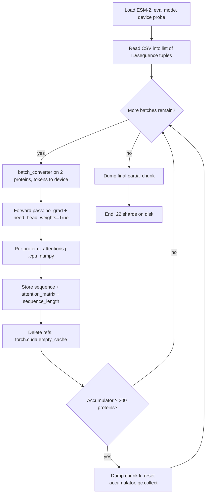

This page documents the repository's foundation stone: converting raw protein sequences into persisted, per-residue attention tensors from ESM-2. The entry point is `scripts/get_esm2_attention_matrices.py`, which runs a 33-layer, 20-head transformer over 4,241 curated protein sequences and shards the resulting ~660 attention matrices per protein into 22 compressed chunks. Everything downstream in the *Attention Analysis Pipeline* — attention rollout, amino acid statistics, disorder correlations — consumes these artifacts, so understanding the exact output contract (tensor shape, token offsets, chunk naming) is a prerequisite for any modification to the pipeline. This page focuses strictly on extraction; the mathematical post-processing lives in [Attention Rollout Algorithm](9-attention-rollout-algorithm).

Sources: [get_esm2_attention_matrices.py](scripts/get_esm2_attention_matrices.py#L12-L15), [README.md](README.md#L44-L48)

## Architectural Overview

The extraction stage sits at the head of the attention analysis pipeline. It reads the curated dataset committed at `data/protein_input_sets.csv` (4,241 sequence/ID pairs, including both DisProt and PDB-derived proteins), tokenizes and pads sequences in micro-batches, performs a single forward pass per batch on the GPU, and then reshapes the batch-level attention tensor into one dictionary entry per protein. Because a single long protein's attention tensor can exceed 2 GB, the script deliberately never accumulates everything in memory: results flush to disk every 200 proteins, and GPU caches are purged after every batch.

```mermaid
flowchart LR
    A["data/protein_input_sets.csv<br/>(Sequence, ProteinID × 4,241)"] --> B["batch_converter<br/>tokenize + pad + add BOS/EOS"]
    B --> C["GPU forward pass<br/>need_head_weights=True"]
    C --> D["results['attentions']<br/>(batch, 33, 20, L_pad, L_pad)"]
    D --> E["Per-protein record<br/>sequence · attention_matrix · sequence_length"]
    E --> F["all_results accumulator"]
    F -->|&ge; 200 proteins| G["joblib.dump<br/>compress=3"]
    G --> H["attention_matrices_chunks/<br/>..._labeled_{0..21}_original.joblib"]
    H --> I["Downstream consumers:<br/>rollout · per-head statistics"]
```

Sources: [get_esm2_attention_matrices.py](scripts/get_esm2_attention_matrices.py#L34-L45), [get_esm2_attention_matrices.py](scripts/get_esm2_attention_matrices.py#L51-L78), [protein_input_sets.csv](data/protein_input_sets.csv#L1-L2)

## Model Configuration and Environment Probing

The script instantiates `esm.pretrained.esm2_t33_650M_UR50D()` via the `fair-esm` package (pinned at `2.0.0`), operating under `torch==2.5.1+cu121` inside the `torch-gpu` conda environment. Two details matter here for extraction semantics. First, `model.eval()` is called explicitly, disabling dropout so attention weights are deterministic per sequence. Second, the header block prints the torch version, CUDA availability, GPU name, and total GPU memory before any work begins — an intentional diagnostic that surfaces hardware constraints *before* a multi-hour extraction job fails mid-run.

| Extraction Parameter | Value | Purpose | Code Location |
|---|---|---|---|
| Model checkpoint | `esm2_t33_650M_UR50D` | 33 transformer layers, 650M parameters, 20 heads/layer | [L29](scripts/get_esm2_attention_matrices.py#L29) |
| Mode | `model.eval()` | Deterministic attention (no dropout) | [L32](scripts/get_esm2_attention_matrices.py#L32) |
| Device | CUDA if available, else CPU | Auto-selected at import time | [L23](scripts/get_esm2_attention_matrices.py#L23) |
| `batch_size` | 2 | Fits attention tensors in GPU memory budget | [L45](scripts/get_esm2_attention_matrices.py#L45) |
| `need_head_weights` | `True` | Returns per-head matrices instead of head-averaged only | [L55](scripts/get_esm2_attention_matrices.py#L55) |
| `save_interval` | 200 proteins | Chunk flush frequency | [L42](scripts/get_esm2_attention_matrices.py#L42) |
| `model_type` | `'original'` | Encoded into chunk filenames to distinguish from fine-tuned variants | [L38](scripts/get_esm2_attention_matrices.py#L38) |

Sources: [get_esm2_attention_matrices.py](scripts/get_esm2_attention_matrices.py#L19-L32), [environment.yml](environment.yml#L486), [environment.yml](environment.yml#L553)

## The Extraction Loop, Step by Step

Each iteration processes exactly two proteins through a five-stage micro-cycle: tokenize on CPU, transfer tokens to device, forward under `torch.no_grad()`, slice out per-protein tensors, and purge GPU memory. The critical call is `model(batch_tokens, need_head_weights=True)` — without this flag, fair-esm returns head-averaged attention only, collapsing the 20 heads per layer into one and forfeiting the per-head analysis that [Amino Acid Attention Statistics](11-amino-acid-attention-statistics) depends on. The resulting `results["attentions"]` tensor has shape `(batch, 33, 20, L_pad, L_pad)`, where `L_pad` includes the `<cls>` token, the residues, the `<eos>` token, and any padding to the longest sequence in the batch.

Alongside the attention tensor, the script records `raw_sequence_lengths` computed as `len(seq)` over the *unmodified* amino acid strings — special tokens excluded. This integer is the pipeline's coordinate system: every downstream consumer uses it to trim the padded tensor back to true residues.

Sources: [get_esm2_attention_matrices.py](scripts/get_esm2_attention_matrices.py#L47-L58), [get_esm2_attention_matrices.py](scripts/get_esm2_attention_matrices.py#L61-L67), [attention_functions.py](scripts/attention_functions.py#L149-L160)

## Output Contract: The Chunk File Schema

Extraction writes `attention_matrices_chunks/attention_matrices_labeled_{chunk_num}_{model_type}.joblib` with zlib compression level 3. Each chunk is a dictionary keyed by protein ID, so consumers gain random access to any protein without loading the full corpus — but any given chunk must still be deserialized whole. With 4,241 proteins flushed at intervals of 200, the arithmetic yields ⌈4241/200⌉ = 22 chunks, indexed 0 through 21. This is not incidental: both downstream consumers hardcode `range(0, 22)` over these shards, making the chunk count a de facto coupling point between extraction and analysis code. Changing `save_interval` in the extractor silently breaks every consumer.

| Contract Aspect | Value | Verified By |
|---|---|---|
| File path pattern | `attention_matrices_chunks/attention_matrices_labeled_{0..21}_original.joblib` | [L78, L87](scripts/get_esm2_attention_matrices.py#L76-L87) |
| Top-level structure | `dict[ProteinID → record]` | [L63](scripts/get_esm2_attention_matrices.py#L61-L67) |
| Record: `sequence` | Raw amino acid string (no special tokens) | [L64](scripts/get_esm2_attention_matrices.py#L61-L67) |
| Record: `attention_matrix` | `float32`, shape `(33, 20, L_pad, L_pad)` | [L65](scripts/get_esm2_attention_matrices.py#L61-L67) |
| Record: `sequence_length` | Integer `L`, raw residue count | [L66](scripts/get_esm2_attention_matrices.py#L58) |
| Chunk count | 22 (indices 0–21) | [attention_functions.py L349](scripts/attention_functions.py#L349), [get_esm2_attention_rollout.py L36](scripts/get_esm2_attention_rollout.py#L36-L39) |
| Loader utility | `safe_load(path)` — runs `gc.collect()` then `joblib.load` | [attention_functions.py](scripts/attention_functions.py#L252-L254) |

The token layout inside the padded matrix follows ESM-2's convention: index `0` is `<cls>`, indices `1..L` are the actual residues, index `L+1` is `<eos>`, and anything beyond is batch padding. The extraction stores the *full padded* tensor per protein and preserves `sequence_length` so consumers can trim it themselves — `get_head_layer_attn` in `attention_functions.py` is the canonical example, slicing `[1:actual_seq_len+1, 1:actual_seq_len+1]` to yield a clean `(L, L)` residue-only matrix.

> [!TIP]
> All offset arithmetic in downstream code assumes residue *i* lives at matrix index *i + 1*. If you regenerate chunks with a different tokenizer or prepend sequences, `get_head_layer_attn`'s `[1:L+1]` slice and every length bookkeeping step will silently misalign. The cleanest safeguard is to always derive offsets from the stored `sequence_length` field, never from matrix dimensions.

Sources: [get_esm2_attention_matrices.py](scripts/get_esm2_attention_matrices.py#L76-L87), [attention_functions.py](scripts/attention_functions.py#L256-L277), [attention_functions.py](scripts/attention_functions.py#L349-L350), [get_esm2_attention_rollout.py](scripts/get_esm2_attention_rollout.py#L36-L39)

> [!TIP]
> Matrix orientation convention: rows are queries (positions doing the attending), columns are keys (positions being attended). This is confirmed by `get_aa_attn_perc`, which computes "attention received by each amino acid" via `attn_matrix.sum(axis=0)` — summing over columns. Any custom statistic you add should inherit this row-query/column-key orientation or your interpretations will be transposed.

Sources: [attention_functions.py](scripts/attention_functions.py#L296-L301)

## Memory Strategy During Extraction

The extraction is dominated by a quadratic scaling problem: each protein's attention tensor contains 33 × 20 = 660 `(L_pad × L_pad)` float32 slices. For a 500-residue protein (padded length 502), that is 660 × 502² × 4 B ≈ 0.66 GB; at 1,000 residues it climbs to ≈ 2.65 GB per protein. This arithmetic alone justifies the design choices — `batch_size = 2`, immediate `.cpu().numpy()` transfer after the forward pass, `torch.cuda.empty_cache()` after every batch, and `gc.collect()` after each 200-protein chunk flush. The deletion block uses `del locals()[obj]`, which works at module scope because `locals()` aliases `globals()` there; inside a function scope this idiom would not actually free the names. The full rationale for these techniques — including why compression level 3 was chosen over higher levels — is expanded in [Large Tensor Memory Management](20-large-tensor-memory-management).

Sources: [get_esm2_attention_matrices.py](scripts/get_esm2_attention_matrices.py#L45-L74), [get_esm2_attention_matrices.py](scripts/get_esm2_attention_matrices.py#L82-L87)

## Reproduction Context and Input Provenance

The attention matrices themselves are **not committed to GitHub** — the README states explicitly that they must be regenerated with `python scripts/get_esm2_attention_matrices.py`, outputting to `/attention_matrices_chunks`. This makes the extraction step the mandatory first stage of reproducing Figures 1 and 2, each of which chains extraction → rollout computation → analysis. The input dataset `data/protein_input_sets.csv` is the *derived* artifact of dataset curation (DisProt release 2025_06 and PDB sequences accessed July 16, 2025), and the repository's reproducibility policy lets you either reuse the committed sequences exactly or regenerate them from live databases via `define_pdb_disprot_datasets.py` — see [Dataset Curation and CD-HIT Clustering](21-dataset-curation-and-cd-hit-clustering) and [Derived Versus Live Data Reproducibility](22-derived-versus-live-data-reproducibility) for that upstream decision. For the biological and modeling context of why per-head attention from ESM-2 is informative for intrinsically disordered proteins, consult [ESM-2 and IDP Biology Primer](6-esm-2-and-idp-biology-primer).

Sources: [README.md](README.md#L44-L48), [README.md](README.md#L88-L97), [esm2_interp_data.py](scripts/esm2_interp_data.py#L20-L27), [esm2_interp_data.py](scripts/esm2_interp_data.py#L38-L46)

## Summary of Key Invariants

Before moving on, anchor these four facts, since every attention analysis page builds on them: (1) stored tensors are **per-head and per-layer** — `(33, 20, L_pad, L_pad)` — because `need_head_weights=True`; (2) chunk shards are keyed by protein ID with **22 shards** derived from `save_interval = 200`; (3) `sequence_length` is the **only** authoritative length, since stored matrices are padded; and (4) data is **not distributed** — extraction must run locally on a CUDA-capable machine, typically hours of GPU time. With the extraction contract established, the natural next step is how these raw tensors are distilled into interpretable residue-level signals.

Sources: [get_esm2_attention_matrices.py](scripts/get_esm2_attention_matrices.py#L29-L45), [get_esm2_attention_matrices.py](scripts/get_esm2_attention_matrices.py#L55-L67)

## Next Steps

- **[Attention Rollout Algorithm](9-attention-rollout-algorithm)** — how the extracted `(33, 20, L, L)` tensors are fused across heads and layers into a single rollout matrix; this is the primary consumer of the chunks documented above.
- **[Amino Acid Attention Statistics](11-amino-acid-attention-statistics)** — the per-head/per-layer statistical analyses enabled by storing head-separated matrices.
- **[Large Tensor Memory Management](20-large-tensor-memory-management)** — deep dive into the batching, purging, and chunking strategy touched on above.
- **[Dataset Curation and CD-HIT Clustering](21-dataset-curation-and-cd-hit-clustering)** — how `protein_input_sets.csv`, this page's input, was constructed.