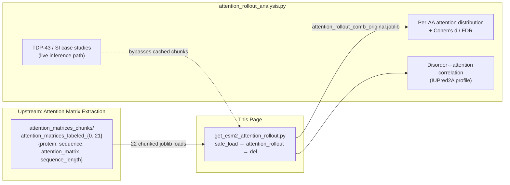
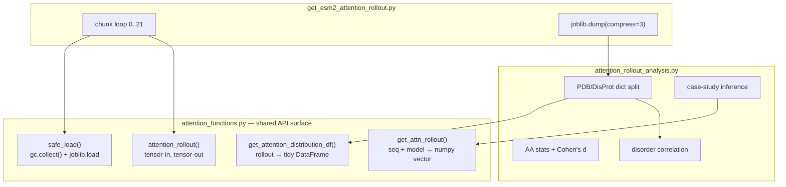
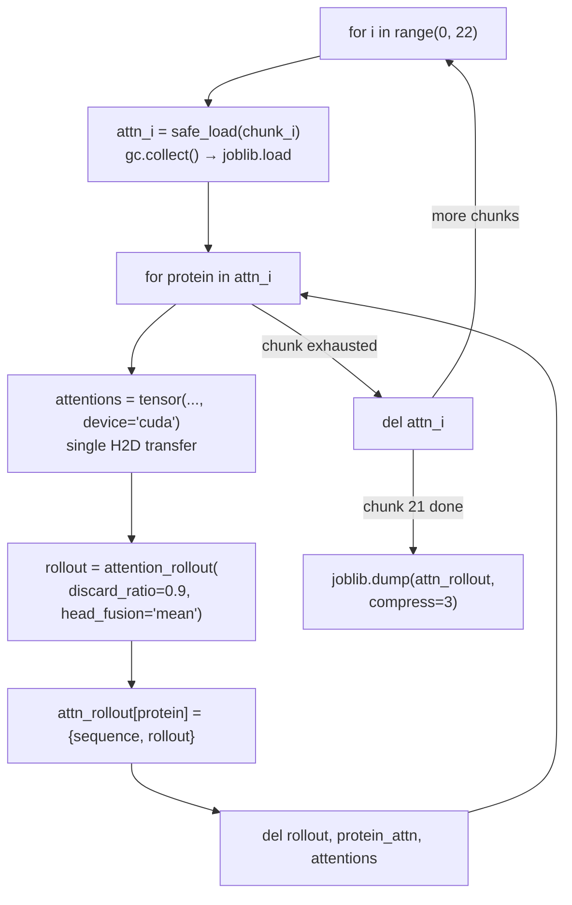

This page dissects the mechanism that collapses ESM-2's 33-layer × 20-head attention tensor into a single `(L, L)` residue-interaction matrix per protein — the **attention rollout**. It covers the mathematical foundation, the six-stage implementation in `attention_functions.py`, the chunked batch orchestrator, and how downstream analyses consume the resulting "attention received" signal. This page sits between upstream raw matrix extraction and downstream statistical validation; for how the `(33, 20, x, x)` tensors are produced in the first place, see [Attention Matrix Extraction](8-attention-matrix-extraction).

Sources: [attention_functions.py](scripts/attention_functions.py#L144-L218), [get_esm2_attention_rollout.py](scripts/get_esm2_attention_rollout.py#L32-L56)

## Architectural Position and Module Interaction

The rollout occupies the transformation bottleneck of the attention pipeline: it converts bulky, cached raw attention artifacts into a compact per-protein summary that every subsequent statistical analysis depends on. Three modules collaborate through a strict producer–library–consumer decomposition — the orchestrator never re-implements algorithmic logic, and the analysis script never touches raw attention tensors.

- **`attention_functions.py`** — the shared library: `attention_rollout()` (the algorithm), `get_attn_rollout()` (single-sequence live-inference wrapper), `safe_load()` (memory-conscious chunk loader), and `get_attention_distribution_df()` (matrix→table reduction).
- **`get_esm2_attention_rollout.py`** — the batch orchestrator: iterates 22 pre-computed joblib chunks, applies rollout per protein, persists one combined artifact.
- **`attention_rollout_analysis.py`** — the consumer: splits results into PDB (ordered) vs DisProt (disordered) cohorts and derives every figure-level statistic.

Sources: [attention_functions.py](scripts/attention_functions.py#L102-L142), [get_esm2_attention_rollout.py](scripts/get_esm2_attention_rollout.py#L36-L56), [attention_rollout_analysis.py](scripts/attention_rollout_analysis.py#L39-L45)

Sources: [get_esm2_attention_rollout.py](scripts/get_esm2_attention_rollout.py#L10), [attention_rollout_analysis.py](scripts/attention_rollout_analysis.py#L206-L220), [attention_rollout_analysis.py](scripts/attention_rollout_analysis.py#L343-L370)

## Mathematical Foundation

Raw attention matrices describe only *direct* token-to-token information flow within a single layer. Attention rollout (Abnar & Zuidema, 2020) recovers *indirect* flow: if residue `i` attends strongly to `j` in layer 1, and `j` attends strongly to `k` in layer 2, rollout attributes signal to the `i → k` path by composing the per-layer transition matrices. The implementation formalizes this in three moves per layer:

1. **Head fusion** — collapse the 20 heads into one `(x, x)` matrix via `dim=0` aggregation.
2. **Stochasticization** — after masking special tokens and sparsifying, inject residual connections as `(A + I) / 2`, then row-normalize so each row sums to 1. Row normalization is applied *after* residual injection because `(A + I)/2` rows no longer sum to unity — the division at line 211 is what makes each layer a valid Markov transition operator.
3. **Composition** — multiply the 33 normalized matrices in sequence order: `R = Ã⁽³³⁾ · Ã⁽³²⁾ · … · Ã⁽¹⁾`, with `R[i, j]` quantifying total (direct + indirect) attention flowing from residue `i` to residue `j`.

Sources: [attention_functions.py](scripts/attention_functions.py#L209-L218)

## Inside `attention_rollout()`: Stage-by-Stage Tensor Analysis

The function accepts a padded attention stack of shape `(33, 20, x, x)` — where `x` includes `<cls>`, the protein residues, `<eos>`, and any batch padding — plus the raw length `L`. It returns a rollout matrix of shape `(L, L)` (or `(L+1, L+1)` if `include_cls=True`): all special-token structure is eliminated before return. The stages below trace exact shapes through the code.

| Stage | Code Region | Input Shape | Output Shape | Purpose |
|---|---|---|---|---|
| 1. Head fusion | L162–177 | per-layer `(20, x, x)` | list of 33 × `(x, x)` | collapse heads into layer consensus |
| 2. Special-token mask | L184–200 | `(x, x)` | `(x, x)`, zeroed outside `[start:end]²` | confine signal to real residues |
| 3. Quantile discard | L201–208 | `(L', L')` | sparsified `(L', L')` | keep top 10% of attention mass |
| 4. Residual injection | L209–210 | `(L', L')` | `(A + I)/2`, shape `(L', L')` | preserve identity/self-attention path |
| 5. Row normalization | L211–212 | `(L', L')` | row-stochastic `(L', L')` | Markov transition validity |
| 6. Composition | L214–218 | 33 × `(L', L')` | `(L', L')` | cross-layer information flow |

Here `L' = L` normally, or `L + 1` when `include_cls=True` (line 192).

Sources: [attention_functions.py](scripts/attention_functions.py#L144-L218)

### Stage 1 — Head Fusion and the `dim=0` Contract

Each layer's `(20, x, x)` tensor is reduced over heads with `attention.mean(dim=0)` (or `max`/`min`). The code comments are unusually explicit about the dimensional contract: `dim=0` is mandatory because head count lives on axis 0; using `dim=1` or `dim=2` would silently produce a malformed `(20, x)` result instead of the intended `(x, x)`. An invalid `head_fusion` string raises `ValueError` immediately rather than defaulting silently (lines 175–176).

Sources: [attention_functions.py](scripts/attention_functions.py#L159-L179)

> [!TIP]
> Fusion via `mean`/`max`/`min` allocates a **fresh tensor**, so the subsequent in-place mutation `layer_attn *= mask` (line 199) never touches the caller's cached `attentions` stack. This is what makes chunk reuse safe — the orchestrator can drop references (`del`) after processing without corrupting anything.

### Stage 2 — Special-Token Masking

Masking operates on a boolean region of ones: `mask[start_idx:end_idx, start_idx:end_idx] = 1`, where `start_idx = 1` skips `<cls>` and `end_idx = start_idx + L` spans exactly the protein residues (tokenized ESM-2 sequences place residues at indices `1..L`, with `<eos>` and padding beyond). Multiplying element-wise zeroes every row and column associated with `<cls>`, `<eos>`, and padding, guaranteeing they can neither emit nor receive rollout signal.

Sources: [attention_functions.py](scripts/attention_functions.py#L183-L200)

### Stage 3 — Quantile Discard

For each layer, the valid `(L', L')` submatrix is flattened and `torch.quantile(flat_att, discard_ratio)` computes a cutoff; entries strictly below it are zeroed via a boolean mask multiplication (line 206). With the production value `discard_ratio=0.9`, only the top ~10% of attention mass per layer survives into composition — a sparsification step that suppresses diffuse, low-signal edges and concentrates rollout on high-confidence pathways.

Sources: [attention_functions.py](scripts/attention_functions.py#L201-L208)

> [!TIP]
> The quantile is computed **after** masking, so the flattened distribution includes the zeros introduced by Stage 2 — the 90th-percentile threshold therefore reflects the masked distribution, not the raw one. Combined with the `>=` comparison (which retains threshold ties), the retained mass is the top decile *of the cleaned distribution*, slightly more aggressive than a naive top-10% over raw values.

### Stages 4–6 — Residual, Normalization, Composition

`I = torch.eye(actual_len)` is built on the target device, `(protein_attn + I) / 2` injects the residual path at exactly half weight, and row-wise normalization (`sum(dim=-1, keepdim=True)` division) yields a row-stochastic matrix. Composition then left-multiplies each successive layer onto an accumulator seeded with layer 1's matrix — `torch.matmul(joint_attention, rollout)` — so the final tensor is `Ã⁽³³⁾ · … · Ã⁽¹⁾` and `R[i, j]` reads as flow *from* `i` *to* `j`.

Sources: [attention_functions.py](scripts/attention_functions.py#L209-L218)

## Head Fusion Strategy Comparison

Only `"mean"` is used in production (both orchestrator and wrapper hard-code it), but the function exposes three fusion semantics with distinct interpretive consequences:

| Strategy | Reduction (`dim=0`) | Saliency Character | Risk Profile |
|---|---|---|---|
| `mean` (production) | `attention.mean(dim=0)` | Consensus flow; robust to individual-head noise | Dampens strongly specialized heads |
| `max` | `attention.max(dim=0)[0]` | Strongest path per position; sharp, high-contrast rollout | Overweights single-head outliers |
| `min` | `attention.min(dim=0)[0]` | Weakest-path estimate; conservative lower bound | Can erase genuine signal |

Sources: [attention_functions.py](scripts/attention_functions.py#L169-L177), [get_esm2_attention_rollout.py](scripts/get_esm2_attention_rollout.py#L48)

## Parameter Reference

| Parameter | Type | Default | Verified Usage | Effect |
|---|---|---|---|---|
| `attentions` | tensor | — | `(33, 20, x, x)` padded stack | raw input to be rolled out |
| `raw_sequence_lengths` | int | — | per-protein `sequence_length` field | defines the retained residue window |
| `discard_ratio` | float | 0.9 | 0.9 in orchestrator (L48) and wrapper (L246) | quantile cutoff for Stage 3 sparsification |
| `head_fusion` | str | `"mean"` | `"mean"` everywhere | Stage 1 reduction rule |
| `include_cls` | bool | `False` | never set `True` in production | widens window to include `<cls>` row/col |
| `device` | str | `'cpu'` | CUDA when available | hosts `eye`, matmuls, quantile |

Sources: [attention_functions.py](scripts/attention_functions.py#L144-L158), [get_esm2_attention_rollout.py](scripts/get_esm2_attention_rollout.py#L20), [get_esm2_attention_rollout.py](scripts/get_esm2_attention_rollout.py#L48)

## Batch Orchestration: Chunked, Memory-Bounded Execution

The orchestrator processes the corpus in 22 sequential joblib chunks, applying the pipeline `safe_load → per-protein rollout → del → del chunk`. Each protein's dict is unpacked into `sequence`, `attention_matrix` (moved to GPU exactly once, line 45), and `sequence_length`; the rollout call is issued with production defaults (`discard_ratio=0.9`, `head_fusion="mean"`). Explicit `del` statements after every protein and every chunk, combined with `safe_load`'s `gc.collect()` before each load, keep peak memory bounded to roughly one chunk plus one protein. The final accumulator — a flat dict mapping protein ID to `{'sequence', 'rollout'}` — is persisted with `joblib.dump(..., compress=3)` as the canonical downstream artifact `attention_rollout_comb_original.joblib`.

Sources: [get_esm2_attention_rollout.py](scripts/get_esm2_attention_rollout.py#L33-L56), [attention_functions.py](scripts/attention_functions.py#L252-L254)

## From Matrix to Signal: The "Attention Received" Reduction

Every downstream statistic operates on a single derived quantity: the **attention received** vector, computed as the column sum of the rollout matrix — `rollout.sum(dim=0)` — so entry `j` measures total incoming attention at residue `j` after cross-layer composition. This reduction appears in three independent places, all consistent:

- `get_attn_rollout()` (lines 247–248) performs the same column-sum inside the live-inference wrapper, which encodes a raw sequence via the tokenizer, runs the model under `torch.no_grad()` with `output_attentions=True`, stacks the 33 layer tensors at batch index 0, and returns a NumPy vector of length `L`.
- `get_attention_distribution_df()` (line 123) applies `attn_matrix.sum(axis=0)` per protein, emitting tidy records of `(protein_id, amino_acid, attention)` with optional min-max normalization or z-standardization.
- The disorder-correlation block (line 350) calls `data['rollout'].sum(dim=0).cpu().numpy()` directly on loaded artifacts before pairing with IUPred2A per-residue probabilities.

Sources: [attention_functions.py](scripts/attention_functions.py#L220-L249), [attention_functions.py](scripts/attention_functions.py#L115-L142), [attention_rollout_analysis.py](scripts/attention_rollout_analysis.py#L343-L363)

## Downstream Consumption Patterns

The rollout artifact feeds three distinct analysis patterns, each isolating a different facet of the signal:

| Pattern | Input | Statistical Treatment | Output Artifact |
|---|---|---|---|
| Per-AA distribution | `get_attention_distribution_df` over PDB/DisProt dicts | group means ± SE, Cohen's d, FDR correction | `mean_aa_attn.csv` + bar figure |
| Disorder correlation | per-residue `attn_received` paired with IUPred2A profile | per-protein Pearson correlation; KDE by disorder-probability bin | `disorder_comp_concat.csv` + KDE figure |
| Case studies | `get_attn_rollout` live on 5 named proteins (TDP-43, P53, FUS, MDM2, APOE) | qualitative overlay of attention vs disorder per region | `si_examples.csv` + TDP-43 region figure |

Notably, the case-study path deliberately **bypasses the cached chunks** and re-runs model inference live — demonstrating that `get_attn_rollout` provides a self-contained end-to-end path (sequence → tokens → forward pass → rollout → received vector) without any dependence on pre-computed artifacts. The disorder side of these comparisons is detailed in [Disorder Scoring with IUPred2A](10-disorder-scoring-with-iupred2a), and the statistical treatment of per-residue attention in [Amino Acid Attention Statistics](11-amino-acid-attention-statistics).

Sources: [attention_rollout_analysis.py](scripts/attention_rollout_analysis.py#L206-L220), [attention_rollout_analysis.py](scripts/attention_rollout_analysis.py#L343-L387), [attention_rollout_analysis.py](scripts/attention_rollout_analysis.py#L393-L453)

## Next Steps

To continue through the pipeline in dependency order:

- See how the `(33, 20, x, x)` inputs are produced and cached: [Attention Matrix Extraction](8-attention-matrix-extraction)
- Understand the disorder scores that rollout vectors are correlated against: [Disorder Scoring with IUPred2A](10-disorder-scoring-with-iupred2a)
- Deep-dive the per-head/layer attention statistics that complement rollout: [Amino Acid Attention Statistics](11-amino-acid-attention-statistics)
- Review the memory-management strategies the chunked orchestrator relies on: [Large Tensor Memory Management](20-large-tensor-memory-management)