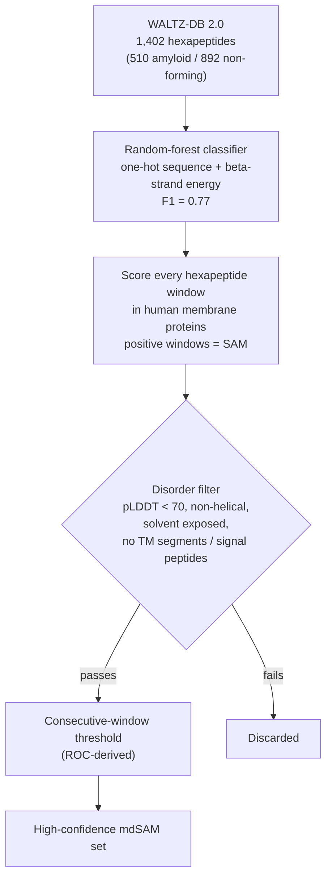
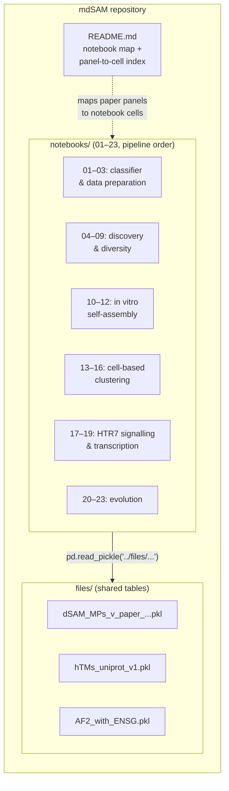

This page is the entry point to the **mdSAM** repository: a companion codebase for the manuscript *Discovery of self-assembly motifs regulating membrane-protein organization and function* (Elazar, Trivedi, et al., Babu lab, St. Jude Children's Research Hospital). It contains 23 numbered analysis notebooks and the shared data tables they consume — everything needed to reproduce the computational analyses behind the paper's figures. Here you will learn what an mdSAM is, how the discovery pipeline works, how the repository is organised, and where to go next in the documentation.

Sources: [README.md](README.md#L1-L3)

## What is an mdSAM?

An **mdSAM** (membrane-disordered Self-Assembly Motif) is a short peptide motif — usually 7–9 residues long, with a median of 8 — located in an intrinsically disordered, solvent-exposed region of a transmembrane protein, predicted to self-assemble through beta-strand-mediated, amyloid-like interactions. The biological motivation is that cell-surface clustering of membrane proteins is central to many cellular processes, yet its molecular determinants remain elusive; the authors postulated that peptide motifs within disordered regions of transmembrane proteins may drive self-association and clustering.

Sources: [README.md](README.md#L5-L12)

## How mdSAMs are discovered: the pipeline at a glance

The discovery workflow runs in three steps, each anchored to a specific data source and filter. First, a random-forest classifier is trained on WALTZ-DB 2.0 (1,402 hexapeptides: 510 amyloid-forming, 892 non-forming) using one-hot-encoded sequence plus summed beta-strand free energy, reaching F1 = 0.77 under stratified 5-fold cross-validation. Second, every hexapeptide window in human membrane proteins is scored; positive windows are called Self-Assembly Motifs (SAMs). Third, a SAM is promoted to an **mdSAM** only if it lies in a disordered region — AlphaFold pLDDT < 70, non-helical and solvent exposed, excluding transmembrane segments and signal peptides — with a ROC-derived threshold on consecutive positive windows defining the high-confidence set. The diagram below summarises this flow from training data to the final motif set.



Sources: [README.md](README.md#L13-L18)

The scale of the result explains why this repository spans so many notebooks: **1,425 high-confidence mdSAMs** were found in **945 membrane proteins** (about 20% of the 4,886 human membrane proteins analysed), with 91% of motifs sitting in N- or C-terminal tails and 72% of mdSAM-containing proteins carrying just a single motif. Crucially, the predictions were validated experimentally — of 44 synthesised mdSAM peptides, 36 (81%) gave a Thioflavin-T signal.

| Metric | Value |
|---|---|
| Classifier training data | 1,402 WALTZ-DB 2.0 hexapeptides (510 amyloid-forming / 892 non-forming) |
| Classifier performance | F1 = 0.77, stratified 5-fold cross-validation |
| High-confidence mdSAMs | 1,425 |
| Proteins with mdSAMs | 945 (~20% of 4,886 human membrane proteins) |
| Motif length | 7–9 residues (median 8) |
| Motif location | 91% in N- or C-terminal tails |
| Single-motif proteins | 72% of mdSAM-containing proteins |
| Peptide validation | 36 / 44 synthesised peptides (81%) Thioflavin-T positive |

Sources: [README.md](README.md#L11-L19)

## Repository layout

The repository is deliberately minimal: documentation, one folder of notebooks, and one folder of shared data. Notebooks are numbered **01–23 in pipeline order**, which doubles as a reading order for the analysis.

```
mdSAM/
├── README.md          # notebook map + figure-to-cell index
├── files/             # shared pickled pandas tables read by notebooks
│   ├── README.md
│   ├── dSAM_MPs_v_paper_v2_new_locs.pkl
│   └── hTMs_uniprot_v1.pkl
└── notebooks/         # 23 analysis notebooks, outputs cleared
    ├── 01_train_waltzdb_classifier.ipynb
    ├── ...
    └── 23_overlap_with_larks_wirs_finches.ipynb
```

Sources: [README.md](README.md#L23-L29)

Three shared tables in `files/` act as the backbone of the analysis — they are pickled pandas DataFrames loaded with `pd.read_pickle`, and the README also documents a `FIGURE_MAP.csv` as the machine-readable map from paper panel → notebook → cell. The mdSAM table is the primary input for most notebooks (motif sequences live in its `AAseq` column), while the other two provide protein-level context.

| File | Contents | Created by | Read by notebooks |
|---|---|---|---|
| `dSAM_MPs_v_paper_v2_new_locs.pkl` | The mdSAM table (motif sequence in the `AAseq` column) | mdSAM identification pipeline (STAR Methods) | 05, 06, 07, 08, 09, 15, 18, 20, 21, 23 |
| `hTMs_uniprot_v1.pkl` | Human transmembrane proteins with UniProt topology annotation | `03_mdsam_sequence_logos.ipynb` | 03, 05, 06, 07, 08, 09, 15, 18, 20, 21, 23 |
| `AF2_with_ENSG.pkl` | AlphaFold-derived per-protein annotations with ENSG gene IDs | `02_alphafold_residue_table_and_early_plots.ipynb` | 02, 03, 05, 06, 07, 08, 11, 15, 18, 19, 20, 21, 23 |

The following diagram shows how these pieces interact: notebooks read the shared tables from `files/`, and the README indexes which notebook and cell produced each paper panel.



Sources: [README.md](README.md#L23-L29), [files/README.md](files/README.md#L3-L9)

> [!TIP]
> Notebooks reference the shared tables as `../files/<name>`, so you must run every notebook with `notebooks/` as the working directory — launching it from the repository root will break the data paths.

## What the 23 notebooks do

Each notebook maps to a phase of the study, from building the classifier through computational characterisation to wet-lab assay analysis and evolutionary validation. The table below is the condensed map; the README carries the full per-notebook detail, including which paper panels each one draws.

| Group | Notebooks | Focus | Paper figures |
|---|---|---|---|
| Data preparation & classifier | 01–03 | Train/evaluate the WALTZ-DB random forest; build the shared AlphaFold residue table; sequence logos | Fig 1D; S1E–H |
| Discovery & diversity | 04–09 | PASTA comparison, UniProt keyword enrichment, sequence-space embedding, hyperLOPIT organelles, topology & membrane distance | Figs 1–2; S1–S2 |
| In vitro self-assembly | 10–12 | Thioflavin-T 96-well screens, GPCR proline mutants, Amytracker fluorescence | Fig 3; S3 |
| Cell-based clustering | 13–16 | TIRF puncta Poisson GLM, flow cytometry, BioGRID interactions, dSTORM cluster analysis | Figs 4–5; S5–S6 |
| HTR7 signalling & transcription | 17–19 | cAMP Emax/EC50, RNA-seq PCA/volcano, DESeq2 + GSEA | Fig 6 |
| Evolution | 20–23 | Alignment-based and ESM-embedding conservation, ortholog peptide ThT, overlap with LARKS/WIRS/FINCHES | Fig 7; S7 |

Sources: [README.md](README.md#L35-L86)

## From notebook cell to paper figure

The repository is built for **figure-level reproducibility**: nearly every panel of the paper's main and supplementary figures is indexed to the exact notebook and 0-based cell index that draws it — for example, Figure 1D (classifier test-set performance) comes from `01_train_waltzdb_classifier.ipynb`, cell 26. Notebooks are distributed with their **outputs cleared**, so you run a notebook to regenerate its plots; panels that are schematics, microscopy/EM images, NMR or mass-photometry data produced outside these notebooks are intentionally not listed. The full mapping lives in the [Figure-to-Notebook Reproducibility Map](9-figure-to-notebook-reproducibility-map) page.

Sources: [README.md](README.md#L88-L96), [README.md](README.md#L242-L246)

## Conventions and safety notes

Two conventions matter before you dive in. First, **naming**: older notebooks call these motifs **dSAM** (disordered SAM), and the structured-region counterpart appears as **mSAM/sSAM/msSAM** — whenever you see `dSAM` in a file name or variable, it means mdSAM. Second, **data safety**: the `files/` tables are pickle files, which can execute code when loaded and depend on the pandas version used to write them — load them only from this repository with a compatible pandas version. The notebooks also rely on a broad set of Python packages (e.g. `Bio`, `Levenshtein`, `gseapy`, `logomaker`, `fcsparser`, `localcider`), listed in the README's "Running the notebooks" section.

Sources: [README.md](README.md#L21), [README.md](README.md#L244-L250), [files/README.md](files/README.md#L13)

> [!TIP]
> The `dSAM` prefix persists in data files (`dSAM_MPs_v_paper_v2_new_locs.pkl`) and notebook names alike — searching the codebase for "dSAM" rather than "mdSAM" will find far more relevant code.

## Where to go next

For a beginner, the natural progression follows the documentation's own pipeline logic: set up and run first, then understand the concept, then explore the machinery. Start with [Quick Start](2-quick-start) for environment setup and running your first notebook, then use [Repository Layout and Notebook Map](3-repository-layout-and-notebook-map) for a deeper tour of the file tree. From there, [mdSAM Concept and Discovery Rationale](4-mdsam-concept-and-discovery-rationale) explains the biology behind the filter chain, [Notebook Pipeline Architecture](5-notebook-pipeline-architecture) dissects how the 23 notebooks depend on each other, and [WALTZ-DB Random-Forest Classifier](6-waltz-db-random-forest-classifier) opens the technical deep dive at notebook 01.

| Step | Page | Why read it |
|---|---|---|
| 1 | [Quick Start](2-quick-start) | Environment, dependencies, running a notebook end-to-end |
| 2 | [Repository Layout and Notebook Map](3-repository-layout-and-notebook-map) | Expanded tour of `notebooks/` and `files/` |
| 3 | [mdSAM Concept and Discovery Rationale](4-mdsam-concept-and-discovery-rationale) | The biology and motivation behind the motif definition |
| 4 | [Notebook Pipeline Architecture](5-notebook-pipeline-architecture) | How notebooks hand off data to each other |
| 5 | [WALTZ-DB Random-Forest Classifier](6-waltz-db-random-forest-classifier) | First deep dive: training and evaluating the classifier |
