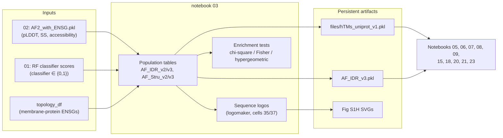

This page documents `notebooks/03_mdsam_sequence_logos.ipynb` — the notebook that characterizes *what mdSAMs look like* at the sequence level. It renders Shannon-information sequence logos of mdSAM hexapeptides versus all predicted SAMs in membrane proteins (paper panel **Fig. S1H**), tests whether amyloid-positive windows are statistically over-represented in disordered regions, and persists two shared artifacts consumed by most later notebooks: the human transmembrane-protein table `hTMs_uniprot_v1.pkl` and the disordered-window table `AF_IDR_v3.pkl`. It also carries exploratory mutation-robustness and gnomAD analyses that never became paper figures. Throughout, note the naming convention: older code calls mdSAMs **dSAM** and their structured-region counterparts **mSAM/sSAM**.

Sources: [README.md](README.md#L41), [README.md](README.md#L21), [03_mdsam_sequence_logos.ipynb](notebooks/03_mdsam_sequence_logos.ipynb#L9-L29)

## Pipeline Position and Data Flow

The notebook sits third in the numbered pipeline: it consumes the AlphaFold residue table built by notebook 02 (`AF2_with_ENSG.pkl` with per-protein sequence, pLDDT, secondary structure and accessibility arrays) and the WALTZ-DB random-forest classifier scores attached to every enumerated hexapeptide. From these it derives the disordered/structured window populations, renders the logos, and exports reference tables that notebooks 05–09, 15, 18, 20, 21 and 23 later read back from `files/`.

Before reading the diagram: `enumerate.pkl` holds every hexapeptide window of the analyzed proteins together with the RF classifier verdict (`classifier` = 1 means amyloid-forming), while `topology_df` supplies membrane-protein ENSG identifiers used to restrict analysis to the membrane proteome.

Sources: [03_mdsam_sequence_logos.ipynb](notebooks/03_mdsam_sequence_logos.ipynb#L38-L53), [files/README.md](files/README.md#L8-L9), [README.md](README.md#L41)

## Constructing the Comparison Populations

The logos are only meaningful relative to a contrast, and the notebook builds four window populations from a single filter grammar: membership in disordered vs. structured regions, solvent accessibility (six `*` characters marks fully accessible), secondary structure (any `H` excludes a window), and removal of hexapeptides overlapping transmembrane segments (`TM_hexa`).

| Table | Definition | Role in the logos |
|---|---|---|
| `AF_IDR_v2` | Windows in IDR regions, non-helical, accessibility `******`, in membrane proteins (`TMs.acc`) | Source of mdSAM hexapeptides |
| `AF_Stru_v2` | Windows with `IDR=='Structure'` in the same proteins | Structured counterpart (mSAM host) |
| `AF_IDR_v3` / `AF_Stru_v3` | v2 tables after dropping `TM_hexa` sequences | TM-contamination-free final populations |

> [!TIP]
> Cell 35's mdSAM logo draws from `AF_IDR_v3[AF_IDR_v3.classifier==1]` — i.e., motifs that are simultaneously classifier-positive *and* in disordered, solvent-exposed context. This is the operational definition of an mdSAM at hexapeptide granularity, mirroring the discovery criteria (pLDDT < 70, non-helical, solvent-exposed, non-TM) described on the [AlphaFold-Based Disorder Filtering](7-alphafold-based-disorder-filtering) page.

Sources: [03_mdsam_sequence_logos.ipynb](notebooks/03_mdsam_sequence_logos.ipynb#L125-L136), [03_mdsam_sequence_logos.ipynb](notebooks/03_mdsam_sequence_logos.ipynb#L148-L149), [03_mdsam_sequence_logos.ipynb](notebooks/03_mdsam_sequence_logos.ipynb#L169-L191)

## Building the Sequence Logos (Fig. S1H)

The logo construction is deliberately transparent — no black-box logo utility does the counting. Two counting cells (33 and 36) loop over the six hexapeptide positions × the 20 standard amino acids, tallying occurrences in the positive-class windows; the result is pivoted into a 6×20 count matrix. The accompanying `seqlogo.fa` cell (cell 34) writes all mdSAM hexapeptides to FASTA for external tools.

The rendering cells then delegate to **logomaker** with an explicit information transform:

| Parameter | Value | Meaning |
|---|---|---|
| `transform_matrix` | `counts → information` | Per-position Shannon information in **bits** (Rₛₑ𝵪₝ₑₙcₑ formula) — stack height = conservation |
| `color_scheme` | `NajafabadiEtAl2017` | Physicochemical AA coloring |
| `font_name` | `Stencil Std` | Glyph font for the letter stacks |
| Y-axis | `Information (bits)` | 0–~4.2 bit scale |
| X-axis | positions 1–6 | Hexapeptide window coordinates |

Two figures result, and the README's figure map pins them exactly to paper panel S1H: cell 35 saves `seqlogo_membrane_all_dSAMs_membrane.svg` (title *mdSAM*) and cell 37 saves `seqlogo_membrane_all_SAMs.svg` (title *SAMs*, counting **all** classifier-positive windows in membrane proteins regardless of disorder). The visual contrast between the two stacks is the point: SAMs overall vs. their disordered-context subset.

Sources: [03_mdsam_sequence_logos.ipynb](notebooks/03_mdsam_sequence_logos.ipynb#L562-L585), [03_mdsam_sequence_logos.ipynb](notebooks/03_mdsam_sequence_logos.ipynb#L597-L616), [03_mdsam_sequence_logos.ipynb](notebooks/03_mdsam_sequence_logos.ipynb#L653-L673), [README.md](README.md#L181-L182)

## Statistical Context: Are Disordered SAMs Enriched?

The logos are framed by three significance tests that justify comparing mdSAM composition against the structured baseline. A 2×2 contingency table (IDR/Structure × classifier 1/0) feeds a chi-square test and a two-sided Fisher exact test; an "expected vs. observed" bar plot (`chi_anaysis_MPs_SAMs_human.svg`) visualizes the chi-square decomposition with dSAM/sSAM axis labels. Hypergeometric CDF curves — written with the authors' "team A runners/winners" metaphor — quantify enrichment from both the disordered (`human_disordered.svg`) and structured (`human_ordered.svg`) sides. A small pie chart quantifies what fraction of the 4,886 analyzed membrane proteins harbor a predicted SAM in disordered context.

Sources: [03_mdsam_sequence_logos.ipynb](notebooks/03_mdsam_sequence_logos.ipynb#L233-L263), [03_mdsam_sequence_logos.ipynb](notebooks/03_mdsam_sequence_logos.ipynb#L287-L288), [03_mdsam_sequence_logos.ipynb](notebooks/03_mdsam_sequence_logos.ipynb#L340-L361), [03_mdsam_sequence_logos.ipynb](notebooks/03_mdsam_sequence_logos.ipynb#L373-L388), [03_mdsam_sequence_logos.ipynb](notebooks/03_mdsam_sequence_logos.ipynb#L476-L536)

## Persistent Artifacts and Downstream Consumers

Beyond figures, notebook 03 is a *producer* notebook: it pickles the population tables it computes and the transmembrane-protein reference table that the rest of the pipeline depends on.

| Artifact | Producer evidence | Read by |
|---|---|---|
| `hTMs_uniprot_v1.pkl` | `TMs.to_pickle` (per `files/README.md`) | Notebooks 03, 05, 06, 07, 08, 09, 15, 18, 20, 21, 23 |
| `AF_IDR_v3.pkl` | v3 tables derived after `TM_hexa` exclusion | Downstream diversity/conservation notebooks |
| `AF_IDR_v2.pkl`, `AF_Stru_v2.pkl` | explicit `to_pickle` calls in cell 17 | Local reuse within the notebook |
| `gnomAD_no_TM_v_2_1._with_ele.pkl` | cell 15 | Off-paper gnomAD extension |

`hTMs_uniprot_v1.pkl` — human transmembrane proteins with UniProt topology annotation — is one of only two data files committed under `files/`, which is why the catalog's [Shared Data Tables Reference](8-shared-data-tables-reference) treats this notebook as its upstream source.

Sources: [03_mdsam_sequence_logos.ipynb](notebooks/03_mdsam_sequence_logos.ipynb#L222-L223), [03_mdsam_sequence_logos.ipynb](notebooks/03_mdsam_sequence_logos.ipynb#L201-L203), [files/README.md](files/README.md#L5-L9)

## Beyond the Paper: Mutation Robustness and gnomAD

The README explicitly flags that this notebook "contains additional gnomAD analyses that are not part of the paper figures." Two exploratory blocks follow the logos:

**Single-mutation robustness.** Loading `enumerate_one_away.pkl` (all hexapeptides one substitution away from an observed window), the notebook computes how many mutations are needed to *create* or *maintain* a SAM, stratified by IDR vs. structured vs. random context, producing the "Creating a mSAM" and "Maintaining a mSAM" cumulative-frequency curves.

**gnomAD variant impact.** Population variants (`gnomAD_mutations_with_WT_and_CADD.pkl`) are classified by re-scoring wild-type and mutant hexapeptides with the RF classifier: `destroy` (WT_RF ≥ 1, MUT_RF = 0), `create`, `maintain`, or `None`. A geometric helper (`seqlocmembrane_IDR_balant`, with a ballantine `0.52·(70n)^(1/3)` correction) estimates each variant's signed distance to the membrane boundary, which is then plotted against CADD-PHRED deleteriousness — asking whether variants that destroy mdSAMs are under constraint near the lipid bilayer.

Sources: [README.md](README.md#L41), [03_mdsam_sequence_logos.ipynb](notebooks/03_mdsam_sequence_logos.ipynb#L706-L718), [03_mdsam_sequence_logos.ipynb](notebooks/03_mdsam_sequence_logos.ipynb#L783-L812), [03_mdsam_sequence_logos.ipynb](notebooks/03_mdsam_sequence_logos.ipynb#L953-L956), [03_mdsam_sequence_logos.ipynb](notebooks/03_mdsam_sequence_logos.ipynb#L1001-L1035)

## Reproducibility Caveats

Two practical facts matter if you re-run this notebook. First, several inputs are **not shipped with the repository**: `AF2_with_ENSG.pkl` must be regenerated by notebook 02, and `enumerate/enumerate.pkl`, `topology_df`, the SSTM boundary tables, and gnomAD pickles reference local paths or an external volume (`/Volumes/aelazar/...`) — only the derived tables in `files/` are committed. The `files/README.md` warns that pickle files execute code on load and are pandas-version sensitive. Second, the committed notebook carries a mechanical text artifact: the token `ax` was globally replaced by `ax[0]`, corrupting identifiers such as `Max[0]NLocator`, `ax[0]is` (for `axis`), and `ww_logo.ax[0]` in the logo cells. Cells must have these reverted to their original identifiers before execution — the analytical logic is intact, only identifiers are affected.

> [!TIP]
> Cell numbers in this documentation are 0-based indices into the notebook's `cells` list, matching the README's figure map convention — so "cell 35" means the 36th cell object in the `.ipynb` JSON, not a display index in Jupyter.

Sources: [03_mdsam_sequence_logos.ipynb](notebooks/03_mdsam_sequence_logos.ipynb#L49-L52), [03_mdsam_sequence_logos.ipynb](notebooks/03_mdsam_sequence_logos.ipynb#L25), [03_mdsam_sequence_logos.ipynb](notebooks/03_mdsam_sequence_logos.ipynb#L663-L668), [files/README.md](files/README.md#L13), [README.md](README.md#L33)

## Where to Go Next

The logos answer *what* mdSAMs look like; the rest of the "Sequence Space Characterization" section answers *how they relate to each other*. Continue to [Physicochemical Embedding and Clustering](11-physicochemical-embedding-and-clustering) for the GMM/Levenshtein/charge-archetype treatment of the same sequence space, or to [PASTA Comparison and Window Thresholds](12-pasta-comparison-and-window-thresholds) for how consecutive positive windows set the high-confidence mdSAM threshold. For the schema of `hTMs_uniprot_v1.pkl` and the other shared tables this notebook produces, see [Shared Data Tables Reference](8-shared-data-tables-reference); for the classifier whose `classifier==1` labels feed every logo stack, see [WALTZ-DB Random-Forest Classifier](6-waltz-db-random-forest-classifier).
