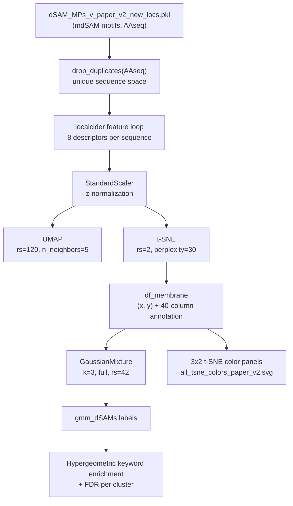

This page documents `notebooks/06_mdsam_sequence_space_embedding.ipynb`, the notebook that maps the mdSAM peptide collection into a low-dimensional physicochemical feature space and partitions it into interpretable clusters. It is the quantitative bridge between the compositional characterization of [Sequence Logos and Composition](10-sequence-logos-and-composition) and the functional annotation performed in [UniProt Keyword Enrichment](13-uniprot-keyword-enrichment): it converts each unique amino-acid sequence into a compact vector of IDR-theory descriptors, projects those vectors with UMAP and t-SNE, fits a Gaussian Mixture Model on the projected coordinates, and then validates that the clusters carry biological meaning via hypergeometric keyword enrichment.

Sources: [06_mdsam_sequence_space_embedding.ipynb](notebooks/06_mdsam_sequence_space_embedding.ipynb#L20-L39)

## Position in the Pipeline and Data Inputs

Architecturally, notebook 06 consumes the two shared intermediate tables defined in the [Shared Data Tables Reference](8-shared-data-tables-reference): the mdSAM motif table `dSAM_MPs_v_paper_v2_new_locs.pkl` (motif sequence in the `AAseq` column) and the human transmembrane protein table `hTMs_uniprot_v1.pkl`. It also reads `AF2_with_ENSG.pkl` (produced by notebook 02) to reconcile UniProt accessions with Ensembl transcripts before embedding. The first structural operation is a strict deduplication on the motif sequence — `dSAM_df.drop_duplicates(subset='AAseq')` — which guarantees that the embedding describes the *sequence space* rather than the redundant occurrence space; the deduplicated count (`len(mdSAMs)`) is the effective population of every subsequent analysis.

Sources: [06_mdsam_sequence_space_embedding.ipynb](notebooks/06_mdsam_sequence_space_embedding.ipynb#L49-L51), [06_mdsam_sequence_space_embedding.ipynb](notebooks/06_mdsam_sequence_space_embedding.ipynb#L297-L297), [06_mdsam_sequence_space_embedding.ipynb](notebooks/06_mdsam_sequence_space_embedding.ipynb#L374-L376), [06_mdsam_sequence_space_embedding.ipynb](notebooks/06_mdsam_sequence_space_embedding.ipynb#L476-L479), [README.md](files/README.md#L5-L9)

The notebook also produces contextual context figures early on: a 70×70 dot matrix (4,900 grid points truncated to the 4,887 membrane proteins) distinguishing the 945 mdSAM-harboring membrane proteins from the remaining 3,978, and a motif-length distribution histogram covering lengths 7 through ≥13. These establish the population statistics that motivate the embedding analysis, and are exported as `mdSAMs_in_membrane_proteins_high_con_dot_matrix.svg` and `mdSAMs_length_distribution.svg` for the figure pipeline mapped in [Figure-to-Notebook Reproducibility Map](9-figure-to-notebook-reproducibility-map).

Sources: [06_mdsam_sequence_space_embedding.ipynb](notebooks/06_mdsam_sequence_space_embedding.ipynb#L341-L349), [06_mdsam_sequence_space_embedding.ipynb](notebooks/06_mdsam_sequence_space_embedding.ipynb#L359-L400), [06_mdsam_sequence_space_embedding.ipynb](notebooks/06_mdsam_sequence_space_embedding.ipynb#L457-L466)

## Stage 1 — Physicochemical Feature Engineering with localcider

The analytical core of the notebook is a per-sequence feature table (`umap_dff`) built by iterating over every deduplicated motif and calling the `localcider.sequenceParameters.SequenceParameters` API — the reference implementation of Uversky/Das-Pappu IDR physics. Each sequence is reduced to eight scalar descriptors: Uversky hydropathy, mean net charge (NCPR), the AAindex `MUNV940103` residue scale aggregated as `beta`, and four grouped residue-class fractions — `Aromatic` = F(Y)+F(W)+F(F), `Posetive` = F(H)+F(R)+F(K), `Negitive` = F(D)+F(E), plus hydrophobic and polar classes (`Hydro` starting from V/I/L, `Polar` from T/S/N).

Sources: [06_mdsam_sequence_space_embedding.ipynb](notebooks/06_mdsam_sequence_space_embedding.ipynb#L498-L512)

| Feature | Definition | Source API | Biological semantics |
|---|---|---|---|
| `beta` | Mean of AAindex `MUNV940103` values per residue | Hard-coded dict (L31–33) | β-aggregation coupling potential (rendered as $\sum\Delta G_{\beta}$ in figures) |
| `hydropathy` | Uversky hydropathy | `get_uversky_hydropathy()` | Promotes inter-peptide association |
| `mean_net_charge` | NCPR | `get_mean_net_charge()` | Electrostatic repulsion / salt-bridge balance |
| `Aromatic` | F(Y)+F(W)+F(F) | `get_amino_acid_fractions()` | π-stacking and hydrophobic core formation |
| `Posetive` | F(H)+F(R)+F(K) | `get_amino_acid_fractions()` | Cationic motif density |
| `Negitive` | F(D)+F(E) | `get_amino_acid_fractions()` | Anionic motif density |
| `Hydro` | F(V)+F(I)+F(L)+… | `get_amino_acid_fractions()` | Aliphatic hydrophobicity |
| `Polar` | F(T)+F(S)+F(N)+… | `get_amino_acid_fractions()` | H-bonding side-chain density |

Sources: [06_mdsam_sequence_space_embedding.ipynb](notebooks/06_mdsam_sequence_space_embedding.ipynb#L31-L33), [06_mdsam_sequence_space_embedding.ipynb](notebooks/06_mdsam_sequence_space_embedding.ipynb#L504-L512)

A second, richer annotation pass reconstructs the full descriptor matrix (`UMAP_plot`): besides the eight embedding features, it computes `get_delta()`, `get_fraction_disorder_promoting()`, `get_FCR()`, `get_Omega()`, motif length, all twenty per-residue fractions, and the *summed* `beta` variant (`np.sum` of `MUNV940103` values, matching the $\sum\Delta G_{\beta}$ axis title). Note the deliberate asymmetry: the **8-column matrix feeds the projection**, while the **40+ column table annotates the projected points** — a separation of concerns that keeps the embedding low-dimensional but the interpretation high-dimensional. The membrane-relevant subset `df_membrane` is then isolated by dropping rows with null `acc` and de-duplicated again by `AAseq`.

Sources: [06_mdsam_sequence_space_embedding.ipynb](notebooks/06_mdsam_sequence_space_embedding.ipynb#L556-L604), [06_mdsam_sequence_space_embedding.ipynb](notebooks/06_mdsam_sequence_space_embedding.ipynb#L601-L603)

> [!TIP]
> The two `beta` aggregations are not redundant — `umap_dff` uses the **mean** flexibility value as an embedding coordinate, while `UMAP_plot` uses the **sum**, which couples motif length into the quantity displayed as $\sum\Delta G_{\beta}$ in the paper panels. Choosing which one to visualize changes the geometric gradient you read off the embedding.

## Stage 2 — Dimensionality Reduction: Standardize, Then UMAP and t-SNE

Both projections follow the same discipline: z-normalize the 8-column feature matrix with `StandardScaler().fit_transform()` before projecting. Two reducers are instantiated and cross-checked:

1. **UMAP** — `umap.UMAP(random_state=120, n_neighbors=5)`, a fine-grained local-manifold view seeded for determinism (L532–533).
2. **t-SNE** — `TSNE(n_components=2, learning_rate='auto', init='random', perplexity=30, random_state=2)` (L556).

The paper-grade figure (`all_tsne_colors_paper_v2.svg`) uses the **t-SNE** coordinates — every panel axis is labeled `t-SNE`, and the earlier UMAP export exists only as a commented-out call (`all_UMAP_madan_colors_paper_not_rasterized_v3.svg`). A hierarchical clustermap of the standardized features (`sns.clustermap`) provides a third, independent sanity check of feature-space structure before projection.

Sources: [06_mdsam_sequence_space_embedding.ipynb](notebooks/06_mdsam_sequence_space_embedding.ipynb#L522-L522), [06_mdsam_sequence_space_embedding.ipynb](notebooks/06_mdsam_sequence_space_embedding.ipynb#L532-L533), [06_mdsam_sequence_space_embedding.ipynb](notebooks/06_mdsam_sequence_space_embedding.ipynb#L556-L556), [06_mdsam_sequence_space_embedding.ipynb](notebooks/06_mdsam_sequence_space_embedding.ipynb#L707-L712)

| Aspect | UMAP path | t-SNE path |
|---|---|---|
| Call | `umap.UMAP(random_state=120, n_neighbors=5)` | `TSNE(n_components=2, perplexity=30, random_state=2, learning_rate='auto', init='random')` |
| Input | Standardized 8-feature matrix | Standardized 8-feature matrix |
| Role in notebook | Exploratory manifold view | Paper-figure geometry (`all_tsne_colors_paper_v2.svg`) |
| Downstream use | Superseded | Feeds `df_membrane['x','y']` and GMM clustering |

Sources: [06_mdsam_sequence_space_embedding.ipynb](notebooks/06_mdsam_sequence_space_embedding.ipynb#L532-L533), [06_mdsam_sequence_space_embedding.ipynb](notebooks/06_mdsam_sequence_space_embedding.ipynb#L556-L570)

The embedding workflow can be summarized as follows:

Sources: [06_mdsam_sequence_space_embedding.ipynb](notebooks/06_mdsam_sequence_space_embedding.ipynb#L498-L533)

## Stage 3 — The Paper Figure: Color-Encoded Feature Gradients

The canonical figure is a 3×2 scatter grid over `df_membrane`, coloring the same t-SNE point cloud by six orthogonal gradients: `Negitive`, `Posetive`, `Aromatic`, `Hydro`, `Polar`, and `beta`. Each panel uses a custom two-stop `LinearSegmentedColormap` (light gray `#DEE0E3` to a signature accent color per class, with the beta panel running `#B9A84B → #000832`), a shared `Normalize(vmin=0, vmax=100)` color scale, and per-panel colorbars — since a single seaborn `hue` cannot span multiple colormaps in one figure, the code loops over `(feature, colormap)` pairs with `fig.colorbar(sm, ...)` attached to each subplot. Panel titles use the compact residue-class notation: `Negative(DE)`, `Positive(RKH)`, `Aromatic(YWF)`, `Hydrophobic(GAVILM)`, `Polar(TSNQC)`, and `$\sum\Delta G_{\beta}$`.

Sources: [06_mdsam_sequence_space_embedding.ipynb](notebooks/06_mdsam_sequence_space_embedding.ipynb#L649-L712)

A companion set of five zoom-in "test" figures validates that color gradients correspond to real sequence families at specific coordinates: each figure draws a `Rectangle` over a quadrant of the global t-SNE (e.g., the cationic block at `(-15, 20, 25, 25)`), then re-plots the magnified window with four hand-selected indices highlighted as white points and their raw `AAseq` strings annotated via `adjust_text`. The exported artifacts — `tnse_RK_test.svg`, `tnse_DE_test.svg`, `tnse_YWF_test.svg`, `tnse_Hydro_test.svg`, `tnse_PLOAR_test.svg` — demonstrate that, e.g., the RK-rich region genuinely contains lysine/arginine-dense motifs and the YWF region aromatic ones. These figures exemplify the notebook's verification pattern: **claim a spatial gradient, then magnify and label the sequences that instantiate it**.

Sources: [06_mdsam_sequence_space_embedding.ipynb](notebooks/06_mdsam_sequence_space_embedding.ipynb#L715-L755), [06_mdsam_sequence_space_embedding.ipynb](notebooks/06_mdsam_sequence_space_embedding.ipynb#L814-L844), [06_mdsam_sequence_space_embedding.ipynb](notebooks/06_mdsam_sequence_space_embedding.ipynb#L991-L1060)

## Stage 4 — Gaussian Mixture Clustering on Embedded Coordinates

The clustering stage is deliberately simple and *post-hoc*: after reloading the annotated projection (`df_membrane = pd.read_pickle('HTS/umap.pkl')`), a `mixture.GaussianMixture(n_components=3, covariance_type="full", random_state=42)` is fitted on the **2-D t-SNE coordinates** (`['x','y']`), and soft-assignment predictions are written back into a `gmm_dSAMs` column. This is a key architectural decision worth internalizing: **the mixture model partitions the embedding manifold, not the original 8-D feature space** — clusters therefore correspond to visually coherent regions of the published figure, and their interpretation inherits the usual t-SNE caveat that only local neighborhoods are trustworthy. An adjacent exploratory cell sweeps the hyperparameters (`n_components=10, covariance_type="diag", random_state=157`) for robustness comparison before settling on k=3.

Sources: [06_mdsam_sequence_space_embedding.ipynb](notebooks/06_mdsam_sequence_space_embedding.ipynb#L1079-L1086), [06_mdsam_sequence_space_embedding.ipynb](notebooks/06_mdsam_sequence_space_embedding.ipynb#L1106-L1113)

| GMM parameter | Value | Rationale in this context |
|---|---|---|
| `n_components` | 3 | Minimal partition matching the three dominant visual lobes of the t-SNE cloud |
| `covariance_type` | `"full"` | Allows anisotropic cluster shapes on the manifold |
| `random_state` | 42 | Deterministic EM initialization for reproducibility |
| Fit coordinates | `['x','y']` (t-SNE) | Clusters are defined on the published geometry, not raw features |
| Exploration sweep | k=10, `diag`, rs=157 | Sensitivity check on over-segmentation |

Sources: [06_mdsam_sequence_space_embedding.ipynb](notebooks/06_mdsam_sequence_space_embedding.ipynb#L1082-L1086)

## Stage 5 — Statistical Validation: Per-Cluster Keyword Enrichment

To show the clusters are not geometric artifacts, the notebook runs a hypergeometric enrichment of UniProt keywords within each `gmm_dSAMs` label. The `hypergeom(keyword, cluster)` function computes observed vs. expected keyword counts over the `df_membrane` population, using `stats.hypergeom.cdf` with a one-sided correction (`p = 1-p` when observed exceeds expected). Candidate keywords are pre-filtered to those with ≥10 mdSAM-bearing members across the `Disease`, `Molecular function`, and `Biological process` categories of a UniProt keyword table (`KeyWord_df`). Multiple-testing pressure is handled by a rankdata-based Benjamini–Hochberg-style `fdr()` helper, and results are plotted as per-cluster and combined volcano panels (`obs-exp` vs. `-log10 FDR`), exported as `obs_exp_Keywords_gmm_cluster_%d.svg` and `obs_exp_Keywords_gmm.svg`.

Sources: [06_mdsam_sequence_space_embedding.ipynb](notebooks/06_mdsam_sequence_space_embedding.ipynb#L1122-L1139), [06_mdsam_sequence_space_embedding.ipynb](notebooks/06_mdsam_sequence_space_embedding.ipynb#L1205-L1248), [06_mdsam_sequence_space_embedding.ipynb](notebooks/06_mdsam_sequence_space_embedding.ipynb#L1258-L1291)

This closes the analytical loop: geometry → clusters → function. Spot checks in the notebook (e.g., querying `enrich[enrich.keyword_ID=='Cell adhesion']` and `'Neurodegeneration'`) indicate the clusters differentiate mdSAM-bearing proteins by functional family. The methodological details of the keyword machinery itself — the UniProt annotation tables and genome-wide enrichment strategy — are covered on [UniProt Keyword Enrichment](13-uniprot-keyword-enrichment); here it serves only as the interpretive endpoint of clustering.

Sources: [06_mdsam_sequence_space_embedding.ipynb](notebooks/06_mdsam_sequence_space_embedding.ipynb#L1335-L1336), [06_mdsam_sequence_space_embedding.ipynb](notebooks/06_mdsam_sequence_space_embedding.ipynb#L1399-L1399)

## Reusable Utilities: Publication-Grade Convex Hulls

Beyond the pipeline proper, notebook 06 ships three plotting utilities that are candidates for extraction into the shared toolkit described in [Reusing the Analysis Toolkit](27-reusing-the-analysis-toolkit): `calculate_hull()` builds a scale-based-padded convex hull (a `StandardScaler → MinMaxScaler(-1,1)` pipeline times a `scale` factor, `scipy.spatial.ConvexHull`, then periodic quadratic B-spline interpolation via `scipy.interpolate.splev(..., per=True, k=4)`); `draw_hull()` wraps it for matplotlib; and `draw_rounded_hull()` renders hulls with true rounded corners by offsetting hull edges along their normals and inserting `matplotlib.patches.Arc` segments. These are the mechanism for drawing cluster/membership boundaries around scattered embedding points in publication figures.

Sources: [06_mdsam_sequence_space_embedding.ipynb](notebooks/06_mdsam_sequence_space_embedding.ipynb#L79-L171), [06_mdsam_sequence_space_embedding.ipynb](notebooks/06_mdsam_sequence_space_embedding.ipynb#L212-L277)

## Reproducibility Notes for Advanced Users

Three environment realities matter when re-running this notebook. First, two inputs are external to the repository: the UniProt id-mapping TSV (`/Users/aelazar/notebooks_for_paper/idmapping_reviewed_true_2024_02_05.tsv`) used for gene-name mapping, and the keyword TSV (`/Users/aelazar/Downloads/keywords_all_2023_10_27.tsv`) — these author-local paths must be replaced with fresh UniProt downloads to reproduce `df_membrane['gene_name']` and the enrichment. Second, the clustering stage re-reads a serialized state (`HTS/umap.pkl`) rather than recomputing from the in-memory t-SNE, so the exact published cluster partition depends on that snapshot; regenerating it requires rerunning the t-SNE cell with `random_state=2` first. Third, all stochastic components (UMAP `random_state=120`, t-SNE `random_state=2`, GMM `random_state=42`) are pinned — preserve them if you need bit-exact figure reproduction. The dependency set (`localcider`, `umap`, `adjustText`, sklearn, seaborn) plus the `Arial` font family via `plt.rcParams` are declared at the top of the notebook.

Sources: [06_mdsam_sequence_space_embedding.ipynb](notebooks/06_mdsam_sequence_space_embedding.ipynb#L612-L618), [06_mdsam_sequence_space_embedding.ipynb](notebooks/06_mdsam_sequence_space_embedding.ipynb#L1079-L1079), [06_mdsam_sequence_space_embedding.ipynb](notebooks/06_mdsam_sequence_space_embedding.ipynb#L1123-L1123), [06_mdsam_sequence_space_embedding.ipynb](notebooks/06_mdsam_sequence_space_embedding.ipynb#L34-L39)

> [!TIP]
> Because GMM labels are fit on t-SNE coordinates, do not treat cluster assignment as a stable function of the 8 input features across reruns — small t-SNE drift propagates into label flips. If you need stable, transferable cluster identity, refit the GMM directly on the standardized `umap_dff` matrix and only *visualize* the labels on the t-SNE plane.

## Where to Go Next

The natural reading order around this page: upstream compositional context in [Sequence Logos and Composition](10-sequence-logos-and-composition); how the same embedding coordinates reappear with per-protein aggregation and localization overlays in [hyperLOPIT Organelle Enrichment](14-hyperlopit-organelle-enrichment) and [Topology and Membrane-Leaflet Distance](15-topology-and-membrane-leaflet-distance); the full statistical machinery behind the keyword enrichment in [UniProt Keyword Enrichment](13-uniprot-keyword-enrichment); and notebook-level orchestration details in [Notebook Pipeline Architecture](5-notebook-pipeline-architecture). For adapting the feature-engineering loop to your own peptide sets, see [Reusing the Analysis Toolkit](27-reusing-the-analysis-toolkit).
