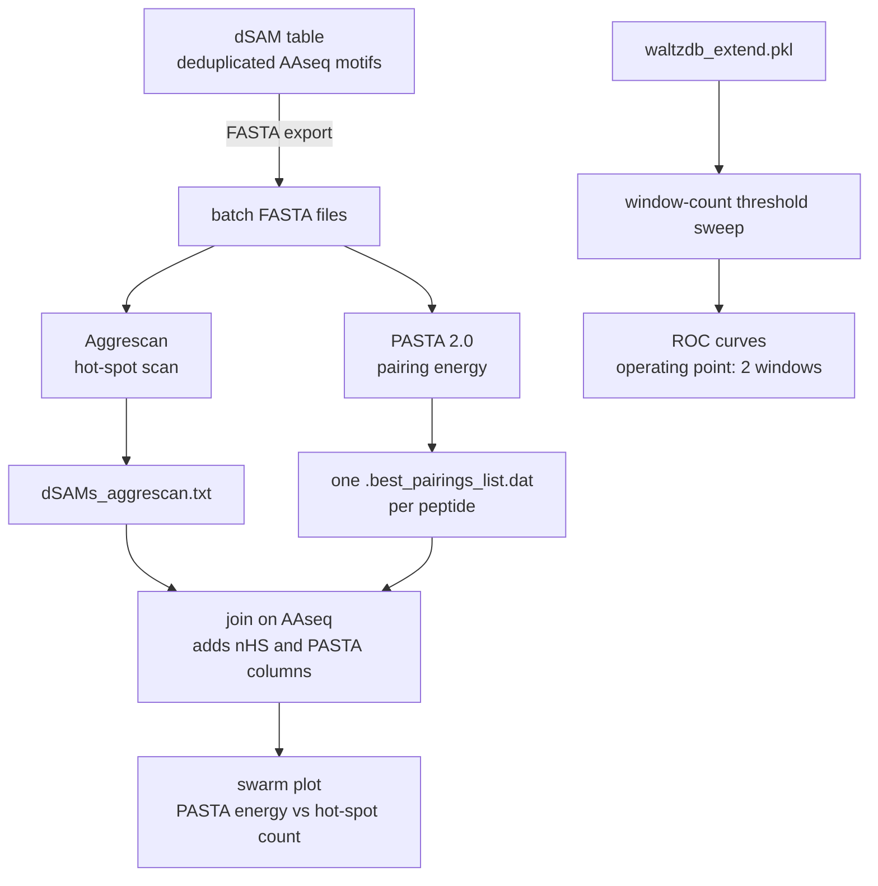
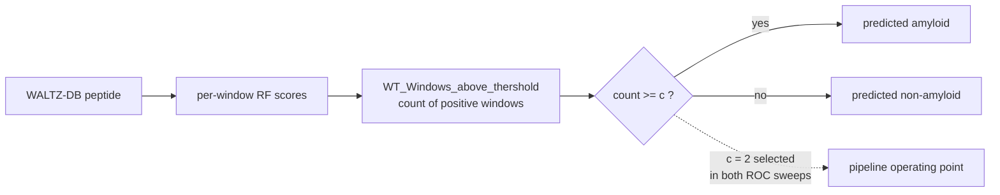

Notebook `04_pasta_aggregation_comparison.ipynb` answers a skepticism question that any reviewer of a *de novo* aggregation predictor should ask: **do mdSAM motifs look like aggregation hot spots to independent, physics-based methods?** The notebook performs two coupled analyses — a round trip to the PASTA 2.0 and Aggrescan web servers for orthogonal scoring of every deduplicated mdSAM motif, and a calibration study that sweeps the "minimum number of windows above threshold" decision rule against the WALTZ-DB ground truth. Its opening comment states the agenda plainly: *supplemental information on cutoff of windows*, citing both tools.

Sources: [04_pasta_aggregation_comparison.ipynb](notebooks/04_pasta_aggregation_comparison.ipynb#L10-L12)

## Pipeline Position and Data Flow

Conceptually this notebook is the **external validation wing** of the sequence-space characterization section. It consumes the mdSAM motif table, ships sequences out to two tools that are not reimplemented anywhere in the repository, joins the returned scores back by sequence string, and then turns to the WALTZ-DB table to ask how many positive windows a sequence must contain before calling it amyloid. The two halves share no data — only a theme — which is why the notebook reads like two mini-pipelines back to back.

The staged hand-off through web servers means several inputs exist only as local files on the original author's machine; the table below is the complete inventory of what the notebook touches.

| Stage | Artifact referenced | Role |
|---|---|---|
| Motif source | `dSAM_MPs_v_paper_v2.pkl` | mdSAM table; motifs in the `AAseq` column |
| Export | printed FASTA records | input batch for both web tools |
| Aggrescan return | `dSAMs_aggrescan.txt` | per-sequence hot-spot count (`nHS`) |
| PASTA return | `*.fasta.seq.best_pairings_list.dat` | per-sequence best pairing energy (`PASTA`) |
| Threshold study | `waltzdb_extend.pkl` | WALTZ-DB labels + `WT_Windows_above_thershold` |

Sources: [04_pasta_aggregation_comparison.ipynb](notebooks/04_pasta_aggregation_comparison.ipynb#L36), [04_pasta_aggregation_comparison.ipynb](notebooks/04_pasta_aggregation_comparison.ipynb#L235), [README.md](files/README.md#L3-L9)

## Round Trip to External Predictors

### A Self-Describing FASTA Export

The export loop deduplicates the table on `AAseq` and prints FASTA records whose *headers embed the sequence itself*: `>acc_AAseq` on the header line, with `AAseq` repeated as the sequence line. This redundancy is deliberate — because PASTA names its output files after the input FASTA header, the sequence ends up encoded in the returned filename, so the notebook can re-join scores without maintaining a separate manifest.

> [!TIP]
> When you re-run this notebook against your own PASTA/Aggrescan batches, keep the `>acc_seq` header convention intact. The join-back expressions (`split('_')[1]` for PASTA, `split('_')[-1]` for Aggrescan) parse the sequence out of filenames and column names — any change to the header format silently breaks the match and leaves `NaN` scores rather than raising an error.

Sources: [04_pasta_aggregation_comparison.ipynb](notebooks/04_pasta_aggregation_comparison.ipynb#L62-L66)

### Ingesting Aggrescan Hot-Spot Counts

The Aggrescan result is a single tab-delimited table where **each column is one sequence** (its name ends with the motif string) and each row is one Aggrescan metric. The ingestion loop walks the columns from index 1 onward, extracts the trailing token of each column name, looks up the matching row in `dSAMs` by `AAseq`, and writes the value at row index 1 into a new `nHS` column. The downstream figure legend labels this quantity as the Aggrescan hot-spot count, which anchors its interpretation.

Sources: [04_pasta_aggregation_comparison.ipynb](notebooks/04_pasta_aggregation_comparison.ipynb#L75), [04_pasta_aggregation_comparison.ipynb](notebooks/04_pasta_aggregation_comparison.ipynb#L86-L89), [04_pasta_aggregation_comparison.ipynb](notebooks/04_pasta_aggregation_comparison.ipynb#L195)

### Ingesting PASTA 2.0 Pairing Energies

PASTA returns **one small space-delimited file per peptide**, exemplified by `Q5VU65_LQHWLWS.fasta.seq.best_pairings_list.dat`. Three consecutive `glob` loops cover the run's output batches — directories `predictions1_1000`, `predictions10001_2000` (spelled exactly so in the code), and `predictions2001_end` — and each iteration parses the motif out of the filename via `split('_')[1].split('.')[0]`, then reads the value at row 0, column 5 into the `PASTA` column. The figure's axis label names this quantity the *PASTA energy (best)*, i.e., the best pairing energy PASTA found for the motif.

Sources: [04_pasta_aggregation_comparison.ipynb](notebooks/04_pasta_aggregation_comparison.ipynb#L140), [04_pasta_aggregation_comparison.ipynb](notebooks/04_pasta_aggregation_comparison.ipynb#L150-L161), [04_pasta_aggregation_comparison.ipynb](notebooks/04_pasta_aggregation_comparison.ipynb#L194)

### The Comparison Figure

Both ingested scores meet in one swarm plot: **`PASTA energy(best)` on the y-axis, colored by Aggrescan hot-spot count (`nHS`)** using the `cividis` palette, over the deduplicated motif set. The plot is produced twice at different figure sizes, saving `PASTA_nHS_mdSAMs_v2.svg` and `PASTA_nHS_mdSAMs.svg`; a `value_counts()` cell on `nHS` beforehand serves as a sanity check on how many sequences received each hot-spot count. A quick mental model of the two external scores:

| Aspect | Aggrescan | PASTA 2.0 |
|---|---|---|
| Input artifact | printed FASTA batch | same FASTA batch |
| Return format | one TSV, sequence-per-column | one `.dat` file per peptide |
| Extraction expression | `dSAMs_aggrescan.loc[1, i]` | `read_csv(...).loc[0, 5]` |
| Filename/column parse | `i.split('_')[-1]` | `split('_')[1].split('.')[0]` |
| Stored column | `nHS` (hot-spot count) | `PASTA` (best pairing energy) |
| Figure role | color (`hue`) | y-axis value |

Sources: [04_pasta_aggregation_comparison.ipynb](notebooks/04_pasta_aggregation_comparison.ipynb#L171), [04_pasta_aggregation_comparison.ipynb](notebooks/04_pasta_aggregation_comparison.ipynb#L183-L199), [04_pasta_aggregation_comparison.ipynb](notebooks/04_pasta_aggregation_comparison.ipynb#L208-L225)

## Calibrating the Window-Count Threshold

The second half of the notebook loads `waltzdb_extend.pkl` — the WALTZ-DB peptide table (curated from `waltzdb_export.csv` in [WALTZ-DB Random-Forest Classifier](6-waltz-db-random-forest-classifier)) extended with a per-sequence `WT_Windows_above_thershold` column (the repository's own spelling, preserved here so you can search for it). That column **counts how many sliding windows of the sequence the trained random forest scored above its amyloid threshold**; it is computed upstream of these notebooks in the identification pipeline and merely consumed here.

Two distribution views establish the raw material: notch-boxplots of the window count split by WALTZ-DB `Classification` (gray for non-amyloid, maroon `#9D282B` for amyloid, with a light strip-overlay of individual points), rendered at both the start and end of this notebook section.

Sources: [04_pasta_aggregation_comparison.ipynb](notebooks/04_pasta_aggregation_comparison.ipynb#L235), [04_pasta_aggregation_comparison.ipynb](notebooks/04_pasta_aggregation_comparison.ipynb#L245-L257), [04_pasta_aggregation_comparison.ipynb](notebooks/04_pasta_aggregation_comparison.ipynb#L426-L438), [01_train_waltzdb_classifier.ipynb](notebooks/01_train_waltzdb_classifier.ipynb#L113-L117)

## Two Sweeps Toward One Operating Point

### Coarse Sweep: Normalized Frequency Tables

The first threshold scan works entirely from **normalized frequency distributions** of the window count per class: `n` for non-amyloid sequences and `a` for amyloid sequences. For each cut `c` from 0 to 8, the false-positive rate is `1 − cumsum(n[:c])` (the non-amyloid share with count ≥ c) and the true-positive rate is `a[c:].sum()` (the amyloid share with count ≥ c), assembled into a cut-vs-rates DataFrame. One literal quirk is worth knowing before you extend the range: the `cut = 1` row hardcodes `TP` to 1 rather than deriving it from `a`.

Sources: [04_pasta_aggregation_comparison.ipynb](notebooks/04_pasta_aggregation_comparison.ipynb#L267-L268), [04_pasta_aggregation_comparison.ipynb](notebooks/04_pasta_aggregation_comparison.ipynb#L290-L298)

### Exact Sweep: Confusion-Matrix Counts

The second scan re-encodes `Classification` into a binary `class` column and computes **exact confusion-matrix counts** for cuts 1 through 4: sequences with count ≤ c−1 are predicted non-amyloid (contributing `TN`/`FN`), sequences with count between c and 10 are predicted amyloid (contributing `TP`/`FP`), then `TPR = TP/(TP+FN)` and `FPR = FP/(FP+TN)` are collected into a small DataFrame. Both sweeps are plotted as ROC scatter plots with the cut value encoded as color, and **both place an empty red circle at the same spot — c = 2** — via `ax.plot(..., markerfacecolor='none', markeredgecolor='red')`; the exact sweep is saved as `ROC_extneded_waltzdb.svg` (again, spelling preserved for searchability).

> [!TIP]
> The c = 2 operating point highlighted in this notebook is not an isolated choice: elsewhere in the pipeline the same "at least 2 RF-positive windows" rule is explicitly annotated (the `Agg_len_RF_at_least_2.pkl` comment defines *Agg* as windows with at least two RF-classified windows, "as used in the IDR search"). Treat 2 as the pipeline-wide convention when reusing the scoring logic on new sequences.

Sources: [04_pasta_aggregation_comparison.ipynb](notebooks/04_pasta_aggregation_comparison.ipynb#L346-L357), [04_pasta_aggregation_comparison.ipynb](notebooks/04_pasta_aggregation_comparison.ipynb#L379-L389), [04_pasta_aggregation_comparison.ipynb](notebooks/04_pasta_aggregation_comparison.ipynb#L311-L336), [04_pasta_aggregation_comparison.ipynb](notebooks/04_pasta_aggregation_comparison.ipynb#L398-L416), [02_alphafold_residue_table_and_early_plots.ipynb](notebooks/02_alphafold_residue_table_and_early_plots.ipynb#L258-L281)

### Reading the Two Sweeps Side by Side

| Property | Coarse sweep | Exact sweep |
|---|---|---|
| Cut range | 0 – 8 | 1 – 4 |
| Rate basis | normalized `value_counts` cumsums | per-cut confusion-matrix counts |
| Binary labels | implicit (n vs a) | explicit `class` 0/1 column |
| Cut encoded by | `hue='cut'`, `cividis` | `hue='c'`, `RdGy` + connecting line |
| Operating point | red circle at c = 2 | red circle at `ll.loc[1]` (c = 2) |
| Known quirk | `TP` hardcoded to 1 at cut = 1 | counts capped at `between(i, 10)` |

The agreement between an approximate frequency-based curve and an exact count-based curve is the notebook's implicit argument that **the operating point is robust to how you compute the rates** — and the `≥ 3` queries on per-transcript window counts in [WALTZ-DB Random-Forest Classifier](6-waltz-db-random-forest-classifier) show the same column being filtered even more conservatively in other contexts.

Sources: [04_pasta_aggregation_comparison.ipynb](notebooks/04_pasta_aggregation_comparison.ipynb#L308-L336), [04_pasta_aggregation_comparison.ipynb](notebooks/04_pasta_aggregation_comparison.ipynb#L398-L416), [01_train_waltzdb_classifier.ipynb](notebooks/01_train_waltzdb_classifier.ipynb#L560-L572)

## Reproducibility Notes

The committed notebook is a faithful record of the analysis but not a turnkey rerun: every cell shows empty outputs, so all figures must be regenerated, and several dependencies live outside the repository. The inventory below tells you exactly what to procure before executing.

| Artifact | Referenced as | Status in repository |
|---|---|---|
| mdSAM motif table | `dSAM_MPs_v_paper_v2.pkl` (working directory) | ships under the newer name `dSAM_MPs_v_paper_v2_new_locs.pkl`; this notebook is not listed among that file's readers |
| Aggrescan output | `/Users/aelazar/notebooks_for_paper/dSAMs_aggrescan.txt` | absent — local absolute path to a web-server result |
| PASTA output batches | `/Users/aelazar/Downloads/predictions*/…dat` | absent — three local batch directories |
| WALTZ-DB extended table | `waltzdb_extend.pkl` (working directory) | absent; not among the shared tables documented for `notebooks/` runs |
| Figures | `PASTA_nHS_mdSAMs*.svg`, `ROC_extneded_waltzdb.svg` | regenerated on execution |

Sources: [04_pasta_aggregation_comparison.ipynb](notebooks/04_pasta_aggregation_comparison.ipynb#L36), [04_pasta_aggregation_comparison.ipynb](notebooks/04_pasta_aggregation_comparison.ipynb#L63), [04_pasta_aggregation_comparison.ipynb](notebooks/04_pasta_aggregation_comparison.ipynb#L150-L161), [README.md](files/README.md#L3-L9)

Practical rerun recipe: point the `read_pickle` call at the shipped `files/dSAM_MPs_v_paper_v2_new_locs.pkl`, export the FASTA batch yourself (cell logic is fully self-contained), submit it to the PASTA 2.0 and Aggrescan servers linked in the notebook header, drop the returned files into a folder, and update the three `glob` paths — the join-back and plotting cells then run unchanged.

Sources: [04_pasta_aggregation_comparison.ipynb](notebooks/04_pasta_aggregation_comparison.ipynb#L10-L12), [04_pasta_aggregation_comparison.ipynb](notebooks/04_pasta_aggregation_comparison.ipynb#L62-L66)

## Where to Go Next

- **Upstream mechanics**: how the random forest that produces the per-window scores was trained and validated is covered in [WALTZ-DB Random-Forest Classifier](6-waltz-db-random-forest-classifier), and the table conventions used across notebooks in [Shared Data Tables Reference](8-shared-data-tables-reference).
- **Same section, next analyses**: with external validation in hand, the sequence-space tour continues to [UniProt Keyword Enrichment](13-uniprot-keyword-enrichment); the preceding steps are [Sequence Logos and Composition](10-sequence-logos-and-composition) and [Physicochemical Embedding and Clustering](11-physicochemical-embedding-and-clustering).
- **Broader context**: for how these mdSAM motifs were discovered in the first place, see [mdSAM Concept and Discovery Rationale](4-mdsam-concept-and-discovery-rationale), and for the figure-level provenance of the outputs saved here, [Figure-to-Notebook Reproducibility Map](9-figure-to-notebook-reproducibility-map).