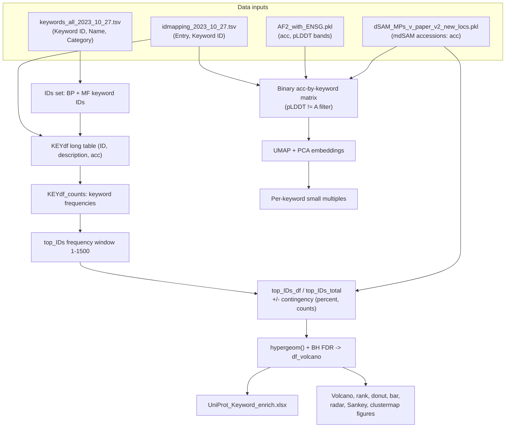
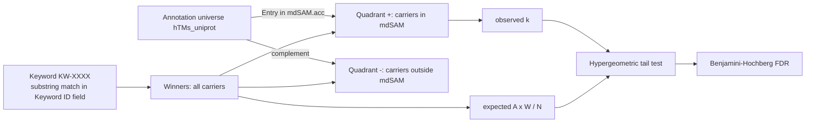

This page documents `notebooks/05_uniprot_keyword_enrichment.ipynb`, the fifth stage of the mdSAM analysis pipeline. The notebook asks a specific functional-genomics question: which **UniProt keywords** are statistically over- or under-represented among proteins discovered by mdSAM, relative to the broader population of annotated human entries? It answers this with a hypergeometric over-representation test over a two-by-two contingency built from an id-mapping export, then layers a series of publication-grade visualizations (donut, rank, volcano, stacked bar, radar, Sankey, clustermap) and a final embedding analysis that projects binary keyword profiles into 2D space via UMAP and PCA. Unlike the pipeline's engineerd modules, this notebook is a **curated exploratory artifact**: the committed version contains dead demo cells, toggled filters, and local file paths — all of which are documented here so you can reproduce or adapt it deliberately rather than archaeologically.

Sources: [notebooks/05_uniprot_keyword_enrichment.ipynb](notebooks/05_uniprot_keyword_enrichment.ipynb#L32-L39), [files/README.md](files/README.md#L7-L9)

## Position in the Analysis Pipeline

Within the *Sequence Space Characterization* block, notebook 05 is the **functional annotation lens** applied to mdSAM hits after their sequence-level properties have been characterized (composition in notebook 03, physicochemical clustering in notebook 06, PASTA comparison in notebook 04). It consumes the two shared pickle tables documented in [Shared Data Tables Reference](8-shared-data-tables-reference) — the mdSAM discovery table and the AlphaFold annotation table — and joins them against two externally downloaded UniProt exports. Its outputs feed the interpretive narrative that continues in [hyperLOPIT Organelle Enrichment](14-hyperlopit-organelle-enrichment), which repeats the same enrichment pattern against a different annotation system. The complete internal data flow is:

Sources: [notebooks/05_uniprot_keyword_enrichment.ipynb](notebooks/05_uniprot_keyword_enrichment.ipynb#L32-L39), [notebooks/05_uniprot_keyword_enrichment.ipynb](notebooks/05_uniprot_keyword_enrichment.ipynb#L2136-L2148), [files/README.md](files/README.md#L7-L9)

## Data Inputs and the Annotation Universe

The notebook loads four tables in its second cell. Two come from the shared `../files/` directory: the **mdSAM table** (whose `.acc` column supplies the discovery set) and the **AlphaFold table** (whose `.acc` and `.pLDDT` columns are used later for embedding-space filtering). Two are *local* TSV exports with dated filenames — `keywords_all_2023_10_27.tsv` (the UniProt keyword taxonomy: `Keyword ID`, `Name`, `Category`) and `idmapping_2023_10_27.tsv` (per-entry keyword assignments in an `Entry` / `Keyword ID` layout) — loaded from the original author's Downloads folder. Note that `files/README.md` lists `hTMs_uniprot_v1.pkl` as the shared resource "read by notebook 05"; the committed notebook instead reads the id-mapping TSV directly, so when adapting the notebook you should either regenerate that export or point the read at the shared pickle.

Sources: [notebooks/05_uniprot_keyword_enrichment.ipynb](notebooks/05_uniprot_keyword_enrichment.ipynb#L32-L39), [files/README.md](files/README.md#L7-L9)

The id-mapping table, renamed `hTMs_uniprot`, plays a dual role that defines the notebook's statistics. It is first filtered to entries whose `Keywords` field is non-null (line 37), and this filtered frame then serves as the **annotation universe** — the population *N* against which all enrichment is measured. Every contingency, expectation, and p-value in the notebook is therefore conditioned on "annotated entries", not on the complete proteome. A commented-out fragment inside the keyword-extraction loop (`hTMs_uniprot.Entry.isin(mdSAM.acc)`) reveals that the extraction once ran on the mdSAM subset only and was widened to the full universe, so membership is now applied *later*, at the contingency stage rather than the extraction stage. Keep this scope in mind when comparing p-values against tools like DAVID or g:Profiler, which use different background definitions.

Sources: [notebooks/05_uniprot_keyword_enrichment.ipynb](notebooks/05_uniprot_keyword_enrichment.ipynb#L36-L37), [notebooks/05_uniprot_keyword_enrichment.ipynb](notebooks/05_uniprot_keyword_enrichment.ipynb#L80-L86)

## Building the Keyword Contingency Table

The transformation chain proceeds in four stages. First, a **category scope filter** selects keyword IDs from `KeyWord_df` whose `Category` is `Biological process` or `Molecular function` into the `IDs` set; a trailing comment shows `Disease` was toggled in and out during the session, and downstream cells (hand-picked keywords including `Epilepsy`, a Disease keyword; volcano plots with a Disease hue entry) confirm the final runs included it. Second, the notebook explodes the semicolon-separated `Keyword ID` field: for every annotated entry it intersects the entry's keyword set with `IDs` and emits one record per keyword into the long-format `KEYdf` (`ID`, `disrcption`, `acc`). Third, `KEYdf_counts` aggregates this into per-keyword frequencies. Fourth, a **frequency window** — `counts_total.between(1, 1500)` — produces `top_IDs`, excluding both ubiquitous keywords (which would dominate any ratio) and singletons (which carry no statistical weight).

Sources: [notebooks/05_uniprot_keyword_enrichment.ipynb](notebooks/05_uniprot_keyword_enrichment.ipynb#L48-L58), [notebooks/05_uniprot_keyword_enrichment.ipynb](notebooks/05_uniprot_keyword_enrichment.ipynb#L80-L95), [notebooks/05_uniprot_keyword_enrichment.ipynb](notebooks/05_uniprot_keyword_enrichment.ipynb#L178), [notebooks/05_uniprot_keyword_enrichment.ipynb](notebooks/05_uniprot_keyword_enrichment.ipynb#L494-L510)

The core cell then sweeps `top_IDs` and builds the contingency semantics that drive everything downstream. For each keyword it counts entries whose `Keyword ID` string contains the keyword ID, split by membership in `mdSAM.acc`, and pivots the results two ways: `top_IDs_df` holds **percentages** of the keyword's carriers inside vs. outside mdSAM, while `top_IDs_total` holds raw **counts** in `+` and `-` columns. A keyword-level `Category` column (mapped back from the full keyword taxonomy) and a hand-picked highlight list (`Cell adhesion`, `G-protein coupled receptor`, `Differentiation`, `Immunity`, `Ion transport`, `Kinase`, `Epilepsy`) decorate these tables for plotting. Conceptually:

Sources: [notebooks/05_uniprot_keyword_enrichment.ipynb](notebooks/05_uniprot_keyword_enrichment.ipynb#L198-L218), [notebooks/05_uniprot_keyword_enrichment.ipynb](notebooks/05_uniprot_keyword_enrichment.ipynb#L293-L306), [notebooks/05_uniprot_keyword_enrichment.ipynb](notebooks/05_uniprot_keyword_enrichment.ipynb#L349-L352)

## The Hypergeometric Over-Representation Test

The `hypergeom()` function is the notebook's statistical engine, phrased in a memorable "team A / winners" metaphor. Given a keyword name, it assembles the four quantities of a hypergeometric experiment from the contingency tables and calls `stats.hypergeom.cdf`. The expected count is the classic ratio `A·W/N`:

| Code variable | Statistical role | Computed as |
|---|---|---|
| `total_runners` | Population size *N* | `len(hTMs_uniprot)` — all annotated entries |
| `number_team_A` | Draw size *A* (mdSAM hits) | entries with `Entry.isin(mdSAM.acc)` |
| `number_winners` | Successes in population *W* | `+` + `-` counts for the keyword |
| `number_win_from_A` | Observed successes *k* | `+` count for the keyword |
| `expected` | Mean of the null | `A·W/N` |
| `p` | Tail probability | `stats.hypergeom.cdf(k, N, W, A)`, flipped when over-represented |

Sources: [notebooks/05_uniprot_keyword_enrichment.ipynb](notebooks/05_uniprot_keyword_enrichment.ipynb#L590-L601)

> [!TIP]
> Watch the tail semantics: `stats.hypergeom.cdf(k, N, W, A)` returns the *lower* tail P(X ≤ k). When `k > expected` the function flips it to `1 − p`, which equals P(X ≥ k+1) — so the reported over-representation p-values are **conservative by exactly one observation** relative to the canonical P(X ≥ k) of a Fisher exact test. This matters if you cross-check the notebook's numbers against `scipy.stats.hypergeom.sf` or `fisher_exact`.

The driver loop applies `hypergeom()` across `df_total`, collecting observed, expected, and p-values into `df_volcano`, then computes **Benjamini–Hochberg FDR** inline: p-values are ranked with `rankdata`, scaled by `p·n/rank`, capped at 1, and expressed as `fdr_log = −log10(fdr)`. The complete result table is exported to `UniProt_Keyword_enrich.xlsx`, making this cell the notebook's durable analytical output. Note that a standalone `fdr()` helper defined earlier computes the identical correction but omits a `return` statement — the inline block is the operative implementation.

> [!TIP]
> When adapting the FDR logic, reuse the inline block at lines 656–661 rather than the `fdr()` helper at lines 611–615: the helper's missing `return` silently yields `None`. Also note the driver drops rows with `pval == 0` before correction — underflowed exact-zero p-values from huge keywords are excluded from the FDR family rather than floored.

Sources: [notebooks/05_uniprot_keyword_enrichment.ipynb](notebooks/05_uniprot_keyword_enrichment.ipynb#L636-L644), [notebooks/05_uniprot_keyword_enrichment.ipynb](notebooks/05_uniprot_keyword_enrichment.ipynb#L656-L671), [notebooks/05_uniprot_keyword_enrichment.ipynb](notebooks/05_uniprot_keyword_enrichment.ipynb#L611-L615)

## Figure Inventory and Design Patterns

The plotting layer converts `df_volcano` and the contingency tables into the paper's figure set. Two design conventions recur throughout: a **fixed category color system** (Biological process `#13609A`/`#125F99`, Molecular function `#3D3E3C`, Disease `#766094`/`#6E578E`, mdSAM-positive red `#C03830` vs. gray `#B4B5B4`) and **`adjust_text` label repulsion** applied to significant keywords only. The notebook also registers a custom `radar_factory` matplotlib projection twice — once early, once mid-notebook with a slightly different `PolarTransform` override — so the second definition wins at runtime; both exist to draw the polygon-frame radar charts used as "spider" summaries.

| Output file | Chart type | Encodes |
|---|---|---|
| `donut_v4.svg` | Donut with count annotations | Top keywords by `+` count, category-colored, hand-picked slices exploded |
| `volcano_<Category>.svg` | Rank plot (per category) | Keywords sorted by `obs_exp`; point size = `−log10 FDR`; FDR-log > 2 colored, others gray |
| `c.svg` | Broken-axis volcano | `obs_exp` vs. `fdr_log` with dashed gates at ±11 and 3 |
| `Biological_top_Keyword_bar.svg` | Stacked fraction bar | `+_ratio` vs. `-_ratio` per keyword from the `zz` ratio table, plus a `Base ratio` reference bar |
| `<Category>_top_Keyword_spider.svg` | Radar | Per-category `+_ratio` (red) vs. `-_ratio` (gray) against the dashed base-ratio circle |
| `mdSAM_all_left2right.svg` | Sankey (holoviews/bokeh) | Keyword → `+` flows for the 11 strongest and 5 weakest keywords |
| *(inline)* clustermaps/heatmaps | `sns.clustermap` / `sns.heatmap` | Receptor and Transport contingency percentages annotated with raw counts |

Sources: [notebooks/05_uniprot_keyword_enrichment.ipynb](notebooks/05_uniprot_keyword_enrichment.ipynb#L527-L547), [notebooks/05_uniprot_keyword_enrichment.ipynb](notebooks/05_uniprot_keyword_enrichment.ipynb#L766-L794), [notebooks/05_uniprot_keyword_enrichment.ipynb](notebooks/05_uniprot_keyword_enrichment.ipynb#L834-L901), [notebooks/05_uniprot_keyword_enrichment.ipynb](notebooks/05_uniprot_keyword_enrichment.ipynb#L1350-L1386), [notebooks/05_uniprot_keyword_enrichment.ipynb](notebooks/05_uniprot_keyword_enrichment.ipynb#L1557-L1574), [notebooks/05_uniprot_keyword_enrichment.ipynb](notebooks/05_uniprot_keyword_enrichment.ipynb#L1714-L1736), [notebooks/05_uniprot_keyword_enrichment.ipynb](notebooks/05_uniprot_keyword_enrichment.ipynb#L2025-L2047)

Two implementation details deserve maintainer awareness. The stacked bars and radar charts read from a `zz` table (columns `word`, `cat`, `+`, `-`, `+_ratio`, `-_ratio`) together with a scalar `ratio_base`; only their *consumption* is in the visible cells, so if you rebuild the notebook from scratch you must reconstruct that aggregation from `top_IDs_total`. And the Sankey/chord section imports holoviews with bokeh sample airport data — those are verbatim demo cells from the holoviews gallery left in place; only the final `hv.Sankey(l)` calls operate on real data.

Sources: [notebooks/05_uniprot_keyword_enrichment.ipynb](notebooks/05_uniprot_keyword_enrichment.ipynb#L1350-L1359), [notebooks/05_uniprot_keyword_enrichment.ipynb](notebooks/05_uniprot_keyword_enrichment.ipynb#L1523-L1529), [notebooks/05_uniprot_keyword_enrichment.ipynb](notebooks/05_uniprot_keyword_enrichment.ipynb#L1600-L1621)

## Conditional Sub-Analyses: Co-occurrence Gating

Beyond the global test, the notebook demonstrates a reusable pattern: **enrichment within an annotation-conditioned subset**. The `SuperKeys(ID)` function counts which other keywords co-occur with a seed keyword across all entries carrying that seed, producing a co-annotation frequency profile for any `KW-XXXX`. The Transport analysis operationalizes the same idea with a *double* string filter — an entry must contain both the transport-family keyword *and* a fixed gate keyword `KW-0813` — before splitting by mdSAM membership, yielding `Transport_df` (percent) and `Transport_df_values` (counts) that feed a cosine-metric clustermap and sorted heatmap. A parallel `Receptor_df` block does the same for receptor-family keywords. This gating answers a sharper question than the global test: *among transporters, which transport modalities characterize mdSAM hits?*

Sources: [notebooks/05_uniprot_keyword_enrichment.ipynb](notebooks/05_uniprot_keyword_enrichment.ipynb#L154-L168), [notebooks/05_uniprot_keyword_enrichment.ipynb](notebooks/05_uniprot_keyword_enrichment.ipynb#L1982-L2005), [notebooks/05_uniprot_keyword_enrichment.ipynb](notebooks/05_uniprot_keyword_enrichment.ipynb#L2025-L2047)

The section also contains two numerical hygiene steps worth copying into any adaptation. A **pseudocount** (`top_IDs_total.loc['Electron transport']['+'] = 1`) prevents a zero cell from breaking downstream ratios and chi-square computation, and a **chi-square normalization** divides the contingency table by `stats.chi2_contingency(...)` output to produce the weighted table `w` used for one of the ranking views. These are ad hoc stabilizers rather than part of the primary hypergeometric result, but they illustrate how the notebook guards degenerate cells in sparse annotation data.

Sources: [notebooks/05_uniprot_keyword_enrichment.ipynb](notebooks/05_uniprot_keyword_enrichment.ipynb#L1633), [notebooks/05_uniprot_keyword_enrichment.ipynb](notebooks/05_uniprot_keyword_enrichment.ipynb#L1643-L1644)

## Keyword Profiles as High-Dimensional Vectors

The final third of the notebook reframes enrichment geometrically. A nested loop builds a **binary acc-by-keyword matrix** `x`: every entry annotated with at least one keyword from the 10–2000 frequency window is crossed with every keyword in that window, marked 1/0 by substring match, and pivoted wide. The matrix is then filtered to entries whose AlphaFold table row has `pLDDT != 'A'` — excluding proteins whose AFDB banded confidence falls in the lowest band — tying annotation structure to model confidence. This is the notebook's bridge to the *sequence space* narrative: proteins become points whose coordinates are their functional annotation fingerprint, and the question becomes whether mdSAM hits occupy annotation space coherently rather than merely testing keyword frequencies.

Sources: [notebooks/05_uniprot_keyword_enrichment.ipynb](notebooks/05_uniprot_keyword_enrichment.ipynb#L2103-L2126)

Two embeddings are computed on `x`: **UMAP** (`random_state=42, n_neighbors=10`) colored by mdSAM membership, and **PCA** (`n_components=2`) with the same coloring at low alpha; a second UMAP variant explores the sparse binary space with `n_neighbors=2, metric='manhattan'`. TSNE is imported but its invocation is commented out — UMAP and PCA are the live paths. Both embeddings are then decomposed into an **11×10 grid of per-keyword small multiples**: each panel highlights the entries carrying one keyword on the shared embedding, letting you read which annotation neighborhoods mdSAM points fall into. A follow-up loop re-annotates the PCA frame with human-readable keyword-name columns via per-entry substring matching against the universe table.

Sources: [notebooks/05_uniprot_keyword_enrichment.ipynb](notebooks/05_uniprot_keyword_enrichment.ipynb#L2136-L2148), [notebooks/05_uniprot_keyword_enrichment.ipynb](notebooks/05_uniprot_keyword_enrichment.ipynb#L2158-L2186), [notebooks/05_uniprot_keyword_enrichment.ipynb](notebooks/05_uniprot_keyword_enrichment.ipynb#L2229-L2280), [notebooks/05_uniprot_keyword_enrichment.ipynb](notebooks/05_uniprot_keyword_enrichment.ipynb#L2330-L2342), [notebooks/05_uniprot_keyword_enrichment.ipynb](notebooks/05_uniprot_keyword_enrichment.ipynb#L2201-L2209)

## Reproducing and Adapting the Notebook

The notebook is executable from `notebooks/` as the working directory (the shared pickles are addressed as `../files/...`). Before running, you must supply the two UniProt exports — both are dated 2023-10-27 snapshots, so re-download current keyword and id-mapping files from UniProt and update the local paths in the loading cell, or regenerate `hTMs_uniprot_v1.pkl` per [Shared Data Tables Reference](8-shared-data-tables-reference). Non-stdlib dependencies beyond the pipeline norm include `umap-learn`, `adjustText`, `cmasher`, and `holoviews`/`bokeh` (only needed for the Sankey section). As with all shared pickles in this repository, `pd.read_pickle` executes stored code — load them only from this repo with a compatible pandas version.

| Knob | Location | Default | Effect |
|---|---|---|---|
| Category scope (`IDs`) | Category filter cell | BP + MF, Disease toggleable | Which keyword families enter `KEYdf` |
| Frequency window (contingency) | `top_IDs` | 1–1500 | Drops ubiquitous keywords and singletons |
| Frequency window (binary matrix) | `accs`/`keys` | 10–2000 | Density threshold for the embedding input |
| FDR display threshold | rank/volcano plots | `fdr_log > 2` (FDR < 0.01) | Which keywords are colored/labeled |
| Volcano label gates | volcano cells | `fdr_log ∈ (3, 35)`, `\|obs_exp\| > 11` | Which points receive text labels |
| UMAP parameters | embedding cells | seed 42; n_neighbors 10 (variant: 2, manhattan) | Geometry of annotation space |
| Co-occurrence gate | Transport block | fixed `KW-0813` seed | Subset within which transport keywords are compared |

Sources: [notebooks/05_uniprot_keyword_enrichment.ipynb](notebooks/05_uniprot_keyword_enrichment.ipynb#L32-L39), [notebooks/05_uniprot_keyword_enrichment.ipynb](notebooks/05_uniprot_keyword_enrichment.ipynb#L178), [notebooks/05_uniprot_keyword_enrichment.ipynb](notebooks/05_uniprot_keyword_enrichment.ipynb#L2103-L2104), [notebooks/05_uniprot_keyword_enrichment.ipynb](notebooks/05_uniprot_keyword_enrichment.ipynb#L2136-L2136), [notebooks/05_uniprot_keyword_enrichment.ipynb](notebooks/05_uniprot_keyword_enrichment.ipynb#L775-L779), [notebooks/05_uniprot_keyword_enrichment.ipynb](notebooks/05_uniprot_keyword_enrichment.ipynb#L808-L808), [files/README.md](files/README.md#L3-L13)

## Where to Go Next

To understand where the mdSAM accessions feeding this enrichment come from, start with [mdSAM Concept and Discovery Rationale](4-mdsam-concept-and-discovery-rationale) and [WALTZ-DB Random-Forest Classifier](6-waltz-db-random-forest-classifier); the `pLDDT` filtering used in the embedding section is contextualized in [AlphaFold-Based Disorder Filtering](7-alphafold-based-disorder-filtering). For the sibling analyses in this sequence-space block, continue to [PASTA Comparison and Window Thresholds](12-pasta-comparison-and-window-thresholds) and then [hyperLOPIT Organelle Enrichment](14-hyperlopit-organelle-enrichment), which mirrors this notebook's contingency-plus-test pattern against mass-spectrometry localization data. To map the figures produced here back to manuscript panels, consult [Figure-to-Notebook Reproducibility Map](9-figure-to-notebook-reproducibility-map), and for extracting reusable functions (contingency construction, FDR correction, radar projection) into your own work, see [Reusing the Analysis Toolkit](27-reusing-the-analysis-toolkit).
