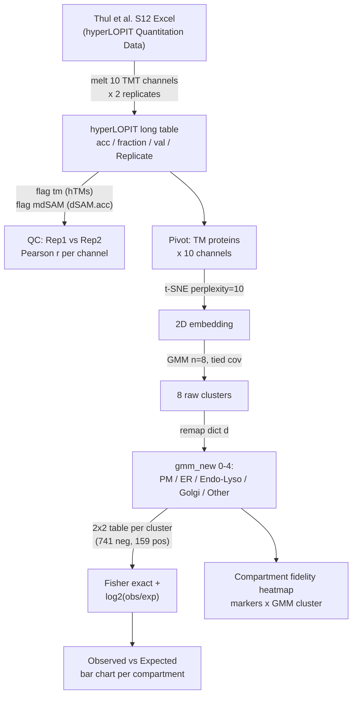

This page explains `07_hyperlopit_organelle_enrichment.ipynb`, the notebook that tests whether mdSAM-bearing membrane proteins are systematically enriched in specific subcellular compartments. The strategy is not a database lookup: the notebook re-quantifies a published hyperLOPIT fractionation dataset (Thul et al., U2OS cells), clusters transmembrane proteins by their 10-channel TMT fractionation profile, labels each cluster with a compartment identity, and then runs a Fisher exact test asking whether mdSAM proteins are over-represented in each compartment relative to expectation. Along the way it produces the replicate-quality-control figures, the t-SNE compartment map, and the observed-vs-expected bar chart that back the paper's localization claims.

The notebook sits between sequence-space characterization and the topology analysis: [UniProt Keyword Enrichment](13-uniprot-keyword-enrichment) asked *what functions* mdSAM proteins share, this page asks *where they live*, and [Topology and Membrane-Leaflet Distance](15-topology-and-membrane-leaflet-distance) follows with *which side of the membrane they face*.

Sources: [07_hyperlopit_organelle_enrichment.ipynb](/notebooks/07_hyperlopit_organelle_enrichment.ipynb#L270-L286), [files/README.md](/files/README.md#L5-L11)

## Analysis Pipeline at a Glance

The notebook is best understood as five sequential stages, each physically separated by markdown-free code cells in the file. Data flows from a wide Excel quantitation table into a tidy long-format frame, gets clustered in an unsupervised embedding, and terminates in a contingency-table test. Note the two asymmetric data paths: the `hyperLOPIT` frame (built from raw Excel) is used for QC and clustering, while `frac_plot_df` (loaded from a local pickle and rebuilt mid-notebook) carries the per-accession annotations used for plotting.

Sources: [07_hyperlopit_organelle_enrichment.ipynb](/notebooks/07_hyperlopit_organelle_enrichment.ipynb#L328-L347), [07_hyperlopit_organelle_enrichment.ipynb](/notebooks/07_hyperlopit_organelle_enrichment.ipynb#L840-L871), [07_hyperlopit_organelle_enrichment.ipynb](/notebooks/07_hyperlopit_organelle_enrichment.ipynb#L1284-L1311)

## Data Inputs and Provenance

Four external sources converge in this notebook, and their provenance matters for reproducing the analysis. The two Excel files are supplementary tables downloaded from published studies and referenced by **absolute local paths** — they are not shipped with the repository. The three pickles come from the shared `files/` directory and are documented in [Shared Data Tables Reference](8-shared-data-tables-reference); note that `AF2_with_ENSG.pkl` is listed as an input but is not present in the current repository tree, so the IDR-count step depends on regenerating it (see [AlphaFold-Based Disorder Filtering](7-alphafold-based-disorder-filtering)).

| Input | Origin | Loaded at | Role in analysis |
|---|---|---|---|
| `aal3321_thul_sm_table_s12.xlsx`, sheet *hyperLOPIT Quantitation Data* | Thul et al. supplementary table (U2OS hyperLOPIT) | `raw` | Source of TMT per-fraction intensities |
| `elife-16950-supp1-v3.xlsx`, sheet *Organellar Markers HeLa* | eLife-16950 supplementary | `markers` | Compartment ground truth (`Compartment` column) |
| `dSAM_MPs_v_paper_v2_new_locs.pkl` | mdSAM identification pipeline | `dSAM` | mdSAM membership via `acc` column |
| `hTMs_uniprot_v1.pkl` | produced by notebook 03 | `hTMs` | Transmembrane universe via `acc` column |
| `AF2_with_ENSG.pkl` | produced by notebook 02 | `AF2` | Per-protein `pLDDT` arrays → disordered-residue count |
| `HPA_frac_df.pkl`, `HPA_anaysis/frac_plot_df.pkl` | prior local runs of this notebook | `xx`, `frac_plot_df` | Pre-annotated plotting tables (`gmm_new`, `mdSAM`, `idr`) |

The marker table is loaded from the *Organellar Markers HeLa* sheet even though the quantitation is U2OS — the marker list serves purely as compartment ground truth for labeling clusters, while the fractionation profiles themselves are U2OS-derived (plot titles read `$U2OS\;hyperLOPIT$`).

Sources: [07_hyperlopit_organelle_enrichment.ipynb](/notebooks/07_hyperlopit_organelle_enrichment.ipynb#L270-L286), [files/README.md](/files/README.md#L5-L13), [07_hyperlopit_organelle_enrichment.ipynb](/notebooks/07_hyperlopit_organelle_enrichment.ipynb#L756-L757)

## From Wide TMT Table to Tidy Fractionation Profiles

The raw hyperLOPIT table stores intensities in a wide layout with TMT channel columns suffixed by replicate. The notebook defines the ten channel stems once — `['126','127C','127N','128C','128N','129C','129N','130C','130N','131']` — and melts the table by iterating over every accession × channel pair, taking the mean of the non-null `Replicate1` and `Replicate2` columns separately. The result is the canonical long frame `hyperLOPIT` with columns `acc`, `fraction`, `val`, `Replicate`.

Two boolean flags are then painted onto every row: `tm` (`yes`/`no`, membership in `hTMs.acc`) and `mdSAM` (`yes`/`no`, membership in `dSAM.acc`). These two columns are the entire definition of the analysis universes — every downstream contingency table is a cross-tabulation of them, so auditing these join keys is the fastest way to audit the results.

> [!TIP]
> The `filter(regex=i)` channel matching is prefix-based: channel stem `126` will also match columns like `126C_Replicate1`, which is exactly the intended behavior here, but it means adding any other column containing `126` (e.g., an unrelated metadata column) would silently contaminate the mean.

Sources: [07_hyperlopit_organelle_enrichment.ipynb](/notebooks/07_hyperlopit_organelle_enrichment.ipynb#L328-L329), [07_hyperlopit_organelle_enrichment.ipynb](/notebooks/07_hyperlopit_organelle_enrichment.ipynb#L339-L347), [07_hyperlopit_organelle_enrichment.ipynb](/notebooks/07_hyperlopit_organelle_enrichment.ipynb#L358-L367)

## Replicate Quality Control

Before any biology is interpreted, the notebook validates the hyperLOPIT quantitation. TM proteins' intensities are paired as `x` = Replicate 1 vs `y` = Replicate 2 per channel into the frame `c3`, and Pearson correlation coefficients are computed per TMT channel. Three figures come out of this stage: a 5×2 panel of per-channel replicate scatter plots (`hyperLOPIT_TM_corr_v2.svg`), a single combined scatter with a global *r* annotation and identity line (`hyperLOPIT_TM_corr.svg`), and a horizontal bar chart of per-channel *r* values on a fixed 0.65–0.95 axis (`hyperLOPIT_TM_corr_bar.svg`). The fixed axis limits are a deliberate presentation choice — they keep all channels visually comparable rather than letting each bar auto-scale.

Sources: [07_hyperlopit_organelle_enrichment.ipynb](/notebooks/07_hyperlopit_organelle_enrichment.ipynb#L379-L392), [07_hyperlopit_organelle_enrichment.ipynb](/notebooks/07_hyperlopit_organelle_enrichment.ipynb#L439-L460), [07_hyperlopit_organelle_enrichment.ipynb](/notebooks/07_hyperlopit_organelle_enrichment.ipynb#L497-L507)

## Compartment Clustering: t-SNE + Gaussian Mixture

This is the notebook's central methodological move. Instead of trusting protein-to-compartment assignments for every protein, only the *marker* proteins are trusted, and all other TM proteins are assigned by the shape of their fractionation profile:

1. **Pivot**: TM proteins (`tm == 'yes'`) become a matrix `xx` of accession × 10 channels (mean over replicates).
2. **Embed**: `TSNE(n_components=2, learning_rate='auto', init='random', perplexity=10)` compresses each profile to a 2D point.
3. **Cluster**: `mixture.GaussianMixture(n_components=8, covariance_type="tied")` is fit on the embedding coordinates.
4. **Consolidate**: a hardcoded remap dictionary `d = {2:0, 6:0, 0:1, 5:1, 7:1, 1:2, 3:3, 4:4}` collapses the 8 raw components into the 5 interpretable clusters stored in `gmm_new`.
5. **Name**: the notebook annotates the t-SNE plot with canonical marker proteins per cluster — SSR1/RTN1/STX5/MIA3/SARAF for ER, ADGRB1/APP/NGFR/MET/CDH2 for PM, GOLIN4/MAN1A2/QSOX2/GLG1/MAN1B1 for Golgi, ATG9A/SORT1/ATP13A3 for Endo/Lyso — fixing the label-to-number mapping as PM=0, ER=1, Endo/Lyso=2, Golgi=3, Other=4.

Each accession also receives an `idr` column (count of AF2 residues with pLDDT < 70) and `mdSAM` polarity labels rendered as `+`/`−` for plotting.

| `gmm_new` | Compartment label | Constituent raw GMM components |
|---|---|---|
| 0 | Plasma membrane (PM) | 2, 6 |
| 1 | ER | 0, 5, 7 |
| 2 | Endo/Lyso | 1 |
| 3 | Golgi | 3 |
| 4 | Other | 4 |

> [!TIP]
> Neither `TSNE` nor `GaussianMixture` is given a `random_state`, and t-SNE with `init='random'` is stochastic. Re-running this cell will produce a different embedding and different raw component numbering, so the remap dictionary `d` is valid only for the run that produced it — treat `gmm_new` in any cached pickle as the authoritative cluster identity, and re-derive `d` by marker-protein inspection if you recluster.

Sources: [07_hyperlopit_organelle_enrichment.ipynb](/notebooks/07_hyperlopit_organelle_enrichment.ipynb#L840-L871), [07_hyperlopit_organelle_enrichment.ipynb](/notebooks/07_hyperlopit_organelle_enrichment.ipynb#L892-L895), [07_hyperlopit_organelle_enrichment.ipynb](/notebooks/07_hyperlopit_organelle_enrichment.ipynb#L958-L971)

## Enrichment Statistics: Fisher Exact per Compartment

The headline test is deliberately simple. For each of the five clusters, a 2×2 contingency table contrasts mdSAM-negative versus mdSAM-positive TM proteins inside the cluster against their totals outside it, with the background hardcoded as **741 negative** and **159 positive** TM proteins. `scipy.stats.fisher_exact` yields the two-sided p-value, `scipy.stats.contingency.expected_freq` yields the expected count under independence, and enrichment is quantified as `enrich = np.log2(observed / expected)`.

| Cluster axis | Recorded fields |
|---|---|
| Per-cluster result | `gmm_cluster`, `gmm_cluster_size`, `obs`, `exp`, `pval`, `enrich` |
| Test universe | 741 mdSAM− TMs + 159 mdSAM+ TMs (900 total) |
| Effect size | log2(observed / expected mdSAM count) |

The results are assembled into `fisher_bar` and rendered as an observed-vs-expected grouped bar chart (`hyperLOPIT_enrich_v2.svg`), where the expected bars are hatch-patterned and both bar groups are colored per compartment, with x labels `$PM$`, `$ER$`, `$Endo/Lyso$`, `$Golgi$`, `$Other$`. The `$n=900\,MPs$` annotation used elsewhere in the notebook's profile plots corresponds to the same 741 + 159 universe. This is an enrichment-by-localization complement to the keyword-based enrichment in [UniProt Keyword Enrichment](13-uniprot-keyword-enrichment), which uses the same +/− universe logic but ontology terms instead of compartments.

Sources: [07_hyperlopit_organelle_enrichment.ipynb](/notebooks/07_hyperlopit_organelle_enrichment.ipynb#L1284-L1311), [07_hyperlopit_organelle_enrichment.ipynb](/notebooks/07_hyperlopit_organelle_enrichment.ipynb#L1320-L1322), [07_hyperlopit_organelle_enrichment.ipynb](/notebooks/07_hyperlopit_organelle_enrichment.ipynb#L1396-L1443)

## Cluster Validation Against Marker Ground Truth

Because the clustering is unsupervised, the notebook includes two validation layers. First, a compartment-purity matrix: for every marker compartment (Plasma membrane, ER, ERGIC, ER_high_curvature, Endosome, Lysosome, Golgi, Mitochondrion, Nuclear pore complex, Peroxisome) and every GMM cluster, it computes the percentage of that compartment's marker proteins falling into the cluster, rendered as the "Organelle fiducial markers" heatmap (`hyperLOPIT_tsne_2_matrix.svg`). Off-diagonal mass here would indicate profile-shape clusters that split or merge true compartments. Second, a per-cluster fractionation profile gallery (`hyperLOPIT_compartments.svg`) overlaying individual protein traces within each cluster, plus a cividis clustermap of the acc × channel matrix (`hyperLOPIT_clustermap.svg`) that shows the dendrogram structure of the profiles directly. A compartment-level mdSAM overlay (`hyperLOPIT_raw.svg`) plots `val_100` (percent-normalized intensity) traces for mdSAM+ (red `#C03830`) versus mdSAM− (gray) proteins, providing the qualitative "mdSAM proteins look like they peak somewhere" evidence that the Fisher test then formalizes.

Sources: [07_hyperlopit_organelle_enrichment.ipynb](/notebooks/07_hyperlopit_organelle_enrichment.ipynb#L1132-L1172), [07_hyperlopit_organelle_enrichment.ipynb](/notebooks/07_hyperlopit_organelle_enrichment.ipynb#L1250-L1257), [07_hyperlopit_organelle_enrichment.ipynb](/notebooks/07_hyperlopit_organelle_enrichment.ipynb#L652-L672)

## Supporting Visualization Utilities

The first substantive cell block defines `calculate_hull`, `draw_hull`, and `draw_rounded_hull` — generic convex-hull drawing helpers. `calculate_hull` scales the point cloud, computes a `scipy.spatial.ConvexHull`, and smooths the boundary via periodic spline interpolation (`quadratic_periodic` by default through `scipy.interpolate.splev`); `draw_rounded_hull` instead rounds hull corners by inset lines and `matplotlib.patches.Arc` segments. These are used to draw smooth compartment boundaries around each GMM cluster in the publication t-SNE (`hyperLOPIT_tsne_v5.svg`), which drops axes and labels in favor of hull silhouettes with mdSAM+ points overplotted in red.

Sources: [07_hyperlopit_organelle_enrichment.ipynb](/notebooks/07_hyperlopit_organelle_enrichment.ipynb#L40-L238), [07_hyperlopit_organelle_enrichment.ipynb](/notebooks/07_hyperlopit_organelle_enrichment.ipynb#L999-L1033)

## Reproducibility Notes and Pitfalls

Running this notebook end-to-end requires more than the repository contains. The practical blockers, in the order you will hit them:

| Issue | Detail | Workaround |
|---|---|---|
| Absolute download paths | `/Users/aelazar/Downloads/aal3321_thul_sm_table_s12.xlsx` and `elife-16950-supp1-v3.xlsx` | Download both supplementary files and rewrite the two `read_excel` paths |
| Missing intermediate pickles | `HPA_frac_df.pkl` and `HPA_anaysis/frac_plot_df.pkl` are loaded at the top but live outside the repo | Recreate by running the notebook's own pivot/annotation cells; create `HPA_anaysis/` for the SVG outputs |
| Missing shared pickle | `AF2_with_ENSG.pkl` is read but absent from `files/` in the current tree | Regenerate via [AlphaFold-Based Disorder Filtering](7-alphafold-based-disorder-filtering) (notebook 02) |
| Working directory | `../files/...` references assume `notebooks/` as CWD | Follow the convention stated in `files/README.md` |
| Stochastic clustering | t-SNE and GMM run without `random_state` | Seed both, and re-derive the 8→5 remap `d` by checking marker-protein positions per cluster |
| Hardcoded test totals | Fisher table uses fixed `741` / `159` background counts | If your dSAM or hTMs tables differ from the paper versions, compute these totals from `xx.mdSAM.value_counts()` before testing |
| Loose `delete` reference | `hyperLOPIT` is filtered against a `delete` list with no visible definition in the notebook | Treat the filter as a no-op for fresh runs, or define an empty list |

The pickle-safety warning in `files/README.md` applies with full force here: these `.pkl` files execute code on load and are pandas-version-sensitive, so load them only from this repository with a compatible pandas version.

Sources: [07_hyperlopit_organelle_enrichment.ipynb](/notebooks/07_hyperlopit_organelle_enrichment.ipynb#L260-L260), [07_hyperlopit_organelle_enrichment.ipynb](/notebooks/07_hyperlopit_organelle_enrichment.ipynb#L1148-L1149), [07_hyperlopit_organelle_enrichment.ipynb](/notebooks/07_hyperlopit_organelle_enrichment.ipynb#L1296-L1296), [files/README.md](/files/README.md#L13-L13)

## Where This Fits and What to Read Next

Within the pipeline, this notebook consumes the outputs of notebooks 02 and 03 (via `files/`) and feeds compartment labels into the localization story completed by [Topology and Membrane-Leaflet Distance](15-topology-and-membrane-leaflet-distance), which resolves *within*-membrane positioning using UniProt topology annotations from the same `hTMs_uniprot_v1.pkl` table. For the mechanical conventions shared across all 23 notebooks — pickle contracts, working-directory rules, figure naming — see [Notebook Pipeline Architecture](5-notebook-pipeline-architecture) and [Repository Layout and Notebook Map](3-repository-layout-and-notebook-map); for matching published figures to the SVG filenames generated here, consult [Figure-to-Notebook Reproducibility Map](9-figure-to-notebook-reproducibility-map). If your interest is the statistical pattern rather than the localization biology, the clustering-plus-enrichment template here is conceptually parallel to the embedding analysis in [Physicochemical Embedding and Clustering](11-physicochemical-embedding-and-clustering).
