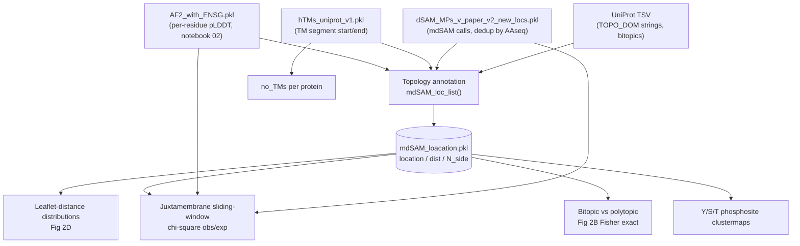
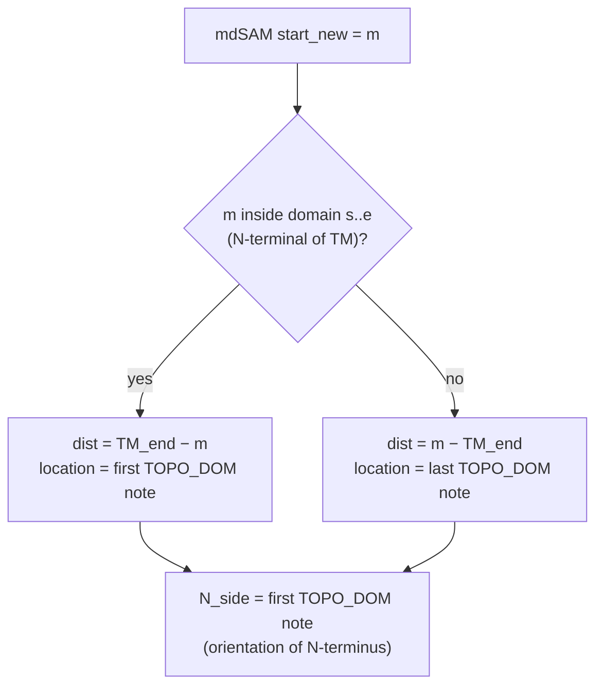

This page documents `08_mdsam_topology_and_membrane_distance.ipynb`, the notebook that characterizes *where* mdSAMs live relative to membrane architecture: whether their host proteins are bitopic or polytopic, which side of the membrane (cytoplasmic, extracellular, or lumenal) the motif faces, and how many amino acids separate the motif from the nearest membrane leaflet. It produces paper panels **Fig 2B, 2C, 2D and 2F** of the manuscript, and it is the step that converts the raw mdSAM calls into a topologically annotated dataset that later analyses (motif swapping, clustering assays) build upon.
Sources: [README.md](README.md#L51), [08_mdsam_topology_and_membrane_distance.ipynb](notebooks/08_mdsam_topology_and_membrane_distance.ipynb#L10-L31)

## Position in the Pipeline and Input Data

The notebook loads three shared artifacts and one external annotation file. From `dSAM_MPs_v_paper_v2_new_locs.pkl` it takes the high-confidence mdSAM calls (with `start_new`/`end_new` positions on the full-length sequence), deduplicated by `AAseq`. From `hTMs_uniprot_v1.pkl` it takes transmembrane-segment coordinates (`start`/`end`) per accession, and from `AF2_with_ENSG.pkl` — the per-residue table built by notebook 02 — it takes the AlphaFold `pLDDT` arrays used to identify disordered (pLDDT < 70) residues. The fourth input is a UniProt ID-mapping TSV carrying `TOPO_DOM` annotation strings for the single-pass (bitopic) membrane proteins, fetched via an accession list of proteins with exactly one TM segment generated in-cell.

Sources: [08_mdsam_topology_and_membrane_distance.ipynb](notebooks/08_mdsam_topology_and_membrane_distance.ipynb#L10-L31), [README.md](README.md#L40), [08_mdsam_topology_and_membrane_distance.ipynb](notebooks/08_mdsam_topology_and_membrane_distance.ipynb#L77-L105)

Note the naming convention carried from the manuscript era: file names and variables use `dSAM`/`SSTM` where "SSTM" here denotes **single-segment transmembrane** proteins — the bitopic population whose topology the notebook resolves. A helper `fdr()` (Benjamini-Hochberg-style: `p × n / rank`, capped at 1) is defined early and available for multiple-testing corrections throughout the notebook.
Sources: [08_mdsam_topology_and_membrane_distance.ipynb](notebooks/08_mdsam_topology_and_membrane_distance.ipynb#L40-L48), [08_mdsam_topology_and_membrane_distance.ipynb](notebooks/08_mdsam_topology_and_membrane_distance.ipynb#L77-L83)

## The Topology Annotation Engine

The core function is `mdSAM_loc_list(ind)`, which parses the UniProt `Topological domain` column of the bitopic annotation file. For a given mdSAM row it (1) extracts the orientation `side` of the first topological domain (this becomes `N_side`, e.g. `Extracellular` for type-I bitopics), (2) extracts the domain boundaries `s..e` from the `TOPO_DOM` string, and (3) assigns the motif's side label and its distance to the nearest transmembrane edge. If the mdSAM start lies *inside* the annotated domain (upstream of the TM), the distance is `TM_end − mdSAM_start`; otherwise it is `mdSAM_start − TM_end`. The result is applied across all mdSAMs whose accession exists in the annotation file, populating three new columns and persisting the annotated frame to `mdSAM_loacation.pkl`.

Sources: [08_mdsam_topology_and_membrane_distance.ipynb](notebooks/08_mdsam_topology_and_membrane_distance.ipynb#L124-L149), [08_mdsam_topology_and_membrane_distance.ipynb](notebooks/08_mdsam_topology_and_membrane_distance.ipynb#L161-L176)

The annotated columns and their semantics:

| Column | Type | Meaning | Produced by |
|---|---|---|---|
| `location` | str | Membrane side of the mdSAM: `Cytoplasmic`, `Extracellular`, or `Lumenal` (organelle lumen) | `mdSAM_loc_list` via UniProt `note=` |
| `dist` | int | Amino acids from the nearest TM-segment edge to `start_new` (residue-counted, log-scale analysis downstream) | `mdSAM_loc_list` arithmetic |
| `N_side` | str | Side facing the N-terminus (`Extracellular`/`Cytoplasmic`), defining protein orientation | first `TOPO_DOM` note |
| `no_TMs` | int | Number of TM segments per protein, from `hTMs.acc.value_counts()` | later count-based cell |

Sources: [08_mdsam_topology_and_membrane_distance.ipynb](notebooks/08_mdsam_topology_and_membrane_distance.ipynb#L124-L149), [08_mdsam_topology_and_membrane_distance.ipynb](notebooks/08_mdsam_topology_and_membrane_distance.ipynb#L663-L675)

> [!TIP]
> The distance metric is in **residues, not nanometers** — it is the sequence separation from the TM boundary, used as a proxy for physical distance to the leaflet. Downstream 2D plots always filter `dist > 0` before plotting, so only positively-offset, side-annotated placements enter the leaflet-distance distributions.

## Distance to the Nearest Leaflet (Fig 2D)

With `location`, `dist` and the per-location counts in hand (observed: **437 cytoplasmic, 136 extracellular, 49 lumenal**), the notebook renders the leaflet-distance distributions in several iterations. The counts bar for the figure uses hardcoded histogram values replicating the observed totals, paired as an inset/side bar with the main axes. The published panel per the README map points to **cell 45** (violin plot, `mdSAM_dist_v5.svg`) and **cell 55** (stacked histogram with inset count bar, `mdSAM_dist.svg`).

| Cell (0-based) | Output SVG | Chart type | Key styling |
|---|---|---|---|
| 43 | `mdSAM_dist_v4.svg` | Boxen plot + side count bar | log-scale x, palette `#232323/#043278/#397BDE` |
| 45 | `mdSAM_dist_v5.svg` | Violin plot (inner box) + side count bar | log-scale x, ylim 1–2×10⁴ |
| 49 / 51 | `mdSAM_dist_v2.svg` | Stacked ridge: one KDE row per location | log-scale, xlim 1–10⁴, shared x-label "No. amino acids (to closest leaflet)" |
| 50 / 52 | `mdSAM_dist_v3.svg` | Single-bin stacked count bar | palette `#B96071/#679AAB/#624A64` |
| 55 | `mdSAM_dist.svg` | Stacked histogram, 15 log bins + inset axes | legend relabeled in math text |

Sources: [08_mdsam_topology_and_membrane_distance.ipynb](notebooks/08_mdsam_topology_and_membrane_distance.ipynb#L663-L674), [08_mdsam_topology_and_membrane_distance.ipynb](notebooks/08_mdsam_topology_and_membrane_distance.ipynb#L684-L742), [08_mdsam_topology_and_membrane_distance.ipynb](notebooks/08_mdsam_topology_and_membrane_distance.ipynb#L843-L941), [README.md](README.md#L112-L113)

All variants restrict to `location ∈ {Cytoplasmic, Extracellular, Lumenal}` with `dist > 0` and place the x-axis on a log scale, spanning roughly 1 to 10⁴ residues — i.e., the analysis covers both immediately juxtamembrane motifs and motifs buried deep inside long disordered tails.
Sources: [08_mdsam_topology_and_membrane_distance.ipynb](notebooks/08_mdsam_topology_and_membrane_distance.ipynb#L685-L686), [08_mdsam_topology_and_membrane_distance.ipynb](notebooks/08_mdsam_topology_and_membrane_distance.ipynb#L916-L918)

## Juxtamembrane Sliding-Window Enrichment

Beyond per-motif distance, the notebook asks a complementary question: **are mdSAM residues specifically enriched in the IDR stretch adjacent to the membrane?** For this it builds 2×2 contingency tables of residues — mdSAM vs non-mdSAM, inside vs outside a juxtamembrane window — restricted to IDR residues (pLDDT < 70) within the annotated domain, then aggregates the tables across proteins and scores them with `chi2_contingency`, recording `log2(observed/expected)` per window width.

| Residue class | In juxtamembrane window | In rest of domain IDR |
|---|---|---|
| mdSAM residues | `juxa_mdSAM` | `non_juxta_mdSAM` |
| Non-mdSAM residues | `juxa_non_mdSAM` | `non_juxta_non_mdSAM` |

Sources: [08_mdsam_topology_and_membrane_distance.ipynb](notebooks/08_mdsam_topology_and_membrane_distance.ipynb#L246-L265), [08_mdsam_topology_and_membrane_distance.ipynb](notebooks/08_mdsam_topology_and_membrane_distance.ipynb#L384-L420)

Two topologically mirrored scans are implemented. The **cytoplasmic scan** targets type-I bitopics (`N_side == 'Extracellular'`, cytoplasmic C-tail): version 1 takes the first `juxta_size` residues of the cytoplasmic domain; the refined version 2 uses only IDR residues and a fixed 50-residue window starting at offset `juxta_size` from the domain edge (`[sc+juxta_size, sc+50+juxta_size]`), with `juxta_size` swept `range(0, 200, 10)`. The **extracellular scan** mirrors this on the N-terminal extracellular domain of the same proteins, taking the *last* `juxta_size` residues — the window physically adjacent to the TM. The cytoplasmic result is plotted as observed-vs-expected mdSAM residues against window width; the extracellular result as the `log2(obs/exp)` enrichment curve.

| Scan | Function | Window definition | Sweep | Plot statistic |
|---|---|---|---|---|
| Cytoplasmic v1 | `fisher_juxta_Cytoplasmic` | first `juxta_size` residues of domain | 1–200 step 25 | observed vs expected |
| Cytoplasmic v2 (final) | `fisher_juxta_Cytoplasmic_v2` | `[sc+juxta_size, sc+50+juxta_size]`, IDR-only | 0–200 step 10 | observed vs expected |
| Extracellular | `fisher_juxta_Extracellular` | last `juxta_size` residues before TM | 1–200 step 10 | `log2(obs/exp)` |

Sources: [08_mdsam_topology_and_membrane_distance.ipynb](notebooks/08_mdsam_topology_and_membrane_distance.ipynb#L275-L297), [08_mdsam_topology_and_membrane_distance.ipynb](notebooks/08_mdsam_topology_and_membrane_distance.ipynb#L328-L346), [08_mdsam_topology_and_membrane_distance.ipynb](notebooks/08_mdsam_topology_and_membrane_distance.ipynb#L408-L420), [08_mdsam_topology_and_membrane_distance.ipynb](notebooks/08_mdsam_topology_and_membrane_distance.ipynb#L441-L452), [08_mdsam_topology_and_membrane_distance.ipynb](notebooks/08_mdsam_topology_and_membrane_distance.ipynb#L482-L516)

## Bitopic vs Polytopic Enrichment (Fig 2B)

The notebook counts TM segments per protein (`no_TMs` from `hTMs.acc.value_counts()`) and compares mdSAM-containing vs mdSAM-free proteins across topology classes. Crucially, it first removes **GPCRs** — identified by the Gene Ontology term `GO:0004984` (G protein-coupled receptor activity) loaded from a second UniProt ID-mapping TSV — because the 7-TM GPCR class would otherwise dominate the heptahelical bin. Binned counts (bitopic `1`, `2–6`, `7`, `>7` TM segments) are tested per bin with `fisher_exact` on the 2×2 table of mdSAM vs non-mdSAM proteins, and observed counts are compared against `expected_freq` in paired barplots.

| Bin | mdSAM proteins counted as | non-mdSAM denominator |
|---|---|---|
| `1` | distinct accs with `no_TMs == 1` | proteins outside the mdSAM set with 1 TM |
| `2–6` | distinct accs with `no_TMs ∈ [2, 6]` | same, `no_TMs ∈ [2, 6]` |
| `7` | distinct accs with `no_TMs == 7` | same, `no_TMs == 7` |
| `>7` | distinct accs with `no_TMs > 7` | same, `no_TMs > 7` |

Sources: [08_mdsam_topology_and_membrane_distance.ipynb](notebooks/08_mdsam_topology_and_membrane_distance.ipynb#L663-L666), [08_mdsam_topology_and_membrane_distance.ipynb](notebooks/08_mdsam_topology_and_membrane_distance.ipynb#L971-L976), [08_mdsam_topology_and_membrane_distance.ipynb](notebooks/08_mdsam_topology_and_membrane_distance.ipynb#L986-L1026), [08_mdsam_topology_and_membrane_distance.ipynb](notebooks/08_mdsam_topology_and_membrane_distance.ipynb#L1084-L1099)

The intermediate cells (59–62) develop this machinery with per-TM-count variants (1–7, >7) of the same Fisher framework; the README's figure map records the final published renderings of panel 2B at **cells 70 and 73** of this notebook.
Sources: [08_mdsam_topology_and_membrane_distance.ipynb](notebooks/08_mdsam_topology_and_membrane_distance.ipynb#L1036-L1064), [README.md](README.md#L107-L108)

## Side-Specific Modification Potential (Exploratory Layer)

A self-contained sub-analysis compares cytoplasmic vs non-cytoplasmic mdSAMs for Tyr/Ser/Thr content — the phosphorylation-relevant residues. Clustered heatmaps (`sns.clustermap`, average linkage, rows = mdSAM sequences) count Y/S/T per motif: `mdSAM_YST_counts_SSTM_cyto.svg` for cytoplasmic motifs (Y+S+T) and `mdSAM_YST_counts_SSTM_non_cyto.svg` for extracellular/lumenal motifs (S+T only), each followed by a computation of the fraction of motifs carrying at least one such residue. This frames cytoplasmic mdSAMs as candidate phospho-regulated self-assembly modules — an exploratory extension of the topology theme rather than a mapped Fig 2 panel.
Sources: [08_mdsam_topology_and_membrane_distance.ipynb](notebooks/08_mdsam_topology_and_membrane_distance.ipynb#L580-L594), [08_mdsam_topology_and_membrane_distance.ipynb](notebooks/08_mdsam_topology_and_membrane_distance.ipynb#L632-L655)

## Remaining Fig 2 Panels and the Exploratory Layer

Two panels of the Figure 2 family finish in this notebook per the reproducibility map: **2C** (mdSAMs at N-/C-termini vs internal loops, cells 146, 148, 168 — built directly on the `location` and `N_side` columns annotated earlier in the notebook) and **2F** (mdSAM length distribution, cell 76). Panel **2E** (mdSAMs per protein) is drawn in the companion notebook `09_mdsams_per_protein.ipynb`. Be aware that the notebook mixes published-panel cells with exploratory material: constant-sequence probes (`GSSVFLNRS`, `Q8IX19`, `Q6DN72`, `Q9ULI3`), a broken scratch cell, and superseded plot versions retained side-by-side — always consult the cell indices in the figure map when reproducing a specific panel.
Sources: [README.md](README.md#L109-L115), [08_mdsam_topology_and_membrane_distance.ipynb](notebooks/08_mdsam_topology_and_membrane_distance.ipynb#L56-L68)

> [!TIP]
> The two UniProt annotation TSVs are loaded from **absolute author-local paths** (`/Users/aelazar/notebooks_for_paper/SSTM_data/idmapping_2023_06_28.tsv` for topology and `/Users/aelazar/Downloads/idmapping_2023_11_15.tsv` for the GPCR GO terms) and are not shipped in `files/`. To rerun, regenerate them via UniProt ID mapping for the single-TM accession list produced in-cell (the SSTMs clipboard workflow), or substitute your own `Topological domain`/`Gene Ontology IDs` export with the same column schema.

## Reading Progression

This page sits between the cellular-localization and assay-analytics blocks of the Deep Dive. For the enrichment context that precedes the topology question, read [hyperLOPIT Organelle Enrichment](14-hyperlopit-organelle-enrichment); for the shared input tables consumed here (`hTMs_uniprot_v1.pkl`, `dSAM_MPs_v_paper_v2_new_locs.pkl`, `AF2_with_ENSG.pkl`), see [Shared Data Tables Reference](8-shared-data-tables-reference); to trace any panel back to its exact notebook cell, use [Figure-to-Notebook Reproducibility Map](9-figure-to-notebook-reproducibility-map). Continuing forward, the topology characterization feeds the experimental tests of mdSAM self-assembly in [Thioflavin-T and Amytracker Screens](16-thioflavin-t-and-amytracker-screens), and the disorder-filtering prerequisite for the mdSAM set is detailed in [AlphaFold-Based Disorder Filtering](7-alphafold-based-disorder-filtering).
