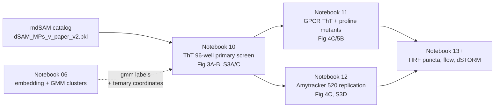
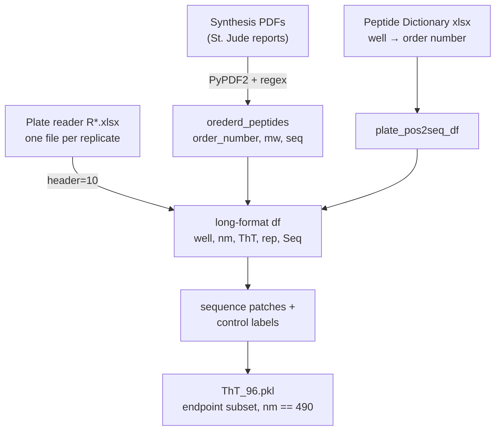

This page documents the **in vitro self-assembly validation arm** of the mdSAM pipeline: three notebooks (`10`–`12`) that convert plate-reader fluorescence data into reproducible evidence that predicted membrane-disordered Self-Assembly Motifs (mdSAMs) form amyloid-like aggregates. Notebook 10 runs the primary 96-well Thioflavin-T (ThT) screen over synthesized mdSAM peptides, notebook 11 confirms GPCR-derived motifs with proline-mutant specificity controls, and notebook 12 provides orthogonal validation with the Amytracker 520 dye. Together they produce Figure 3A–B, Figure 4C, Figure 5B, and Supplementary Figure S3A/C/D of the manuscript. Of 44 synthesized mdSAM peptides, 36 (81%) gave ThT signal, which is the discovery paper's central in vitro result.

Sources: [README.md](README.md#L84-L95), [README.md](README.md#L18-L24)

## Position in the Assay Analytics Pipeline

The dye screens sit at the transition point between computational discovery and cell-based assays. Upstream notebooks produce the mdSAM catalog and its physicochemical embedding; the screens test whether catalog members physically self-assemble; downstream notebooks ask whether that self-assembly has cellular consequences. The dependency flow below shows the three assays as a battery: ThT is the wide primary screen, the GPCR ThT panel is a targeted confirmation, and Amytracker is an orthogonal-dye replication designed to rule out ThT-specific artifacts.

Notebook 10 imports cluster labels from the physicochemical embedding (`HTS/umap.pkl` refit with a 3-component Gaussian mixture) so that per-peptide ThT readouts can be stratified by charge-archetype cluster — the overlay that becomes Figure 3A.

Sources: [README.md](README.md#L84-L95), [notebooks/10_tht_peptide_screen_96well.ipynb](notebooks/10_tht_peptide_screen_96well.ipynb#L440-L452), [notebooks/10_tht_peptide_screen_96well.ipynb](notebooks/10_tht_peptide_screen_96well.ipynb#L625-L660)

## Notebook 10: The 96-Well Thioflavin-T Primary Screen

**Data ingestion is a three-stage identity chain.** The screen's first problem is bookkeeping: 96 wells must be mapped to peptide sequences. Notebook 10 solves it by parsing St. Jude peptide synthesis PDF reports with `PyPDF2` (regex filters on `HC Number`, `Calculated Molecular Weight`, and `Sequence` lines yield `order_number`, `mw`, `seq` into `orederd_peptides`), reading a plate layout dictionary (`2023_11_08_Peptide_Dictionary.xlsx`) that maps each well (e.g., `A01`–`H12`) to an order number, and then joining plate-reader exports (`2023_11_08_Peptide_R*.xlsx`, one file per replicate, parsed with `header=10`) through well → order number → sequence into a tidy long-format frame with columns `well`, `nm` (wavelength), `ThT` (intensity), `rep`, and `Seq`.

Sources: [notebooks/10_tht_peptide_screen_96well.ipynb](notebooks/10_tht_peptide_screen_96well.ipynb#L12-L66), [notebooks/10_tht_peptide_screen_96well.ipynb](notebooks/10_tht_peptide_screen_96well.ipynb#L415-L433), [notebooks/10_tht_peptide_screen_96well.ipynb](notebooks/10_tht_peptide_screen_96well.ipynb#L454-L530)

**Sequence patches and control wells are hardcoded after ingestion.** Three sequence strings are remapped to their intended canonical forms — the Aβ core `GYEVHHQKLVFFAED` → `YEVHHQKLVFFA`, `AGVVTTVMG` → `AGVVTTVMGS` (NGFR), and `DKVIILS` → `DKVIILSP` (TNFRSF13C) — and two special wells receive explicit labels: `H10` carries the APP benchmark peptide at double concentration (`gmm=5`, labeled `APP**`) and `C03` carries the MAPT (tau) positive control (`gmm=6`).

| Well | Role | Label | Use in analysis |
|---|---|---|---|
| `C03` | MAPT peptide | positive control | horizontal reference line in Figure 3B (~901.3 AU) |
| `H10` | APP Aβ core, 2× | `APP**` | literature benchmark, cluster 5 |
| `H12` | background well | threshold source | hit cutoff = mean + std at 490 nm |
| DDW rows (nb 11/12) | water | negative control | log-scale floor for panels |

Sources: [notebooks/10_tht_peptide_screen_96well.ipynb](notebooks/10_tht_peptide_screen_96well.ipynb#L500-L530), [notebooks/10_tht_peptide_screen_96well.ipynb](notebooks/10_tht_peptide_screen_96well.ipynb#L1054-L1064)

**Hit calling and visualization use 490 nm as the endpoint readout.** The full emission spectrum per well is retained in the `nm` column, but every downstream decision filters to `nm == 490`. The endpoint subset is persisted as `ThT_96.pkl` for reuse. Hit calling is deliberately simple: a peptide is scored above background when its mean intensity exceeds the `H12` mean-plus-std cutoff; the Figure 3B bar panels encode three background zones as filled bands — red below 200 AU (no signal), light gray from 200 up to the MAPT control mean, and dark gray above MAPT. Per-cluster radar charts (using a custom `radar_factory` projection) plot log-scale mean ThT with ±SEM envelopes for each GMM cluster, again with dashed reference circles at 200 and the MAPT value. The smooth convex-hull helpers (`calculate_hull`, `draw_hull` with periodic quadratic interpolation) draw the charge-archetype hulls on the embedding that become Figure 3A.

Sources: [notebooks/10_tht_peptide_screen_96well.ipynb](notebooks/10_tht_peptide_screen_96well.ipynb#L1042-L1052), [notebooks/10_tht_peptide_screen_96well.ipynb](notebooks/10_tht_peptide_screen_96well.ipynb#L962-L1049), [notebooks/10_tht_peptide_screen_96well.ipynb](notebooks/10_tht_peptide_screen_96well.ipynb#L1066-L1149), [notebooks/10_tht_peptide_screen_96well.ipynb](notebooks/10_tht_peptide_screen_96well.ipynb#L78-L345)

> [!TIP]
> The identity chain is indirect by design: well → order number → sequence. If you regenerate the screen with a new peptide dictionary, the three hardcoded sequence patches and the `H10`/`C03` control overrides will silently drift out of sync — re-verify them first.

## Notebook 11: GPCR mdSAMs and Proline-Mutant Specificity Controls

Notebook 11 applies the ThT assay to a targeted panel of GPCR-derived mdSAMs — the HTR7 (5HT7R) motif `VSVWVLQS`, CCR4 `VLCQYCGLLQI`, and DRD1 `LSVILDYD` — plus an extended receptor panel (DR5, DR4, IFNAR1, IFNAR2, IFNLR1, IL1R7). Its central design element is the **element taxonomy** encoded directly in row labels of the two plate-reader exports (`GPCR_ThT/Vikas_15_10_22.tsv` with 6 measurement columns, and `GPCR_ThT/Vikas_27_10_22.tsv` with 8): each label is `name_AAseq_element`, where element is `WT`, `MUT`, or `SHUFFLE`. The parser splits on `_` and stacks both batches with a `date` column (1 vs 2) so replicates across measurement days remain distinguishable.

Sources: [notebooks/11_tht_gpcr_peptides_proline_mutants.ipynb](notebooks/11_tht_gpcr_peptides_proline_mutants.ipynb#L13-L17), [notebooks/11_tht_gpcr_peptides_proline_mutants.ipynb](notebooks/11_tht_gpcr_peptides_proline_mutants.ipynb#L19-L49), [notebooks/11_tht_gpcr_peptides_proline_mutants.ipynb](notebooks/11_tht_gpcr_peptides_proline_mutants.ipynb#L51-L65)

**MUT variants are single proline substitutions** that break the β-strand backbone of each motif — the assay-level analog of the HTR7 V451P mutation studied in cells later in the pipeline. The documented WT → MUT pairs:

| Protein | WT peptide | Proline mutant (MUT) |
|---|---|---|
| HTR7 (5HT7R) | `VSVWVLQS` | `VSPWVLQS` (V451P) |
| CCR4 | `VLCQYCGLLQI` | `VLCQYPGLLQI` |
| DRD1 | `LSVILDYD` | `LSVPLDYD` |
| DRD1 (2nd) | `CNLVYLIPH` | `CNLVPLIPH` |
| IFNAR1 | `KCFIIENIS` | `KCFIPENIS` |
| IFNLR1 | `QTLTFCWE` | `QTLPFCWE` |
| IFNAR2 | `DMVEVIYINRK` | `DMVEPPYINRK` |
| IL1R7 | `ITSRIFQWK` | `ITSRPFQWK` (+ `FWIRQKITS` SHUFFLE) |

Sources: [notebooks/11_tht_gpcr_peptides_proline_mutants.ipynb](notebooks/11_tht_gpcr_peptides_proline_mutants.ipynb#L400-L436), [notebooks/11_tht_gpcr_peptides_proline_mutants.ipynb](notebooks/11_tht_gpcr_peptides_proline_mutants.ipynb#L543-L610), [notebooks/11_tht_gpcr_peptides_proline_mutants.ipynb](notebooks/11_tht_gpcr_peptides_proline_mutants.ipynb#L628-L662)

**Visualization is strip-plus-point panels on a log fluorescence axis**, black for WT and red for MUT, with a thin vertical reference line at the mean ThT of the water (`DDW`) wells. The final Figure 5B panel (`GPCR_paper.svg`) is a 4-row figure — 5HT7R, CCR4, DRD1, H₂O — with superscripted residue-position labels (⁴⁴⁹, ³²⁷, ³⁸⁵, ⁴²⁰) anchoring each motif in its parent protein sequence; `GCPR_ThT.svg` is the wider Fig 4C/5B layout, and the `Thiru_good`/`Thiru_bad` panels split the extended receptor panel by whether the proline mutant abolishes signal. A `seq2name_df` lookup maps each sequence back to its gene name for the twin-axis annotation. Per the figure map, cells 16–17 produce the HTR7 WT vs V451P comparison (Fig 4C/5B) and cell 32 the GPCR ThT spectra (Fig 5B).

Sources: [notebooks/11_tht_gpcr_peptides_proline_mutants.ipynb](notebooks/11_tht_gpcr_peptides_proline_mutants.ipynb#L400-L436), [notebooks/11_tht_gpcr_peptides_proline_mutants.ipynb](notebooks/11_tht_gpcr_peptides_proline_mutants.ipynb#L700-L745), [notebooks/11_tht_gpcr_peptides_proline_mutants.ipynb](notebooks/11_tht_gpcr_peptides_proline_mutants.ipynb#L748-L758), [README.md](README.md#L160-L170)

## Notebook 12: Amytracker 520 Orthogonal Validation

Notebook 12 is the smallest of the three and follows a strict replication logic: it re-tests the GPCR motif panel with a chemically different amyloid dye. Data comes from a single Excel export (`CD/20260115_Amytracker520.xlsx`, `header=9`) whose instrument layout places the fluorescence channel in a raw column named `' Raw Data  (470-15/513-20)'`; rows are filtered to `Concentration (uM) == 100` and the six assayed peptides (`APP`, `DRD1`, `5HTR7`, `CCR4`, `IFNAR2`, `IFNAR1`). The figure is a hollow-bar grouped plot with `hue='Element'` separating `WT` from `MUT`, and a dashed horizontal line at the median of the `Control` peptide wells. Statistical support is a one-sided `stats.ttest_ind(..., alternative='greater')` per peptide testing WT > MUT, run for IFNAR2, 5HTR7, DRD1, and CCR4. Output: `Amytracker_100uM.svg` (Fig 4C; S3D).

Sources: [notebooks/12_amytracker_peptides.ipynb](notebooks/12_amytracker_peptides.ipynb#L13-L17), [notebooks/12_amytracker_peptides.ipynb](notebooks/12_amytracker_peptides.ipynb#L22-L32), [notebooks/12_amytracker_peptides.ipynb](notebooks/12_amytracker_peptides.ipynb#L34-L58)

> [!TIP]
> The Amytracker channel column name contains a leading space and double internal spaces (`' Raw Data  (470-15/513-20)'`) exactly as exported by the reader software — any `df[column]` access must reproduce that string verbatim, so copy it rather than retyping it.

## Cross-Assay Comparison

The three notebooks form one evidentiary argument with complementary designs. ThT in notebook 10 maximizes breadth (44 peptides, full spectra, cluster stratification); ThT in notebook 11 maximizes specificity (paired WT/MUT/SHUFFLE on targeted motifs); Amytracker in notebook 12 maximizes robustness (orthogonal dye chemistry on the key GPCR panel).

| Dimension | Notebook 10 (ThT primary) | Notebook 11 (GPCR ThT) | Notebook 12 (Amytracker) |
|---|---|---|---|
| Input | Synthesis PDFs + dictionary + `R*.xlsx` (3 reps) | Two TSV reader exports (`date` 1–2) | One Excel export, `header=9` |
| Format | 96-well plate, emission spectra | Plate rows, 6–8 reads per peptide | 100 µM endpoint reads |
| Readout | ThT @ 490 nm (endpoint of `nm` scan) | ThT @ 490 nm, log axis | Amytracker 520 channel (470/513) |
| Specificity controls | APP** and MAPT references, background bands | MUT (proline) + SHUFFLE per motif | MUT (proline) per motif |
| Statistics | H12 mean+std cutoff; SEM envelopes | Descriptive strip/point panels | One-sided t-tests (WT > MUT) |
| Persistence | `ThT_96.pkl` | — (SVG figures only) | — (SVG figure only) |
| Paper panels | Fig 3A–B; S3A, S3C | Fig 4C, 5B; S3C | Fig 4C; S3D |

Sources: [notebooks/10_tht_peptide_screen_96well.ipynb](notebooks/10_tht_peptide_screen_96well.ipynb#L1042-L1052), [notebooks/11_tht_gpcr_peptides_proline_mutants.ipynb](notebooks/11_tht_gpcr_peptides_proline_mutants.ipynb#L13-L49), [notebooks/12_amytracker_peptides.ipynb](notebooks/12_amytracker_peptides.ipynb#L22-L58), [README.md](README.md#L84-L95)

**Reproducibility caveats.** All three notebooks contain absolute local paths (macOS user directories under `/Users/aelazar/...`) for the raw instrument files and intermediate pickles, and the distributed notebooks ship with outputs cleared — rerunning them requires placing the raw reader exports, the peptide dictionary, and the embedding pickles at the referenced locations, or editing the path constants. The key reusable intermediate is `ThT_96.pkl`; notebook 11 and 12 operate entirely in-memory from raw files. The manuscript's figure map (`FIGURE_MAP.csv`) pins each panel to notebook and 0-based cell index: Figure 3A from cells 25–26 and Figure 3B from cells 54/73 of notebook 10, cells 16/17 of notebook 11, and cell 3 of notebook 12.

Sources: [notebooks/10_tht_peptide_screen_96well.ipynb](notebooks/10_tht_peptide_screen_96well.ipynb#L415-L433), [README.md](README.md#L150-L200), [notebooks/11_tht_gpcr_peptides_proline_mutants.ipynb](notebooks/11_tht_gpcr_peptides_proline_mutants.ipynb#L400-L436)

## Where to Go Next

The dye screens are the entry point into the *Experimental Assay Analytics* section. Logical continuation within this catalog:

- **[TIRF Puncta Poisson GLM](17-tirf-puncta-poisson-glm)** — the next page: the same WT vs proline-mutant logic translated into cells via puncta-density modeling.
- **[Flow Cytometry Surface Gating](18-flow-cytometry-surface-gating)** — controls the cell-based WT/mutant comparisons for surface-expression confounds.
- **[Physicochemical Embedding and Clustering](11-physicochemical-embedding-and-clustering)** — origin of the GMM cluster labels and t-SNE coordinates that notebook 10 overlays in Figure 3A.
- **[Shared Data Tables Reference](8-shared-data-tables-reference)** — the mdSAM catalog pickles (including the `dSAM_MPs_v_paper_v2` family) consumed here.
- **[Ortholog Peptides and Motif Overlaps](26-ortholog-peptides-and-motif-overlaps)** — a later page that reuses the notebook 10/11 ThT assay on ortholog peptides (notebook 22).
- **[HTR7 End-to-End Case Study](21-htr7-end-to-end-case-study)** — synthesizes the HTR7 V451P thread that begins with the peptide ThT in notebook 11.