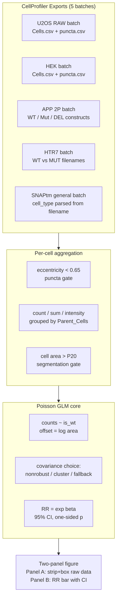
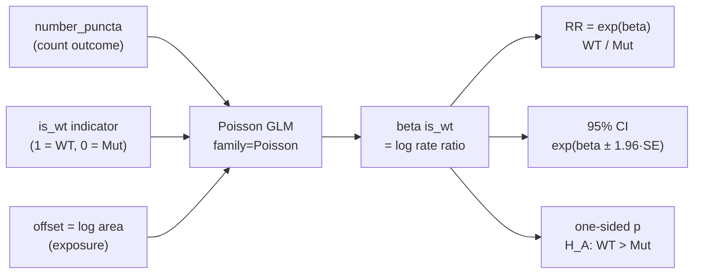

This page documents `notebooks/13_tirf_puncta_poisson_glm.ipynb`, the statistical engine behind the paper's cell-based clustering claims (Fig 4C-D, 5E, S5C). The notebook converts raw CellProfiler segmentation exports from TIRF microscopy experiments into per-cell puncta-count records, then fits a Poisson generalized linear model (GLM) with a log-area offset to estimate a **rate ratio (RR)** of puncta density between wild-type (mdSAM-intact) and mutant (mdSAM-disrupted) constructs — per protein and per cell line. The model family evolved through five iterations inside the notebook, culminating in cluster-robust inference by imaging replicate.

Sources: [README.md](README.md#L66), [13_tirf_puncta_poisson_glm.ipynb](notebooks/13_tirf_puncta_poisson_glm.ipynb#L1-L34)

## Architecture: From Microscopy Segmentation to Rate Ratios

The notebook is organized as a funnel: five independent CellProfiler export batches are normalized into a single tidy schema, filtered through two quality gates, and fed to a shared GLM fitting routine that emits a two-panel "gold standard" figure (raw single-cell distributions + rate-ratio bar). Each ingestion block parses metadata (protein identity, topology, replicate) directly from the `FileName_OrigImg` column or from a well-ID lookup table, so the raw CSVs carry no experimental annotation of their own.



Sources: [13_tirf_puncta_poisson_glm.ipynb](notebooks/13_tirf_puncta_poisson_glm.ipynb#L53-L74), [13_tirf_puncta_poisson_glm.ipynb](notebooks/13_tirf_puncta_poisson_glm.ipynb#L1313-L1336)

## Data Ingestion and Metadata Parsing

Four ingestion cells share an identical skeleton. Each loads a `Cells.csv` (segmented cells with `ObjectNumber` and `AreaShape_Area`) and a `puncta.csv` (segmented puncta with `Parent_Cells`, `AreaShape_Area`, `AreaShape_Eccentricity`, `Intensity_IntegratedIntensity_MaskedPuncta`), then loops over every image file and every cell within it, emitting one record per cell. Metadata is recovered by string surgery on filenames: the well identifier `file.split('_')[-3].split('-')[-1][1:]` is joined against the `names` sheet of `20251017_IDRmdSAM_Expession_local.xlsx` to recover the protein name and topology label, while the replicate comes from a separate filename token.

The APP/2P batch uses construct-level string matching instead of well lookups: filenames containing `APP_2P` are labeled `2P` (mapped to `Mut`), `DEL` to `DEL`, everything else to `+` (mapped to `WT`). The HTR7 batch is simpler still — any filename containing `WT` is wild-type, otherwise `MUT` — and assigns `ele='in'` (intracellular topology) and a numeric replicate parsed from the third underscore-delimited token. These per-batch conventions matter because downstream functions key on the exact label strings `WT`/`Mut`/`DEL`.

> [!TIP]
> The variable naming is deliberately counterintuitive: the batch loaded into `df_u2os` is immediately relabeled `cell_type='hek'`, and the first batch gets `cell_type='u2os'` only after a corrective overwrite cell. The labels encode *which experiment batch* the data came from, not the cell line in the variable name — trust the `cell_type` column, never the DataFrame identifier.

Sources: [13_tirf_puncta_poisson_glm.ipynb](notebooks/13_tirf_puncta_poisson_glm.ipynb#L53-L74), [13_tirf_puncta_poisson_glm.ipynb](notebooks/13_tirf_puncta_poisson_glm.ipynb#L134-L142), [13_tirf_puncta_poisson_glm.ipynb](notebooks/13_tirf_puncta_poisson_glm.ipynb#L203-L213), [13_tirf_puncta_poisson_glm.ipynb](notebooks/13_tirf_puncta_poisson_glm.ipynb#L850-L870), [13_tirf_puncta_poisson_glm.ipynb](notebooks/13_tirf_puncta_poisson_glm.ipynb#L123-L125)

## Per-Cell Aggregation and Quality-Control Gates

For each parent cell, the notebook computes four quantities restricted to puncta passing the eccentricity gate: `number_puncta` (count), `area_puncta` (summed puncta areas), `puncta_inten` (summed integrated puncta intensity), and the parent cell's `area`. The primary response is the density `value = number_puncta / area`, and the two visualization-oriented transforms are added after concatenation: `area_log = log(area)` and `val_log = log1p(number_puncta/area)`.

| Gate | Threshold | Rationale | Applies to |
|---|---|---|---|
| Puncta eccentricity | `< 0.65` | Retains near-round puncta; excludes elongated filament/segmentation artifacts | All batches |
| Cell area | `> 20th percentile` of pooled areas | Removes segmentation debris and undersized cells from the exposure base | All batches |
| Construct exclusions | `DEL` dropped from WT-vs-Mut models | Deletion control analyzed in a separate WT-vs-DEL contrast | Full-length panel |
| Topology filter | `ele == 'in'` | Restricts HTR7 analysis to the intracellular-topology records | HTR7 batch |

The three batches are concatenated into `df_all`, which becomes the single input to every fitting function; a later re-ingestion from `/Users/aelazar/Downloads/TIFFs/` builds an analogous frame where `cell_type` itself is parsed from the filename, enabling the by-cell-type function generation.

Sources: [13_tirf_puncta_poisson_glm.ipynb](notebooks/13_tirf_puncta_poisson_glm.ipynb#L56-L74), [13_tirf_puncta_poisson_glm.ipynb](notebooks/13_tirf_puncta_poisson_glm.ipynb#L248-L262), [13_tirf_puncta_poisson_glm.ipynb](notebooks/13_tirf_puncta_poisson_glm.ipynb#L193-L213), [13_tirf_puncta_poisson_glm.ipynb](notebooks/13_tirf_puncta_poisson_glm.ipynb#L1313-L1336)

## Why a Poisson GLM Rather Than a t-test on Densities

The statistical core is a log-linear Poisson regression on **raw counts**, not on the density ratio:

```python
model = sm.GLM(
    df2['number_puncta'],
    sm.add_constant(df2['is_wt']),
    family=sm.families.Poisson(),
    offset=np.log(df2['area'])
)
res = model.fit(cov_type='nonrobust')
```

The specification implies `E[puncta] = area · exp(β₀ + β₁·is_wt)`, so `β₁` is exactly the log rate ratio of puncta-per-unit-area between conditions. The offset makes cell area an *exposure* rather than a covariate — larger cells are expected to capture more puncta proportionally, and the model compares rates, not raw counts. This respects the data-generating process: puncta detection events are non-negative integers with variance approximately equal to the mean, which a t-test on `log1p(density)` treats as Gaussian.



Because the biological prior is directional — an intact mdSAM should *increase* puncta — the notebook converts the two-sided Wald p-value into a one-sided test aligned with `H_A: WT > Mut`: halve it when `β > 0`, otherwise use `1 − p/2`. The `val_log`/`log1p` column exists **only** for Panel A visualization; it never enters the likelihood.

> [!TIP]
> The asymmetry between Panel A and Panel B is intentional and load-bearing: the strip/box plots show `log1p(number_puncta/area)` for visual compressibility, while inference runs on raw counts with the log-area offset. If you reproduce the RR from the plotted values you will not recover the printed estimate — always refit from `number_puncta` and `area`.

Sources: [13_tirf_puncta_poisson_glm.ipynb](notebooks/13_tirf_puncta_poisson_glm.ipynb#L271-L312), [13_tirf_puncta_poisson_glm.ipynb](notebooks/13_tirf_puncta_poisson_glm.ipynb#L306-L312), [13_tirf_puncta_poisson_glm.ipynb](notebooks/13_tirf_puncta_poisson_glm.ipynb#L258-L261)

## The Figure-Function Family: Five Generations

The notebook refines a single "gold standard" rendering function through five named iterations, each adding statistical or layout capability. All share the same contract — return `(fig, results_df)` with Panel A raw distributions and Panel B the RR bar with asymmetric CI — but differ in grouping structure and covariance treatment.

| Generation | Function | Grouping | Covariance | Distinctive features |
|---|---|---|---|---|
| v1 | `glm_gold_standard_figure` (cell 15) | One GLM per cell type (`hek`, `u2os`) | `nonrobust` | Baseline; skips groups missing either condition |
| v2 | `glm_gold_standard_figure_clustered` (cell 22) | Per cell type | `cluster` by replicate | Tracks `nrep_WT`/`nrep_Mut`; GEE alternative in comments |
| v3 | `glm_gold_standard_figure_clustered_single_group` (cell 25) | Single cell line (HTR7) | `cluster` by replicate | `condition_col='Protein'`, `include_ele='in'` |
| v4 | `glm_gold_standard_figure_clustered_by_celltype` (cell 42) | Per cell type | `cluster`, auto-fallback to `nonrobust` if ≤1 replicate | Explicit z-statistic; `norm.sf(z)` one-sided p |
| v5 | `glm_gold_standard_figure` (redefined, cell 45) | Single cell type (HEK-only) | configurable `cov_type` | LaTeX `format_p_value` annotation; saves `SNAPtm_<protein>_hek.svg` |

The v1 function is applied across the ten-protein full-length panel — `A4`, `APP`, `KCNE4`, `EVI2A`, `MANS4`, `X3CL1`, `SYCY1`, `SIGL6`, `TIMD4`, `CD34` — with per-protein results concatenated into a summary table, and a separate WT-vs-DEL contrast generated for APP by passing `mut_label='DEL', exclude_eles=('Mut',)`.

Sources: [13_tirf_puncta_poisson_glm.ipynb](notebooks/13_tirf_puncta_poisson_glm.ipynb#L383-L577), [13_tirf_puncta_poisson_glm.ipynb](notebooks/13_tirf_puncta_poisson_glm.ipynb#L586-L594), [13_tirf_puncta_poisson_glm.ipynb](notebooks/13_tirf_puncta_poisson_glm.ipynb#L634-L637), [13_tirf_puncta_poisson_glm.ipynb](notebooks/13_tirf_puncta_poisson_glm.ipynb#L1697-L1708)

## Covariance Strategy: Nonrobust, Cluster-Robust, and GEE

Cells within the same imaging replicate are not independent — shared illumination, transfection efficiency, and segmentation conditions induce intra-replicate correlation, deflating naive standard errors when thousands of cells are pooled from few plates. The v2+ functions therefore request cluster-robust covariance (`cov_type="cluster", cov_kwds={"groups": d[rep_col]}`), and the code comments preserve the design reasoning, including the rule of thumb that cluster-robust SEs need roughly ≥10 clusters to be meaningful. v4 formalizes the edge case: when only one replicate exists per condition, it silently degrades to the model-based covariance rather than crashing.

| Strategy | Invocation | SE behavior | Used when |
|---|---|---|---|
| Model-based | `fit(cov_type='nonrobust')` | IRLS information matrix; anti-conservative under replicate clustering | Exploratory single-cell pooling, ≤1 replicate |
| Cluster-robust | `fit(cov_type='cluster', cov_kwds={'groups': rep})` | Sandwich estimator grouped by imaging replicate | Production figures (v2–v4), ≥~10 replicates |
| GEE (commented) | `sm.GEE(..., cov_struct=Exchangeable)` | Population-averaged with exchangeable working correlation | Considered but not adopted |

The CI construction `exp(β ± 1.96·SE)` is Wald-based on the log scale and is symmetric in log-space but asymmetric around RR after exponentiation — which is why Panel B passes `xerr = [RR − CI_low, CI_high − RR]` to `barh`.

Sources: [13_tirf_puncta_poisson_glm.ipynb](notebooks/13_tirf_puncta_poisson_glm.ipynb#L721-L738), [13_tirf_puncta_poisson_glm.ipynb](notebooks/13_tirf_puncta_poisson_glm.ipynb#L1476-L1490), [13_tirf_puncta_poisson_glm.ipynb](notebooks/13_tirf_puncta_poisson_glm.ipynb#L530-L536)

## Replicate-Level Robustness Checks for HTR7

The HTR7 section supplements the cell-level GLM with a complementary experiment-level analysis: per-replicate medians of puncta density (`groupby(["Protein","rep"])["value"].quantile(0.50)`) are paired across replicates and compared with a one-sided paired t-test (`alternative='greater'`). This operates on n = replicate counts rather than n = cell counts, directly addressing the pseudo-replication concern the cluster-robust SEs mitigate asymptotically.

Two intensity-side features probe whether the WT effect reflects puncta *brightness* rather than count: `pi_vs_pi_area = Puncta_Intensity / area_puncta` (density-normalized puncta intensity) and `pi_vs_value = Puncta_Intensity / value`, computed for both HTR7 and the merged `df_all`, then inspected via box plots (including a log-scale cross-protein view) and a split violin of raw puncta intensity. An ECDF of `Puncta_Intensity` by condition completes the distributional picture.

Sources: [13_tirf_puncta_poisson_glm.ipynb](notebooks/13_tirf_puncta_poisson_glm.ipynb#L1181-L1207), [13_tirf_puncta_poisson_glm.ipynb](notebooks/13_tirf_puncta_poisson_glm.ipynb#L1227-L1259), [13_tirf_puncta_poisson_glm.ipynb](notebooks/13_tirf_puncta_poisson_glm.ipynb#L1170-L1172)

## Paper-Figure Traceability

Per the repository's figure map, specific cells of this notebook generate named manuscript panels. Cell indices are 0-based positions in the notebook's `cells` list:

| Panel | Content | Cells |
|---|---|---|
| Fig 4C | SNAPtm motif swaps: puncta density for HTR7 and KCNE4 mdSAMs | 42, 43 |
| Fig 4D / S5C | Full-length protein puncta density, Poisson GLM, HEK vs U2OS | 12, 15, 19, 22 |
| Fig 5E | HTR7 WT vs V451P TIRF puncta | 25 |

The v5 HEK-only renderer writes `SNAPtm_<protein>_hek.svg` for the motif-swap constructs (HTR7, KCNE4), while the full-length panel figures were exported as `<protein>_Poisson.svg` and `<protein>_DEL_Poisson.svg` (export paths are commented in the shipped version).

Sources: [README.md](README.md#L135-L142), [README.md](README.md#L149), [13_tirf_puncta_poisson_glm.ipynb](notebooks/13_tirf_puncta_poisson_glm.ipynb#L1957)

## Reproducibility Caveats

Three practical constraints govern rerunning this notebook. First, all input paths are absolute local paths (`/Users/aelazar/...`) pointing to CellProfiler exports and the reviewer-response working copy of the well-name table; the shared `files/` tables are not used here, and the `names` lookup is resolved relative to `../response_reviewers/`. Second, outputs are cleared in the distributed version — figures regenerate on execution, but the SVG exports and the `res_table_df` summary exist only in-session unless re-enabled. Third, label-string coupling is brittle: functions match on exact `WT`/`Mut`/`DEL`/`MUT`/`in` values, so any ingestion change that renames labels must be propagated to `wt_label`/`mut_label`/`exclude_eles` arguments. The heavy per-cell pandas filtering loops are quadratic in file×cell combinations and rely on `tqdm` for progress — acceptable at screen-count scale, slow at full-plate scale.

Sources: [13_tirf_puncta_poisson_glm.ipynb](notebooks/13_tirf_puncta_poisson_glm.ipynb#L30), [13_tirf_puncta_poisson_glm.ipynb](notebooks/13_tirf_puncta_poisson_glm.ipynb#L54-L55), [13_tirf_puncta_poisson_glm.ipynb](notebooks/13_tirf_puncta_poisson_glm.ipynb#L1313-L1314), [README.md](README.md#L244-L248)

## Suggested Reading Progression

This notebook sits mid-stack in the *Experimental Assay Analytics* section. The peptide-level assays it validates against are covered in [Thioflavin-T and Amytracker Screens](16-thioflavin-t-and-amytracker-screens); the super-resolution counterpart of the same HTR7 WT-vs-V451P question is [dSTORM Cluster Analysis](19-dstorm-cluster-analysis); the expression controls that rule out abundance as a confounder are in [Flow Cytometry Surface Gating](18-flow-cytometry-surface-gating), and the downstream signalling consequence appears in [cAMP Dose-Response Mixed Models](20-camp-dose-response-mixed-models). For how these assays slot into the full evidence chain around HTR7, see [HTR7 End-to-End Case Study](21-htr7-end-to-end-case-study); for adapting the GLM pattern to new assays, see [Reusing the Analysis Toolkit](27-reusing-the-analysis-toolkit).