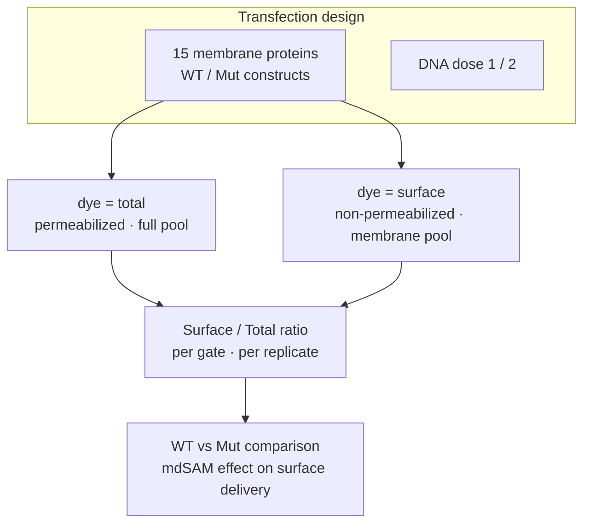
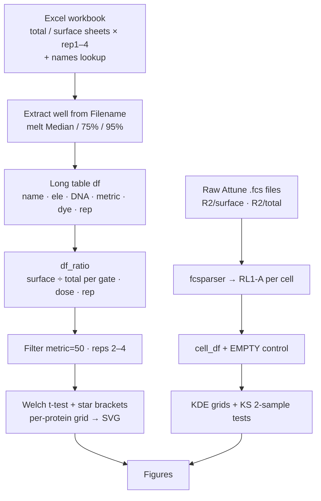

This page documents `14_flow_cytometry_total_vs_surface.ipynb`, the notebook that quantifies how mdSAM-bearing aggregation-prone segments affect **surface delivery** of intact membrane proteins. It pairs two flow cytometry staining conditions — *total* (permeabilized, all expressed molecules) and *surface* (non-permeabilized, plasma-membrane pool) — across WT and mdSAM-mutant constructs, condenses per-well Attune cytometer exports into a tidy analysis table, computes a **surface/total ratio** as a trafficking-efficiency readout, and validates aggregate results against raw single-cell FCS distributions. For the biological motivation behind these constructs, see [mdSAM Concept and Discovery Rationale](4-mdsam-concept-and-discovery-rationale).

## Assay Concept: A Two-Channel Total-vs-Surface Design

The experiment follows a factorial design: each of 15 membrane proteins is transfected in WT and mdSAM-mutant form, at two DNA doses (`DNA` = 1 or 2), and measured under two staining conditions (`dye` = `total` or `surface`) across four independent replicates. Because both channels report fluorescence from the same fluorescent tag, dividing the surface signal by the total signal yields a *normalized trafficking efficiency* that is robust to well-to-well differences in transfection and expression level — a mutation that reduces surface/total ratio specifically impairs membrane delivery rather than overall expression.

The 15-protein panel is fixed as a Python list early in the notebook: A4, APP, CD302, CD34, CSF1R, EVI2A, KCNE4, LRRC4, MANS4, MMP14, SEM4D, SIGL6, SYCY1, TIMD4, X3CL1, and is re-declared identically before the single-cell section. A later in-notebook comment expands the abbreviated codes for the ten proteins promoted to the publication figure: X3CL1 ↔ CX3CL1, SYCY1 ↔ ERVW-1, SIGL6 ↔ SIGLEC6, MANS4 ↔ MANSC4.

Sources: [14_flow_cytometry_total_vs_surface.ipynb](notebooks/14_flow_cytometry_total_vs_surface.ipynb#L122-L136), [14_flow_cytometry_total_vs_surface.ipynb](notebooks/14_flow_cytometry_total_vs_surface.ipynb#L1198-L1212), [14_flow_cytometry_total_vs_surface.ipynb](notebooks/14_flow_cytometry_total_vs_surface.ipynb#L851-L853)

## Data Model: From Plate Wells to a Tidy Long Table

All per-well summaries live in one Excel workbook, `20251017_IDRmdSAM_Expession_local.xlsx`, whose sheets encode the factorial design: `total` and `surface` (replicate 1), `total_rep2`/`surface_rep_2`, `total_rep3`/`surface_rep_3`, `total_rep4`/`surface_rep4`, plus a `names` sheet that joins cytometer filenames to the experimental metadata. Each summary sheet carries per-well distribution statistics — `Median`, `75%-ile`, `95%-ile` — exported from the Attune acquisition software, and each row's well identifier is recovered by splitting the `Filename` string (`i.split('_')[-1].split('.')[0]`).

The notebook then **melts** the wide summary columns into a long-format table with one row per (protein, variant, dose, gate, dye, replicate) observation: the three statistics are relabeled as numeric gates `{50, 75, 95}`, the `names` sheet is consulted per well to recover the protein code, the WT/Mut element, and the DNA dose, and each observation is tagged with `dye` and `rep`. The melt block is re-executed once per replicate, appending to the same list so the final DataFrame `df` accumulates all four replicates in one schema.

> [!TIP]
> The well→metadata join uses `names[names.well==...].name.values[0]` — a positional first-match lookup rather than a validated merge. Any duplicated well key in the `names` sheet silently resolves to its first row, so treat the `names` sheet as a uniqueness invariant when extending this notebook.

Sources: [14_flow_cytometry_total_vs_surface.ipynb](notebooks/14_flow_cytometry_total_vs_surface.ipynb#L39-L44), [14_flow_cytometry_total_vs_surface.ipynb](notebooks/14_flow_cytometry_total_vs_surface.ipynb#L64-L81), [14_flow_cytometry_total_vs_surface.ipynb](notebooks/14_flow_cytometry_total_vs_surface.ipynb#L548-L552)

## The Surface-to-Total Ratio Metric

The central derived quantity is computed by nested iteration over replicate, DNA dose, gate, and protein: for each combination, the surface and total values of the WT row and the `Mut` row are retrieved and divided (`ratio = s/t`), producing the ratio table `df_ratio` with columns `name, ratio, ele, gate, dna, rep`. Because numerator and denominator come from matched wells of the same construct, the ratio cancels expression-level variation and isolates the fraction of synthesized molecules that reach the plasma membrane.

The final version of this loop (executed after all four replicates are ingested) iterates `rep in [2,3,4]` and additionally retains the raw `surface` and `total` values alongside the ratio, so downstream figures can fall back to absolute intensities if needed. Ratios are visualized on a log scale with a reference line at 1.0 — values below 1 indicate that most protein is retained intracellularly, and the WT-vs-Mut gap within a protein is the mdSAM surface-trafficking effect.

Sources: [14_flow_cytometry_total_vs_surface.ipynb](notebooks/14_flow_cytometry_total_vs_surface.ipynb#L146-L165), [14_flow_cytometry_total_vs_surface.ipynb](notebooks/14_flow_cytometry_total_vs_surface.ipynb#L978-L990), [14_flow_cytometry_total_vs_surface.ipynb](notebooks/14_flow_cytometry_total_vs_surface.ipynb#L905-L911)

## Replicate Inclusion Strategy

The notebook's filter choices evolve across execution: early ratio tables cover replicate 1 alone, then replicates 1–3, and the final tables use replicates **2–4** (replicate 1 is excluded from headline figures but remains in `df`). Summary barplots follow the same convention, drawing `errorbar='se'` over the included replicates and annotating titles such as `reps(2,3,4)` so the provenance of every panel is visible on the figure itself.

> [!TIP]
> When reusing this notebook, replicate inclusion is not centralized: each figure cell hard-codes its own `rep.isin([...])` filter. A dataset extension should therefore update every plotting cell, or refactor the filters into a single constant, to avoid mixing replicate sets across panels.

Sources: [14_flow_cytometry_total_vs_surface.ipynb](notebooks/14_flow_cytometry_total_vs_surface.ipynb#L431-L443), [14_flow_cytometry_total_vs_surface.ipynb](notebooks/14_flow_cytometry_total_vs_surface.ipynb#L452-L485), [14_flow_cytometry_total_vs_surface.ipynb](notebooks/14_flow_cytometry_total_vs_surface.ipynb#L620-L634)

## Statistical Framework: Welch's t-Test with Significance Brackets

The publication-style figure cell imports `ttest_ind` and defines a self-contained annotation toolkit. `get_pvalue` runs **Welch's unequal-variance t-test** (`equal_var=False`) between the WT and Mut value sets, returning `NaN` when either group has fewer than two observations — a guard that prevents degenerate statistics on partially missing wells. `p_to_star` maps p-values to the conventional star ladder (`<0.05` → `*`, `<0.01` → `**`, `<0.001` → `***`, `<0.0001` → `****`, else `n.s.`), and `add_wt_mut_stats` draws the black significance brackets above each DNA-dose group, reserving vertical headroom (18% of the y-range) so annotations never clip.

The figure itself is a 5-column grid of per-protein subplots (`sharey=False`, since absolute fluorescence magnitudes differ per protein), filtered to `dye='total'`, `metric=50`, replicates 2–4, and the ten-protein final panel. Bars use `hue='ele'` with the fixed palette WT `#B24438` / Mut `#949598`, per-panel legends are stripped in favor of one figure-level legend, and the result is exported as `all_total_subfigures_WT_vs_Mut_stats.svg`. Companion loops export the same panel per-protein as individual `<name>_total.svg` files.

| Component | Implementation | Scope |
|---|---|---|
| Test statistic | `scipy.stats.ttest_ind(..., equal_var=False)` | WT vs Mut per protein × dose |
| Missing-data guard | `len(a) < 2 or len(b) < 2 → np.nan` | Skips annotation, no error |
| P-value encoding | `p_to_star`: 4-tier star ladder + `n.s.` | Bracket labels |
| Bracket drawing | manual `ax.plot` bracket + `ax.text`, `clip_on=False` | Per x-tick group |
| Population filter | `dye='total'`, `metric=50`, `rep ∈ {2,3,4}` | Final figure |
| Layout | `5`-column grid, shared palette, figure legend | Consistent styling |

Sources: [14_flow_cytometry_total_vs_surface.ipynb](notebooks/14_flow_cytometry_total_vs_surface.ipynb#L664-L709), [14_flow_cytometry_total_vs_surface.ipynb](notebooks/14_flow_cytometry_total_vs_surface.ipynb#L711-L833), [14_flow_cytometry_total_vs_surface.ipynb](notebooks/14_flow_cytometry_total_vs_surface.ipynb#L644-L656)

## Single-Cell Validation Layer: Raw FCS and Distribution Tests

Because per-well medians can mask distributional shifts, the notebook opens a second, cell-level analysis path using **`fcsparser`** to read raw Attune `.fcs` files directly (e.g. `/Volumes/aelazar/Attune_data/D2_R4.fcs`), extracting the `RL1-A` fluorescence area channel for every event. Individual well pairs are compared with a **Kolmogorov–Smirnov two-sample test** (`stats.ks_2samp`) on `RL1-A` and visualized as log-scale KDE overlays — an approach that detects differences in distribution *shape*, not just central tendency, complementing the t-tests on summary statistics.

A bulk ingestion loop then `glob`s the replicate-2 acquisition directories (`R2/surface/*_R3.fcs` and `R2/total/*_R3.fcs`), joins each file back to the `names` sheet by well prefix, and stacks **every single cell's** `RL1-A` value into `cell_df` with the same protein/element/dose/dye/replicate schema as the well-level table. This enables per-protein 4×4 KDE grids — surface channel titled *Alexa-647*, total channel titled *647 SiR* — where each protein's WT (red) and Mut (gray) distributions are drawn against the EMPTY-vector control (blue).

Sources: [14_flow_cytometry_total_vs_surface.ipynb](notebooks/14_flow_cytometry_total_vs_surface.ipynb#L1029-L1063), [14_flow_cytometry_total_vs_surface.ipynb](notebooks/14_flow_cytometry_total_vs_surface.ipynb#L1147-L1178), [14_flow_cytometry_total_vs_surface.ipynb](notebooks/14_flow_cytometry_total_vs_surface.ipynb#L1244-L1345)

## How the Gate Actually Works

The "gating" in this pipeline is implemented through **filtering conventions** rather than a polygon gate drawn in cytometry software. Three layers define the analyzed population: (1) the `val > 0` event filter drops null/negative fluorescence artifacts; (2) the plotting window `xlim([300, 1e7])` on the log-scaled `RL1-A` axis excludes low-channel noise; and (3) the **EMPTY-vector transfection control** serves as the biological negative reference — any protein population whose KDE mass sits visibly right of the blue EMPTY peak represents specific surface or total expression above background. The gate percentiles (50/75/95) then summarize position within that gated population, with the 95th percentile intentionally capturing the brightest tail of high-expressing cells.

This design means the gate is *implicit and reproducible in code*: rerunning the notebook regenerates identical population definitions, unlike interactive cytometry gating. The KS-test loop at the end of the single-cell section makes the WT-vs-Mut comparison systematic — counting, across the 15-protein panel, how many proteins show a significant total-channel distribution shift with `statistic_sign == -1` (Mut shifted below WT).

Sources: [14_flow_cytometry_total_vs_surface.ipynb](notebooks/14_flow_cytometry_total_vs_surface.ipynb#L1227-L1235), [14_flow_cytometry_total_vs_surface.ipynb](notebooks/14_flow_cytometry_total_vs_surface.ipynb#L1280-L1289), [14_flow_cytometry_total_vs_surface.ipynb](notebooks/14_flow_cytometry_total_vs_surface.ipynb#L1359-L1366)

## End-to-End Reproduction Workflow

The complete data flow, from raw acquisition to figure export, is summarized below. Note that the FCS paths are absolute volumes on the original acquisition machine — a working `fcsparser` installation and access to the Attune export directory are required for the single-cell layer, while the well-level path needs only the Excel workbook.

| Parameter | Values | Role |
|---|---|---|
| `metric` (gate) | 50 / 75 / 95 | Median, 75th, 95th percentile of gated fluorescence |
| `DNA` dose | 1 / 2 | Transfection plasmid amount per well |
| `ele` | WT / Mut | mdSAM intact vs mutated segment |
| `dye` | total / surface | Permeabilized vs membrane-only stain channel |
| `rep` | 1–4 | Biological replicate; figures use 2–4 |
| `RL1-A` | fluorescence area | Single-cell readout channel in FCS files |

Sources: [14_flow_cytometry_total_vs_surface.ipynb](notebooks/14_flow_cytometry_total_vs_surface.ipynb#L1029-L1040), [14_flow_cytometry_total_vs_surface.ipynb](notebooks/14_flow_cytometry_total_vs_surface.ipynb#L1147-L1168)

## Position in the Assay Analytics Pipeline

Within the *Experimental Assay Analytics* section, this notebook is the membrane-traffic endpoint of the mdSAM perturbation series: it follows the imaging-based screens in [Thioflavin-T and Amytracker Screens](16-thioflavin-t-and-amytracker-screens) and the puncta modeling of [TIRF Puncta Poisson GLM](17-tirf-puncta-poisson-glm), and its surface-trafficking phenotype is spatially resolved at single-molecule scale in [dSTORM Cluster Analysis](19-dstorm-cluster-analysis). The topology reasoning that predicts which leaflet a mdSAM segment faces — and hence whether surface staining should detect it — is developed in [Topology and Membrane-Leaflet Distance](15-topology-and-membrane-leaflet-distance). For a worked example of the same WT-vs-mutant experimental logic applied to a single receptor across multiple assay modalities, continue to [HTR7 End-to-End Case Study](21-htr7-end-to-end-case-study).
