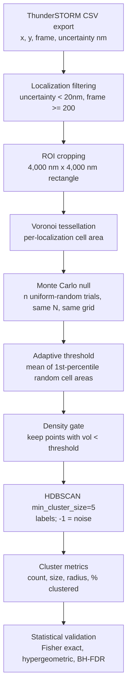
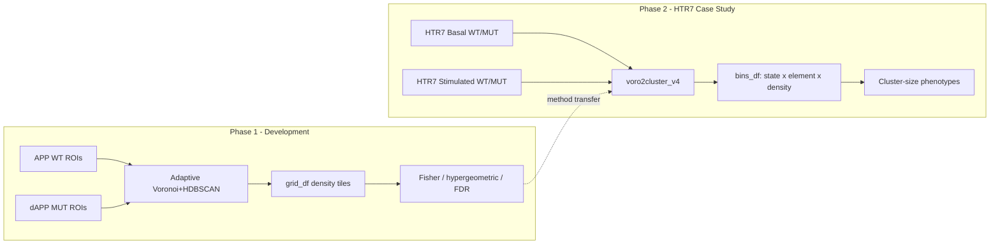

This page dissects `notebooks/16_dstorm_htr7_cluster_analysis.ipynb` — an 11,700-line spatial-statistics notebook that converts raw ThunderSTORM single-molecule localization exports into biologically interpretable receptor-cluster measurements. The methodological core is a **Voronoi-tessellation density threshold calibrated against a Monte Carlo spatial null**, followed by **HDBSCAN cluster assignment** on threshold-passing localizations. The notebook operates in two dataset phases: an APP/dAPP (WT vs. mutant transmembrane peptide) development phase, and the HTR7 GPCR phase (basal vs. stimulated, WT vs. MUT) that feeds the end-to-end HTR7 case study. It sits between [Flow Cytometry Surface Gating](18-flow-cytometry-surface-gating) and [cAMP Dose-Response Mixed Models](20-camp-dose-response-mixed-models) in the Experimental Assay Analytics track.

Sources: [16_dstorm_htr7_cluster_analysis.ipynb](notebooks/16_dstorm_htr7_cluster_analysis.ipynb#L9-L53), [16_dstorm_htr7_cluster_analysis.ipynb](notebooks/16_dstorm_htr7_cluster_analysis.ipynb#L114-L150)

## Why Voronoi Before Clustering: The Core Concept

Direct density-based clustering of SMLM localizations is confounded by local labeling density: a region with 500 localizations/µm² may look "clustered" under a fixed epsilon even when it is spatially random, purely because fluorophore density is high. This notebook's central insight is to invert the problem — measure *local crowding per localization* via Voronoi cell area, then decide "what counts as crowded" **empirically per ROI** rather than by a global constant. Each localization's Voronoi cell area is converted to a density score `vol_invers = log10(1/vol)` (smaller cell → higher score), and the cut between "random" and "clustered" is set at the 1st percentile of Voronoi areas drawn from uniform-random point patterns matched to the ROI's point count. Only points below this adaptive threshold enter the clusterer.

The dependency chain of this concept is worth internalizing before reading the code:

Sources: [16_dstorm_htr7_cluster_analysis.ipynb](notebooks/16_dstorm_htr7_cluster_analysis.ipynb#L399-L431), [16_dstorm_htr7_cluster_analysis.ipynb](notebooks/16_dstorm_htr7_cluster_analysis.ipynb#L340-L366)

## Ingestion Layer: `ThnderSTORM2df`

The entry point `ThnderSTORM2df(file, squre_size, x1, y1, parent, element, cell, rectangle, replicate)` reads localization tables from `csv/v2/<file>.csv` and applies two physics-motivated filters before any spatial analysis: localizations with fitting **uncertainty ≥ 20 nm** are discarded (they are too imprecise to support nanoscale cluster claims), and **frame < 200** localizations are dropped — early frames of a dSTORM acquisition carry transient high-density blinking artifacts. The function then crops the requested rectangle (production calls use 4,000 nm squares; the function default is a full 50,000 nm field), renders a two-panel QA figure (full field with ROI rectangle overlay, zoomed ROI), exports it as SVG and 600-dpi PNG, and returns a tidy DataFrame with unified column names (`x`, `y`, `intensity`) plus experimental metadata (`parent`, `element`, `cell`, `rectangle`, `replicate`, `name`).

| Filter / Parameter | Value | Rationale |
|---|---|---|
| `uncertainty [nm]` | `< 20` | Reject imprecise localizations that blur cluster boundaries |
| `frame` | `>= 200` | Skip early-frame acquisition artifacts |
| `squre_size` | `4000` nm | Standard ROI (4 µm membrane patch) in all production calls |
| Output columns | `x, y, intensity, parent, element, cell, rectangle, replicate, name` | Schema consumed by every downstream function |

Sources: [16_dstorm_htr7_cluster_analysis.ipynb](notebooks/16_dstorm_htr7_cluster_analysis.ipynb#L114-L150), [16_dstorm_htr7_cluster_analysis.ipynb](notebooks/16_dstorm_htr7_cluster_analysis.ipynb#L165-L169)

## The Adaptive Threshold Engine: `voronoi_thershold_v2`

This is the notebook's intellectual center. Given a point array, it runs `n` Monte Carlo trials, each drawing `len(points)` uniform-random coordinates over the same `size_of_grid` (4,000 nm in practice). For every trial it computes Voronoi cell volumes via `voronoi_volumes` (which wraps `scipy.spatial.Voronoi` and returns `ConvexHull(...).volume` per cell, `inf` for open boundary cells), records the **1st percentile** of each trial's volume distribution, and averages the percentiles into a single threshold. The intuition: under complete spatial randomness, ~1% of localizations will occupy cells smaller than the threshold — so labeling real points below it yields a controlled ~1% false-density rate regardless of ROI-level localization count. The real pattern's cells are then gated, and `HDBSCAN(min_cluster_size=5)` is fit on the survivors; labels are written back to the full frame (`-1` and `NaN` retained for noise). Notably, the function retains a commented-out `DBSCAN(eps=50, min_samples=3)` variant, documenting the migration from fixed-epsilon to hierarchical-density clustering. It returns five objects: the annotated point DataFrame, the random-trial volume table, the scalar threshold, per-cluster size probabilities, and the concatenated random-point table used in threshold visualization.

> [!TIP]
> The threshold is recomputed **per ROI** because it depends on `len(points)` and `size_of_grid` — never cache thresholds across ROIs with different localization counts, or the false-positive calibration silently breaks.

| Design decision | Implementation | Why it matters |
|---|---|---|
| Null model | `np.random.uniform(0, size_of_grid, size=(len(points), 2))` | Matches the ROI's point count exactly |
| Threshold statistic | `np.mean` of per-trial `np.percentile(random_dist, 1)` | Reduces Monte Carlo variance across trials |
| Density score | `vol_invers = log10(1/vol)` | Log-scaled crowding, stable for violin/threshold plots |
| Clusterer | `HDBSCAN(min_cluster_size=5)` | No fixed eps; adapts to varying cluster scales |
| Legacy alternative | `DBSCAN(eps=50, min_samples=3)` (commented) | Fixed 50 nm radius rejected for density robustness |

Sources: [16_dstorm_htr7_cluster_analysis.ipynb](notebooks/16_dstorm_htr7_cluster_analysis.ipynb#L399-L431), [16_dstorm_htr7_cluster_analysis.ipynb](notebooks/16_dstorm_htr7_cluster_analysis.ipynb#L103-L112)

## Per-ROI Orchestration: `voro2cluster` and `roi2df`

Two wrappers standardize the workflow. `voro2cluster` is the **publication-figure generator**: a three-panel layout showing (1) raw filtered localizations with the teal ROI rectangle, (2) Voronoi cells colored by `vol_invers` under a viridis density scale with tessellation edges overlaid, and (3) HDBSCAN-assigned points colored per cluster with noise faintly black underneath. It embeds the threshold call (`n=1` for speed) and saves 600-dpi PNGs per cell/rectangle. `roi2df` is the **metrics-oriented wrapper** used in batch statistics: it runs the heavier calibration (`n=30` trials), bins each clustered localization's `cluster_size` into ranges `5-10`, `11-50`, `51-100`, `>100`, flags `binary_theshold` per point, and propagates ROI identity columns (`name`, `cell`, `rectangle`, `replicate`) into the returned frame so that every localization row is traceable to its source image.

Sources: [16_dstorm_htr7_cluster_analysis.ipynb](notebooks/16_dstorm_htr7_cluster_analysis.ipynb#L240-L306), [16_dstorm_htr7_cluster_analysis.ipynb](notebooks/16_dstorm_htr7_cluster_analysis.ipynb#L1586-L1607)

## Metric Functions and Batch Execution

A utility block defines the measurement vocabulary applied to every labeled ROI. `df2clustersize` computes each cluster's **maximal pairwise extent** via `scipy.spatial.distance.pdist` (nanometers, since coordinates are in nm), `area2clusters` produces cluster-size distributions as tidy records tagged with element and square number, `cluster_fraction` relates each cluster's size to unclustered-spot counts, and `precent_clustered` returns the fraction of Voronoi-gated points plus total localization count — the notebook's headline "percent clustered" statistic. Geometric annotation is handled by `cluster2rad_for_fig`, which computes each cluster's centroid, its **max radial distance R (nm)**, draws proportional circles on the scatter, and annotates `R=…nm / n=…` for exemplar clusters.

The batch loop then iterates over ~29 WT (`apps_v2`) and ~17 MUT (`dapp_v2`) ROI DataFrames, and — critically — additionally tiles each ROI into **500 nm × 500 nm sub-squares**, recording per-tile `all_points`, `db_points`, `vor_points`, `clusters_in_roi`, and cluster-size aggregates into a records list that later becomes the density-controlled `grid_df`. This sub-sampling layer is what enables the density-bin analyses described below.

| Function | Metric produced | Scale |
|---|---|---|
| `df2clustersize` | Max pairwise distance within cluster | nm |
| `area2clusters` | Cluster-size distribution records | localizations/cluster |
| `cluster_fraction` | Cluster size relative to free spots | dimensionless |
| `precent_clustered` | % localizations below threshold | % + count |
| `cluster2rad_for_fig` | Centroid-to-farthest-point radius R | nm |

Sources: [16_dstorm_htr7_cluster_analysis.ipynb](notebooks/16_dstorm_htr7_cluster_analysis.ipynb#L73-L112), [16_dstorm_htr7_cluster_analysis.ipynb](notebooks/16_dstorm_htr7_cluster_analysis.ipynb#L2318-L2399), [16_dstorm_htr7_cluster_analysis.ipynb](notebooks/16_dstorm_htr7_cluster_analysis.ipynb#L1642-L1662), [16_dstorm_htr7_cluster_analysis.ipynb](notebooks/16_dstorm_htr7_cluster_analysis.ipynb#L2232-L2298)

## Statistical Validation Layer

Because single-molecule cluster claims are easy to overstate, the notebook wraps its point estimates in three complementary tests. **Fisher exact tests** run on 2×2 contingency tables partitioning cluster anatomy by `cluster_size_log` and `dens_log` cutoffs, independently for APP and dAPP, with `scipy.stats.contingency.expected_freq` printed alongside observed-minus-expected residuals. **Hypergeometric radius enrichment** (`G_hypergeom_radii` over radius quantiles q = 1–4 for both elements) asks whether large-R clusters are over-represented relative to expectation; p-values pass through a hand-rolled **Benjamini–Hochberg FDR** (`fdr`) that scales p by `len(p_vals)/rankdata(p)` with values capped at 1, and results are plotted as `log2(observed/expected)` enrichment barplots. Finally, Tukey-style outlier bounds (`calculate_upper_bound`, Q3 + 1.5×IQR) bound "compatibly sized high-density" cluster populations before medians are reported.

> [!TIP]
> The Fisher-exact cutoffs (`cluster_size_log >= 1`, `dens_log >= -3`) are strata definitions, not significance thresholds — they define the high-size/high-density quadrant of the contingency table, so changing them changes the tested hypothesis, not just its power.

Sources: [16_dstorm_htr7_cluster_analysis.ipynb](notebooks/16_dstorm_htr7_cluster_analysis.ipynb#L6808-L6833), [16_dstorm_htr7_cluster_analysis.ipynb](notebooks/16_dstorm_htr7_cluster_analysis.ipynb#L5201-L5208), [16_dstorm_htr7_cluster_analysis.ipynb](notebooks/16_dstorm_htr7_cluster_analysis.ipynb#L5238-L5255), [16_dstorm_htr7_cluster_analysis.ipynb](notebooks/16_dstorm_htr7_cluster_analysis.ipynb#L5313-L5326)

## Density Normalization: Controlling the Dominant Confound

Cluster-size statistics co-vary trivially with localization density, so the notebook normalizes comparisons by construction. Using the 500 nm tile records (`grid_df`), cluster-level means are regrouped into **density bins** — `0–300`, `301–900`, `901–1500` localizations per tile for the APP phase — and `cluster_sizes_full_vals_nm_mean` is plotted per bin as strip + mean-marker point plots on a log y-axis (`Localizations_per_clsuter_SNAPtm_v2_dAPP.svg`). The notebook even catalogs hand-picked exemplar tiles at matched point counts (e.g., 53, 140, 295 localizations) to render like-for-like Voronoi panels for WT and MUT. This design means any WT/MUT cluster-size difference reported downstream survives a same-density comparison — the strongest form of evidence this pipeline produces.

Sources: [16_dstorm_htr7_cluster_analysis.ipynb](notebooks/16_dstorm_htr7_cluster_analysis.ipynb#L7800-L7858), [16_dstorm_htr7_cluster_analysis.ipynb](notebooks/16_dstorm_htr7_cluster_analysis.ipynb#L7895-L7944)

## The HTR7 Phase: `voro2cluster_v4` and Basal/Stimulated Design

The final notebook section reapplies the matured pipeline to the HTR7 receptor. A refined wrapper, `voro2cluster_v4`, is invoked over dozens of `HTR7_MUT_Basal_1_*` / `HTR7Mut_B_2_*` ThunderSTORM files — parent `HTR7`, element `MUT`, cells 2–10, replicates 1–2, all with 4,000 nm ROIs — following the identical call pattern established in the APP phase. Files are referenced from the author's local figure directory (`dSTORM/figures/HTR7_Science/`) via `glob` sampling for the main-figure composites. The terminal analysis joins clusters back into `bins_df` split by functional **state** (`basal` vs. stimulated) and **element** (`WT` vs. `MUT`), with density re-binned to HTR7-appropriate ranges (`0-70`, `71-150`), and produces the log-scaled "localizations per cluster" violin/strip comparisons (`Localizations_per_clsuter_HTR7_high_dens.svg`) that summarize HTR7 clustering phenotypes.

Sources: [16_dstorm_htr7_cluster_analysis.ipynb](notebooks/16_dstorm_htr7_cluster_analysis.ipynb#L11400-L11511), [16_dstorm_htr7_cluster_analysis.ipynb](notebooks/16_dstorm_htr7_cluster_analysis.ipynb#L11521-L11542), [16_dstorm_htr7_cluster_analysis.ipynb](notebooks/16_dstorm_htr7_cluster_analysis.ipynb#L11554-L11583)

## Supporting Spatial-Statistics Tooling

Beyond the Voronoi/HDBSCAN core, the import block reveals the notebook's fuller spatial-analysis arsenal: `ripleyk` for Ripley's K second-order statistics, `rdfpy.rdf` for radial distribution functions, `OPTICS` as another density-based alternative, `shapely` geometries plus `ConvexHull` and an `intersection` helper for region algebra, and `NearestNeighbors` for neighbor-based computations. These are wired in alongside the DBSCAN-family clusterers, indicating the threshold calibration was cross-validated against classical point-pattern methods before settling on the Voronoi-percentile design. Reproducibility caveats for developers: raw localization CSVs live under a local `csv/v2/` path (not shipped in this repository — see [Repository Layout and Notebook Map](3-repository-layout-and-notebook-map) for what is versioned), several output paths point to the author's machine (`/Users/aelazar/...`), and cell outputs are stripped from the committed notebook, so a full reproduction requires the ThunderSTORM exports plus matching directory scaffolding.

| Dependency | Role in pipeline |
|---|---|
| `ripleyk` | Ripley's K spatial autocorrelation cross-check |
| `rdfpy` | Radial distribution function of localization patterns |
| `sklearn.cluster` (DBSCAN/OPTICS/HDBSCAN) | Density-based cluster assignment (HDBSCAN production) |
| `scipy.spatial` (Voronoi, ConvexHull, pdist) | Tessellation, cell areas, cluster extents |
| `shapely` + `intersect` | Polygon region logic for Voronoi visual overlays |

Sources: [16_dstorm_htr7_cluster_analysis.ipynb](notebooks/16_dstorm_htr7_cluster_analysis.ipynb#L9-L53), [16_dstorm_htr7_cluster_analysis.ipynb](notebooks/16_dstorm_htr7_cluster_analysis.ipynb#L114-L118)

## Where This Fits and What to Read Next

This notebook is the microscopy leg of the HTR7 evidence chain: its cluster phenotypes (percent clustered, localizations per cluster, radius distributions under matched density) quantify the membrane-organization consequences of the HTR7 constructs, which are then related to signaling output on [cAMP Dose-Response Mixed Models](20-camp-dose-response-mixed-models) and integrated into the narrative on [HTR7 End-to-End Case Study](21-htr7-end-to-end-case-study). For the upstream discovery context — why these membrane-proximal motifs were targeted for single-molecule imaging at all — see [mdSAM Concept and Discovery Rationale](4-mdsam-concept-and-discovery-rationale); for the imaging assays that precede dSTORM in resolution, see [TIRF Puncta Poisson GLM](17-tirf-puncta-poisson-glm). The figure-to-analysis mapping conventions it follows are cataloged in [Figure-to-Notebook Reproducibility Map](9-figure-to-notebook-reproducibility-map).
