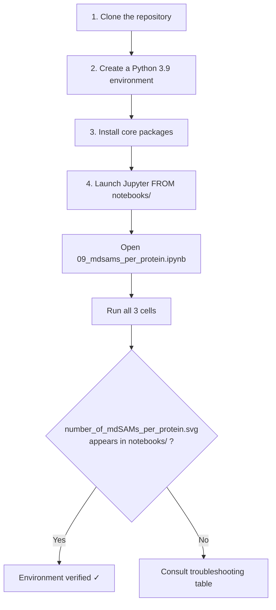
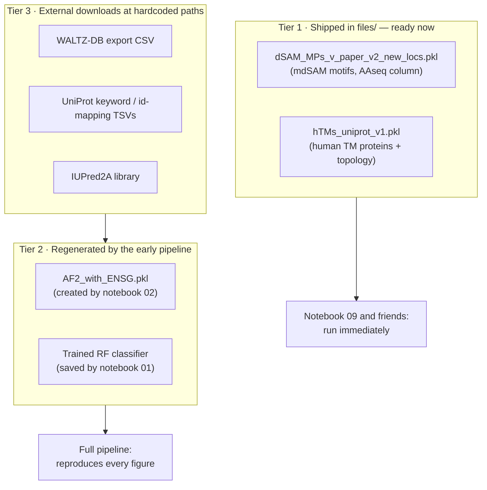

This page gets you from a fresh clone to a verified, running environment in one session. The repository is a **notebook-only research codebase**: there is nothing to `pip install` from it and no package to import. Instead, you will (1) prepare a Python environment, (2) launch Jupyter from the correct directory, and (3) run a three-cell smoke-test notebook that touches every critical component — the shipped data tables, the plotting stack, and the output path. Everything you need ships in the repo except two optional dependency tiers explained below.

mdSAM stands for *membrane-disordered Self-Assembly Motif* — a short (7–9 residue) peptide inside a disordered, solvent-exposed region of a transmembrane protein, predicted to self-assemble via beta-strand, amyloid-like interactions. The notebooks reproduce the discovery, validation, and downstream analyses of that motif set.

Sources: [README.md](README.md#L1-L15), [README.md](README.md#L31-L37)

## Repository at a Glance

The project has a deliberately flat layout — two directories and two README files carry everything:

```
mdSAM/
├── README.md                  # paper context, notebook map, figure→cell index
├── files/
│   ├── README.md              # data dictionary for the shared pickle tables
│   ├── dSAM_MPs_v_paper_v2_new_locs.pkl   # mdSAM motif table (shipped)
│   ├── hTMs_uniprot_v1.pkl                # human TM protein topology table (shipped)
│   └── placeholder
└── notebooks/
    ├── 01_train_waltzdb_classifier.ipynb  # trains & saves the RF classifier
    ├── 02_alphafold_residue_table_and_early_plots.ipynb  # builds AF2_with_ENSG.pkl
    ├── 03…23_*.ipynb                      # analysis notebooks, numbered in pipeline order
    └── placeholder
```

The two-digit prefixes define execution order: `01`–`03` **build** models and tables, `04` onward **consume** them. All notebooks ship with their outputs cleared — you run them to regenerate the plots.

Sources: [README.md](README.md#L31-L37), [README.md](README.md#L244-L246), [files/README.md](files/README.md#L3-L9)

## Prerequisites

| Requirement | Version / Notes | Why |
|---|---|---|
| Python | **3.9** (author kernel: 3.9.13) | Pinned by the notebook kernel metadata |
| Jupyter | any recent Notebook/JupyterLab | Notebooks were written for interactive sessions |
| Core scientific stack | pandas, numpy, scipy, scikit-learn, matplotlib, seaborn | Used by essentially every notebook |
| Smoke-test extras | tqdm, Levenshtein | Imported by the first notebook you will run |
| Full analysis stack | ~20 more packages (see table below) | Only needed for specific deep-dive notebooks |

The author kernel metadata pins Python **3.9.13**, so a 3.9 environment is the safest starting point. The README also warns that **pip package names can differ from import names** — for example, you `pip install biopython` but `import Bio`, and `pip install umap-learn` but `import umap`.

Sources: [notebooks/09_mdsams_per_protein.ipynb](notebooks/09_mdsams_per_protein.ipynb#L70-L86), [README.md](README.md#L250), [notebooks/05_uniprot_keyword_enrichment.ipynb](notebooks/05_uniprot_keyword_enrichment.ipynb#L18-L20)

### Package reference

| Import name | pip install name | Required for |
|---|---|---|
| `pandas`, `numpy`, `scipy` | `pandas`, `numpy`, `scipy` | All notebooks |
| `sklearn` | `scikit-learn` | Classifier, clustering, embedding |
| `matplotlib`, `seaborn` | `matplotlib`, `seaborn` | All plotting |
| `Levenshtein` | `Levenshtein` | Sequence distance (notebook 09 smoke test) |
| `tqdm` | `tqdm` | Progress bars |
| `Bio` | `biopython` | FASTA/sequence I/O |
| `localcider` | `localcider` | IDR sequence physics (notebooks 01–02) |
| `joblib` | `joblib` | Model persistence (notebooks 01–02) |
| `logomaker` | `logomaker` | Sequence logos (notebook 03) |
| `cmasher`, `adjustText`, `umap` | `cmasher`, `adjustText`, `umap-learn` | Plot color/labeling, embeddings |
| `gseapy`, `fcsparser`, `geopandas`, `bokeh`, `holoviews`, `PIL`, `PyPDF2` | same names | Specialized notebooks (RNA-seq, flow cytometry, figure assembly) |

The complete author-maintained import list lives in the README's *Running the notebooks* section — install lazily, per notebook, rather than up front.

Sources: [README.md](README.md#L250), [notebooks/09_mdsams_per_protein.ipynb](notebooks/09_mdsams_per_protein.ipynb#L10-L25), [notebooks/01_train_waltzdb_classifier.ipynb](notebooks/01_train_waltzdb_classifier.ipynb#L9-L25)

## Environment Setup in Four Steps



**Step 1 — Clone.** Standard clone of the `main` branch. Both data pickles come with the clone; no separate download step is needed for the smoke test.

**Step 2 — Create an environment.** Any workflow works (conda, venv, pyenv); the only hard constraint is Python 3.9 to match the author kernel:

```bash
conda create -n mdsam python=3.9 -y
conda activate mdsam
```

**Step 3 — Install the smoke-test package set** (extend later per notebook):

```bash
pip install jupyter pandas numpy scipy scikit-learn matplotlib seaborn tqdm Levenshtein
```

**Step 4 — Launch Jupyter from `notebooks/`, not the repo root.** This is the single most important detail in the whole setup. The notebooks load every shared table with the relative path `../files/<name>`, which only resolves when the notebook's working directory is `notebooks/`:

```bash
cd mdSAM/notebooks
jupyter lab   # or: jupyter notebook
```

> [!TIP]
> Launching Jupyter from the repo root instead of `notebooks/` is the #1 cause of `FileNotFoundError: '../files/...'` in this repository. Every shared table is addressed relative to `notebooks/`, by design.

Sources: [files/README.md](files/README.md#L11-L14), [README.md](README.md#L248), [notebooks/09_mdsams_per_protein.ipynb](notebooks/09_mdsams_per_protein.ipynb#L35-L36)

## Your First Run: the Three-Cell Smoke Test

Notebook `09_mdsams_per_protein.ipynb` is the smallest notebook in the repository and the fastest end-to-end verification of your setup. It reproduces Figure 2E (mdSAMs per protein) in exactly three cells:

1. **Cell 1 — imports.** Loads only the core stack plus `tqdm` and `Levenshtein`; nothing exotic.
2. **Cell 2 — data load.** Reads the two shipped tables: `pd.read_pickle('../files/hTMs_uniprot_v1.pkl')` and `pd.read_pickle('../files/dSAM_MPs_v_paper_v2_new_locs.pkl')`.
3. **Cell 3 — plot.** Counts proteins carrying 1, 2, or ≥3 mdSAMs and writes `number_of_mdSAMs_per_protein.svg` into `notebooks/`.

Run all three cells (*Run → Run All Cells*). **Success criterion:** the SVG file appears in `notebooks/` and the bar chart renders inline — your environment, working directory, data paths, and plotting stack are all confirmed at once.

> [!TIP]
> Notebook 09 doubles as a data-integrity check: if either shipped pickle fails to load here, the problem is your pandas version or working directory — not the notebook. Fix this before attempting any other notebook.

Sources: [notebooks/09_mdsams_per_protein.ipynb](notebooks/09_mdsams_per_protein.ipynb#L10-L25), [notebooks/09_mdsams_per_protein.ipynb](notebooks/09_mdsams_per_protein.ipynb#L35-L36), [notebooks/09_mdsams_per_protein.ipynb](notebooks/09_mdsams_per_protein.ipynb#L65), [README.md](README.md#L62-L63)

## Understanding the Data: Three Tiers

Not every notebook can run out of the box, and the reason is a clean three-tier data model. Knowing which tier a notebook depends on tells you exactly how much setup it needs:



| Tier | Files | Status | Needed by |
|---|---|---|---|
| **1 — Shipped** | `dSAM_MPs_v_paper_v2_new_locs.pkl`, `hTMs_uniprot_v1.pkl` | In `files/` after cloning | Notebooks 05–09, 15, 18, 20, 21, 23 |
| **2 — Regenerated** | `AF2_with_ENSG.pkl` (by notebook 02), trained classifier (by notebook 01) | Appears only after running 01/02 | Notebooks 03, 05–08, 11, 15, 18–21, 23 |
| **3 — External** | WALTZ-DB export, UniProt TSVs, IUPred2A library | Not in repo; fetched by author-local absolute paths | Notebooks 01, 02, 05 |

Tier 3 is the practical surprise for newcomers: the early pipeline notebooks contain author-local paths such as `/Users/aelazar/Downloads/waltzdb_export.csv` (notebook 01), `/Users/aelazar/Downloads/keywords_all_2023_10_27.tsv` (notebook 05), and `sys.path.append('/Users/aelazar/Downloads/iupred2a/')` (notebook 02). To run Tier 2/3 notebooks you either edit those paths to your own downloads or restructure them into the expected format — the data sources are named in the code comments (e.g., WALTZ-DB at `waltzdb.switchlab.org`).

A safety note applies to all tiers: **pickle files can execute code when loaded** and are sensitive to the pandas version used to write them. Load them only from this repository, with a compatible pandas.

Sources: [files/README.md](files/README.md#L5-L9), [files/README.md](files/README.md#L13-L14), [notebooks/01_train_waltzdb_classifier.ipynb](notebooks/01_train_waltzdb_classifier.ipynb#L113), [notebooks/05_uniprot_keyword_enrichment.ipynb](notebooks/05_uniprot_keyword_enrichment.ipynb#L33-L36), [notebooks/02_alphafold_residue_table_and_early_plots.ipynb](notebooks/02_alphafold_residue_table_and_early_plots.ipynb#L18-L19)

## Troubleshooting

| Symptom | Root cause | Fix |
|---|---|---|
| `FileNotFoundError: '../files/...'` | Jupyter launched from repo root | `cd notebooks/` and relaunch — all table paths are relative to it |
| `ModuleNotFoundError` on first import | Missing package, or pip-name mismatch | Install from the package table (e.g., `umap-learn` not `umap`) |
| Unpickling / version error on `read_pickle` | pandas version differs from the one that wrote the tables | Use a pandas version compatible with the authors' (Python 3.9 environment) |
| `FileNotFoundError: /Users/aelazar/...` | Tier 3 external data not present on your machine | Download the named source (e.g., WALTZ-DB export) and edit the path in the cell |
| Plots missing after running a notebook | Expected behavior | Notebooks ship with outputs cleared; running regenerates them |

Sources: [README.md](README.md#L244-L250), [README.md](README.md#L246-L247), [files/README.md](files/README.md#L13-L14), [notebooks/01_train_waltzdb_classifier.ipynb](notebooks/01_train_waltzdb_classifier.ipynb#L113)

## Where to Go Next

With a verified environment, this progression takes you from consumer to contributor of the analysis:

1. **[Repository Layout and Notebook Map](3-repository-layout-and-notebook-map)** — the full annotated inventory of all 23 notebooks and how they group into the paper's figure sections.
2. **[Shared Data Tables Reference](8-shared-data-tables-reference)** — column-level documentation of the three pickle tables so you can query the mdSAM set directly.
3. **[Notebook Pipeline Architecture](5-notebook-pipeline-archive)** *(use [Notebook Pipeline Architecture](5-notebook-pipeline-architecture))* — how notebooks 01–03 feed the downstream analyses.
4. **[WALTZ-DB Random-Forest Classifier](6-waltz-db-random-forest-classifier)** — the science and mechanics behind notebook 01, your entry point into Tier 2 reproduction.
5. **[Reusing the Analysis Toolkit](27-reusing-the-analysis-toolkit)** — adapting the notebook patterns to your own protein sets.

If your goal is simply to explore the mdSAM predictions, you already have everything: notebook 09 and its Tier 1 companions (05–08) run against the shipped tables with zero further setup.
