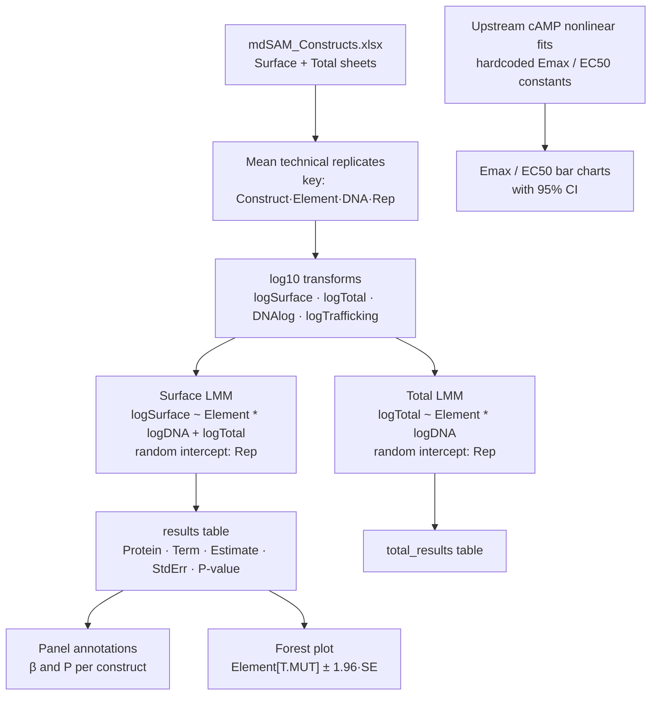

This page dissects `notebooks/17_htr7_camp_emax_ec50_and_expression_plots.ipynb`, the functional endpoint of the HTR7 assay chain. The notebook answers two coupled questions with one statistical engine: does the mdSAM-derived proline mutation change *how much receptor is expressed* as transfection DNA is titrated, and does it change *how well the receptor signals* (cAMP Emax and EC50)? The expression side is handled by per-construct **linear mixed models** with replicate-level random intercepts, while the cAMP side enters as a pre-computed summary layer. Understanding the division of labor between these two layers is the key to adapting the notebook correctly.

## Role in the Assay Analytics Chain

Within the *Experimental Assay Analytics* cluster, this notebook sits immediately after the single-cell imaging readouts and before the transcriptomic response. The mdSAM classifier proposes aggregation-prone membrane motifs; notebooks 13–16 test cellular phenotypes (puncta, surface gating, organelle clusters); notebook 17 closes the loop by testing whether the motif mutation alters receptor *expression* (Total), *trafficking* (Surface), and *function* (cAMP). Its outputs feed directly into the HTR7 end-to-end narrative.

The notebook's own header explicitly frames it as a plotting revision: log10-transformed values (not a log axis), statistics on the transformed scale, replicate trajectories grouped by `Element + Rep`, mean ± SEM, significant proteins split from the remainder, and SVG outputs. Every downstream design decision — the transforms, the trajectory keys, the figure split — follows from that stated contract.

Sources: [17_htr7_camp_emax_ec50_and_expression_plots.ipynb](notebooks/17_htr7_camp_emax_ec50_and_expression_plots.ipynb#L7-L17)

## The Data Contract: From Workbook to Model Frame

The raw input is a single Excel workbook read through two sheets, `Surface` and `Total`, using the `Geometric Mean` column as the measurement metric. Rows are filtered to the two conditions of interest, `Element ∈ {WT, MUT}`, then technical replicates are collapsed by taking the mean of the metric within each `(Construct, Element, DNA, Rep)` group — the four-column key that later feeds the merge between sheets. This groupby-then-mean step is deliberate: it removes well-level measurement noise *before* the model sees the data, so the mixed model's residual term reflects biological rather than technical variance.

Sources: [17_htr7_camp_emax_ec50_and_expression_plots.ipynb](notebooks/17_htr7_camp_emax_ec50_and_expression_plots.ipynb#L26-L49), [17_htr7_camp_emax_ec50_and_expression_plots.ipynb](notebooks/17_htr7_camp_emax_ec50_and_expression_plots.ipynb#L51-L61)

After merging, four derived columns define the entire analysis space: `logSurface`, `logTotal`, `DNAlog` (all log10), and `logTrafficking = logSurface − logTotal`. Two properties of this design deserve attention. First, transforming **before** plotting and statistics means every β coefficient is interpretable as a log10-fold change and every mean ± SEM ribbon is on the plotted scale — statistics and visuals never disagree. Second, the difference-of-logs `logTrafficking` is exactly log10(Surface/Total), so the trafficking panel is a ratio test expressed additively; a β on this column reads as a percent change in surface-per-total delivery.

Sources: [17_htr7_camp_emax_ec50_and_expression_plots.ipynb](notebooks/17_htr7_camp_emax_ec50_and_expression_plots.ipynb#L63-L69)

> [!TIP]
> The groupby key `(Construct, Element, DNA, Rep)` is simultaneously the merge key between sheets and the identity of one biological unit. If you add a condition (e.g., a second mutant), adding it to this key propagates automatically through averaging, merging, and model grouping — the only place to touch is the categorical `hue_order` used in plotting.

## Model Architecture: Two Live LMMs and One Imported Summary

The statistical core is a per-construct loop fitting two statsmodels linear mixed models, with the cAMP results arriving as constants rather than fits:

| Model | Fixed formula | Random effect | Optimizer | Status | Purpose |
|---|---|---|---|---|---|
| Surface LMM | `logSurface ~ Element * logDNA + logTotal` | intercept per `Rep` | lbfgs, REML | **Active** | Surface phenotype adjusted for expression |
| Surface-only LMM | `logSurface ~ Element * logDNA` | intercept per `Rep` | lbfgs, REML | Commented out | Archived pre-adjustment variant |
| Total LMM | `logTotal ~ Element * logDNA` | intercept per `Rep` | lbfgs, REML | **Active** | Expression-level dose response |

Sources: [17_htr7_camp_emax_ec50_and_expression_plots.ipynb](notebooks/17_htr7_camp_emax_ec50_and_expression_plots.ipynb#L893-L944), [17_htr7_camp_emax_ec50_and_expression_plots.ipynb](notebooks/17_htr7_camp_emax_ec50_and_expression_plots.ipynb#L1099-L1132), [17_htr7_camp_emax_ec50_and_expression_plots.ipynb](notebooks/17_htr7_camp_emax_ec50_and_expression_plots.ipynb#L774-L783)

## Fixed-Effects Logic: Why `Element * logDNA + logTotal`

The interaction `Element * logDNA` expands to four terms, and each has a precise geometric meaning on the dose-response plane. Because DNA dose enters as the continuous covariate `logDNA` rather than a categorical factor, the model estimates **slopes** instead of per-dose offsets — one degree of freedom per curve, and an interaction term that directly tests whether the mutant's dose-response *tilt* differs from WT's. `Element[T.MUT]` alone is the vertical offset at the reference dose, while `logTotal` is the adjustment covariate that asks the surface effect question *at equal expression*, which is what separates a trafficking phenotype from an expression artifact.

| Fitted term | Interpretation on the log-log plane |
|---|---|
| `Intercept` | WT baseline log10(Surface) at log10(DNA) = 0 |
| `Element[T.MUT]` | Vertical mutant offset at zero dose (log10 units) |
| `logDNA` | WT dose-response slope |
| `Element[T.MUT]:logDNA` | Differential slope — mutant vs WT sensitivity to transfection dose |
| `logTotal` | Δ log10(Surface) per log10 unit of total expression (the expression adjustment) |

Sources: [17_htr7_camp_emax_ec50_and_expression_plots.ipynb](notebooks/17_htr7_camp_emax_ec50_and_expression_plots.ipynb#L903-L907)

The commented-out cell preserves the notebook's analytical history: the original specification was `logSurface ~ Element * logDNA` with no adjustment, and the revision added `logTotal`. Keeping both in the file is useful archaeology — if a reviewer asks whether the adjustment drives a conclusion, the unadjusted comparison is one uncomment away. The same `results`-collection protocol (loop over `fit.params.index`, harvesting Estimate, `fit.bse`, and `fit.pvalues` into a tidy frame) is identical in both variants, so the downstream annotation code is agnostic to which specification ran.

Sources: [17_htr7_camp_emax_ec50_and_expression_plots.ipynb](notebooks/17_htr7_camp_emax_ec50_and_expression_plots.ipynb#L774-L811), [17_htr7_camp_emax_ec50_and_expression_plots.ipynb](notebooks/17_htr7_camp_emax_ec50_and_expression_plots.ipynb#L920-L943)

## Random-Effects and Estimation Choices

Every model uses `groups=sub["Rep"]`, which statsmodels implements as a random intercept per biological replicate — a compound-symmetry assumption stating that observations from the same replicate share a common shift. This is the correct minimal structure when each replicate contributes observations at multiple DNA doses: ignoring `Rep` would treat dose points within a replicate as independent and deflate standard errors. The loop also carries a defensive guard, skipping any construct with fewer than two unique replicates, since a single-group variance component is unidentifiable.

Estimation uses restricted maximum likelihood (`reml=True`) with the lbfgs optimizer. REML is the conventional default for a model whose purpose is fixed-effect inference on balanced-ish designs, and lbfgs avoids the convergence fragility of the default optimizer on small per-construct samples. Failures are caught per-construct and reported without halting the batch, so one pathological construct cannot silence the other twelve.

Sources: [17_htr7_camp_emax_ec50_and_expression_plots.ipynb](notebooks/17_htr7_camp_emax_ec50_and_expression_plots.ipynb#L894-L932), [17_htr7_camp_emax_ec50_and_expression_plots.ipynb](notebooks/17_htr7_camp_emax_ec50_and_expression_plots.ipynb#L1099-L1132)

> [!TIP]
> The random-intercept-only specification means all within-replicate correlation is assumed equal across doses and conditions. If you suspect replicate-specific slopes (e.g., one transfection batch titrates differently), the upgrade path is a random-slope model — `mixedlm(..., groups="Rep")` cannot express that in statsmodels' basic interface, so you would move to `GEE` or `MixedLM` with variance components via formula tricks.

## From Fit to Annotation: The `results` Table Protocol

The tidy `results` frame — columns `Protein`, `Term`, `Estimate`, `StdErr`, `P-value` — is the single source of truth for every figure annotation. Plotting code performs a two-key lookup, `results[(results["Protein"] == pro) & (results["Term"] == "Element[T.MUT")]`, then formats the p-value in mantissa-exponent LaTeX when it drops below 10⁻³. This is the notebook's second generation of statistics: an earlier legacy path embedded a hardcoded `mut_stats` dictionary (e.g., `"HTR7_SNAPtm": (1.040, 0.0001)`) directly in the source, which survives only inside the first `make_figure` helper. The model-driven lookup is strictly preferable — numbers can never drift from the fit that produced them.

Sources: [17_htr7_camp_emax_ec50_and_expression_plots.ipynb](notebooks/17_htr7_camp_emax_ec50_and_expression_plots.ipynb#L197-L212), [17_htr7_camp_emax_ec50_and_expression_plots.ipynb](notebooks/17_htr7_camp_emax_ec50_and_expression_plots.ipynb#L40-L46), [17_htr7_camp_emax_ec50_and_expression_plots.ipynb](notebooks/17_htr7_camp_emax_ec50_and_expression_plots.ipynb#L920-L940)

The forest plot reuses the same table for a cross-construct comparison: for each protein's `Element[T.MUT]` row it computes a Wald 95% interval as `Estimate ± 1.96 × StdErr`, sorts constructs by effect size, and draws the interval against a zero reference line. Because the estimates are on the log10 surface scale, a unit of β is a ten-fold trafficking shift — the APP construct's large positive β in `mut_stats` is exactly the kind of effect this panel is designed to rank.

Sources: [17_htr7_camp_emax_ec50_and_expression_plots.ipynb](notebooks/17_htr7_camp_emax_ec50_and_expression_plots.ipynb#L963-L1008)

## The cAMP Emax/EC50 Layer

The final cell renders the functional readout, and its architecture differs fundamentally from everything above it: **no model is fitted in this notebook**. The Emax and EC50 statistics arrive as literal constants — `emax_mean = [99.8, 75.3]` with CIs `[4.6, 4.8]` and `p_emax = 0.0003`; `ec50_mean = [2.69, 2.79]` nM with CIs `[0.94, 1.26]` and `p_ec50 = 0.95` — for the two groups labeled `Red` and `Black`, which inherit the WT/MUT color coding (`#AF3437` red, `#BDBEC0` gray) used throughout the notebook. The cell's job is purely presentational: twin bar charts with 95% CI whiskers and a `format_pvalue` helper that switches to scientific-notation LaTeX below 0.01.

| cAMP parameter | WT ("Red") | Proline mutant ("Black") | P value | Reading |
|---|---|---|---|---|
| Emax (% max cAMP) | 99.8 ± 4.6 | 75.3 ± 4.8 | 3 × 10⁻⁴ | Mutant loses ~25% of maximal signaling |
| EC50 (nM) | 2.69 ± 0.94 | 2.79 ± 1.26 | 0.95 | Agonist potency unchanged |

The biological synthesis is in the contrast between the two rows: a significant Emax reduction with an unchanged EC50 is the signature of a *signaling-capacity* defect (fewer competent receptors at the surface) rather than a *binding/potency* defect — which is coherent with the surface-expression phenotype the LMMs quantify. The upstream nonlinear dose-response fits that produced these numbers live outside the repository, so this cell is a visualization contract, not an inference engine.

Sources: [17_htr7_camp_emax_ec50_and_expression_plots.ipynb](notebooks/17_htr7_camp_emax_ec50_and_expression_plots.ipynb#L1440-L1515)

> [!TIP]
> Re-running this notebook reproduces the Emax/EC50 figure exactly as published, but will **never** re-estimate those values — they are frozen constants. If the upstream cAMP fit changes, you must hand-edit `emax_mean`, `emax_ci`, `ec50_mean`, `ec50_ci`, and both p-values; there is no data dependency to warn you. Treat this cell as an import boundary and consider loading it from a CSV in any reusable version.

## Visualization Grammar and Output Artifacts

Every expression figure follows one shared grammar: `sns.pointplot` with `errorbar="se"` for the mean ± SEM trend, `native_scale=True` so log-spaced DNA doses sit at their true positions, and the fixed WT/MUT palette `['#AF3437', '#BDBEC0']` with `hue_order=['WT', 'MUT']`. The earlier generic helper adds replicate trajectory lines via `units="Trajectory"` with `estimator=None` — the `Trajectory = Element + "_Rep" + Rep` key created at transform time — so individual replicate curves stay visible beneath the summary points. The final total-expression figure switches to grouped bars with per-dose two-sided Student's t-tests drawn as significance brackets, a deliberately coarser summary view.

Sources: [17_htr7_camp_emax_ec50_and_expression_plots.ipynb](notebooks/17_htr7_camp_emax_ec50_and_expression_plots.ipynb#L70-L118), [17_htr7_camp_emax_ec50_and_expression_plots.ipynb](notebooks/17_htr7_camp_emax_ec50_and_expression_plots.ipynb#L63-L69), [17_htr7_camp_emax_ec50_and_expression_plots.ipynb](notebooks/17_htr7_camp_emax_ec50_and_expression_plots.ipynb#L1369-L1390)

All figures save as SVG at 900 dpi under a local reviewer-response directory, one file per analytical question:

| Artifact | Content |
|---|---|
| `total_vs_surface/{pro}.svg` | Three-panel Total/Surface/Trafficking per significant construct |
| `total_vs_surface/all_proteins.svg` | 3×3 grid, significant constructs, β/P annotations from `results` |
| `total_vs_surface/other_proteins.svg` | Grid for the remaining constructs |
| `total_vs_surface/all_beta_CI.svg` | Forest plot of `Element[T.MUT]` effects |
| `total_vs_surface/total_expression_only.svg`, `total_expression_barplot.svg` | Total-expression-only dose curves and bar+t-test summary |
| `HTR7_stats_emax_ec50.svg` | cAMP Emax/EC50 bar charts |

Sources: [17_htr7_camp_emax_ec50_and_expression_plots.ipynb](notebooks/17_htr7_camp_emax_ec50_and_expression_plots.ipynb#L240-L245), [17_htr7_camp_emax_ec50_and_expression_plots.ipynb](notebooks/17_htr7_camp_emax_ec50_and_expression_plots.ipynb#L1262-L1267), [17_htr7_camp_emax_ec50_and_expression_plots.ipynb](notebooks/17_htr7_camp_emax_ec50_and_expression_plots.ipynb#L1511-L1515)

## Adapting the Notebook: Known Friction Points

Three adaptation hazards are visible in the source. The data path is split across eras: the first loading block uses an absolute macOS path while the model block uses a bare relative filename (`file = "20270728_mdSAM_Constructs.xlsx"`), so a fresh clone requires normalizing both to one location. The file ends with a stray cell containing `plt.)()` — a syntax error that will break `nbconvert`/`jupyter execute` runs until deleted. And the metric is hardcoded as `"Geometric Mean"`; if the workbook's column naming changes, both the read and the groupby rename (`rename(columns={metric: "Surface"})`) must move together.

| Change | Where | Risk |
|---|---|---|
| New input location | Two `file =` assignments (absolute path L33, relative L830) | Silent `FileNotFoundError` in the later block only |
| Unadjusted surface model | Uncomment cell at L713–811 | Overwrites `df`/`results` from the adjusted run |
| Re-fit cAMP parameters | Not possible in-repo — constants at L1448–1455 | Stale functional claims if upstream fit changes |
| Batch execution | Delete trailing `plt.)()` cell | `nbconvert` hard-fails on syntax error |

Sources: [17_htr7_camp_emax_ec50_and_expression_plots.ipynb](notebooks/17_htr7_camp_emax_ec50_and_expression_plots.ipynb#L26-L49), [17_htr7_camp_emax_ec50_and_expression_plots.ipynb](notebooks/17_htr7_camp_emax_ec50_and_expression_plots.ipynb#L822-L831), [17_htr7_camp_emax_ec50_and_expression_plots.ipynb](notebooks/17_htr7_camp_emax_ec50_and_expression_plots.ipynb#L1444-L1455), [17_htr7_camp_emax_ec50_and_expression_plots.ipynb](notebooks/17_htr7_camp_emax_ec50_and_expression_plots.ipynb#L1524-L1526)

## Where This Connects

The LMM pattern here — log-transform first, dose as continuous covariate, replicate as random intercept — is the continuous-dose sibling of the count-based modeling in [TIRF Puncta Poisson GLM](17-tirf-puncta-poisson-glm), and the Total/Surface measurements it consumes are produced by the pipeline documented in [Flow Cytometry Surface Gating](18-flow-cytometry-surface-gating). The functional Emax/EC50 result is one pillar of the [HTR7 End-to-End Case Study](21-htr7-end-to-end-case-study), whose transcriptomic consequences continue in [RNA-seq Differential Expression and GSEA](22-rna-seq-differential-expression-and-gsea); for how this notebook maps to paper figures, see [Figure-to-Notebook Reproducibility Map](9-figure-to-notebook-reproducibility-map).
