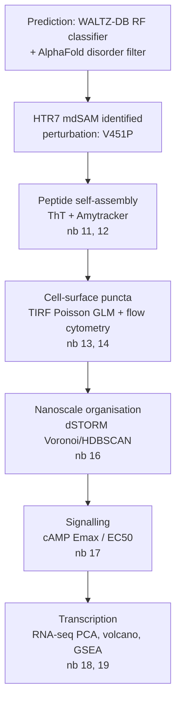
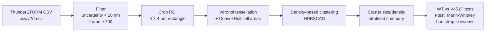

This page traces how a single predicted mdSAM — the amyloid-like motif in the serotonin 5-HT7 receptor (HTR7) — was taken from computational prediction through in-vitro peptide assays, cellular clustering measurements, nanoscale dSTORM imaging, signalling readouts, and finally transcriptomics. It is the repository's most complete worked example of the "motif → mechanism → consequence" logic, spanning notebooks 11–14 (upstream assays), 16–19 (the core case-study chain), and the shared figure map. Everything here is documented from the notebooks themselves; notebooks ship with outputs cleared, so all cell references are 0-based indices you can run to regenerate.

Sources: [README.md](README.md#L21-L38), [README.md](README.md#L138-L166)

## Why HTR7: One Motif, Five Orthogonal Assays

An mdSAM is a short (7–9 residue) peptide motif in a disordered, solvent-exposed region of a transmembrane protein, predicted to self-assemble via beta-strand-mediated amyloid-like interactions. HTR7 carries such a motif, and the key experimental perturbation is a single-residue **proline substitution, V451P**, which breaks the beta-strand geometry that the assembly model requires. Because proline disrupts the motif without grossly altering the protein, every downstream difference between WT and V451P becomes attributable to the motif's self-assembly — provided expression and trafficking are controlled for, which is exactly what notebooks 14 and 17 quantify.

Sources: [README.md](README.md#L21-L31), [README.md](README.md#L124-L128)

The evidence chain is deliberately layered: each stage tests the same hypothesis at a different physical scale, and each has a dedicated notebook with its own statistical model.

The assay-to-notebook mapping below is the navigation table for the rest of this page; panel letters refer to the manuscript figures that the notebooks regenerate.

| Stage | Assay | Notebook | Paper panels | Key statistic |
|---|---|---|---|---|
| Peptide | ThT spectra, GPCR peptides | `11_tht_gpcr_peptides_proline_mutants.ipynb` | Fig 4C / 5B | WT vs V451P fluorescence |
| Peptide | Amytracker 520 | `12_amytracker_peptides.ipynb` | Fig 4C | WT vs proline mutants |
| Cells | TIRF puncta density | `13_tirf_puncta_poisson_glm.ipynb` | Fig 4C-D, 5E | Poisson GLM rate ratio |
| Cells | Total vs surface expression | `14_flow_cytometry_total_vs_surface.ipynb` | S6A | percentile gating vs mock |
| Nanoscale | dSTORM clusters | `16_dstorm_htr7_cluster_analysis.ipynb` | Fig 5F-G | Voronoi/HDBSCAN + bootstrap skewness |
| Signalling | cAMP dose-response | `17_htr7_camp_emax_ec50_and_expression_plots.ipynb` | Fig 6D, S6A | Emax/EC50 + mixed model |
| Transcriptome | PCA + volcano | `18_htr7_rnaseq_pca_volcano.ipynb` | Fig 6E | padj/log2FC thresholds |
| Transcriptome | GSEA | `19_htr7_rnaseq_gsea.ipynb` | supports Fig 6E | KEGG prerank NES/FDR |

Sources: [README.md](README.md#L114-L133), [README.md](README.md#L138-L166), [README.md](README.md#L215-L228)

## Stage 1 — Peptide-Level Self-Assembly (Notebooks 11–12)

The case study begins at the peptide level. Notebook 11 measures Thioflavin-T fluorescence of GPCR mdSAM peptides (HTR7, CCR4, DRD1) alongside their proline mutants, including HTR7 V451P, and produces the ThT spectra shown in Fig 4C/5B (cells 16–17, spectra figure at cell 32). Notebook 12 repeats the logic with Amytracker 520 at 100 µM peptide, providing a dye-independent confirmation that the wild-type motif assembles and the proline mutant does not.

Sources: [README.md](README.md#L122-L128), [README.md](README.md#L209-L213)

## Stage 2 — Cell-Level Puncta and the Expression Confound (Notebooks 13–14)

Notebook 13 fits a **Poisson generalised linear model** to CellProfiler puncta tables and reports puncta-per-cell-area rate ratios (WT/mutant) for full-length APP and HTR7 in HEK and U2OS cells — HTR7 WT vs V451P TIRF puncta are Fig 5E (cell 25). Notebook 14 then runs flow cytometry on FCS files, computing total and surface SNAP signal for WT vs mutant constructs across DNA amounts with percentile gating against mock cells; these plots (cells 45, 98) become the S6A expression control that later stages lean on. The logic is important: a clustering phenotype is only interpretable if the mutant is expressed at comparable levels and reaches the surface at comparable rates.

Sources: [README.md](README.md#L130-L134), [README.md](README.md#L215-L222)

## Stage 3 — Nanoscale Organisation: dSTORM Cluster Analysis (Notebook 16)

Notebook 16 is the largest HTR7-specific analysis (~480 cells) and the technical centrepiece of Fig 5. It starts from **ThunderSTORM localisation tables** exported as CSVs under `csv/v2/`, where the code comments `5000 pixes = 1micron` record the pixel-to-nanometre convention. The entry-point function `ThnderSTORM2df` applies two quality filters — localisation `uncertainty [nm] < 20` and `frame >= 200` (discarding the pre-stabilisation part of each movie) — then crops a `squre_size=4000` nm (4 µm) rectangle from the field and tags every localisation with `parent`/`element`/`cell`/`rectangle`/`replicate` metadata. HTR7 cells are loaded as WT and MUT (V451P) across multiple cells and replicates (e.g., `HTR7Mut_B_2_8`, `HTR7Mut_B_2_10` at nine and six ROI coordinates respectively).

Sources: [16_dstorm_htr7_cluster_analysis.ipynb](notebooks/16_dstorm_htr7_cluster_analysis.ipynb#L114-L150), [16_dstorm_htr7_cluster_analysis.ipynb](notebooks/16_dstorm_htr7_cluster_analysis.ipynb#L11500-L11511)

The clustering engine combines Voronoi tessellation with density-based clustering. `voro2cluster`/`voro2cluster_v4` tile each ROI with a Voronoi diagram (`scipy.spatial.Voronoi`), while `voronoi_volumes` computes each cell's area via `ConvexHull`, separating dense from sparse regions before cluster calls. Density-independent geometric descriptors come from helpers such as `df2clustersize` (cluster diameter = max pairwise distance via `pdist`) and `cluster_fraction`. The environment imports `HDBSCAN`, `OPTICS`, `DBSCAN`, `ripleyk` (Ripley's K), and `rdfpy` (radial distribution functions), so alternative cluster-callers and point-process statistics are all in scope.

Sources: [16_dstorm_htr7_cluster_analysis.ipynb](notebooks/16_dstorm_htr7_cluster_analysis.ipynb#L73-L112), [16_dstorm_htr7_cluster_analysis.ipynb](notebooks/16_dstorm_htr7_cluster_analysis.ipynb#L240-L259)

The figure-critical cells sit at the end of the notebook: Fig 5F (localisation map with Voronoi/cluster overlay) at cells 409–410, and Fig 5G (cluster stoichiometry by local density, bootstrap skewness) at cells 440–453. The analysis stratifies clusters by local density into bins `0-70` and `71-150`, then compares `cluster_sizes_full_vals_nm_mean` between WT (red `#C03830`) and MUT (grey `#B4B5B4`) with violin/strip plots; non-parametric confirmation uses `mannwhitneyu` alongside `stats.ttest_ind`.

Sources: [README.md](README.md#L138-L152), [16_dstorm_htr7_cluster_analysis.ipynb](notebooks/16_dstorm_htr7_cluster_analysis.ipynb#L11554-L11583), [16_dstorm_htr7_cluster_analysis.ipynb](notebooks/16_dstorm_htr7_cluster_analysis.ipynb#L11648-L11665)

> [!TIP]
> The density stratification (`densitiy` bins 0-70 vs 71-150) exists because naive cluster-size comparisons confound cluster geometry with localisation density: dense regions mechanically produce larger apparent clusters. Comparing WT vs V451P within each density stratum isolates the motif effect from the sampling effect — replicate this pattern whenever you compare point-cloud clusters across conditions.

## Stage 4 — Signalling Readout: cAMP Dose-Response and Expression Controls (Notebook 17)

Notebook 17 closes the mechanistic loop: if V451P disrupts HTR7 clustering, does signalling change? Its header markdown states the design explicitly — total (left) and surface (right) plots on **log10-transformed** values (not log axes), statistics on the same transformed scale, replicate trajectories grouped by `Element + Rep`, mean ± SEM, SVG output. Input is `20270728_mdSAM_Constructs.xlsx` (sheets `Surface`/`Total`, metric `Geometric Mean`), and the derived quantity `logTrafficking = logSurface − logTotal` gives a per-construct trafficking index. Fig 6D (cell 18) summarises HTR7 cAMP Emax and EC50 between WT and V451P; S6A (cells 13, 17) holds the total-expression bar plots.

Sources: [17_htr7_camp_emax_ec50_and_expression_plots.ipynb](notebooks/17_htr7_camp_emax_ec50_and_expression_plots.ipynb#L4-L17), [17_htr7_camp_emax_ec50_and_expression_plots.ipynb](notebooks/17_htr7_camp_emax_ec50_and_expression_plots.ipynb#L26-L69), [README.md](README.md#L154-L166)

Statistical anchoring comes from a **linear mixed model** per construct: `smf.mixedlm("logSurface ~ Element * logDNA", groups=Rep)`, fit by REML with lbfgs, regressing surface expression on condition (WT/MUT) and DNA amount (a proxy for expression level) with replicate as random effect. The hard-coded `mut_stats` dictionary records the resulting β and p-values and annotates them onto the figures:

| Construct | β (Element=MUT effect) | p-value | Interpretation |
|---|---|---|---|
| HTR7 | −0.197 | 0.338 | No surface-expression deficit in full-length V451P |
| HTR7_SNAPtm | 1.040 | 0.0001 | Motif-swap construct shows strong surface effect |
| APP | 1.959 | 0.0001 | Positive control |
| A4 | 1.710 | 0.001 | Positive control |
| KCNE4_SNAPtm | 0.962 | 0.002 | Second motif-swap control |

Sources: [17_htr7_camp_emax_ec50_and_expression_plots.ipynb](notebooks/17_htr7_camp_emax_ec50_and_expression_plots.ipynb#L40-L46), [17_htr7_camp_emax_ec50_and_expression_plots.ipynb](notebooks/17_htr7_camp_emax_ec50_and_expression_plots.ipynb#L197-L239), [17_htr7_camp_emax_ec50_and_expression_plots.ipynb](notebooks/17_htr7_camp_emax_ec50_and_expression_plots.ipynb#L823-L839)

> [!TIP]
> Notice that full-length HTR7 shows **no** significant surface effect (β = −0.197, p = 0.338) while the SNAPtm motif-swap constructs do. This is the analytical payoff of the design: any WT-vs-V451P differences in dSTORM clustering or cAMP signalling cannot be dismissed as a trafficking artefact, because surface delivery is statistically indistinguishable between full-length WT and V451P.

## Stage 5 — Transcriptional Consequences: RNA-seq (Notebooks 18–19)

The transcriptome stage asks whether a clustering/signalling defect propagates to gene expression. Notebook 18 is the figure notebook: it reads precomputed DESeq2 tables from `GPCR_ThT/RNAseq/ywang34_data/` and plots PCA (`PCA_data.tsv`, samples labelled `$WT$` rows 0–3, `$V451P$` rows 3–6, `$pCDNA$` empty-vector rows 6+) and a volcano for `deseq2_HTR7_MUT_vs_HTR7_WT.tsv` — these are Fig 6E (cells 3 and 8). Volcano thresholds are `padj_log > 2` (i.e., FDR < 0.01) combined with `|log2FC| > 0.4` for the MUT-vs-WT contrast, and a more permissive `|log2FC| > 1` for each construct vs the HEK pCDNA empty-vector control; `adjustText` de-overlaps gene labels and a `venn2` diagram contrasts the upregulated sets of V451P and WT versus pCDNA.

Sources: [18_htr7_rnaseq_pca_volcano.ipynb](notebooks/18_htr7_rnaseq_pca_volcano.ipynb#L10-L31), [18_htr7_rnaseq_pca_volcano.ipynb](notebooks/18_htr7_rnaseq_pca_volcano.ipynb#L40-L70), [18_htr7_rnaseq_pca_volcano.ipynb](notebooks/18_htr7_rnaseq_pca_volcano.ipynb#L120-L149), [18_htr7_rnaseq_pca_volcano.ipynb](notebooks/18_htr7_rnaseq_pca_volcano.ipynb#L169-L248)

Notebook 19 re-derives the differential expression from raw counts so the whole transcriptome stage is reproducible end-to-end. It reads the RSEM gene-count matrix (`BABU-301366-STRANDED_RSEM_gene_count...txt`), selects the nine samples (3× HTR7 WT basal, 3× HTR7 MUT basal, 3× HEK pCDNA), filters genes with total counts ≤ 10, and runs **pyDESeq2** with `DeseqDataSet(..., design_factors="Condition")` and `DeseqStats(contrast=('Condition','MUT','WT'))`. Genes with `baseMean >= 10` are ranked by the Wald statistic and fed to **gseapy prerank** GSEA against `KEGG_2021_Human` (seed=4, 1000 permutations); enriched sets are filtered at `FDR q-val < 0.2` with `|NES| > 1.5`, and the MAPK signalling pathway is inspected explicitly — consistent with HTR7 being a Gs-coupled receptor.

| Parameter | Value | Where |
|---|---|---|
| Contrast | MUT vs WT (basal) | `DeseqStats` call |
| Gene filter | sum > 10 counts; baseMean ≥ 10 | pre-DESeq2 / pre-ranking |
| Gene sets | KEGG_2021_Human | `gp.prerank` |
| Permutations / seed | 1000 / 4 | `gp.prerank` |
| Report thresholds | FDR q < 0.2, \|NES\| > 1.5 | results filtering |

Sources: [19_htr7_rnaseq_gsea.ipynb](notebooks/19_htr7_rnaseq_gsea.ipynb#L46-L92), [19_htr7_rnaseq_gsea.ipynb](notebooks/19_htr7_rnaseq_gsea.ipynb#L124-L155), [19_htr7_rnaseq_gsea.ipynb](notebooks/19_htr7_rnaseq_gsea.ipynb#L200-L224)

## Reproducing the Case Study

Run each notebook with `notebooks/` as the working directory; the shared input tables live in `files/` (`dSAM_MPs_v_paper_v2_new_locs.pkl`, `hTMs_uniprot_v1.pkl`, and — for notebooks 18–19 — `AF2_with_ENSG.pkl`), as documented in `files/README.md`. Note that some stages depend on raw data not redistributed in this repository (ThunderSTORM CSVs under `csv/v2/`, the RNA-seq count matrix, and the cAMP Excel workbook referenced by absolute local paths), and notebook 18 additionally loads local pickles for an auxiliary phosphorylation-site analysis. The panel-to-cell mapping is fully specified in the README's figure tables, and notebooks call the motifs `dSAM` in filenames and variables — same concept as mdSAM.

Sources: [README.md](README.md#L244-L248), [18_htr7_rnaseq_pca_volcano.ipynb](notebooks/18_htr7_rnaseq_pca_volcano.ipynb#L273-L301), [README.md](README.md#L119-L122)

## Where to Go Next

To go deeper on any single stage, follow the catalog: the dSTORM methods are elaborated in [dSTORM Cluster Analysis](19-dstorm-cluster-analysis), the mixed-model machinery in [cAMP Dose-Response Mixed Models](20-camp-dose-response-mixed-models), and the RNA-seq workflow in [RNA-seq Differential Expression and GSEA](22-rna-seq-differential-expression-and-gsea). The upstream assays that motivate this case study are covered in [Thioflavin-T and Amytracker Screens](16-thioflavin-t-and-amytracker-screens), [TIRF Puncta Poisson GLM](17-tirf-puncta-poisson-glm), and [Flow Cytometry Surface Gating](18-flow-cytometry-surface-gating). For the discovery logic that nominated HTR7's motif in the first place, start at [mdSAM Concept and Discovery Rationale](4-mdsam-concept-and-discovery-rationale), and for the complete panel-to-notebook index see [Figure-to-Notebook Reproducibility Map](9-figure-to-notebook-reproducibility-map).