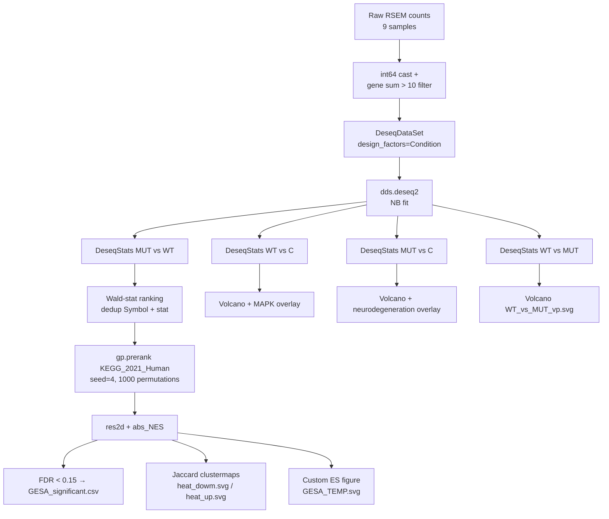

This page documents the transcriptional readout of the HTR7 case study: how the repository converts a 9-sample RNA-seq experiment into the Figure 6E panels and their supporting gene-set enrichment analysis. Two notebooks implement the layer, and they are deliberately different in kind. `18_htr7_rnaseq_pca_volcano.ipynb` is a publication-figure playback notebook that consumes precomputed DESeq2 result tables and renders the final panels (PCA, cell index 3; V451P-vs-WT volcano, cell 8). `19_htr7_rnaseq_gsea.ipynb` is the full reanalysis engine: it re-fits the negative-binomial model from raw RSEM counts with **pyDESeq2**, then runs **GSEA pre-ranking** with **gseapy** over the KEGG 2021 human gene-set library, producing enrichment-score curves, pathway-similarity clustermaps, and pathway-annotated volcano plots. Together they form a two-tier architecture: a frozen, figure-exact layer on top of a re-runnable, statistically explicit layer.

Sources: [README.md](README.md#L157-L163), [18_htr7_rnaseq_pca_volcano.ipynb](notebooks/18_htr7_rnaseq_pca_volcano.ipynb#L40-L80), [19_htr7_rnaseq_gsea.ipynb](notebooks/19_htr7_rnaseq_gsea.ipynb#L33-L36)

## Where This Layer Sits in the Pipeline

The RNA-seq notebooks are terminal nodes of the experimental-assay track. Everything upstream (classifier, motif discovery, ThT screens, dSTORM imaging) converges on HTR7; this layer measures what the V451P motif-disrupting mutation does to the transcriptome, complementing the cAMP dose-response and imaging measurements documented in [cAMP Dose-Response Mixed Models](20-camp-dose-response-mixed-models) and [dSTORM Cluster Analysis](19-dstorm-cluster-analysis). The notebooks load the shared pickled tables from `files/` (`hTMs_uniprot_v1.pkl`, `AF2_with_ENSG.pkl`, `dSAM_MPs_v_paper_v2_new_locs.pkl`) for identifier cross-referencing, but the transcriptional data itself lives in a project-local `GPCR_ThT/RNAseq/` directory with collaborator-provided inputs (`ywang34_data/` DESeq2 tables in notebook 18, a raw RSEM gene-count matrix in notebook 19).

Sources: [18_htr7_rnaseq_pca_volcano.ipynb](notebooks/18_htr7_rnaseq_pca_volcano.ipynb#L27-L30), [19_htr7_rnaseq_gsea.ipynb](notebooks/19_htr7_rnaseq_gsea.ipynb#L28-L36), [files/README.md](files/README.md#L1-L7)

```mermaid
flowchart LR
    subgraph External inputs
        A[RSEM gene counts<br/>BABU-301366 STRANDED] --> B
        B[9 RNA-seq samples<br/>WT / V451P / pCDNA]
    end
    subgraph Notebook 19 — reanalysis engine
        C[pyDESeq2 DeseqDataSet<br/>design_factors = Condition]
        D[DeseqStats<br/>4 contrasts]
        E[Wald-stat ranking]
        F[gseapy prerank<br/>KEGG_2021_Human]
    end
    subgraph Notebook 18 — figure playback
        G[ywang34_data DESeq2 TSVs<br/>precomputed]
        H[PCA + volcano SVGs]
    end
    B --> C --> D --> E --> F
    B --> G --> H
    F --> I[ES curves, Jaccard<br/>clustermaps, annotated volcanoes]
```

## Experimental Design and Data Layer

The experiment is a 3 × 3 design: three conditions in triplicate, encoded in sample names with sequential numeric prefixes. Notebook 19 selects the nine columns explicitly — `2613875/76/77` are HTR7-WT basal replicates, `2613878/79/80` are HTR7-MUT (V451P) basal replicates, and `2613881/82/83` are HEK cells transfected with the empty pCDNA vector — then builds a `Sample`/`Condition` metadata frame with conditions labeled `WT`, `MUT`, `C` ([19_htr7_rnaseq_gsea.ipynb](notebooks/19_htr7_rnaseq_gsea.ipynb#L77-L92)). Three preprocessing rules precede modeling: counts are cast to `int64` (the pyDESeq2 integer requirement), genes with a total count sum ≤ 10 across all samples are dropped, and the matrix is transposed to the samples × genes orientation pyDESeq2 expects. Notebook 18 takes the opposite ingestion philosophy: it never touches raw counts, instead reading collaborator-precomputed DESeq2 tables (`deseq2_HTR7_MUT_vs_HTR7_WT.tsv`, `deseq2_HTR7_WT_vs_HEK_pCDNA.tsv`, `deseq2_HTR7_MUT_vs_HEK_pCDNA.tsv`) and precomputed PCA coordinates from `PCA_data.tsv`, where the first three rows are WT, the next three V451P, the rest pCDNA.

The key architectural distinction: notebook 18 guarantees bit-identical figure reproduction; notebook 19 guarantees statistical reproducibility and adds capabilities the precomputed tables lack (GSEA, arbitrary contrast re-fitting, pathway overlays). Both paths must agree on gene identity, so notebook 19 maintains a `geneID → geneSymbol` dictionary built from the count file itself and maps Ensembl IDs to symbols after every `DeseqStats` call.

Sources: [19_htr7_rnaseq_gsea.ipynb](notebooks/19_htr7_rnaseq_gsea.ipynb#L46-L92), [18_htr7_rnaseq_pca_volcano.ipynb](notebooks/18_htr7_rnaseq_pca_volcano.ipynb#L40-L53), [18_htr7_rnaseq_pca_volcano.ipynb](notebooks/18_htr7_rnaseq_pca_volcano.ipynb#L169-L172)

| Ingestion mode | Notebook | Input artifact | Preprocessing on load | Figure fidelity |
|---|---|---|---|---|
| Frozen DESeq2 tables | 18 | `ywang34_data/*.tsv`, `PCA_data.tsv` | `padj_log = −log10(padj)` only | Exact panel playback (Fig 6E) |
| Raw RSEM counts | 19 | `BABU-301366-STRANDED_RSEM_gene_count.*.txt` | int64 cast, sum > 10 filter, transpose, metadata frame | Re-runnable; supports Fig 6E |

Sources: [18_htr7_rnaseq_pca_volcano.ipynb](notebooks/18_htr7_rnaseq_pca_volcano.ipynb#L100-L110), [19_htr7_rnaseq_gsea.ipynb](notebooks/19_htr7_rnaseq_gsea.ipynb#L77-L102)

## Notebook 18: Publication-Figure Playback (Fig 6E)

Notebook 18 contains 22 cells, of which cells 0–15 are the figure pipeline and cells 16–20 are trailing exploratory work. The PCA panel (cell 3) plots the precomputed coordinates with axis labels hard-coding the explained variance — PC1 at 60.7% and PC2 at 10.5% — and the fixed palette `['#C03830', '#B4B5B4', '#000080']` (red = WT, gray = V451P, navy = pCDNA), exporting `PCA_ywang34.svg` ([18_htr7_rnaseq_pca_volcano.ipynb](notebooks/18_htr7_rnaseq_pca_volcano.ipynb#L63-L70)). The volcano (cell 8) is the statistical centerpiece: it colors upregulated genes teal (`#18827E`) and downregulated genes magenta (`#B34F91`), draws dashed decision boundaries at log2FC = ±0.4 and −log10(FDR) = 2, and resolves overlapping labels with `adjustText`, exporting `volcano_ywang34.svg` ([18_htr7_rnaseq_pca_volcano.ipynb](notebooks/18_htr7_rnaseq_pca_volcano.ipynb#L120-L149)).

> [!TIP]
> Notebook 18 uses two different significance bands, and conflating them is the most common misreading of this layer. The V451P-vs-WT contrast — the biological comparison — uses the stricter band −log10(padj) > 2 (i.e., FDR < 0.01) with |log2FC| > 0.4 (cells 8–9), while the against-vector contrasts and the exploratory filter in cell 7 use −log10(padj) > 1.3 (FDR < 0.05). The against-vector volcanoes relax the fold-change boundary to |log2FC| > 1 because expression of the receptor itself generates large, expected shifts relative to pCDNA.

After the main volcano, cells 12–14 produce the two against-vector volcanoes and a `matplotlib_venn` overlap of the upregulated gene sets from V451P-vs-pCDNA and WT-vs-pCDNA, with the exact intersection printed in cell 15; cell 11 spot-checks the immediate-early gene JUNB across both contrasts as a sanity probe. Cells 16–20 are an unrelated side analysis intersecting predicted phosphorylation-site PTMs (iPTM score ≥ 3) with mdSAM-containing accessions — worth knowing for archaeology, but not part of any paper panel.

Sources: [18_htr7_rnaseq_pca_volcano.ipynb](notebooks/18_htr7_rnaseq_pca_volcano.ipynb#L120-L149), [18_htr7_rnaseq_pca_volcano.ipynb](notebooks/18_htr7_rnaseq_pca_volcano.ipynb#L186-L248), [18_htr7_rnaseq_pca_volcano.ipynb](notebooks/18_htr7_rnaseq_pca_volcano.ipynb#L266-L311), [README.md](README.md#L162-L163)

## Notebook 19: The End-to-End Reanalysis Engine

Notebook 19 executes a five-stage pipeline: fit → contrast → rank → enrich → visualize. The fit stage constructs a `DeseqDataSet` with `design_factors="Condition"` over the 9-sample count matrix and runs the dispersions/size-factor estimation with `dds.deseq2()` (cell 6). The contrast stage then calls `DeseqStats` four times against the same fitted object — `MUT` vs `WT` (cell 8), `WT` vs `C` (cell 44), `MUT` vs `C` (cell 49), and `WT` vs `MUT` (cell 51) — each with `n_cpus=8`, filtering to `baseMean >= 10` before any downstream use. The ranking stage converts the MUT-vs-WT result into a GSEA input: genes sorted by descending Wald statistic, deduplicated on both symbol and statistic to guarantee a strictly ordered rank vector. The enrichment stage runs `gp.prerank` with `gene_sets='KEGG_2021_Human'`, `seed=4`, and `permutation_num=1000`, extracting `res2d` and augmenting it with an `abs_NES` column.

> [!TIP]
> Cells 12 and 15 intentionally run the identical `gp.prerank` call twice with the same `seed=4`. This is a determinism audit, not dead code: with gene permutation and a fixed seed, both invocations must return identical NES/FDR columns, letting the author verify that pathway calls are not an artifact of sampling noise before the results were exported and plotted. Preserve the seed if you re-run; changing it shifts FDR q-values near the significance boundary.

Sources: [19_htr7_rnaseq_gsea.ipynb](notebooks/19_htr7_rnaseq_gsea.ipynb#L124-L155), [19_htr7_rnaseq_gsea.ipynb](notebooks/19_htr7_rnaseq_gsea.ipynb#L200-L233), [19_htr7_rnaseq_gsea.ipynb](notebooks/19_htr7_rnaseq_gsea.ipynb#L712-L850)



## Pathway-Level Results and Their Visual Grammar

The enrichment table is filtered at three nested stringency levels: `FDR q-val < 0.15` rows are exported to `GSEA_significant.csv` as the canonical result set (cell 18); an inspection band of `FDR < 0.2 & abs_NES > 1.5` (cell 14) and subsequent `abs_NES > 1.6/1.7` cuts (cells 37, 59) are used for display. NES sign follows the ranking direction: because the ranking is MUT-vs-WT, negative NES marks pathways suppressed in the V451P mutant. The two signature suppressed pathways — `MAPK signaling pathway` and `Pathways of neurodegeneration` — anchor the downstream graphics ([19_htr7_rnaseq_gsea.ipynb](notebooks/19_htr7_rnaseq_gsea.ipynb#L213-L223)).

The visualization layer has three distinct grammar rules. First, redundancy among enriched pathways is quantified by **Jaccard similarity of lead genes**: for all pairs of pathways with NES < −1.7 (down) and NES > 1.7 (up), cell 21 defines the similarity function and cells 24–25 render `sns.clustermap` matrices with a shared SymLogNorm (linthresh 0.15) and the teal–gray–magenta diverging colormap, exporting `figures/heat_dowm.svg` and `figures/heat_up.svg`. Second, the enrichment-score curve is hand-built rather than delegated to `gseaplot`: cell 36 extracts the running enrichment score (`RES`) and hit positions from `pre_res.results`, and cell 39 composes a 12×12 `GridSpec` figure layering the ES curves for both signature pathways, a twinned axis with the ranked-metric bar spectrum, and two thin hit-index strips — annotated with NES values read from `out_df.loc[18]` and `out_df.loc[12]` — exporting `GESA_TEMP.svg`. Third, contrast volcanoes are annotated by *pathway membership* rather than by raw significance: cells 47, 50, and 52 label only genes that pass a −log10(FDR) cutoff and appear in a pathway's `matched_genes` list, visually tying single-gene statistics to the enrichment result.

Sources: [19_htr7_rnaseq_gsea.ipynb](notebooks/19_htr7_rnaseq_gsea.ipynb#L268-L310), [19_htr7_rnaseq_gsea.ipynb](notebooks/19_htr7_rnaseq_gsea.ipynb#L352-L419), [19_htr7_rnaseq_gsea.ipynb](notebooks/19_htr7_rnaseq_gsea.ipynb#L562-L650), [19_htr7_rnaseq_gsea.ipynb](notebooks/19_htr7_rnaseq_gsea.ipynb#L758-L878)

A final cell worth noting is the mdSAM tie-in: cell 57 executes `AF2.loc[9137].AAseq.find('VSVWVLQS')`, locating the HTR7 mdSAM motif inside the receptor sequence from the shared AlphaFold table — the programmatic reminder that the V451P mutation under test is the proline substitution inside this motif, connecting the transcriptome data back to the motif-discovery layer described in [mdSAM Concept and Discovery Rationale](4-mdsam-concept-and-discovery-rationale).

Sources: [19_htr7_rnaseq_gsea.ipynb](notebooks/19_htr7_rnaseq_gsea.ipynb#L927-L931), [files/README.md](files/README.md#L5-L7)

## Reproducibility Contract

For an advanced developer re-running this layer, the parameters below constitute the full statistical contract. Run both notebooks with `notebooks/` as the working directory, since all relative paths assume `../files/` for shared tables and `GPCR_ThT/RNAseq/` for transcriptional data — a requirement stated for all notebooks in the repository manifest. The dependency set is larger than most notebooks in the repo because it spans two ecosystems: the DESeq2 re-implementation stack (`pydeseq2`, `scanpy`) and the enrichment stack (`gseapy`, plus `sanbomics` for plot utilities).

Sources: [19_htr7_rnaseq_gsea.ipynb](notebooks/19_htr7_rnaseq_gsea.ipynb#L33-L36), [files/README.md](files/README.md#L3-L4)

| Parameter | Value | Location (notebook 19) | Purpose |
|---|---|---|---|
| Design formula | `design_factors="Condition"` | cell 6 | Single-factor 3-level design |
| Gene filter (pre-fit) | row sum > 10 | cell 3 | Removes ultra-low-count genes |
| Gene filter (post-stats) | `baseMean >= 10` | cells 8, 44, 49, 51 | Independent-filtering analogue |
| GSEA gene sets | `KEGG_2021_Human` | cells 12, 15 | Pathway library |
| Permutations | `permutation_num=1000` | cells 12, 15 | Gene-set permutation null |
| Random seed | `seed=4` | cells 12, 15 | Deterministic FDR |
| Ranking metric | Wald `stat`, descending | cell 8 | GSEA pre-ranked input |
| FDR export cutoff | `FDR q-val < 0.15` | cell 18 | Canonical result set |
| Clustermap NES bands | \|NES\| > 1.7 (down/up) | cells 24, 25 | Redundancy display set |
| Volcano FDR highlight | −log10(FDR) > 1.3 (vs C); > 0 (WT vs MUT) | cells 47, 52 | Pathway-member labeling |

Sources: [19_htr7_rnaseq_gsea.ipynb](notebooks/19_htr7_rnaseq_gsea.ipynb#L124-L155), [19_htr7_rnaseq_gsea.ipynb](notebooks/19_htr7_rnaseq_gsea.ipynb#L200-L268), [19_htr7_rnaseq_gsea.ipynb](notebooks/19_htr7_rnaseq_gsea.ipynb#L352-L419)

## Output Artifacts

Every exported artifact of this layer, with its generating cell, is enumerated below. The two Fig 6E SVGs come exclusively from notebook 18; notebook 19's exports support the panel and the pathway claims. Note that cells 47 and 50 in notebook 19 have their `savefig` calls commented out — the WT-vs-pCDNA and MUT-vs-pCDNA reanalysis volcanoes exist as inspection figures only, while `WT_vs_MUT_vp.svg` (cell 52) is the one persisted to disk.

Sources: [18_htr7_rnaseq_pca_volcano.ipynb](notebooks/18_htr7_rnaseq_pca_volcano.ipynb#L70-L149), [19_htr7_rnaseq_gsea.ipynb](notebooks/19_htr7_rnaseq_gsea.ipynb#L860-L878)

| Artifact | Producer | Content |
|---|---|---|
| `PCA_ywang34.svg` | nb 18, cell 3 | Fig 6E left panel, PCA of DESeq2-normalized data |
| `volcano_ywang34.svg` | nb 18, cell 8 | Fig 6E right panel, V451P vs WT volcano |
| `volcano_ywang34_WT_vs_pCDNA.svg` | nb 18, cell 12 | WT vs vector volcano |
| `volcano_ywang34_MUT_vs_pCDNA.svg` | nb 18, cell 13 | V451P vs vector volcano |
| `volcano_ywang34_MUT_vs_pCDNA_venn.svg` | nb 18, cell 14 | Upregulated-gene overlap between constructs |
| `RNA_seq_counts.csv` | nb 19, cell 4 | Filtered count matrix, reusable input |
| `GESA_significant.csv` | nb 19, cell 18 | Pathways at FDR < 0.15 |
| `figures/heat_dowm.svg`, `figures/heat_up.svg` | nb 19, cells 24–25 | Lead-gene Jaccard clustermaps |
| `GESA_TEMP.svg` | nb 19, cell 39 | Custom dual-pathway ES figure |
| `GPCR_ThT/RNAseq/WT_vs_MUT_vp.svg` | nb 19, cell 52 | WT vs MUT volcano with MAPK overlay |

## Suggested Reading Progression

Within the catalog, this page is best read as the third act of the HTR7 story: start with [HTR7 End-to-End Case Study](21-htr7-end-to-end-case-study) for the biological framing, then [cAMP Dose-Response Mixed Models](20-camp-dose-response-mixed-models) for the signaling-level measurement whose transcriptional consequences are quantified here. Continue to the sibling omics page [BioGRID Interaction Enrichment](23-biogrid-interaction-enrichment) for the interactomic dimension, and return to [Figure-to-Notebook Reproducibility Map](9-figure-to-notebook-reproducibility-map) when you need the authoritative panel-to-cell mapping used throughout this page. For the statistical machinery shared with other notebooks (mixed models, hypergeometric enrichment), [Reusing the Analysis Toolkit](27-reusing-the-analysis-toolkit) is the practical reference.
