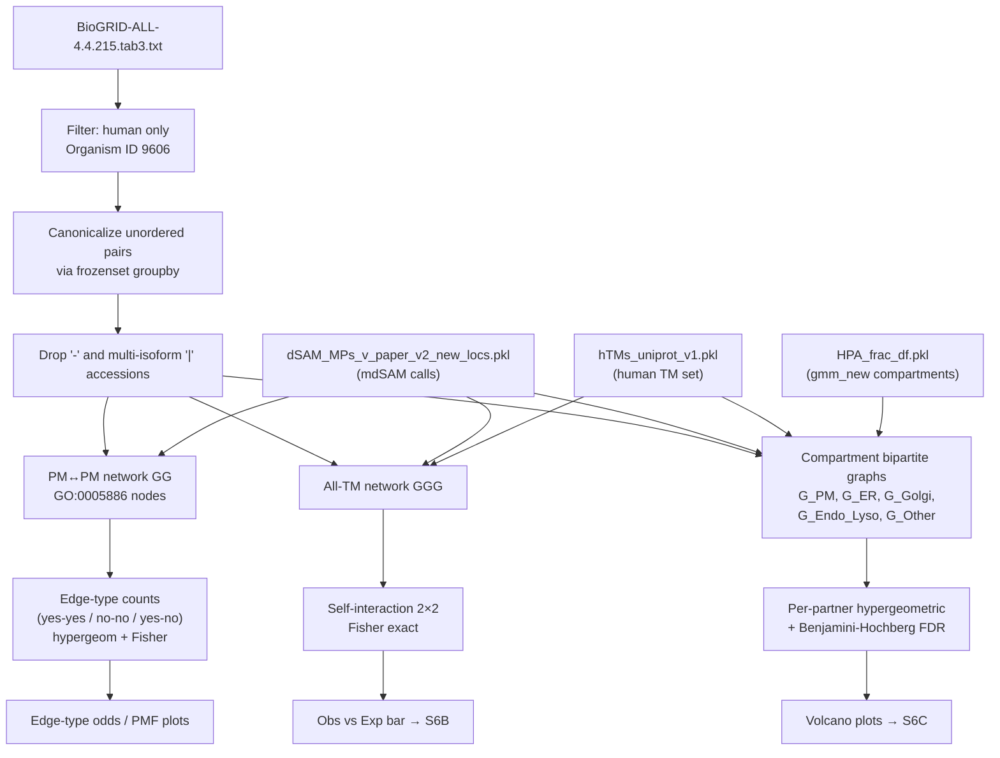

This page documents `notebooks/15_biogrid_interactions_by_mdsam.ipynb`, the interactomics integration notebook of the mdSAM repository. The notebook asks a single architectural question in three ways: **do membrane proteins that carry mdSAMs (membrane-disordered Self-Assembly Motifs) participate in protein–protein interactions in a way that distinguishes them from mdSAM-negative membrane proteins?** It answers this by analyzing the BioGRID physical interaction database through three complementary network constructions — compartment-stratified bipartite graphs, a plasma-membrane TM↔TM network, and a genome-wide TM network for self-interactions — each probed with hypergeometric and Fisher exact statistics. The paper-facing outputs are panels **S6B** (self-interaction enrichment) and **S6C** (plasma-membrane PPI partner enrichment) of Supplementary Figure S6. The notebook also contains substantial exploratory work that never reached the figures, which this page flags explicitly.

Sources: [README.md](README.md#L68), [README.md](README.md#L223-L228)

## Why the Interactome Is the Right Test Bed

The mdSAM hypothesis (see [mdSAM Concept and Discovery Rationale](4-mdsam-concept-and-discovery-rationale)) predicts that amyloid-like motifs in disordered regions drive **self-association and clustering** of membrane proteins. If true, two interactomic signatures should exist: (1) mdSAM-containing proteins should self-interact in curated databases more often than expected, and (2) the *soluble partners* of mdSAM-positive plasma-membrane proteins should be a biased population — for example, enriched in signaling regulators — compared to partners of mdSAM-negative proteins. The notebook operationalizes both predictions against BioGRID release **4.4.215** (tab3 format), intersected with the shared mdSAM and topology tables from `files/`.

Sources: [README.md](README.md#L68), [files/README.md](files/README.md#L7-L9)

## Pipeline Architecture

The notebook follows a strict funnel: one cleaned interaction table feeds three independently constructed networks, each with its own statistical machinery. Understanding this branching is essential before reading the cells, because all three branches share the same cleaned edge list.

Sources: [15_biogrid_interactions_by_mdsam.ipynb](notebooks/15_biogrid_interactions_by_mdsam.ipynb#L17-L64), [15_biogrid_interactions_by_mdsam.ipynb](notebooks/15_biogrid_interactions_by_mdsam.ipynb#L126-L176)

## Input Data and Preprocessing

The preprocessing cell (notebook cell 1) is the foundation everything else inherits, so its four cleaning steps deserve precise attention.

**Human-only filter and identifier hygiene.** The raw tab3 table is filtered to `Organism ID Interactor A == 9606`, SWISS-PROT accession columns are renamed to `acc1`/`acc2`, and rows where either side is `-` (no curated accession) are dropped. Because BioGRID stores directional records, the same physical pair can appear multiple times; the notebook groups rows by `frozenset` of the two accessions and keeps one representative per unordered pair while counting duplicates — a canonicalization that converts a directional database into an undirected graph edge list. Finally, accessions containing `|` (multiple isoforms collapsed into one field) are removed entirely to keep node identity unambiguous.

> [!TIP]
> The `groupby`-on-`frozenset` idiom at lines 43–50 is the load-bearing trick of the whole notebook: it deduplicates A→B and B→A records in one pass *and* preserves the interaction count in a `Duplicates` column, so downstream degree statistics operate on true physical interactions rather than database re-annotations.

Sources: [15_biogrid_interactions_by_mdsam.ipynb](notebooks/15_biogrid_interactions_by_mdsam.ipynb#L39-L55), [15_biogrid_interactions_by_mdsam.ipynb](notebooks/15_biogrid_interactions_by_mdsam.ipynb#L36-L37)

**Shared analysis tables.** The mdSAM calls come from `dSAM_MPs_v_paper_v2_new_locs.pkl`, the transmembrane reference set from `hTMs_uniprot_v1.pkl`, and the AlphaFold residue table from `AF2_with_ENSG.pkl`. From `hTMs` the notebook derives `sub_TMs` (all human TM proteins) and `non_TMs` (BioGRID accessions that are not TM proteins) — the two node classes that drive every graph construction. Note the naming convention: older notebooks, including this one, use the variable name `dSAMs` where the paper says *mdSAM*.

Sources: [files/README.md](files/README.md#L7-L9), [15_biogrid_interactions_by_mdsam.ipynb](notebooks/15_biogrid_interactions_by_mdsam.ipynb#L57-L63), [README.md](README.md#L21)

**Compartment labels.** Subcellular assignment reuses the hyperLOPIT Gaussian-mixture clustering from notebook 07: `HPA_frac_df.gmm_new` cluster 0 maps to plasma membrane (PM), 1 to ER, 2 to endosomes/lysosomes, 3 to Golgi, 4 to other. These five sets are materialized as Python sets and parameterize the compartment graphs.

Sources: [15_biogrid_interactions_by_mdsam.ipynb](notebooks/15_biogrid_interactions_by_mdsam.ipynb#L110-L116), [hyperLOPIT Organelle Enrichment](14-hyperlopit-organelle-enrichment)

## Three Interaction Networks from One Edge List

| Network | Variable(s) | Nodes | Edges retained | Statistical role |
|---|---|---|---|---|
| Compartment bipartite (×5) | `G_PM`, `G_ER`, `G_Golgi`, `G_Endo_Lyso`, `G_Other` | Compartment TM proteins + their soluble partners | Edges with **exactly one** endpoint in the compartment TM set | Per-partner enrichment of mdSAM+ TM neighbors |
| Plasma-membrane TM↔TM | `GG` | Plasma-membrane TMs (UniProt GO:0005886), labeled `mdSAM` yes/no | TM–TM interactions between *distinct* proteins | Edge-type assortativity (yes-yes / no-no / yes-no) |
| All-TM network | `GGG` | All human TM proteins | TM–TM interactions including self-loops | Self-interaction contingency (S6B) |

Sources: [15_biogrid_interactions_by_mdsam.ipynb](notebooks/15_biogrid_interactions_by_mdsam.ipynb#L126-L176), [15_biogrid_interactions_by_mdsam.ipynb](notebooks/15_biogrid_interactions_by_mdsam.ipynb#L1288-L1307)

**Compartment bipartite graphs.** `Graph_organelle()` is parameterized by one compartment set. It adds every node with an `mdSAM` yes/no attribute, then iterates the cleaned edge list and keeps an edge only when exactly one endpoint is a TM of the compartment — TM↔TM and soluble↔soluble pairs are both skipped, yielding a strictly bipartite graph. Hub control is applied by pruning nodes with degree ≤ `min_egde` (1) or ≥ `max_edge` (90), removing both singletons and extreme hubs that would dominate the hypergeometric denominators.

Sources: [15_biogrid_interactions_by_mdsam.ipynb](notebooks/15_biogrid_interactions_by_mdsam.ipynb#L126-L162), [15_biogrid_interactions_by_mdsam.ipynb](notebooks/15_biogrid_interactions_by_mdsam.ipynb#L172-L176)

**The PM↔PM and all-TM networks.** The plasma-membrane membrane-protein-only network `GG` is built later in the notebook from `PM_TMs` (GO:0005886 ∩ TM set), keeping only edges between distinct proteins (`acc1 != acc2`) and then removing degree-0 nodes. The all-TM network `GGG`, used for the self-interaction test, is the same construction generalized to every human TM protein. This three-graph design separates two confounded questions: *whom* mdSAM proteins talk to (bipartite analysis) versus *whether like talks to like* (TM↔TM analysis).

Sources: [15_biogrid_interactions_by_mdsam.ipynb](notebooks/15_biogrid_interactions_by_mdsam.ipynb#L1288-L1307)

## Statistical Machinery

Every test in the notebook answers the same primitive question with a different sampling frame, summarized below.

| Test | Scope | Null hypothesis | Implementation |
|---|---|---|---|
| Per-partner hypergeometric | each soluble node in a compartment graph | The node's TM partners are a random draw from the graph's TM population | `stats.hypergeom.cdf` with direction flip |
| Benjamini–Hochberg FDR | all partner rows per compartment | — | `rankdata`-based `fdr()` helper |
| GTPase-domain enrichment | IPR005225 members among enriched PM partners | Enriched set is random w.r.t. domain membership | `stats.hypergeom.cdf` |
| Endocytosis GO enrichment | GO:0006897 genes among enriched PM partners | Same | `stats.hypergeom.cdf` |
| Edge-type tests (yes-yes / no-no / yes-no) | `GG` | Edge labels independent of mdSAM status | `stats.hypergeom.sf` + `fisher_exact` |
| Self-interaction test | `GGG` | Self-interaction independent of mdSAM status | `scipy.stats.fisher_exact`, 2×2 |

Sources: [15_biogrid_interactions_by_mdsam.ipynb](notebooks/15_biogrid_interactions_by_mdsam.ipynb#L200-L211), [15_biogrid_interactions_by_mdsam.ipynb](notebooks/15_biogrid_interactions_by_mdsam.ipynb#L262-L269)

**The per-partner test** (`G_hypergeom`) frames each soluble protein as drawing `number_winners` (= its degree among TM nodes) proteins from a population of `total_runners` TM nodes of which `number_team_A` carry mdSAMs. The p-value is computed via `hypergeom.cdf` and flipped with `p = 1 - p` when the observed mdSAM-neighbor count exceeds expectation — the manual equivalent of a survival function, giving a one-sided enrichment p-value. `G2df()` then assembles a per-compartment results table with observed edges, expected edges, `obs_exp` (observed minus expected), fold change, −log₁₀ p, and the BH-FDR columns `fdr`/`log_fdr`, retaining only partners with at least one TM edge and a resolvable gene name.

> [!TIP]
> The `obs_exp` column is a *difference*, not a ratio — volcano x-axes in this notebook plot `deg(Obs) − deg(Exp)` in raw edge counts, with significance gates at |obs_exp| ≥ 8–10 combined with FDR < 0.25 (i.e. `log_fdr > 0.602`). Reading the x-axis as fold change is the most common misinterpretation of these plots.

Sources: [15_biogrid_interactions_by_mdsam.ipynb](notebooks/15_biogrid_interactions_by_mdsam.ipynb#L200-L212), [15_biogrid_interactions_by_mdsam.ipynb](notebooks/15_biogrid_interactions_by_mdsam.ipynb#L232-L252), [15_biogrid_interactions_by_mdsam.ipynb](notebooks/15_biogrid_interactions_by_mdsam.ipynb#L280-L286)

**Edge-type tests in the PM network.** For `GG`, the notebook tallies edges into three classes — mdSAM+↔mdSAM+ (`yes-yes`), mdSAM−↔mdSAM− (`no-no`), and mixed — with an assertion that counts sum to the total edge count. Each class is then tested two ways: a hypergeometric test against the count of possible same-type edges in the complete graph (`n_nodes·(n_nodes−1)` frame), and one-sided Fisher exact tests on 2×2 contingency tables. A binomial-test variant (`stats.binomtest`) exists in the notebook but is commented out; the active final implementation is hypergeometric + Fisher. Odds ratios for the three classes are visualized in `Membrane_graph_BioGrid_v6.svg`.

Sources: [15_biogrid_interactions_by_mdsam.ipynb](notebooks/15_biogrid_interactions_by_mdsam.ipynb#L1515-L1592), [15_biogrid_interactions_by_mdsam.ipynb](notebooks/15_biogrid_interactions_by_mdsam.ipynb#L1395-L1433), [15_biogrid_interactions_by_mdsam.ipynb](notebooks/15_biogrid_interactions_by_mdsam.ipynb#L1618-L1642)

## Paper Outputs: Panels S6B and S6C

**S6B — self-interaction enrichment.** The final consolidated contingency table hardcodes the interaction counts and tests them with a two-sided Fisher exact test:

| | Self-interactor | Not self-interactor | Row totals |
|---|---|---|---|
| mdSAM+ | 111 | 658 − 111 = 547 | 658 |
| mdSAM− | 348 | 2,642 − 348 = 2,294 | 2,642 |

The observed self-interaction proportions are 111/658 ≈ 16.9% versus 348/2,642 ≈ 13.2%. The companion figure cell renders observed versus *expected* self-interaction counts (from `scipy.stats.contingency.expected_freq`) as a paired bar plot with the expected bar hatched, saved as `self_association_BioGrid_v3.svg`. Per the repository's figure map, this panel is drawn at notebook cells 171–172 (0-based), with the mdSAM+ (n=658) and mdSAM− (n=2,642) node counts printed in the panel description. Exact p-values are not recoverable from the repository because notebook outputs are cleared by design.

Sources: [15_biogrid_interactions_by_mdsam.ipynb](notebooks/15_biogrid_interactions_by_mdsam.ipynb#L2975-L2984), [15_biogrid_interactions_by_mdsam.ipynb](notebooks/15_biogrid_interactions_by_mdsam.ipynb#L2837-L2904), [README.md](README.md#L223-L224)

**S6C — plasma-membrane partner enrichment.** The primary S6C visualization is a volcano plot over the `G_plot_PM` table: x = `obs_exp` (excess mdSAM+ partners), y = −log₁₀(p) or −log₁₀(FDR), points colored by total TM-edge count via a gray→blue→red colormap. Two annotated reference populations are overlaid: proteins carrying the InterPro **small GTP-binding domain (IPR005225)** as white-outlined circles, and **endocytosis genes (GO:0006897)** in amber — hence the `Rho_enrich_PM_*.svg` script names. The enrichment of each population among significant partners is quantified with dedicated hypergeometric tests (the GTPase-domain test runs against partners with `obs_exp > 0`; the endocytosis test against `obs_exp > 2` and `log_fdr > 0.6`). Panel cells 78, 81, 84, and 86 correspond to the successive plot iterations (`Rho_enrich_PM_v6.svg` through `v9.svg` and the mosaic layout in `v8`). The same volcano machinery is re-run for the PM↔TM network's membrane-protein nodes (`GG_plot`, highlighting UniProt keywords KW-0813 *Transport* and KW-0418 *tyrosine-protein kinase*) and analogously computed for ER, Golgi, endo-lysosomal, and "other" compartments, though those are not mapped to paper panels.

Sources: [15_biogrid_interactions_by_mdsam.ipynb](notebooks/15_biogrid_interactions_by_mdsam.ipynb#L415-L450), [15_biogrid_interactions_by_mdsam.ipynb](notebooks/15_biogrid_interactions_by_mdsam.ipynb#L358-L386), [15_biogrid_interactions_by_mdsam.ipynb](notebooks/15_biogrid_interactions_by_mdsam.ipynb#L1252-L1259), [15_biogrid_interactions_by_mdsam.ipynb](notebooks/15_biogrid_interactions_by_mdsam.ipynb#L2131-L2215), [README.md](README.md#L225-L228)

## Beyond the Panels: Exploratory Analyses

The README explicitly notes that this notebook "contains further interaction analyses that are not part of the paper figures." When reading or reusing the notebook, the following cells belong to that exploratory layer and should not be mistaken for figure sources:

- **Degree comparisons** — mdSAM+ vs mdSAM− node degree in `GG`/`G_PM_All`, tested with Welch's t-test and a two-sample Kolmogorov–Smirnov test, visualized as box+swarm and ECDF plots (`Dgree_Sol-MP.svg`).
- **Keyword sweep** — a loop running Fisher exact per UniProt keyword over the enriched/non-enriched partition of PM partners, producing an enrichment-vs-FDR scatter (mirroring the approach of [UniProt Keyword Enrichment](13-uniprot-keyword-enrichment)).
- **External endocytosis dataset** — loads a Nature supplementary Excel (4,609 scored genes, `41586_2010_BFnature08779`), maps gene IDs to accessions, and re-tests overlap among high-confidence partners.
- **InterPro domain scan** — reads locally cached InterPro JSON results to flag domain-bearing partners (the source of the `IPR005225` annotation set).
- **Per-node hypergeometric on `GGG`** (`GGG_hypergeom`) — an mdSAM-partner enrichment score for every TM protein in the all-TM network, tabulated in `GGG_plot`.

Sources: [README.md](README.md#L68), [15_biogrid_interactions_by_mdsam.ipynb](notebooks/15_biogrid_interactions_by_mdsam.ipynb#L1134-L1172), [15_biogrid_interactions_by_mdsam.ipynb](notebooks/15_biogrid_interactions_by_mdsam.ipynb#L700-L714), [15_biogrid_interactions_by_mdsam.ipynb](notebooks/15_biogrid_interactions_by_mdsam.ipynb#L1215-L1231)

## Practical Reproducibility Notes

Running this notebook requires more staging than the average notebook in the repository, for three verifiable reasons. First, several inputs are read from **hardcoded absolute macOS paths** that are not in the repository: the BioGRID tab3 download, two UniProt id-mapping TSVs (accession→gene names and keyword/GO annotations), a directory of cached InterPro JSON files, and the endocytosis supplementary Excel; only the three `files/` tables are repo-relative (`../files/...`). Second, `HPA_frac_df.pkl` — the hyperLOPIT compartment table consumed at line 37 — is an intermediate from notebook 07 and is likewise not distributed in `files/`, so reproducing the compartment graphs requires running [hyperLOPIT Organelle Enrichment](14-hyperlopit-organelle-enrichment) first. Third, as with all notebooks here, run from `notebooks/` as the working directory and observe the pickle-compatibility caution in `files/README.md`.

Sources: [15_biogrid_interactions_by_mdsam.ipynb](notebooks/15_biogrid_interactions_by_mdsam.ipynb#L36-L37), [15_biogrid_interactions_by_mdsam.ipynb](notebooks/15_biogrid_interactions_by_mdsam.ipynb#L61-L95), [README.md](README.md#L244-L248), [files/README.md](files/README.md#L13-L14)

## Where This Fits in the Catalog

Within the *Omics and Interactomics Integration* group, this page pairs with [RNA-seq Differential Expression and GSEA](22-rna-seq-differential-expression-and-gsea): both ask whether mdSAM-bearing proteins occupy systematically distinct molecular contexts, one in cis (transcriptional programs) and one in trans (interaction partners). The S6C finding that soluble signaling regulators — GTPase-domain and endocytosis proteins — are enriched partners of mdSAM+ plasma-membrane proteins connects directly to the cell-based clustering evidence in [Thioflavin-T and Amytracker Screens](16-thioflavin-t-and-amytracker-screens) and [TIRF Puncta Poisson GLM](17-tirf-puncta-poisson-glm), and to the HTR7 case study that validates the mechanism end-to-end in [HTR7 End-to-End Case Study](21-htr7-end-to-end-case-study). For the provenance of the underlying mdSAM calls and compartment assignments, consult [Shared Data Tables Reference](8-shared-data-tables-reference) and [hyperLOPIT Organelle Enrichment](14-hyperlopit-organelle-enrichment); for locating every figure cell mechanically, see [Figure-to-Notebook Reproducibility Map](9-figure-to-notebook-reproducibility-map), and for extracting reusable patterns from this notebook's statistics and plotting style, see [Reusing the Analysis Toolkit](27-reusing-the-analysis-toolkit).
