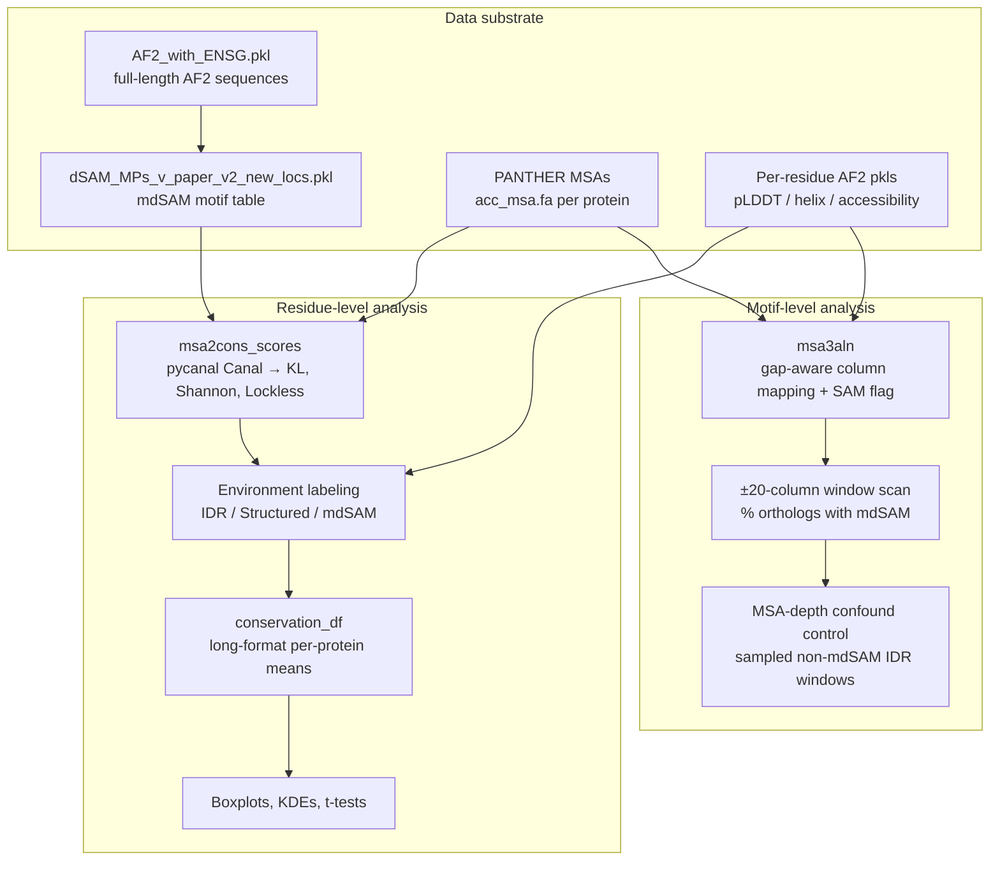
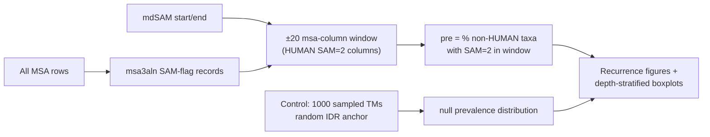

This page documents `notebooks/20_conservation_alignment_based.ipynb`, the residue- and motif-level evolutionary conservation module of the mdSAM pipeline. The notebook asks a single mechanistic question in two complementary ways: **are membrane-domain aggregation motifs (mdSAMs) evolutionarily conserved like functional elements, or like random disordered sequence?** It answers this at the *residue level* by scoring every position of PANTHER multiple sequence alignments (MSAs) with three independent conservation estimators, and at the *motif level* by measuring how often the dSAM state itself recurs in orthologous sequences across taxa. It is the classical-alignment counterpart to the protein-language-model approach in [ESM Embedding Conservation](25-esm-embedding-conservation).

## Architectural Overview: Two Scales, One MSA Substrate

The notebook is organized as two stacked analyses sharing a common substrate — per-protein PANTHER ortholog MSAs plus AlphaFold-derived residue annotations. Understanding this layering is the key to navigating the 1,600-line notebook, which mixes exploratory plotting with reusable primitives.

The residue-level branch produces the "Conservation" and "Divergence" figures; the motif-level branch produces the "across orthologs" recurrence figures. Both persist their outputs as pickles for downstream notebooks.

Sources: [20_conservation_alignment_based.ipynb](/notebooks/20_conservation_alignment_based.ipynb#L9-L19), [20_conservation_alignment_based.ipynb](/notebooks/20_conservation_alignment_based.ipynb#L36-L41), [20_conservation_alignment_based.ipynb](/notebooks/20_conservation_alignment_based.ipynb#L131-L160), [20_conservation_alignment_based.ipynb](/notebooks/20_conservation_alignment_based.ipynb#L891-L925)

## Data Substrate and Motif Coordinate Anchoring

The notebook loads four pickles: the mdSAM motif table `dSAM_MPs_v_paper_v2_new_locs.pkl` (from `files/`), the full-length `AF2_with_ENSG.pkl` human proteome sequences, the ortholog registry `hTM_ortologs.pkl`, and `hMP_AF_orthologdb.pkl`. Because the motif table stores motifs as bare peptide strings rather than genomic coordinates, the first computation anchors each motif to its parent sequence: for every dSAM row, `str.find` locates the motif inside the full-length AF2 amino acid sequence, writing `start` and `end` columns used by all downstream window logic. An MSA-depth census then counts orthologs per human accession, which later serves as the covariate for detecting depth-dependent bias.

Sources: [20_conservation_alignment_based.ipynb](/notebooks/20_conservation_alignment_based.ipynb#L36-L41), [20_conservation_alignment_based.ipynb](/notebooks/20_conservation_alignment_based.ipynb#L51-L55), [20_conservation_alignment_based.ipynb](/notebooks/20_conservation_alignment_based.ipynb#L66-L69)

## Residue-Environment Taxonomy: The Four-Way Comparison Frame

Before any conservation score is interpreted, the notebook partitions every residue of every protein into one of four structural environments derived from the AlphaFold residue-level pickles. This taxonomy is the experimental design: mdSAMs are compared against a *negative* disordered background and two *structured* baselines of varying solvent exposure, so that any conservation signal can be attributed to aggregation propensity rather than to order or burial per se. The labeling rules evaluated per residue in `msa2cons_scores` are:

| Environment tag | Criteria (per-residue AF2 pickle) | Role in comparison |
|---|---|---|
| `IDR` | `AF2_SS_helix_count == 0` **and** `AF2_pLDDT_max < 70` **and** accessibility `***********` (exposed) | Disordered negative control |
| `Structred_exposed` | `AF2_pLDDT_max > 70` **and** accessibility `***********` | Structured, solvent-exposed baseline |
| `Structred_burid` | `AF2_pLDDT_max > 70` **and** accessibility `...........` (buried) | Structured, buried ceiling baseline |
| `dSAM` | Position within a motif's `start`–`end` range from the anchored motif table | Class under test |

The environment classification reuses the same low-pLDDT/no-secondary-structure/exposed heuristics documented in [AlphaFold-Based Disorder Filtering](7-alphafold-based-disorder-filtering), so conservation results are directly comparable with the disorder-filtered motif set. After annotation, the per-residue frame is tagged with the parent accession and accumulated across all proteins into `concervation_msa.pkl`; two accessions (`Q6UXD1`, `A8MZ97`) are explicitly skipped because their PANTHER MSA files are absent.

Sources: [20_conservation_alignment_based.ipynb](/notebooks/20_conservation_alignment_based.ipynb#L131-L160), [20_conservation_alignment_based.ipynb](/notebooks/20_conservation_alignment_based.ipynb#L181-L198)

## Three Complementary Conservation Estimators via pycanal

The scoring engine is the `pycanal` library: `Canal(fastafile=<msa>, ref=0, startcount=1)` treats the first MSA row (the human reference) as the coordinate frame, and `canal.analysis(include=None, method='all')` returns per-column scores for every estimator the library supports. The notebook deliberately exploits **three orthogonal definitions of conservation**, which is the strongest methodological feature of this analysis — a conclusion that holds under all three metrics is robust to the known pitfalls of any single one:

| Metric (pycanal column) | Plotted as | What it captures | Caveat addressed |
|---|---|---|---|
| `relative` | KL divergence (`Divergence`) | Divergence of the observed column distribution from a background model | Sensitive to MSA composition |
| `shannon` | `1/H` (`\\\\frac{1}{H}`) | Inverse Shannon entropy — column purity | Ignores amino-acid similarity classes |
| `lockless` | `Conservation` | Statistical coupling / Lockless score | Computationally heavier, context-aware |

These are unified into a tidy long-format frame `conservation_df` with columns `acc`, `ele` (environment), `conservation` (mean per protein–environment cell) and `Conservation_type`, persisted as `conservation_df.pkl` for reuse. Per-protein means (rather than per-residue pooling) are the unit of statistical replication, avoiding pseudo-replication from correlated residues within a motif.

Sources: [20_conservation_alignment_based.ipynb](/notebooks/20_conservation_alignment_based.ipynb#L131-L160), [20_conservation_alignment_based.ipynb](/notebooks/20_conservation_alignment_based.ipynb#L364-L372), [20_conservation_alignment_based.ipynb](/notebooks/20_conservation_alignment_based.ipynb#L654-L656)

## Statistical Testing Strategy and Publication Figures

The inferential design pairs an initial *paired* test with follow-up *independent* tests. Because each protein contributes a mean value to all four environments, the first pass pivots the per-protein means into a protein × environment matrix and applies `stats.ttest_rel` between the IDR and dSAM columns — a within-protein comparison that cancels protein-specific MSA depth and phylogenetic breadth. Subsequent `stats.ttest_ind` calls compare KL-divergence means of IDR vs. dSAM, buried vs. dSAM, and Lockless IDR vs. dSAM across proteins. The final figure (`Divergence.svg`) renders three-environment notched boxplots (Disordered / mdSAM / Structured*) with p-values formatted as scientific-notation annotations via a small lead-digit/exponent extraction routine, and annotates the sample size `n=929` proteins.

Sources: [20_conservation_alignment_based.ipynb](/notebooks/20_conservation_alignment_based.ipynb#L261-L273), [20_conservation_alignment_based.ipynb](/notebooks/20_conservation_alignment_based.ipynb#L456-L464), [20_conservation_alignment_based.ipynb](/notebooks/20_conservation_alignment_based.ipynb#L581-L614)

> [!TIP]
> Environment tags `Structred_exposed` / `Structred_burid` contain typos (single "r", "burid"). These strings are load-bearing keys across joins, pivots, and plot `order` lists — if you refactor, rename them everywhere at once or every comparison silently degrades to empty selections.

## Gap-Aware Coordinate Remapping: `msa3aln`

Alignments introduce gaps, so ungapped motif coordinates cannot be compared across orthologs without remapping. The notebook first prototypes the idea with a regex: gaps in the reference are replaced by `.`, the query motif becomes a regex pattern, and `re.match` locates it against the gapped reference; an index array converts alignment columns to ungapped positions. The production function `msa3aln(acc, msa_seq)` generalizes this to *every* MSA row: it builds a column→ungapped-position map from gap positions, then emits one record per alignment column carrying `msa_pos` (column index), `original_pos` (ungapped position in that ortholog), and a discrete **SAM flag** marking which residues satisfy the mdSAM criteria *in that specific organism* — HUMAN rows require the full IDR signature plus `WT_Windows_above_thershold > 0`, while non-human rows use the lighter `pLDDT < 70` + window-threshold rule, reflecting the absence of the full human annotation stack for orthologs.

| Record field | HUMAN row | Non-HUMAN row |
|---|---|---|
| `SAM = 2` (mdSAM-state) | IDR criteria **and** `WT_Windows_above_thershold > 0` | `AF2_pLDDT_max < 70` **and** `WT_Windows_above_thershold > 0` |
| `SAM = 1` (baseline) | all other residues | all other residues |
| `msa_pos` | alignment column (gap-aware) | alignment column (gap-aware) |
| `original_pos` | ungapped index into `AF2_with_ENSG` sequence | ungapped index into ortholog sequence |

This SAM-flag matrix per protein is the substrate for the motif-level recurrence analysis: the human row tells you *where* the mdSAM is in alignment space, and the ortholog rows tell you *whether the same alignment window is also mdSAM-like*.

Sources: [20_conservation_alignment_based.ipynb](/notebooks/20_conservation_alignment_based.ipynb#L664-L697), [20_conservation_alignment_based.ipynb](/notebooks/20_conservation_alignment_based.ipynb#L891-L925)

## Motif-Level Recurrence: % Orthologs with mdSAM in the Alignment Window

The recurrence scan is direct: for each mdSAM of each protein, `msa3aln` records are concatenated across all MSA rows, a ±20-alignment-column window is centered on the human SAM=2 columns overlapping the motif, and `pre` is computed as the percentage of non-HUMAN taxa whose SAM=2 columns fall inside that window, alongside `number_of_tax` (MSA depth). The result — persisted as `number_of_tax_vs_pre.pkl` — is visualized as a histogram of `%Orthologs with dSAM` with an inset showing taxon counts, a joint scatter of prevalence vs. log MSA depth, and a motif-level boxplot binned by MSA depth. A crucial positive-control cell re-runs the identical window statistic on ~1,000 randomly sampled transmembrane proteins *without* mdSAMs, anchoring the window at a random disordered residue instead, so the mdSAM prevalence distribution can be interpreted against the null expectation for ordinary disordered sequence.

An additional derived quantity, `with_sam = pre × number_of_tax / 100`, converts prevalence into an absolute count of orthologs carrying the mdSAM state, and the diagnostic scatter against reference lines at `x`, `x/2`, `x/4`, and `x/10` exposes how recurrence decays with evolutionary distance.

Sources: [20_conservation_alignment_based.ipynb](/notebooks/20_conservation_alignment_based.ipynb#L941-L961), [20_conservation_alignment_based.ipynb](/notebooks/20_conservation_alignment_based.ipynb#L981-L1000), [20_conservation_alignment_based.ipynb](/notebooks/20_conservation_alignment_based.ipynb#L1167-L1220)

## MSA-Depth Confound and Sparse-Alignment Sanity Check

A recurring threat to alignment-based conservation claims is that deep MSAs are available only for well-studied, slowly evolving proteins — so apparent conservation could be a study-bias artifact. The notebook confronts this explicitly: the joint scatter and depth-binned boxplots stratify prevalence by `number_of_tax`, a custom colormap scatter colors each MSA-depth point by how many proteins share that depth (with a gray band flagging MSAs of fewer than 20 sequences), and a fraction computation quantifies how much of the motif cohort sits in the sparsest MSA-depth bins. If mdSAM recurrence were merely a depth artifact, it would co-vary with taxon count; the stratified views make that testable rather than assumed.

Sources: [20_conservation_alignment_based.ipynb](/notebooks/20_conservation_alignment_based.ipynb#L1042-L1063), [20_conservation_alignment_based.ipynb](/notebooks/20_conservation_alignment_based.ipynb#L1262-L1294)

## Phylogenetic Utilities: Identity Distance and Neighbor-Joining Trees

Two auxiliary functions extend the MSA handling toolkit. `para2dist` (evolved variant) computes a BioPython identity `DistanceCalculator` matrix over the MSA, extracts each sequence's distance to the first (reference) row, and filters orthologs by `tree_cutoff=0.7` — a simple phylogenetic pruning step restricting comparisons to near-reference orthologs. `para2dist_tree` returns both the filtered distance table and a **neighbor-joining tree** built with `DistanceTreeConstructor().nj(dm)`, which the notebook exports in Newick format (e.g., `tree-Q96RJ3.nwk`) for external tree viewers. These utilities are exercised interactively on test accessions (`P08138`, `Q96RJ3`) and are the natural building blocks if you need distance-restricted conservation estimates in your own reanalyses.

Sources: [20_conservation_alignment_based.ipynb](/notebooks/20_conservation_alignment_based.ipynb#L769-L803), [20_conservation_alignment_based.ipynb](/notebooks/20_conservation_alignment_based.ipynb#L812-L849), [20_conservation_alignment_based.ipynb](/notebooks/20_conservation_alignment_based.ipynb#L859-L872)

## Reproducibility Notes and Known Quirks

Repurposing this notebook requires awareness of several verifiable quirks. All heavy inputs live on an external volume (`/Volumes/aelazar/...`) — PANTHER MSA FASTAs, per-protein residue pickles, and the ortholog databases — and only the mdSAM table and AF2 sequences ship in `files/`, so a full re-run requires reconstructing that substrate first (see [Shared Data Tables Reference](8-shared-data-tables-reference)). In `msa2cons_scores`, the dSAM-annotation loop filters `dSAMs.acc=='Q9NQW8'` rather than the loop variable `acc`, so only that one protein receives correct `dSAM` environment tags on a fresh execution — the persisted `concervation_msa.pkl` in the authors' environment was produced from a corrected run. The output artifacts to look for when validating an execution are `concervation_msa.pkl`, `conservation_df.pkl`, `number_of_tax_vs_pre.pkl`, and the SVG figure exports (`Conservation_new_version*.svg`, `Divergence.svg`, `across_orthologs_v2*.svg`, `msa_v2.svg`).

Sources: [20_conservation_alignment_based.ipynb](/notebooks/20_conservation_alignment_based.ipynb#L131-L160), [20_conservation_alignment_based.ipynb](/notebooks/20_conservation_alignment_based.ipynb#L157), [20_conservation_alignment_based.ipynb](/notebooks/20_conservation_alignment_based.ipynb#L196-L198), [20_conservation_alignment_based.ipynb](/notebooks/20_conservation_alignment_based.ipynb#L1062-L1063)

> [!TIP]
> When porting `msa2cons_scores` to a batch setting, replace the hard-coded `Q9NQW8` filter with the loop's `acc` and pre-load per-residue pickles outside the MSA loop — the current implementation re-reads each protein's residue pickle once per call, which dominates runtime on large cohorts.

## Position in the Conservation Trilogy and Reading Path

This page is the first of three evolutionary-conservation analyses. Notebook 20 establishes the *alignment-based ground truth*: mdSAM residues show divergence/conservation profiles distinct from both disordered and structured backgrounds, and the mdSAM state itself recurs in orthologous alignment windows above the disordered-sequence null. The natural next steps are [ESM Embedding Conservation](25-esm-embedding-conservation), which asks whether a protein language model's representations encode the same signal without any MSA, and [Ortholog Peptides and Motif Overlaps](26-ortholog-peptides-and-motif-overlaps), which turns recurrence into experimentally testable orthologous peptide constructs. For the upstream definitions that feed every threshold on this page, see [mdSAM Concept and Discovery Rationale](4-mdsam-concept-and-discovery-rationale) and [AlphaFold-Based Disorder Filtering](7-alphafold-based-disorder-filtering); for turning these primitives into your own pipeline, see [Reusing the Analysis Toolkit](27-reusing-the-analysis-toolkit).