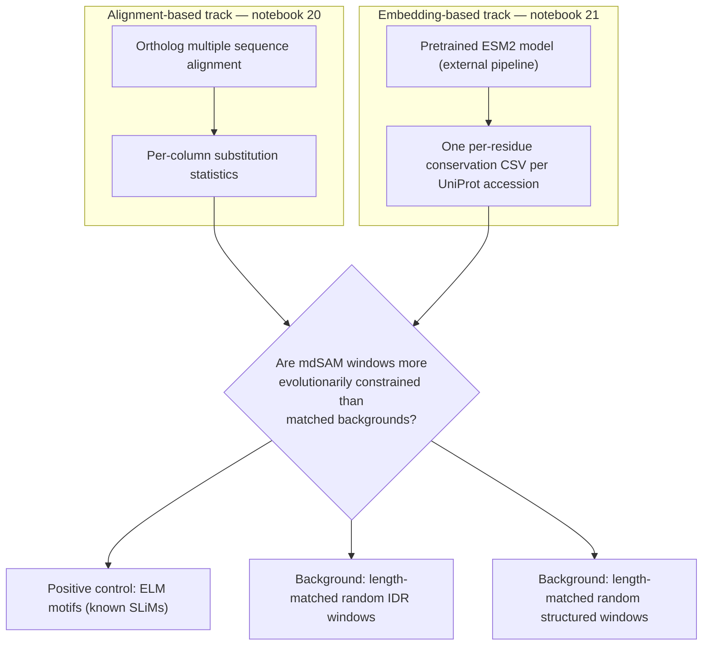
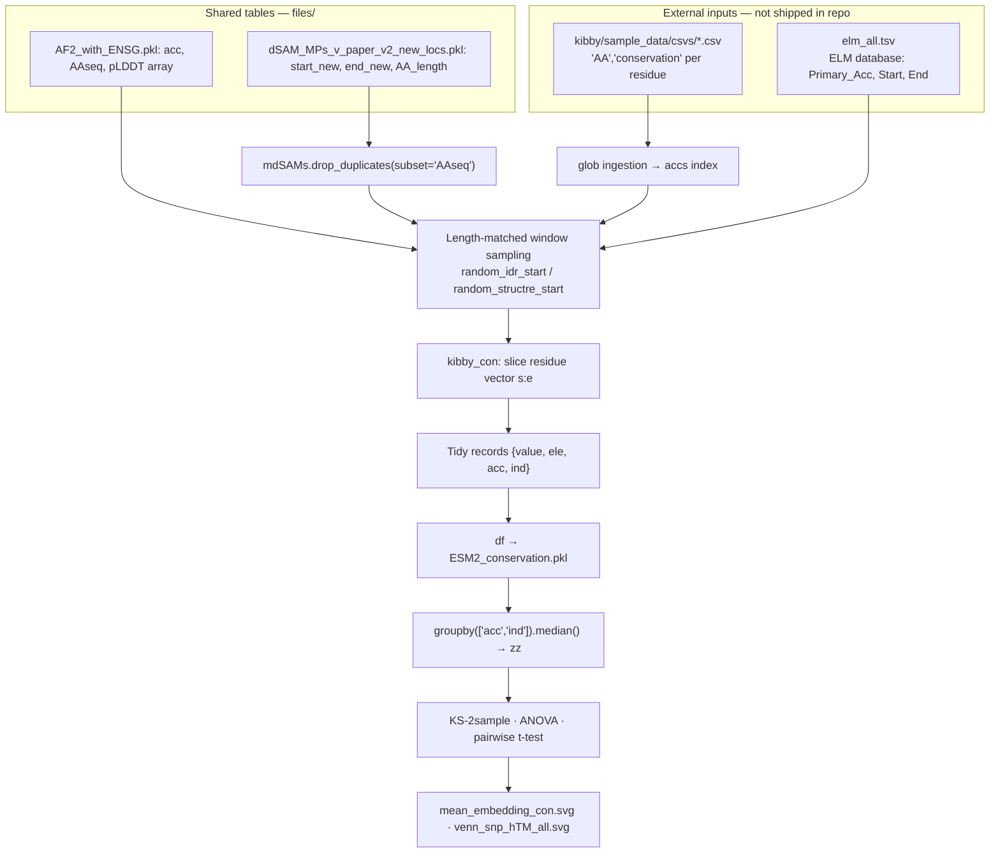

This page documents `21_conservation_esm_embedding.ipynb`, the embedding-based half of the repository's evolutionary-conservation analysis. The notebook asks whether mdSAM windows — self-assembly motifs predicted inside intrinsically disordered regions — carry an evolutionary signature detectable by a protein language model, rather than by classical alignment statistics. It does this by ingesting per-residue ESM2-derived conservation scores produced by an external pipeline, and benchmarking mdSAM windows against three controls: known short linear motifs from the ELM database, length-matched random windows inside IDRs, and length-matched random windows inside structured regions. All inference operates on precomputed score tables; no language-model inference happens inside this notebook.

Sources: [21_conservation_esm_embedding.ipynb](notebooks/21_conservation_esm_embedding.ipynb#L9-L28), [21_conservation_esm_embedding.ipynb](notebooks/21_conservation_esm_embedding.ipynb#L37-L38), [21_conservation_esm_embedding.ipynb](notebooks/21_conservation_esm_embedding.ipynb#L48-L61)

## Why an Embedding-Based Track

The conservation question is interrogated through two independent instruments in this repository. The alignment-based track ([Alignment-Based Conservation Metrics](24-alignment-based-conservation-metrics)) derives per-column statistics from ortholog multiple sequence alignments. Notebook 21 instead consumes per-residue conservation scores produced from ESM2 embeddings — the output pickle is explicitly named `ESM2_conservation.pkl`, and the notebook pins its methodological anchor to a Briefings in Bioinformatics article on embedding-based conservation (URL preserved as a comment in the second cell). The design logic: sequence-level alignment metrics can miss functional constraint that manifests as *semantic* conservation (different residues, similar encoded context), which embedding divergence is designed to capture. Running both tracks over the same mdSAM set makes the two instruments mutually corroborating rather than redundant.

Sources: [21_conservation_esm_embedding.ipynb](notebooks/21_conservation_esm_embedding.ipynb#L37-L38), [21_conservation_esm_embedding.ipynb](notebooks/21_conservation_esm_embedding.ipynb#L189-L210)

## Pipeline Architecture

The notebook is a linear extraction-and-test pipeline with one external ingestion boundary. Per-residue CSVs are discovered by globbing a local `kibby/sample_data/csvs/` directory — one file per UniProt accession, read as two unnamed columns (`AA`, `conservation`). Accessions are recovered from filenames, forming the `accs` index that gates every downstream comparison: a protein participates only if an embedding-conservation file exists for it.

The deduplication step matters for statistical hygiene: motif records are collapsed on unique `AAseq` before sampling, so repeated identical sequences cannot vote multiple times. The final tidy frame is pickled to the working directory, making the residue-level raw data the checkpoint artifact for re-analysis without re-ingestion.

Sources: [21_conservation_esm_embedding.ipynb](notebooks/21_conservation_esm_embedding.ipynb#L48-L61), [21_conservation_esm_embedding.ipynb](notebooks/21_conservation_esm_embedding.ipynb#L120-L121), [21_conservation_esm_embedding.ipynb](notebooks/21_conservation_esm_embedding.ipynb#L189-L210), [files/README.md](files/README.md#L7-L9)

## Data Dependencies and Contracts

| Artifact | Contract (columns consumed) | Role | Producer |
|---|---|---|---|
| `dSAM_MPs_v_paper_v2_new_locs.pkl` | `acc`, `AAseq`, `start_new`, `end_new`, `AA_length` | Case windows | mdSAM identification pipeline |
| `AF2_with_ENSG.pkl` | `acc`, `AAseq` (length validation), `pLDDT` (per-residue array) | Structural masks | `02_alphafold_residue_table_and_early_plots.ipynb` |
| `hTMs_uniprot_v1.pkl` | loaded, not referenced in retained cells | Vestigial in this notebook | `03_mdsam_sequence_logos.ipynb` |
| `elm_all.tsv` | `Primary_Acc`, `Start`, `End` | Positive controls | External ELM download (absolute local path) |
| `kibby/sample_data/csvs/*.csv` | `AA`, `conservation` per residue | Scoring source | External embedding-conservation pipeline |
| `conservation_df.pkl` | `Conservation_type`, `ele`, `conservation` | Secondary KL track | Upstream precomputation (not in `files/`) |

Note that `AF2_with_ENSG.pkl` is documented in `files/README.md` as read by notebook 21, but the current `files/` tree ships only the mdSAM and hTMs pickles — reproducing this notebook requires regenerating the AlphaFold table via notebook 02.

Sources: [21_conservation_esm_embedding.ipynb](notebooks/21_conservation_esm_embedding.ipynb#L23-L26), [files/README.md](files/README.md#L7-L13)

## The Structural Null Model

The core methodological move is **context-matched, length-matched background sampling**. A helper `ranges()` compresses a sorted index list into contiguous `[start, end]` intervals, and two samplers draw a random start inside a region only if the region is long enough: `random_idr_start` scans intervals where `pLDDT < 70` (the repository-wide disorder proxy, defined by the AlphaFold filtering convention in [AlphaFold-Based Disorder Filtering](7-alphafold-based-disorder-filtering)), while `random_structre_start` scans `pLDDT >= 70` intervals. Both enforce a `motif_length + 2` minimum region length, and `randrange(r[0], r[1]-motif_length)` leaves a two-residue margin so the window fits strictly inside the region.

> [!TIP]
> Every `randrange` call is unseeded — the background sets are non-deterministic across runs. Any figure-level reproduction must either fix a seed before the main loop or persist `ESM2_conservation.pkl` and work from the checkpoint downstream.

The loop over mdSAMs draws three windows per motif — the real mdSAM window, a random IDR window, and a random structured window — all of identical length `AA_length`. The structured draw is explicitly guarded with `if ss_r is not None`, because proteins can lack any structured interval long enough for the motif; the IDR draw is used unguarded, which is safe in practice only because mdSAM-containing proteins are, by construction, IDR-bearing. A second loop walks ELM entries whose `Primary_Acc` appears in `accs`, extracting each annotated motif window, guarded by a check that the AF2 row's `pLDDT` entry is not the `'A'` placeholder used for proteins lacking predicted structures.

Sources: [21_conservation_esm_embedding.ipynb](notebooks/21_conservation_esm_embedding.ipynb#L71-L88), [21_conservation_esm_embedding.ipynb](notebooks/21_conservation_esm_embedding.ipynb#L136-L168)

## The Four Window Classes

| `ele` tag | Window origin | Coordinates as coded | Inferential role |
|---|---|---|---|
| `mdSAM` | mdSAM table | `start_new - 1` (1-based → 0-based) through window of `AA_length` | Case |
| `random` | `random_idr_start` | Length-matched, random position in `pLDDT < 70` intervals | IDR background |
| `random_struct` | `random_structre_start` | Length-matched, random position in `pLDDT ≥ 70` intervals | Structured background |
| `ELM` | ELM database | `Start` through `Start + (End - Start) + 1` (exclusive end) — *no* −1 offset applied, unlike the mdSAM branch | Positive control (known functional motifs) |

Two asymmetries deserve attention when reproducing. First, mdSAM start coordinates are decremented to 0-based indexing while ELM `Start` values are consumed as-is; if ELM annotations are 1-based inclusive (their standard convention), ELM windows sit one residue left of their annotated span — verify against your ELM release before extending. Second, the variable `strcutre` passed as the mask for the structured class is built with the `pLDDT < 70` filter (line 147), not `>= 70`; as shown below, this parameter is currently inert, but it becomes load-bearing the moment background normalization is re-enabled.

Sources: [21_conservation_esm_embedding.ipynb](notebooks/21_conservation_esm_embedding.ipynb#L136-L168)

## Scoring and Aggregation Mechanics

`kibby_con(acc, s, e, idrs)` is the single scoring gateway. It reads the per-accession CSV, validates that the CSV row count equals the AlphaFold `AAseq` length (returning `[]` on mismatch — a silent length-based exclusion), slices rows `s:e`, and returns the raw per-residue conservation values. The function also computes a same-amino-acid IDR background mean for normalization, but the division is commented out and the `idrs` argument is a bare no-op expression inside the function body: **scores are consumed raw**.

> [!TIP]
> The commented normalization (`WT_con / background`) is the notebook's one acknowledged extension point. If you re-enable it, first fix the mask bug at line 147 (`strcutre` must use `>= 70`), otherwise structured-class scores would be normalized against the IDR background — a subtle inversion of the null model.

Aggregation is deliberately two-tiered to defeat residue-level pseudoreplication. The tidy frame `df` holds one row per residue, then `groupby(['acc','ind']).median()` collapses each window to its median, producing motif-level distributions (`zz`) for `random`, `mdSAM`, `ELM`, and `strctre`. All primary statistics in the notebook operate on these motif medians, not raw residues — the correct unit of independence, since residues within a motif share a protein and a window.

Sources: [21_conservation_esm_embedding.ipynb](notebooks/21_conservation_esm_embedding.ipynb#L97-L110), [21_conservation_esm_embedding.ipynb](notebooks/21_conservation_esm_embedding.ipynb#L234-L256)

## Statistical Framework

| Test | Function | Comparisons | Analysis unit | Output anchor |
|---|---|---|---|---|
| Kolmogorov–Smirnov 2-sample | `stats.ks_2samp(...)[-1]` | random vs mdSAM; ELM vs mdSAM; ELM vs random | Motif medians | p-value annotations on main figure, `mean_embedding_con.svg` |
| One-way ANOVA | `scipy.stats.f_oneway` | ELM, mdSAM, random, strctre (4 groups) | Motif medians | `F, p` printout |
| Pairwise Welch t-tests | `scipy.stats.ttest_ind` | All 6 pairs of the 4 classes | Motif medians | Console table |
| Pairwise t-tests + Bonferroni alpha | `scipy.stats.ttest_ind` | IDR, Structred_burid, Structred_exposed, dSAM | Residue values (KL table) | Console table |
| Tukey HSD | `scipy.stats.tukey_hsd` | Same 4 KL-track groups | Residue values | Full HSD result printout |

Two precision notes on the primary figure cell. The box order is `['random','mdSAM','strctre','ELM']` but the tick labels are `['$IDR_{random}$','$mdSAM$','$ELM$','$Structured$']` — as written, the third positional label `$ELM$` lands on the `random_struct` boxes and `$Structured$` lands on the `ELM` boxes. The palette (`teal, red, amber, gray`) follows the box order, so color-to-class mapping is unambiguous even where the strings are not; reconcile this mapping if you regenerate the SVG. Second, the pairwise t-test cell computes a Bonferroni-corrected alpha (`0.05 / C(4,2)`) but prints raw unadjusted p-values; apply the correction yourself when consuming that output. A complementary ECDF plot over raw residue values and an unguarded-ylim box plot provide distribution-shape checks beyond the median summaries.

Sources: [21_conservation_esm_embedding.ipynb](notebooks/21_conservation_esm_embedding.ipynb#L267-L302), [21_conservation_esm_embedding.ipynb](notebooks/21_conservation_esm_embedding.ipynb#L314-L326), [21_conservation_esm_embedding.ipynb](notebooks/21_conservation_esm_embedding.ipynb#L338-L348), [21_conservation_esm_embedding.ipynb](notebooks/21_conservation_esm_embedding.ipynb#L427-L453)

## Secondary Track: KL-Divergence Conservation

The final block pivots to a different precomputed artifact, `conservation_df.pkl`, filtered to `Conservation_type == 'Kullback-Leibler'`. Here the comparison classes are residue-level environment categories rather than motif classes: `IDR`, `Structred_burid` (structured, buried), `Structred_exposed` (structured, solvent-exposed), and `dSAM` residues. This reframes the question from *are mdSAM windows constrained* to *is the burial-specific conservation gradient consistent with dSAM residues behaving like functional surface sites*. The track applies pairwise t-tests with a computed Bonferroni alpha and `scipy.stats.tukey_hsd` across the four groups, the latter requiring a SciPy release that provides `tukey_hsd`. Unlike the primary track, no sampling happens here — the table arrives fully classified, so this block is pure inference over upstream output.

Sources: [21_conservation_esm_embedding.ipynb](notebooks/21_conservation_esm_embedding.ipynb#L481-L494), [21_conservation_esm_embedding.ipynb](notebooks/21_conservation_esm_embedding.ipynb#L509-L530), [21_conservation_esm_embedding.ipynb](notebooks/21_conservation_esm_embedding.ipynb#L540-L574)

## Reproducibility Notes

Repointing this notebook requires three path edits: the absolute ELM path (`/Users/aelazar/notebooks_for_paper/elm/elm_all.tsv`), the absolute Kibby CSV glob, and regeneration of `AF2_with_ENSG.pkl` via notebook 02 since it is absent from the shipped `files/` tree. Both shared pickles carry the repository's standard pickle-safety caveat: load only from this repository with a compatible pandas version. The retained cells carry more imports than they use (`TSNE`, `cmasher`, `fisher_exact`, `expected_freq` are unreferenced), so a minimal dependency set is: pandas, numpy, scipy, seaborn, matplotlib, tqdm. Note also that `hTMs_uniprot_v1.pkl` is loaded but never queried — the filename `venn_snp_hTM_all.svg` on the raw-residue figure is inherited naming, not evidence of a transmembrane filter in this analysis.

Sources: [21_conservation_esm_embedding.ipynb](notebooks/21_conservation_esm_embedding.ipynb#L9-L28), [21_conservation_esm_embedding.ipynb](notebooks/21_conservation_esm_embedding.ipynb#L348-L348), [files/README.md](files/README.md#L13-L14)

## Related Pages

The embedding track presupposes the AlphaFold disorder convention — start with [AlphaFold-Based Disorder Filtering](7-alphafold-based-disorder-filtering) for the pLDDT threshold rationale, and [Shared Data Tables Reference](8-shared-data-tables-reference) for the table schemas consumed here. Compare the orthogonal methodology in [Alignment-Based Conservation Metrics](24-alignment-based-conservation-metrics), then continue to [Ortholog Peptides and Motif Overlaps](26-ortholog-peptides-and-motif-overlaps), which moves from conservation scores to experimentally screened ortholog-derived peptides.