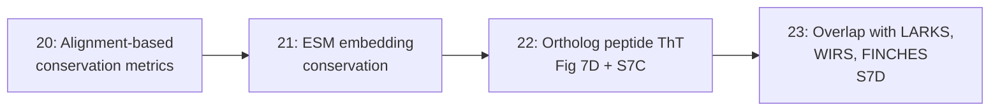
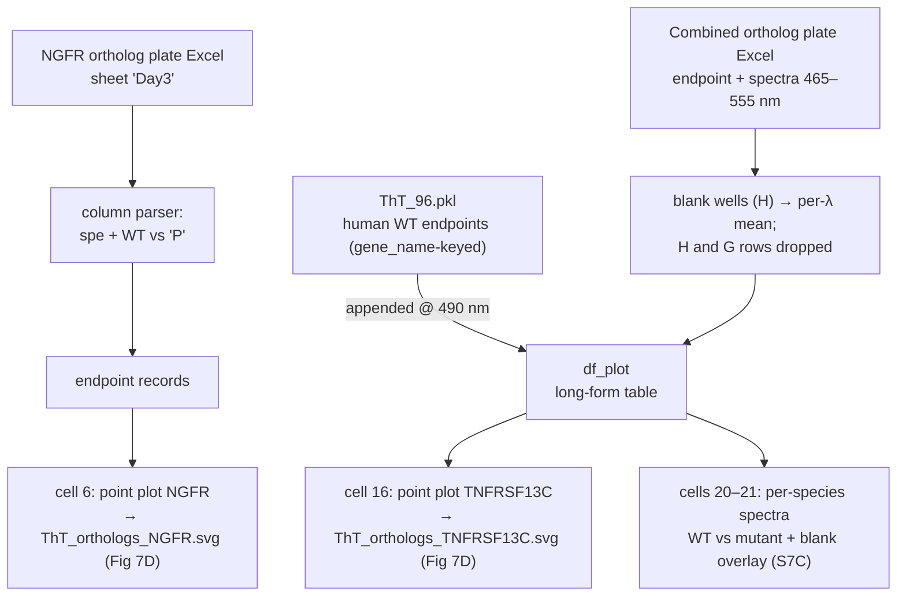
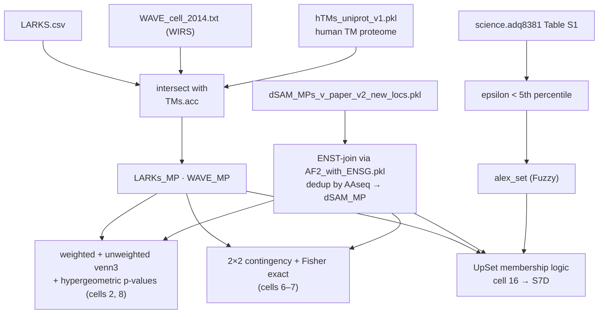

This page documents the final two notebooks of the Evolution branch — `22_ortholog_peptide_tht.ipynb` and `23_overlap_with_larks_wirs_finches.ipynb` — which close the loop on mdSAM conservation from two complementary directions. Notebook 22 asks an *experimental* question: if mdSAMs are evolutionarily constrained, do the orthologous motifs from other vertebrate species still self-assemble, and does a proline mutant abolish that signal? Notebook 23 asks a *comparative* question: how does the mdSAM-containing protein set overlap with three independent motif-family catalogs (LARKS, WIRS, FINCHES-predicted fuzzy interactions) once everything is projected onto the human transmembrane proteome? Together they produce Figure 7D, Supplementary Figure S7C, and Supplementary Figure S7D of the manuscript.

Sources: [README.md](README.md#L79-L86), [README.md](README.md#L172-L173), [README.md](README.md#L238-L240)

## Position in the Pipeline

Both notebooks sit at the end of the Evolution (Fig 7 / S7) section, consuming the outputs of the computational conservation analyses. Notebooks 20 and 21 establish that mdSAMs are conserved *computationally* (alignment-based metrics and ESM embeddings). Notebook 22 converts conservation into a *functional* claim by synthesizing ortholog peptides and measuring Thioflavin-T (ThT) amyloid reactivity; notebook 23 then maps the mdSAM family onto the broader landscape of known/prone-to-assembly motif families to establish that it is related to — but distinct from — LARKS, WIRS, and FINCHES fuzzy interactions.

The mapping from figures to notebook cells is explicit: Fig 7D comes from cells 6 and 16 of notebook 22; S7C from cells 20–21 of the same notebook; S7D from cell 16 of notebook 23 (cell indices are 0-based, matching `FIGURE_MAP.csv` conventions used throughout the repository).

Sources: [README.md](README.md#L79-L86), [README.md](README.md#L165-L173), [README.md](README.md#L230-L240)

## Notebook 22 — Thioflavin-T of Ortholog Peptides

**Design rationale.** The mdSAMs of two human proteins — **NGFR** and **TNFRSF13C** — were traced to orthologous sequence windows in other vertebrates. Each ortholog peptide was synthesized twice: as the wild-type ortholog sequence and as a proline mutant (`_MUT`), the same β-strand-breaking negative-control design used across all peptide ThT screens in this repository. If an mdSAM is functionally conserved, ortholog WT peptides should retain amyloid-like ThT signal while their proline mutants collapse toward blank. The notebook is entirely plot-centric: it ingests raw plate-reader workbooks, normalizes against blanks, melts spectra into long form, and renders the point plots and spectra that became Fig 7D and S7C.

Sources: [22_ortholog_peptide_tht.ipynb](notebooks/22_ortholog_peptide_tht.ipynb#L51-L74), [22_ortholog_peptide_tht.ipynb](notebooks/22_ortholog_peptide_tht.ipynb#L113-L131), [README.md](README.md#L58-L60)

### Assay Design and Plate Layout

Two physical plates underlie the analysis. The first workbook (`2025_05_03_NGFR_Orthologs.xlsx`, sheet `Day3`) holds the NGFR ortholog endpoint plate. The second workbook (`20250512_Ortholog_ThT_2.xlsx`, sheet `Table End point`, read with `header=10`) holds a combined NGFR + TNFRSF13C plate with full emission spectra. The plate map is constructed programmatically in cell 7 from an ordered name list: wells 01–12 alternate WT and mutant for six peptide pairs, and the `ele` column is derived purely from list parity (even index → `WT`, odd → `mut`).

| Protein | Ortholog species (UniProt code → common name) | Mutant control |
|---|---|---|
| NGFR | CHICK (chicken), LEPOC (spotted gar), BOVIN (cattle) | Proline mutant per species |
| TNFRSF13C | CHICK (chicken), FELCA (domestic cat), MACMU (rhesus macaque) | Proline mutant per species |
| Human reference | Both proteins | WT endpoints from the 96-well screen table |

Sources: [22_ortholog_peptide_tht.ipynb](notebooks/22_ortholog_peptide_tht.ipynb#L51-L56), [22_ortholog_peptide_tht.ipynb](notebooks/22_ortholog_peptide_tht.ipynb#L113-L131)

### Data Flow and Figure Cells

**Blank normalization is asymmetric between the two plates.** The NGFR endpoint plate uses a single hardcoded blank constant (`blank = 9848.166667`) drawn as a dashed reference line, while the combined spectra plate computes a per-wavelength blank by averaging all rows whose well ID contains `H` (H-column wells), then drops both the `H` and `G` rows from the data. The combined plate is melted into a long-form table with one row per (well, wavelength) across 465–555 nm in 5-nm steps, then annotated with `human_ortholog`, `spe`, and `ele` columns via a well→name dictionary. Crucially, the human WT reference points are not on the ortholog plate at all — they are appended from `ThT_96.pkl` (the human peptide ThT table keyed by `gene_name`, an intermediate of the 96-well screen workflow that is not distributed in the repository) at the 490 nm endpoint.

The final figure cells follow this structure: the NGFR Fig 7D panel (cell 6, re-rendered at cell 17 with BOVIN excluded and the species order fixed to CHICK/LEPOC/human) is a point plot of WT vs mutant per species on a log y-axis; the TNFRSF13C Fig 7D panel (cell 16) is the equivalent for CHICK/FELCA/human with a hardcoded blank reference at 166.5; and the S7C spectra panels (cells 20–21) overlay each species' WT-vs-mutant emission band against the grey blank curve.

Sources: [22_ortholog_peptide_tht.ipynb](notebooks/22_ortholog_peptide_tht.ipynb#L33-L35), [22_ortholog_peptide_tht.ipynb](notebooks/22_ortholog_peptide_tht.ipynb#L151-L170), [22_ortholog_peptide_tht.ipynb](notebooks/22_ortholog_peptide_tht.ipynb#L251-L257), [22_ortholog_peptide_tht.ipynb](notebooks/22_ortholog_peptide_tht.ipynb#L305-L330), [README.md](README.md#L172-L173), [README.md](README.md#L238-L239)

## Notebook 23 — Overlap with LARKS, WIRS and FINCHES

**Core question.** Is the mdSAM family the same phenomenon as previously characterized assembly-prone motif families, or does it occupy distinct sequence space? The notebook answers this with set algebra: three external motif catalogs, each intersected with the human transmembrane proteome (`hTMs_uniprot_v1.pkl`), are compared against `dSAM_MP` — the set of mdSAM-containing transmembrane proteins. Note the naming convention: `dSAM` in file and variable names is the legacy term for mdSAM (the structured-region counterpart being mSAM/sSAM).

Sources: [23_overlap_with_larks_wirs_finches.ipynb](notebooks/23_overlap_with_larks_wirs_finches.ipynb#L39-L52), [README.md](README.md#L21), [README.md](README.md#L86)

### Building the Four Sets

All set definitions are computed in one dense cell (cell 2) plus one for the fourth family. **LARKs_MP** and **WAVE_MP** are direct intersections of UniProt accessions: `TMs.acc ∩ LARKS.csv['UniProt ID']` and `TMs.acc ∩ WAVE_cell_2014.txt['Uniprot ID']` (the WIRS catalog, despite the WAVE filename). **dSAM_MP** is assembled through the AlphaFold bridge: the mdSAM table is deduplicated by `AAseq`, filtered to rows whose `ENST` appears in `AF2_with_ENSG.pkl` entries whose accession is a transmembrane protein, and reduced to the unique `acc` set. The fourth family, **Fuzzy** (`alex_set`), comes from the FINCHES supplement (`science.adq8381_table_s1.xlsx`): UniProt IDs in the transmembrane set whose ` epsilon` score falls below the 5th percentile of the distribution — i.e., the strongest fuzzy-interaction predictions.

| Set | Source file (as read by the notebook) | Selection rule | Variable |
|---|---|---|---|
| LARKs | `LARKS.csv` (tab-delimited despite extension) | Any catalog hit that is a human TM protein | `LARKs_MP` |
| WIRS | `WAVE_cell_2014.txt` (tab-delimited) | Any catalog hit that is a human TM protein | `WAVE_MP` |
| mdSAMs | `dSAM_MPs_v_paper_v2_new_locs.pkl` + `AF2_with_ENSG.pkl` | Proteins with ≥1 mdSAM, ENST-joined to the TM set, dedup by `AAseq` | `dSAM_MP` |
| Fuzzy | `science.adq8381_table_s1.xlsx` | TM proteins with `epsilon` < 5th percentile | `alex_set` |

Sources: [23_overlap_with_larks_wirs_finches.ipynb](notebooks/23_overlap_with_larks_wirs_finches.ipynb#L39-L52), [23_overlap_with_larks_wirs_finches.ipynb](notebooks/23_overlap_with_larks_wirs_finches.ipynb#L87-L97), [23_overlap_with_larks_wirs_finches.ipynb](notebooks/23_overlap_with_larks_wirs_finches.ipynb#L204-L207), [files/README.md](files/README.md#L5-L9)

### Statistics: Hypergeometric and Fisher Exact

Two layers of statistical support are computed. First, **hypergeometric tail probabilities** (cell 2) test whether the observed mdSAM overlaps exceed chance given the size of the transmembrane proteome: the WIRS overlap (35 proteins) yields p = 8×10⁻⁷ and the LARKS overlap (22 proteins) yields p = 1×10⁻⁵, both printed and annotated as text on the Venn figures. Second, **Fisher exact tests** (cells 6–7) build explicit 2×2 contingency tables (overlap / one-sided-only / neither) and compare observed cell counts against `expected_freq`, reporting enrichment and a two-sided p-value per family. Both weighted (`venn3`) and unweighted (`venn3_unweighted`) Venn renderings are produced, the latter normalizing circle sizes for legibility.

Sources: [23_overlap_with_larks_wirs_finches.ipynb](notebooks/23_overlap_with_larks_wirs_finches.ipynb#L53-L76), [23_overlap_with_larks_wirs_finches.ipynb](notebooks/23_overlap_with_larks_wirs_finches.ipynb#L125-L164), [23_overlap_with_larks_wirs_finches.ipynb](notebooks/23_overlap_with_larks_wirs_finches.ipynb#L173-L195)

### The UpSet Rendering (S7D)

Because a four-set comparison cannot be drawn honestly as a Venn diagram, the final figure switches to **UpSet**. Cell 14 prototypes the plot with the region counts baked in as membership data — [WIRS]=41, [LARKs]=22, [mdSAMs]=887, [LARKs,WIRS]=0, [mdSAMs,WIRS]=35, [mdSAMs,LARKs]=22, [mdSAMs,LARKs,WIRS]=1 — which tells you the headline numbers at a glance: the mdSAM-only region dominates (~887 TM proteins), while the overlaps with WIRS and LARKS are significant but thin slices. Cell 16 (the README-designated S7D source) then derives all non-empty regions *programmatically* for all four sets via a `combinations` walk: each region is computed as `intersection(included) − union(excluded)`, guaranteeing disjoint, summing-correct bars, and renders `upsetplot_setlogic.svg`.

Sources: [23_overlap_with_larks_wirs_finches.ipynb](notebooks/23_overlap_with_larks_wirs_finches.ipynb#L253-L271), [23_overlap_with_larks_wirs_finches.ipynb](notebooks/23_overlap_with_larks_wirs_finches.ipynb#L290-L326), [README.md](README.md#L240)

## Reproducibility Caveats

Like several late-stage notebooks in this repository, notebooks 22 and 23 were written as interactive session transcripts and retain **absolute local paths** (OneDrive and `~/Downloads`) for the plate-reader workbooks, the UniProt GO idmapping table, and the FINCHES supplement. The three shared pickle tables required by notebook 23 ship in `files/` and must be referenced as `../files/...` with `notebooks/` as the working directory; notebook 22 additionally depends on the undistributed `ThT_96.pkl` intermediate. Notebooks ship with outputs cleared, so all plots must be regenerated by execution.

> [!TIP]
> Blank handling in notebook 22 is deliberately asymmetric: the NGFR endpoint plate subtracts one hardcoded constant (9848.166667), while the combined spectra plate averages H-column wells per wavelength. Reproduce both rules exactly, or the Fig 7D/S7C baselines will not match.

> [!TIP]
> In notebook 23 cell 3, the variable `PM` is assigned `set(hTMs.acc)` — the GO:0005886 (plasma membrane) intersection is computed into `PM_TMs` but then commented out on the assignment line. As the code stands, the Fisher-exact cells 6–7 therefore test overlap across the *full* transmembrane proteome, not strictly PM-annotated proteins.

Sources: [22_ortholog_peptide_tht.ipynb](notebooks/22_ortholog_peptide_tht.ipynb#L52-L56), [23_overlap_with_larks_wirs_finches.ipynb](notebooks/23_overlap_with_larks_wirs_finches.ipynb#L87-L97), [23_overlap_with_larks_wirs_finches.ipynb](notebooks/23_overlap_with_larks_wirs_finches.ipynb#L205-L207), [README.md](README.md#L244-L248), [files/README.md](files/README.md#L3-L13)

## Reading Progression

This page is the practical payoff of the Evolution section. Read it after the two computational conservation notebooks — [Alignment-Based Conservation Metrics](24-alignment-based-conservation-metrics) and [ESM Embedding Conservation](25-esm-embedding-conservation) — which motivate why the ortholog peptides in notebook 22 were chosen at all. The ThT assay methodology and the proline-mutant control design are introduced in [Thioflavin-T and Amytracker Screens](16-thioflavin-t-and-amytracker-screens); the shared pickle tables that notebook 23 consumes are documented in [Shared Data Tables Reference](8-shared-data-tables-reference). For the complete panel-to-cell mapping of Fig 7D/S7C/S7D, consult the [Figure-to-Notebook Reproducibility Map](9-figure-to-notebook-reproducibility-map), and to adapt this overlap-statistics pattern (hypergeometric + Fisher exact + UpSet) to your own set comparisons, continue to [Reusing the Analysis Toolkit](27-reusing-the-analysis-toolkit).