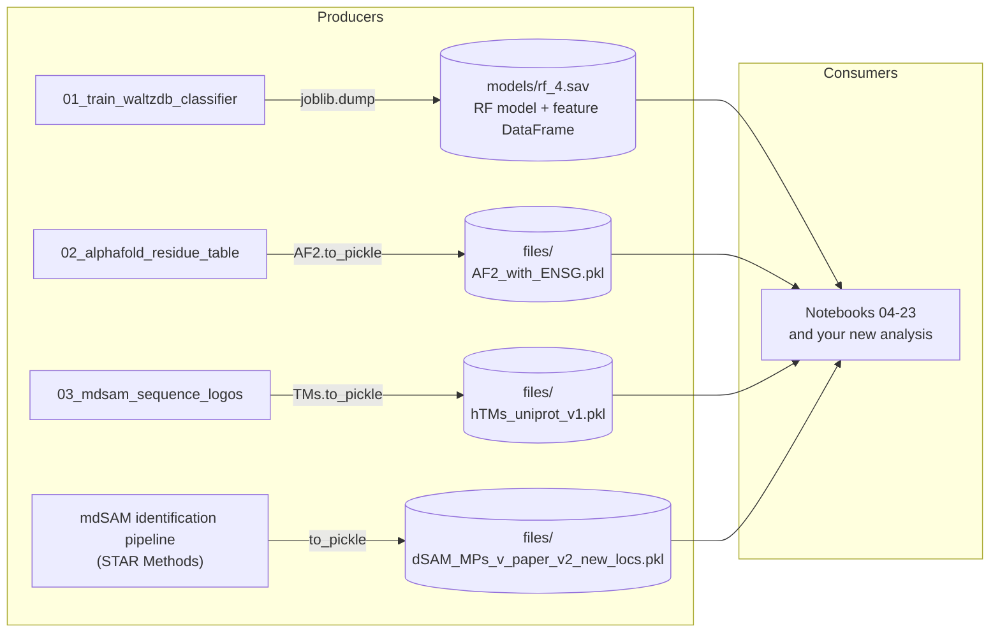
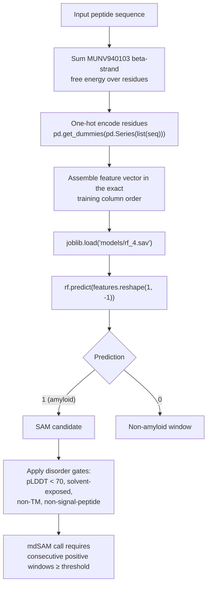

This page explains how to lift the mdSAM analysis machinery out of this notebook-only repository and apply it to new questions. There is no installable Python package here — the "toolkit" is the set of 23 numbered notebooks, three shared pickled tables in `files/`, the persisted random-forest model from `01_train_waltzdb_classifier.ipynb`, and a handful of conventions (working directory, relative paths, column names) that every notebook obeys. Everything below is documented strictly from what the repository contains, so you can replicate the reuse patterns with zero speculation.

Sources: [README.md](/README.md#L23-L29), [files/README.md](/files/README.md#L1-L14)

## What "the Toolkit" Actually Is

The repository is organized as a producer/consumer graph rather than a library. Three artifacts *produce* shared state, and twenty notebooks *consume* it. Notebook `01` trains and saves the random-forest classifier; notebook `02` builds the AlphaFold-derived per-residue table `AF2_with_ENSG.pkl`; notebook `03` builds the human transmembrane-protein table `hTMs_uniprot_v1.pkl` (plus `AF_IDR_v3.pkl`); and the external mdSAM identification pipeline contributes the motif table `dSAM_MPs_v_paper_v2_new_locs.pkl`, which is shipped pre-built in `files/`. A new analysis plugs into this graph by loading the same assets with the same conventions.

This is why reusing the toolkit means copying *cells and conventions*, not importing modules: each notebook re-declares its imports and helpers at the top (for example, the identical `MUNV940103` amino-acid index dictionary appears in both notebook 01 and notebook 02), so a new notebook should do the same rather than expecting an importable package.

Sources: [README.md](/README.md#L24-L29), [files/README.md](/files/README.md#L5-L9), [notebooks/01_train_waltzdb_classifier.ipynb](/notebooks/01_train_waltzdb_classifier.ipynb#L22-L25), [notebooks/02_alphafold_residue_table_and_early_plots.ipynb](/notebooks/02_alphafold_residue_table_and_early_plots.ipynb#L22-L24)

## Core Reusable Assets

Three pickled DataFrames and one model checkpoint form the complete reusable state. The `files/README.md` documents exactly which notebooks read which file, and the motif sequence always lives in the `AAseq` column — a naming convention reinforced inside the notebooks themselves (notebook 03 renames an unnamed first column to `AAseq` with `df_enumerate.rename(columns={0: "AAseq"})`).

| Asset | Contents | Producer | Consumed by (notebook numbers) |
|---|---|---|---|
| `files/dSAM_MPs_v_paper_v2_new_locs.pkl` | The mdSAM motif table; motif sequence in `AAseq` | External mdSAM identification pipeline (STAR Methods) | 05, 06, 07, 08, 09, 15, 18, 20, 21, 23 |
| `files/hTMs_uniprot_v1.pkl` | Human transmembrane proteins with UniProt topology annotation | `03_mdsam_sequence_logos.ipynb` (`TMs.to_pickle`) | 03, 05, 06, 07, 08, 09, 15, 18, 20, 21, 23 |
| `files/AF2_with_ENSG.pkl` | AlphaFold-derived per-protein annotations with Ensembl gene IDs (ENSG) | `02_alphafold_residue_table_and_early_plots.ipynb` (`AF2.to_pickle`, cell 205) | 02, 03, 05, 06, 07, 08, 11, 15, 18, 19, 20, 21, 23 |
| `models/rf_4.sav` + `RandomForestClassifier_DataFrame.sav` | Trained random-forest classifier and its training feature DataFrame | `01_train_waltzdb_classifier.ipynb` (`joblib.dump`) | Cross-notebook scoring runs |

> [!TIP]
> Two naming traps when reusing: (1) older notebooks and file names say **dSAM** where the paper says **mdSAM** — they are the same object, per the README's naming note; (2) cell references in all documentation are **0-based** indices into the notebook's `cells` list, so "cell 205" means the 206th cell.

Sources: [files/README.md](/files/README.md#L5-L13), [README.md](/README.md#L21), [README.md](/README.md#L33), [notebooks/03_mdsam_sequence_logos.ipynb](/notebooks/03_mdsam_sequence_logos.ipynb#L48-L53)

## Pattern 1 — Scoring New Peptides with the Saved Classifier

The single most reusable component is the hexapeptide classifier workflow: build a feature vector (summed beta-strand free energy from AAindex entry `MUNV940103` plus one-hot-encoded residues), load the persisted model with `joblib`, and call `predict`. The final production classifier uses `RandomForestClassifier(n_estimators=700, min_samples_split=2, min_samples_leaf=1, max_features=3, max_depth=None, bootstrap=False)`, evaluated with `StratifiedKFold(n_splits=5)`; one fitted model per fold is written to `models/rf_%d.sav`, and notebook 01 reloads fold 4 for its test-set analysis. Reuse follows exactly the same sequence:

The table below contrasts each step's original notebook cell with the minimal adaptation for a standalone script:

| Step | Notebook 01 original | Minimal standalone adaptation |
|---|---|---|
| Beta energy | `dff.append({'beta': np.sum([MUNV940103[i] for i in waltzdb.loc[k,'Sequence']])})` | `beta = sum(MUNV940103[a] for a in seq)` |
| One-hot encoding | `pd.get_dummies(waltzdb['Sequence'].apply(lambda x: pd.Series(list(x))))` (batch) | `pd.get_dummies(pd.Series(list(seq)))` (single peptide) |
| Model load | `rf = joblib.load('models/rf_4.sav')` | identical, after re-running notebook 01 to regenerate `models/` |
| Prediction | `rf.predict(np.array(df.drop(['classification','type'], axis=1).loc[i,:]).reshape(1, -1))[0]` | `rf.predict(X.reshape(1, -1))[0]` where `X` follows the saved column order |
| Persistence | `joblib.dump(rf, '.../RandomForestClassifier_model.sav')` + `joblib.dump(df.drop(['type'],axis=1), '.../RandomForestClassifier_DataFrame.sav')` | keep both saves — the DataFrame *is* the column-order contract |

> [!TIP]
> The saved `RandomForestClassifier_DataFrame.sav` is the true interface, not just a byproduct: one-hot encoding via `pd.get_dummies` only emits columns for residues actually present, so single-peptide inference can silently produce a different column layout than training. Always reindex your inference matrix against that saved DataFrame's columns (minus `type`) before calling `predict`.

For hyperparameter exploration, notebook 01 also contains the full `RandomizedSearchCV` grid (200–2000 estimators, `max_features` in `['auto','sqrt']`, depth 10–110 or `None`, `min_samples_split` 2/5/10, `min_samples_leaf` 1/2/4, bootstrap on/off), which you can lift directly if you retrain on a updated WALTZ-DB export.

Sources: [notebooks/01_train_waltzdb_classifier.ipynb](/notebooks/01_train_waltzdb_classifier.ipynb#L22-L25), [notebooks/01_train_waltzdb_classifier.ipynb](/notebooks/01_train_waltzdb_classifier.ipynb#L148-L161), [notebooks/01_train_waltzdb_classifier.ipynb](/notebooks/01_train_waltzdb_classifier.ipynb#L303-L340), [notebooks/01_train_waltzdb_classifier.ipynb](/notebooks/01_train_waltzdb_classifier.ipynb#L402-L429), [notebooks/01_train_waltzdb_classifier.ipynb](/notebooks/01_train_waltzdb_classifier.ipynb#L528-L529), [notebooks/01_train_waltzdb_classifier.ipynb](/notebooks/01_train_waltzdb_classifier.ipynb#L613-L633)

## Pattern 2 — Reusing the Shared Tables in a New Notebook

Every consumer notebook follows one loading convention, and your new notebook should copy it verbatim: launch Jupyter with `notebooks/` as the working directory, then load shared assets with the relative prefix `../files/`. Notebook 03 demonstrates the canonical form: `AF2 = pd.read_pickle('../files/AF2_with_ENSG.pkl')`. Because the shipped tables are pickled DataFrames, they load with full column structure intact — the motif table's `AAseq` column, the topology table's UniProt annotations, and the AlphaFold table's ENSG keys are immediately queryable without any parsing code.

| Convention | Rule | Why it matters for reuse |
|---|---|---|
| Working directory | Run with `notebooks/` as CWD | All relative paths (`../files/...`, `models/...`) resolve only from there |
| Shared asset path | `pd.read_pickle('../files/<name>.pkl')` | Matches every consumer notebook; breaking this breaks the cross-notebook cache |
| Motif sequence column | Always `AAseq` | All filtering/joining logic across 10+ notebooks keys on it |
| Identifier columns | `acc` (UniProt) and `ENSG` (Ensembl gene) | The join keys linking motifs ↔ AlphaFold residues ↔ topology |
| New outputs | Persist with `df.to_pickle(...)` / `joblib.dump(...)` | Same mechanism that produced `AF2_with_ENSG.pkl` and `hTMs_uniprot_v1.pkl` |

The pickles carry a documented safety caveat: they can execute code on load and depend on the pandas version that wrote them, so load them only from this repository and keep a compatible pandas version. When your new analysis produces a derived table other notebooks might use, mirror the producers: write it to pickle and document it in a `files/`-style README.

Sources: [files/README.md](/files/README.md#L3), [files/README.md](/files/README.md#L13-L14), [notebooks/03_mdsam_sequence_logos.ipynb](/notebooks/03_mdsam_sequence_logos.ipynb#L38-L40), [files/README.md](/files/README.md#L7-L9)

## Pattern 3 — Rebuilding the Annotation Tables Instead of Trusting the Pickles

If you need the pipeline to run end-to-end (for example, after a WALTZ-DB update), the two shipped tables are regenerable from the notebooks themselves. Notebook 02 writes `AF2_with_ENSG.pkl` at cell 205 (`AF2.to_pickle`), and notebook 03 writes `hTMs_uniprot_v1.pkl` via `TMs.to_pickle` plus `AF_IDR_v3.pkl`. The disorder logic that turns raw AlphaFold predictions into mdSAM calls is visible in notebook 02's gating function, `f(x, y) = (1/(1+exp(-2*(x-2)))) * (1/(1+exp(.5*(y-70))))` — a logistic decay over the number of consecutive amyloid-classified windows and the pLDDT score, encoding the "pLDDT < 70" and "consecutive positive windows" thresholds from the discovery protocol. Lifting this function gives you the exact scoring surface without re-deriving the statistics.

Notebook 03 also shows what regeneration *doesn't* cover: it reads side intermediates (`enumerate/enumerate.pkl`, `topology_df`, and an `AF2_background.pkl` on an external volume) that are not shipped in the repository, and the README explicitly notes some notebooks still read unshipped intermediates. Budget for reconstructing those from the STAR Methods if you need the full logo/topology stage.

Sources: [README.md](/README.md#L40-L41), [files/README.md](/files/README.md#L8-L9), [notebooks/02_alphafold_residue_table_and_early_plots.ipynb](/notebooks/02_alphafold_residue_table_and_early_plots.ipynb#L82-L84), [notebooks/03_mdsam_sequence_logos.ipynb](/notebooks/03_mdsam_sequence_logos.ipynb#L48-L53), [README.md](/README.md#L248)

## Locating Reusable Code: FIGURE_MAP.csv and the Cell-Level Index

Because the toolkit is cell-granular, the fastest way to find a reusable snippet is by *figure panel*. The repository ships `FIGURE_MAP.csv` — a machine-readable map from paper panel → notebook → cell — and the README expands the same mapping as human-readable tables (e.g., panel 1D → notebook 01 cell 26; panel 2D membrane-leaflet distance → notebook 08 cell 45). Cell numbers are 0-based indices into the `.ipynb` `cells` list. Notebooks are distributed with outputs cleared, so locate the cell, run the notebook, and the plotting/statistics code materializes in place — this locate-then-run loop is the intended reuse path for every panel in the paper.

Sources: [README.md](/README.md#L28), [README.md](/README.md#L33), [README.md](/README.md#L90), [README.md](/README.md#L96-L99), [README.md](/README.md#L112-L113)

## Practical Constraints and Troubleshooting

Reusing cells outside their original environment hits a small, well-defined set of obstacles. All of them are visible in the code itself:

| Symptom | Cause in the code | Fix |
|---|---|---|
| `ImportError: iupred2a_lib` | `sys.path.append('/Users/aelazar/Downloads/iupred2a/')` — a local, author-machine path | Install/clone IUPred2A and point `sys.path` at your own copy |
| `FileNotFoundError` on `enumerate/enumerate.pkl`, `topology_df`, `/Volumes/aelazar/...` | Unshipped intermediates read by some notebooks (03 and others) | Rebuild those intermediates or skip those cells; README flags this explicitly |
| `AttributeError: 'DataFrame' object has no attribute 'append'` | Notebooks use the removed `df.append(...)` (pandas ≥ 2.0) | Replace with `pd.concat` |
| `ValueError` on `max_features='auto'` | Removed in scikit-learn ≥ 1.3 (appears in notebook 01's exploration cells) | Use `max_features=3` as the final production classifier does |
| Model files missing | `models/rf_4.sav` was saved at runtime; notebooks ship with cleared outputs | Re-run `01_train_waltzdb_classifier.ipynb` to regenerate `models/` |
| Pickle load warnings or failures | Pickles execute code and bind to the writing pandas version | Load only from this repo with a compatible pandas version |

Notebooks were written for interactive sessions and import a wide stack (`Bio`, `Levenshtein`, `fcsparser`, `geopandas`, `gseapy`, `holoviews`, `localcider`, `logomaker`, `joblib`, `iupred2a_lib`, among others — pip names may differ from import names), so provision the environment before running any notebook rather than cell-by-cell.

Sources: [notebooks/01_train_waltzdb_classifier.ipynb](/notebooks/01_train_waltzdb_classifier.ipynb#L16-L19), [notebooks/03_mdsam_sequence_logos.ipynb](/notebooks/03_mdsam_sequence_logos.ipynb#L48-L53), [notebooks/01_train_waltzdb_classifier.ipynb](/notebooks/01_train_waltzdb_classifier.ipynb#L159), [notebooks/01_train_waltzdb_classifier.ipynb](/notebooks/01_train_waltzdb_classifier.ipynb#L314), [notebooks/01_train_waltzdb_classifier.ipynb](/notebooks/01_train_waltzdb_classifier.ipynb#L340), [files/README.md](/files/README.md#L13-L14), [README.md](/README.md#L244-L250)

## Where to Go Next

The catalog is ordered so that each reuse pattern above has a dedicated deep-dive: the classifier's mathematics and training protocol in [WALTZ-DB Random-Forest Classifier](6-waltz-db-random-forest-classifier), the disorder gates in [AlphaFold-Based Disorder Filtering](7-alphafold-based-disorder-filtering), full column-level schemas in [Shared Data Tables Reference](8-shared-data-tables-reference), and the complete panel-to-cell index in [Figure-to-Notebook Reproducibility Map](9-figure-to-notebook-reproducibility-map). If you are starting fresh, the shortest path is [Quick Start](2-quick-start) → [Repository Layout and Notebook Map](3-repository-layout-and-notebook-map) → this page; to understand *why* the toolkit is shaped this way, read [Notebook Pipeline Architecture](5-notebook-pipeline-architecture) first.