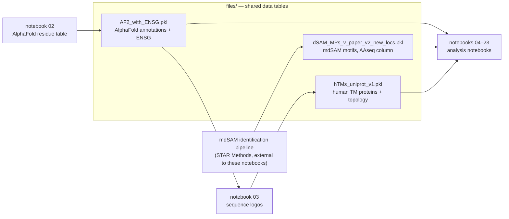

This page is your orientation map for the **mdSAM** repository — the analysis code behind the manuscript *Discovery of self-assembly motifs regulating membrane-protein organization and function* (Elazar, Trivedi, et al., Babu lab, St. Jude). The repo is deliberately minimal: a root `README.md`, one directory of **23 numbered Jupyter notebooks**, and one directory of **shared pickled data tables**. If you understand these three pieces, you can navigate every result in the paper. This page covers what lives where, how the pieces connect, and which notebook produces which figure panel.

An **mdSAM** (membrane-disordered Self-Assembly Motif) is a short 7–9 residue peptide in a disordered, solvent-exposed region of a transmembrane protein, predicted to self-assemble via beta-strand-mediated, amyloid-like interactions. Keep that definition in mind — every notebook, table, and figure in this repository ultimately traces back to finding or validating these motifs.

Sources: [README.md](README.md#L1-L21)

## The Two-Directory Layout

The repository has exactly three top-level entries: the root README, `notebooks/`, and `files/`. The actual tree on disk is:

```
.
├── README.md            # project overview, notebook descriptions, figure-to-notebook map
├── files/               # shared input tables (pickled pandas DataFrames)
│   ├── README.md        # documents each pickle: contents, producer, consumers
│   ├── dSAM_MPs_v_paper_v2_new_locs.pkl
│   └── hTMs_uniprot_v1.pkl
└── notebooks/           # 23 notebooks, numbered 01–23 in pipeline order
    ├── 01_train_waltzdb_classifier.ipynb
    ├── 02_alphafold_residue_table_and_early_plots.ipynb
    ├── ⋮
    └── 23_overlap_with_larks_wirs_finches.ipynb
```

The README's *Repository contents* block summarizes this structure in three lines: `notebooks/` holds the 23 analysis notebooks numbered in pipeline order (with outputs cleared), `files/` holds shared input tables, and it also lists a `FIGURE_MAP.csv` described as a "machine-readable map: paper panel → notebook → cell." Note that `FIGURE_MAP.csv` does **not** appear in the current repository tree — the same panel→notebook→cell mapping is available as human-readable tables in the README itself (see [Tracing Paper Figures Back to Notebooks](#tracing-paper-figures-back-to-notebooks) below). Similarly, `files/` ships two of the three pickles its README describes; the third, `AF2_with_ENSG.pkl`, is generated at runtime by notebook 02.

Sources: [README.md](README.md#L23-L29), [files/README.md](files/README.md#L1-L9)

The two directories have clearly separated roles:

| Directory | Role | Contents |
|---|---|---|
| `notebooks/` | All analysis logic | 23 `.ipynb` files, two-digit prefix = pipeline order, outputs cleared |
| `files/` | Shared data layer | Pickled pandas DataFrames read with `pd.read_pickle`; ships `dSAM_MPs_v_paper_v2_new_locs.pkl` and `hTMs_uniprot_v1.pkl` |
| `README.md` (root) | Documentation hub | Project abstract, per-notebook task tables, complete figure→notebook→cell map, run instructions, package list |

Sources: [README.md](README.md#L25-L29), [files/README.md](files/README.md#L5-L13)

## Architecture at a Glance

Before reading the notebook map, it helps to see the data flow. The central pattern of this repository is a **shared-table hub**: notebooks don't pass data to each other directly. Instead, a few notebooks *write* pickle tables into `files/`, and most later notebooks *read* them back with relative paths like `../files/<name>`. Three tables form this hub:



Reading the diagram left to right: the mdSAM identification pipeline (described in the paper's STAR Methods, not part of these notebooks) produces the main mdSAM motif table. Notebook 02 builds the AlphaFold-derived per-residue table, notebook 03 builds the human transmembrane-protein table, and notebooks 04–23 consume all of these. For beginners, the practical consequence is that **notebook 02 is a prerequisite for nearly everything else**, because it writes the most widely consumed table.

Sources: [files/README.md](files/README.md#L5-L9), [README.md](README.md#L40-L41)

## The Notebook Map: 23 Notebooks in Pipeline Order

Every notebook filename follows the same convention: a two-digit prefix (`01`–`23`) indicating pipeline order, followed by a topic slug. The root README groups the notebooks into six thematic stages that mirror the manuscript's figure sequence — from data preparation, through motif discovery and characterization, into experimental validation, and finally evolutionary analysis. The tables below condense each notebook's task and the paper panels it produces. Cell numbers referenced in the README are 0-based indices into each notebook's `cells` list.

Sources: [README.md](README.md#L31-L33), [README.md](README.md#L26)

### Stage 1 — Data preparation and classifier

| Notebook | Task | Paper panels |
|---|---|---|
| `01_train_waltzdb_classifier.ipynb` | Trains and evaluates the random-forest classifier on WALTZ-DB 2.0 hexapeptides (one-hot sequence + summed beta-strand energy); saves the trained model | Fig 1D; S1E–G |
| `02_alphafold_residue_table_and_early_plots.ipynb` | Builds the shared `AF2_with_ENSG.pkl` residue table (cell 205) used by most other notebooks; remaining cells hold earlier exploratory plots | (input table) |
| `03_mdsam_sequence_logos.ipynb` | Sequence logos and amino-acid composition of mdSAMs; also builds `hTMs_uniprot_v1.pkl` and `AF_IDR_v3.pkl` | S1H |

Sources: [README.md](README.md#L35-L42)

### Stage 2 — Discovery and diversity (Figs 1–2, S1–S2)

| Notebook | Task | Paper panels |
|---|---|---|
| `04_pasta_aggregation_comparison.ipynb` | Compares mdSAM predictions with PASTA energies; ROC for consecutive positive windows | S1I–J |
| `05_uniprot_keyword_enrichment.ipynb` | UniProt keyword enrichment (process, function, disease) for mdSAM-containing proteins | Fig 1G; S1K |
| `06_mdsam_sequence_space_embedding.ipynb` | Embeds mdSAM sequence space from physicochemical features; GMM clustering, charge-archetype ternary plot, dot matrix, Levenshtein distances | Fig 1F; 2G–I; S2E–G |
| `07_hyperlopit_organelle_enrichment.ipynb` | Re-analyzes hyperLOPIT subcellular fractionation (U2OS); mdSAM enrichment per organelle | Fig 2A; S2A–C |
| `08_mdsam_topology_and_membrane_distance.ipynb` | Topology of mdSAM-containing proteins: bitopic vs polytopic, N-/C-terminus vs loop, distance to nearest membrane leaflet | Fig 2B–D, 2F |
| `09_mdsams_per_protein.ipynb` | Histogram of mdSAMs per protein (1, 2, 3+) | Fig 2E |

Sources: [README.md](README.md#L43-L52), [README.md](README.md#L96-L119)

### Stage 3 — In vitro self-assembly (Fig 3, S3)

| Notebook | Task | Paper panels |
|---|---|---|
| `10_tht_peptide_screen_96well.ipynb` | Thioflavin-T screen of mdSAM peptides in 96-well plates; WT vs proline-mutant plates; ternary-plot overlay | Fig 3A–B; S3A, S3C |
| `11_tht_gpcr_peptides_proline_mutants.ipynb` | ThT of GPCR mdSAM peptides (HTR7, CCR4, DRD1) and proline mutants, including HTR7 V451P | Fig 4C, 5B; S3C |
| `12_amytracker_peptides.ipynb` | Amytracker 520 fluorescence of WT and proline-mutant peptides | Fig 4C; S3D |

Sources: [README.md](README.md#L54-L60)

### Stage 4 — Cell-based clustering (Figs 4–5, S5–S6)

| Notebook | Task | Paper panels |
|---|---|---|
| `13_tirf_puncta_poisson_glm.ipynb` | Poisson GLM on CellProfiler tables: puncta per cell area, WT/mutant rate ratios (HEK, U2OS), SNAPtm motif swaps, full-length APP and HTR7 | Fig 4C–D, 5E; S5C |
| `14_flow_cytometry_total_vs_surface.ipynb` | Flow cytometry (FCS files): total vs surface SNAP signal with percentile gating against mock cells | S6A |
| `15_biogrid_interactions_by_mdsam.ipynb` | BioGRID: self-interactions and plasma-membrane networks by mdSAM status (hypergeometric and binomial tests) | S6B–C |
| `16_dstorm_htr7_cluster_analysis.ipynb` | dSTORM cluster analysis: Voronoi thresholding, HDBSCAN clustering, WT-vs-V451P skewness bootstrap for HTR7 | Fig 5F–G |

Sources: [README.md](README.md#L62-L69), [README.md](README.md#L130-L155)

### Stage 5 — HTR7 signalling and transcription (Fig 6)

| Notebook | Task | Paper panels |
|---|---|---|
| `17_htr7_camp_emax_ec50_and_expression_plots.ipynb` | HTR7 cAMP Emax/EC50 comparison (WT vs V451P); expression plots with a mixed model adjusted for total expression | Fig 6D; S6A |
| `18_htr7_rnaseq_pca_volcano.ipynb` | RNA-seq PCA and volcano plots from DESeq2 tables (WT, V451P, empty vector) | Fig 6E |
| `19_htr7_rnaseq_gsea.ipynb` | Re-runs differential expression (pyDESeq2) and gene-set enrichment (gseapy); heatmaps and volcano plots | supports Fig 6E |

Sources: [README.md](README.md#L71-L77)

### Stage 6 — Evolution (Fig 7, S7)

| Notebook | Task | Paper panels |
|---|---|---|
| `20_conservation_alignment_based.ipynb` | Alignment-based conservation (KL, Shannon, Lockless via pycanal); mdSAM retention in one-to-one orthologs | Fig 7B; S7A–B |
| `21_conservation_esm_embedding.ipynb` | Alignment-free conservation from protein language-model embeddings | Fig 7B |
| `22_ortholog_peptide_tht.ipynb` | ThT of NGFR and TNFRSF13C ortholog mdSAM peptides (WT and proline mutant) across species | Fig 7D; S7C |
| `23_overlap_with_larks_wirs_finches.ipynb` | UpSet plot: overlap of mdSAM-containing proteins with LARKS, WIRS, FINCHES predictions | S7D |

Sources: [README.md](README.md#L79-L86), [README.md](README.md#L165-L173)

## The Shared Data Tables in `files/`

The `files/` directory is the data backbone of the repository. Its three tables are pickled pandas DataFrames — Python objects serialized to disk — that notebooks load with `pd.read_pickle`. One critical convention governs all of this: notebooks reference the tables as `../files/<name>`, so you must **run every notebook with `notebooks/` as your working directory**, or the relative paths will break.

> [!TIP]
> The single most common failure mode for newcomers is launching Jupyter from the repository root. Because notebooks hard-code `../files/` paths, always start your session from inside `notebooks/` (e.g., `cd notebooks && jupyter lab`).

| File | Contents | Created by | Read by notebooks |
|---|---|---|---|
| `dSAM_MPs_v_paper_v2_new_locs.pkl` | The mdSAM table loaded by the analysis notebooks; motif sequence in the `AAseq` column | mdSAM identification pipeline (STAR Methods) | 05, 06, 07, 08, 09, 15, 18, 20, 21, 23 |
| `hTMs_uniprot_v1.pkl` | Human transmembrane proteins with UniProt topology annotation | `03_mdsam_sequence_logos.ipynb` | 03, 05, 06, 07, 08, 09, 15, 18, 20, 21, 23 |
| `AF2_with_ENSG.pkl` | AlphaFold-derived per-protein annotations with Ensembl gene IDs (ENSG) | `02_alphafold_residue_table_and_early_plots.ipynb` | 02, 03, 05, 06, 07, 08, 11, 15, 18, 19, 20, 21, 23 |

> [!TIP]
> `AF2_with_ENSG.pkl` is *not* shipped in the repository — it only exists after you run notebook 02, which writes it via `AF2.to_pickle`. Since it is the most widely consumed table (14 notebooks), running notebook 02 first is effectively mandatory. Also handle pickles with care: they can execute code when loaded and depend on the pandas version used to write them, so only load them from this repository.

Sources: [files/README.md](files/README.md#L3-L14), [README.md](README.md#L244-L248)

## Tracing Paper Figures Back to Notebooks

A distinguishing feature of this repository is its **figure traceability**: the README contains complete tables mapping every notebook-produced figure panel to the exact notebook and cell that draws it, covering Figure 1 through Figure 7 plus supplementary figures S1, S2, S3, S6, and S7. For example, Fig 1D (RF classifier performance) comes from `01_train_waltzdb_classifier.ipynb` cell 26, and Fig 2D (distance to nearest membrane leaflet) comes from `08_mdsam_topology_and_membrane_distance.ipynb` cell 45. Two caveats keep these tables honest: cell indices are 0-based into the notebook's `cells` list, and panels that are schematics, microscopy/EM images, NMR, or mass-photometry data are deliberately excluded because they were produced outside these notebooks.

Notebooks are distributed with their outputs cleared — running a notebook regenerates its plots locally. The full per-figure breakdown deserves its own reference page, which the catalog provides at [Figure-to-Notebook Reproducibility Map](9-figure-to-notebook-reproducibility-map); the same information also exists in machine-readable form per the README's `FIGURE_MAP.csv` entry, though that file is not present in the current tree.

Sources: [README.md](README.md#L88-L242)

## Naming and Terminology Conventions

Three conventions will save you confusion when reading code and file names. First, the **two-digit prefixes are pipeline order**, not arbitrary IDs — `05` means notebook 05, and `files/README.md` uses these same numbers in its consumer lists. Second, older notebooks use the term **dSAM** (disordered Self-Assembly Motif) and its structured-region counterpart **mSAM/sSAM/msSAM**; per the README, "dSAM" in any file name or variable name means **mdSAM** — hence the shipped file `dSAM_MPs_v_paper_v2_new_locs.pkl` is the mdSAM table. Third, the notebooks were written for interactive sessions rather than as a formal package: there is no `src/` module or entry-point script, just 23 self-contained notebooks plus the shared pickle tables, which is why the README also enumerates the imported Python packages (`Bio`, `Levenshtein`, `logomaker`, `gseapy`, `fcsparser`, `localcider`, and others) rather than shipping a dependency file.

Sources: [README.md](README.md#L21), [README.md](README.md#L244-L250), [files/README.md](files/README.md#L11)

## Suggested Reading Path

With the map above in hand, a logical progression through the rest of the catalog is: solidify the big picture with [Overview](1-overview) and get the environment running via [Quick Start](2-quick-start). Then follow the pipeline in execution order: [Notebook Pipeline Architecture](5-notebook-pipeline-architecture) explains how the 23 notebooks depend on each other, [WALTZ-DB Random-Forest Classifier](6-waltz-db-random-forest-classifier) deep-dives notebook 01, and [AlphaFold-Based Disorder Filtering](7-alphafold-based-disorder-filtering) covers notebook 02 — the table-builder you must run first. For the data layer, keep [Shared Data Tables Reference](8-shared-data-tables-reference) open as a lookup companion to this page, and use [Figure-to-Notebook Reproducibility Map](9-figure-to-notebook-reproducibility-map) whenever you want to jump straight from a paper panel to its generating cell. When you are ready to adapt the methods to your own data, finish with [Reusing the Analysis Toolkit](27-reusing-the-analysis-toolkit).
