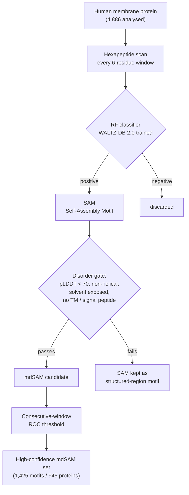

This page explains the central scientific idea behind the mdSAM repository: what an mdSAM is, why the discovery approach was designed the way it was, and how the evidence for the concept was assembled across 23 notebooks. It is a conceptual companion to the implementation-focused pages — the classifier mechanics live in [WALTZ-DB Random-Forest Classifier](6-waltz-db-random-forest-classifier), the disorder gate in [AlphaFold-Based Disorder Filtering](7-alphafold-based-disorder-filtering), and the shared input tables in [Shared Data Tables Reference](8-shared-data-tables-reference).

## From biological question to postulate

The work starts from an open problem: cell-surface clustering of membrane proteins is central to many cellular processes, yet the molecular determinants that drive this clustering remained elusive. The authors' postulate was that short peptide motifs inside **disordered regions** of transmembrane proteins — the flexible tails and loops flanking transmembrane helices — could drive self-association and clustering through amyloid-like interactions. Everything in this repository exists to test that one hypothesis systematically across the human membrane proteome.

Sources: [README.md](/README.md#L5-L7)

## What exactly is an mdSAM?

An **mdSAM** (membrane-disordered Self-Assembly Motif) is a short peptide motif — typically 7–9 residues with a median of 8 — located in an intrinsically disordered, solvent-exposed region of a transmembrane protein, predicted to self-assemble through beta-strand-mediated, amyloid-like interactions. The definition is deliberately two-part: the motif must pass an *assembly* test (sequence-level amyloid propensity) and a *context* test (disorder, exposure, and non-transmembrane localization). Both parts are essential; either alone would describe a different biological object.

The identification logic reflects this two-part definition, executed as a three-stage screen:

1. A random-forest classifier trained on WALTZ-DB 2.0 (1,402 hexapeptides: 510 amyloid-forming, 892 non-forming), using one-hot-encoded sequence plus summed beta-strand free energy (F1 = 0.77 under stratified 5-fold cross-validation).
2. Every hexapeptide window across human membrane proteins is scored; positive windows are called **Self-Assembly Motifs (SAMs)**.
3. A SAM becomes an **mdSAM** only if it lies in a disordered region: AlphaFold pLDDT < 70, non-helical and solvent exposed, excluding transmembrane segments and signal peptides. A ROC-derived threshold on consecutive positive windows defines the high-confidence set.

Sources: [README.md](/README.md#L9-L17)

The prerequisite for reading the diagram below: the classifier is a per-hexapeptide scorer, so it produces many isolated positive windows; the disorder gate and consecutive-window threshold are what convert noisy per-window scores into a biologically meaningful motif set.

Sources: [README.md](/README.md#L11-L17)

### Why this design rather than energy-based prediction alone

The rationale is visible in the validation notebook: the pipeline's primary engine is the WALTZ-DB-trained classifier because WALTZ-DB provides *labeled* experimental hexapeptides (downloaded from waltzdb.switchlab.org), while energy-only tools have no per-motif trained decision boundary. PASTA 2.0 and Aggrescan hot spots were deliberately positioned as **independent cross-checks**, not as the discovery engine — notebook 04's header states its purpose is supplemental information on the window cutoff, PASTA, and Aggrescan, and its main plot cross-references PASTA pairing energies against Aggrescan hot-spot counts for the discovered motifs.

Sources: [notebooks/04_pasta_aggregation_comparison.ipynb](/notebooks/04_pasta_aggregation_comparison.ipynb#L10-L12), [README.md](/README.md#L47)

A telling conceptual anchor appears at the very top of the classifier notebook: the beta-strand free-energy scale (AAindex `MUNV940103`) is immediately applied to two sequences side by side — the APP amyloid core `YEVHHQKLVFFA` (the canonical positive control) and the HTR7 motif `VSVWVLQS` (a candidate). This calibration-against-known-amyloid pattern is the intellectual seed of the whole approach: treat motifs in membrane-protein tails as testable analogs of known amyloid cores.

Sources: [notebooks/01_train_waltzdb_classifier.ipynb](/notebooks/01_train_waltzdb_classifier.ipynb#L22-L24), [notebooks/01_train_waltzdb_classifier.ipynb](/notebooks/01_train_waltzdb_classifier.ipynb#L34-L38)

| Strategy | Evidence basis | Role in this study |
|---|---|---|
| RF classifier (one-hot + summed beta-strand energy) | 1,402 labeled WALTZ-DB 2.0 hexapeptides; F1 = 0.77 | Primary genome-wide scan engine |
| PASTA 2.0 pairing energy | Physicochemical beta-pairing energies | Independent validation of discovered motifs (S1J) |
| Aggrescan hot-spot count (nHS) | Aggregation hot-spot density | Independent validation of discovered motifs |
| Consecutive-window ROC threshold | ROC over window counts per region | Sets the high-confidence boundary (S1I) |

Sources: [README.md](/README.md#L15-L17), [README.md](/README.md#L183-L185), [notebooks/04_pasta_aggregation_comparison.ipynb](/notebooks/04_pasta_aggregation_comparison.ipynb#L189-L195)

## What the screen found

The concept survived its first contact with the proteome with striking statistics. The screen yielded **1,425 high-confidence mdSAMs in 945 membrane proteins** — roughly 20% of the 4,886 human membrane proteins analysed carry at least one. The localization signature is strongly non-random: 91% of mdSAMs sit in N- or C-terminal tails rather than internal loops, and 72% of mdSAM-containing proteins carry exactly one motif, suggesting motifs are a targeted, not ubiquitous, feature. Critically, the concept was testable at the peptide level: of 44 synthesized mdSAM peptides, 36 (81%) gave a Thioflavin-T signal — in vitro assembly rates far above what a random motif set would produce.

| Quantity | Value | Interpretation |
|---|---|---|
| High-confidence mdSAMs | 1,425 | The discoverable motif population |
| mdSAM-containing proteins | 945 (~20% of 4,886) | Widespread, not rare |
| Motif length | 7–9 residues (median 8) | Hexapeptide windows aggregate into short motifs |
| Tail localization | 91% N- or C-terminal | Tails are the preferred regulatory position |
| Single-motif proteins | 72% | Motifs are specific features, not generic clutter |
| Peptide validation | 36/44 (81%) ThT-positive | In vitro assembly confirms prediction quality |

Sources: [README.md](/README.md#L11-L19)

## The evidence chain: how the rationale was validated

The discovery rationale is structured as a tiered argument, and the notebook numbering mirrors it exactly. Each tier answers a distinct question and would stand as evidence even without the later tiers; together they move from *prediction* to *physics* to *cell biology* to *function* to *evolution*.

Sources: [README.md](/README.md#L43-L86)

| Tier | Question answered | Notebooks | Paper figure |
|---|---|---|---|
| Discovery | Do mdSAMs exist genome-wide? | 01, 02, 04, 05 | Fig 1; S1 |
| Diversity | Where do they sit and how varied are they? | 06, 07, 08, 09 | Fig 2; S2 |
| In vitro | Do the peptides physically assemble? | 10, 11, 12 | Fig 3; S3 |
| In cells | Do they cluster full-length proteins? | 13, 14, 15, 16 | Figs 4–5; S5–S6 |
| Function | Does motif disruption change signalling? | 17, 18, 19 | Fig 6 |
| Evolution | Are motifs evolutionarily maintained? | 20, 21, 22, 23 | Fig 7; S7 |

Sources: [README.md](/README.md#L35-L86)

Two design choices in this chain deserve emphasis. First, the diversity tier (notebooks 06–09) characterizes the sequence space *before* any experiment: physicochemical embedding, charge-archetype clustering, organelle enrichment via hyperLOPIT, and topology analysis — this established that mdSAMs are a coherent, non-random class worth experimental investment. Second, the functional tier is anchored by a single deep case study (HTR7): proline mutants (which break beta-strand assembly) serve as the causal perturbation across every assay from peptide ThT through dSTORM nanoscale clustering to cAMP dose-response and RNA-seq. The logic is that one mutation, V451P, breaks motif assembly and everything downstream if — and only if — the mdSAM concept is correct.

Sources: [README.md](/README.md#L43-L52), [README.md](/README.md#L71-L77)

> [!TIP]
> The shared motif table is named `dSAM_MPs_v_paper_v2_new.pkl` with the **dSAM** prefix, not mdSAM. When grepping notebooks for the central object, search for `dSAM` — searching for `mdSAM` will miss every load site (e.g., notebook 05 reads `../files/dSAM_MPs_v_paper_v2_new_locs.pkl`).

## Terminology you will meet in the code

The vocabulary shifted over the course of the project, and the notebooks preserve that history. Reading the terminology map below first will prevent most confusion when you open the notebooks.

| Term | Meaning | Where encountered |
|---|---|---|
| mdSAM | Current paper term: membrane-disordered Self-Assembly Motif | README, manuscript context |
| dSAM | Older in-code name for the same object (disordered SAM) | File names and variables, e.g. `dSAM_MPs_v_paper_v2_new_locs.pkl` |
| SAM | Any classifier-positive hexapeptide window, no disorder requirement | Sequence-logo comparisons (S1H) |
| mSAM / sSAM / msSAM | Structured-region counterpart motifs in older notebooks | Legacy variable names |

Sources: [README.md](/README.md#L21), [notebooks/04_pasta_aggregation_comparison.ipynb](/notebooks/04_pasta_aggregation_comparison.ipynb#L36), [files/README.md](/files/README.md#L7)

The SAM-versus-mdSAM distinction is not pedantry — it is the operationalization of the concept. The supplementary sequence logos explicitly compare mdSAMs against all SAMs, which is how the study quantifies what the disorder context *adds* to the amino-acid composition signature beyond raw amyloid propensity. The discovered motifs are all stored in the shared table with their sequence in the `AAseq` column, read by ten downstream notebooks.

Sources: [README.md](/README.md#L181-L182), [files/README.md](/files/README.md#L7-L9), [notebooks/05_uniprot_keyword_enrichment.ipynb](/notebooks/05_uniprot_keyword_enrichment.ipynb#L33-L34)

## Where to go next

If the concept convinced you, the natural progression through this catalog follows the evidence chain itself. [Notebook Pipeline Architecture](5-notebook-pipeline-architecture) maps how the 23 notebooks interconnect as a system. To understand the two-stage screen in depth, continue to [WALTZ-DB Random-Forest Classifier](6-waltz-db-random-forest-classifier) and [AlphaFold-Based Disorder Filtering](7-alphafold-based-disorder-filtering). For the characterizations that justified experimental investment, see [Sequence Logos and Composition](10-sequence-logos-and-composition) and [hyperLOPIT Organelle Enrichment](14-hyperlopit-organelle-enrichment); for the causal tests, start with [Thioflavin-T and Amytracker Screens](16-thioflavin-t-and-amytracker-screens) and then the [HTR7 End-to-End Case Study](21-htr7-end-to-end-case-study), which integrates every tier in one protein. The evolutionary closure of the argument is documented under [Alignment-Based Conservation Metrics](24-alignment-based-conservation-metrics).