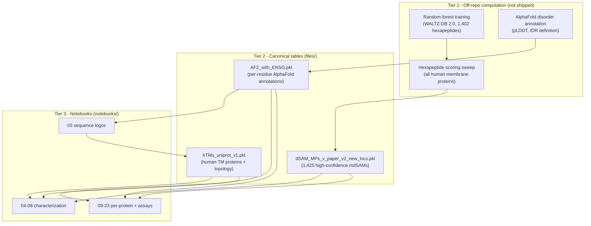
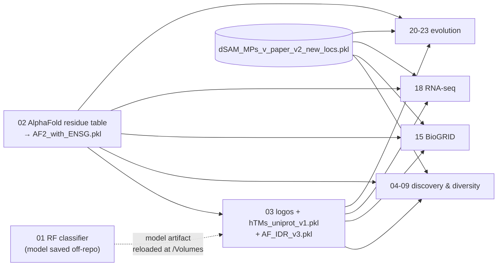

This page explains how the 23 numbered notebooks in `notebooks/` are organized, how they exchange data through the shared tables in `files/`, and where the real execution dependencies lie. The central architectural fact is that this repository is a **publishing checkpoint**, not a self-contained executable pipeline: the heavy lifting (classifier training artifacts, the genome-wide hexapeptide scoring sweep) was performed off-repo, and the repo ships canonical *result tables* that downstream notebooks consume. Understanding this producer/consumer topology is the key to reading, re-running, or extending any notebook in the series.

Sources: [README.md](README.md#L23-L33), [files/README.md](files/README.md#L3)

## The Three-Tier Architecture

The repository separates concerns into three tiers: an off-repo computation tier (classifier training and the full sweep over every hexapeptide window in human membrane proteins, described in the paper's STAR Methods), a canonical data tier (the pickled tables in `files/`), and a presentation/analysis tier (the 23 notebooks that generate figure panels). Only tiers two and three live in this repository; the notebooks in tier three deliberately *start from* frozen results rather than re-deriving them.

Sources: [README.md](README.md#L35-L52), [files/README.md](files/README.md#L5-L9), [notebooks/01_train_waltzdb_classifier.ipynb](notebooks/01_train_waltzdb_classifier.ipynb#L528-L529)

Sources: [README.md](README.md#L13-L19), [files/README.md](files/README.md#L5-L9)

The off-repo tier explains the single most confusing artifact in notebook 01: the notebook evaluates the classifier via cross-validation, but the *trained* model that actually produced the shipped mdSAM table is persisted to an external volume (`joblib.dump(rf, '/Volumes/aelazar/.../RandomForestClassifier_model.sav')`), and notebooks later reload that same artifact to re-score new sequences. The scoring logic that turned classifier outputs into the mdSAM call set ran outside this repository; `dSAM_MPs_v_paper_v2_new_locs.pkl` is its frozen output.

Sources: [notebooks/01_train_waltzdb_classifier.ipynb](notebooks/01_train_waltzdb_classifier.ipynb#L528-L529), [README.md](README.md#L15-L19)

> [!TIP]
> When auditing reproducibility, treat `files/*.pkl` as the ground truth, not notebook outputs. Notebooks are distributed with outputs cleared and would rebuild only their own intermediate frames — never the canonical tables — if re-run as-is.

## The Shared Tables: the Inter-Notebook Data Bus

Notebooks never pass data to each other directly through cell state. The only sanctioned exchange mechanism is the pickle bus in `files/`, read with `pd.read_pickle` via relative paths like `../files/AF2_with_ENSG.pkl`. This requires running every notebook with `notebooks/` as the working directory — a hard convention documented in both READMEs. Two of the three bus tables are notebook-producible (`hTMs_uniprot_v1.pkl` from notebook 03, `AF2_with_ENSG.pkl` from notebook 02 at cell 205); the third, the mdSAM call set itself, arrives from the off-repo pipeline and is the widest fan-in input.

Sources: [files/README.md](files/README.md#L3-L9), [notebooks/03_mdsam_sequence_logos.ipynb](notebooks/03_mdsam_sequence_logos.ipynb#L39), [README.md](README.md#L40-L41)

| Table | Contents | Producer | Consumers (notebook numbers) |
|---|---|---|---|
| `dSAM_MPs_v_paper_v2_new_locs.pkl` | The mdSAM call set; motif sequence in the `AAseq` column | Off-repo identification pipeline (STAR Methods) | 05, 06, 07, 08, 09, 15, 18, 20, 21, 23 |
| `hTMs_uniprot_v1.pkl` | Human transmembrane proteins with UniProt topology annotation | `03_mdsam_sequence_logos.ipynb` (`TMs.to_pickle`) | 03, 05, 06, 07, 08, 09, 15, 18, 20, 21, 23 |
| `AF2_with_ENSG.pkl` | AlphaFold-derived per-residue annotations + Ensembl gene IDs | `02_alphafold_residue_table_and_early_plots.ipynb` (cell 205, `AF2.to_pickle`) | 02, 03, 05, 06, 07, 08, 11, 15, 18, 19, 20, 21, 23 |

Sources: [files/README.md](files/README.md#L5-L9)

The consumer matrix reveals the join keys that matter for integration: `AF2_with_ENSG.pkl` carries both UniProt accessions (`acc`) and Ensembl gene IDs (`ENSG`), which is why notebook 03 uses it to map `ENSG` keys in its local `topology_df` frame onto accessions before building the topology table. Any notebook that needs to reconcile mdSAM coordinates with gene-level annotations routes through this one table.

Sources: [notebooks/03_mdsam_sequence_logos.ipynb](notebooks/03_mdsam_sequence_logos.ipynb#L39), [notebooks/03_mdsam_sequence_logos.ipynb](notebooks/03_mdsam_sequence_logos.ipynb#L62-L64), [files/README.md](files/README.md#L9)

> [!TIP]
> Pickle files execute code on load and are pandas-version sensitive. The repo's own guidance is to load them only from this repository and match the pandas version used to write them — do not "upgrade" the bus tables casually.

## Notebook Numbering as Pipeline Order

The `NN_` prefixes encode a deliberate funnel: broad sequence-space characterization narrows into per-protein analysis, then into controlled experiments, then into a single-protein case study (HTR7), and finally into evolutionary generality checks. The numbering is also the execution order assumed by the figure map: every paper panel in the README resolves to a `(notebook, 0-based cell index)` pair, making the numbering the primary traceability key across the whole repo.

Sources: [README.md](README.md#L31-L33), [README.md](README.md#L88-L90)

| Stage | Notebooks | Role in the funnel |
|---|---|---|
| Foundation | 01, 02, 03 | Train/evaluate RF classifier; build `AF2_with_ENSG.pkl`; build logos, `hTMs_uniprot_v1.pkl`, `AF_IDR_v3.pkl` |
| Discovery & diversity | 04–08 | PASTA/threshold validation, UniProt keyword enrichment, sequence-space embedding & GMM clustering, hyperLOPIT organelles, topology & membrane distance |
| Per-protein census | 09 | mdSAMs-per-protein histogram |
| In vitro assembly | 10–12 | ThT 96-well screen, GPCR peptide ThT, Amytracker |
| Cell-based clustering | 13–16 | TIRF puncta Poisson GLM, flow cytometry gating, BioGRID interactomics, dSTORM clusters |
| HTR7 case study | 17–19 | cAMP dose-response, RNA-seq PCA/volcano, DE + GSEA |
| Evolution | 20–23 | Alignment-based and ESM conservation, ortholog peptide ThT, LARKS/WIRS/FINCHES overlap |

Sources: [README.md](README.md#L35-L86)

## The Dependency Topology in Practice

Reading order and execution order agree on the foundation, but the dependency edges are *star-shaped around the bus*, not a chain. Notebook 03, for instance, depends on notebook 02's output (it reads `../files/AF2_with_ENSG.pkl` as its second cell) while simultaneously reading the mdSAM table and re-scoring gnomAD variants by reloading the classifier artifact from the external volume — the same feature schema (one-hot hexapeptide + summed MUNV940103 beta energy) that notebook 01 defines. This is why notebook 01's feature engineering is worth studying even though its model artifact lives off-repo: downstream notebooks re-instantiate the scoring function locally.

Sources: [notebooks/03_mdsam_sequence_logos.ipynb](notebooks/03_mdsam_sequence_logos.ipynb#L39), [notebooks/03_mdsam_sequence_logos.ipynb](notebooks/03_mdsam_sequence_logos.ipynb#L2776-L2790), [notebooks/01_train_waltzdb_classifier.ipynb](notebooks/01_train_waltzdb_classifier.ipynb#L22-L25), [notebooks/03_mdsam_sequence_logos.ipynb](notebooks/03_mdsam_sequence_logos.ipynb#L2824-L2830)

Sources: [notebooks/03_mdsam_sequence_logos.ipynb](notebooks/03_mdsam_sequence_logos.ipynb#L2776-L2778), [files/README.md](files/README.md#L5-L9)

Two friction points in this topology deserve explicit acknowledgment. First, several notebooks still reference the original author's machine paths (`/Volumes/aelazar/...` for background tables, model artifacts, and gnomAD data, plus notebook-local side files like `enumerate/enumerate.pkl` and `topology_df`), which the root README itself flags as a caveat for re-running. Second, the README references a machine-readable `FIGURE_MAP.csv` that is not present in the shipped tree — the README's panel tables are the de facto figure map. Neither breaks the read path for the shipped tables, but both affect a from-scratch re-execution attempt.

Sources: [README.md](README.md#L27-L29), [README.md](README.md#L248-L250), [notebooks/03_mdsam_sequence_logos.ipynb](notebooks/03_mdsam_sequence_logos.ipynb#L49-L51)

## Notebook Anatomy: A Representative Pattern

Across the catalog, notebooks share a recognizable skeleton: an import cell (often duplicating the `MUNV940103` energy scale and helper functions like `adjust_box_widths`), followed by reads from `../files/`, followed by analysis cells and `plt.savefig` calls that emit figure assets. Notebook 02's anatomy is the extreme case: it begins with the same import block family (including `iupred2a_lib`, `pyaaisc.Aaindex`, UMAP/t-SNE) and ends with a long tail of exploratory PTM-enrichment plots that the README explicitly labels as earlier versions not tied to final panels. The shipped figure panels are pinned to specific cell indices, so a notebook's *position* in its cell list — not its narrative flow — is what the reproducibility contract depends on.

Sources: [notebooks/01_train_waltzdb_classifier.ipynb](notebooks/01_train_waltzdb_classifier.ipynb#L9-L25), [notebooks/02_alphafold_residue_table_and_early_plots.ipynb](notebooks/02_alphafold_residue_table_and_early_plots.ipynb#L9-L28), [README.md](README.md#L40), [README.md](README.md#L33)

For intermediate developers, the practical contract when touching any notebook is therefore: preserve cell ordering (or update the map), keep reads pointing at `../files/`, and treat `01`'s feature definitions as the canonical scoring schema. The classifier design itself — one-hot-encoded hexapeptide plus summed beta-strand free energy, F1 = 0.77 under stratified 5-fold CV — is detailed on the dedicated classifier page, and the disorder-filtering rules that turn SAMs into mdSAMs are covered on the AlphaFold page.

Sources: [README.md](README.md#L15-L17)

## Suggested Reading Progression

To build a working mental model in three steps: start with the catalog-level map to locate each notebook's role, then study the two producer notebooks (02 and 03) since everything downstream hangs off their tables, and finish with the shared-table reference before attempting any re-runs. From here, the natural deep-dive order follows the funnel.

1. [Repository Layout and Notebook Map](3-repository-layout-and-notebook-map) — inventory of what lives where
2. [mdSAM Concept and Discovery Rationale](4-mdsam-concept-and-discovery-rationale) — the biology behind the call set
3. [WALTZ-DB Random-Forest Classifier](6-waltz-db-random-forest-classifier) — notebook 01's training and evaluation in depth
4. [AlphaFold-Based Disorder Filtering](7-alphafold-based-disorder-filtering) — notebook 02's residue table and IDR rules
5. [Shared Data Tables Reference](8-shared-data-tables-reference) — schemas of the three bus tables
6. [Figure-to-Notebook Reproducibility Map](9-figure-to-notebook-reproducibility-map) — the panel → `(notebook, cell)` contract
