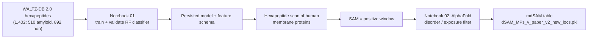
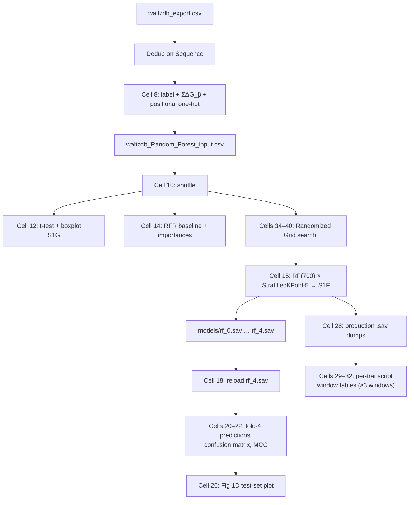

This page documents `notebooks/01_train_waltzdb_classifier.ipynb`, the notebook that trains, validates, and persists the binary amyloid-forming classifier at the root of the mdSAM discovery pipeline. It covers the WALTZ-DB 2.0 training data, the feature construction (positional one-hot encoding plus summed beta-strand free energy), the hyperparameter search, the stratified cross-validated evaluation behind paper figures Fig 1D, S1F, and S1G, and the persisted artifacts that downstream notebooks consume. All references are to the notebook JSON line ranges unless otherwise noted.

## Role in the mdSAM Discovery Pipeline

Notebook 01 is **stage one of a two-stage discovery cascade**. The random forest it produces scores every hexapeptide window of human membrane proteins for amyloid-forming potential; a window labeled positive is a Self-Assembly Motif (SAM), and only SAMs that additionally sit in a disordered, solvent-exposed region — a determination made later by notebook 02 using AlphaFold confidence — become mdSAMs. Of the 4,886 human membrane proteins analysed, this cascade ultimately yields 1,425 high-confidence mdSAMs across 945 proteins. Understanding the classifier's exact training contract is therefore prerequisite to interpreting every downstream result in the repository.

The prerequisite to read this diagram: the classifier operates on **fixed-length hexapeptides**, so "window scoring" means sliding a 6-residue frame across each protein sequence and predicting class per frame. The final table above is the shared input read by ten analysis notebooks (05, 06, 07, 08, 09, 15, 18, 20, 21, 23).

Sources: [README.md](README.md#L13-L21), [README.md](README.md#L19), [files/README.md](files/README.md#L7)

## Training Data: the WALTZ-DB 2.0 Export

The notebook ingests a CSV export from [waltzdb.switchlab.org](http://waltzdb.switchlab.org/), consisting of **1,402 experimentally characterised hexapeptides — 510 amyloid-forming and 892 non-forming** — and immediately enforces uniqueness by dropping duplicate `Sequence` rows before resetting the index. Each entry carries a `Classification` field (the label source) and a `UniProt ID` (retained as provenance). The export itself is a local download, referenced by a hardcoded user path rather than being bundled in the repository.

| Property | Value | Role in training |
|---|---|---|
| Unit of data | Hexapeptide sequence | One feature vector per peptide |
| Positive class | `Classification == 'amyloid'` (510) | Encoded as `classification = 1` |
| Negative class | all other classifications (892) | Encoded as `classification = 0` |
| Deduplication | `drop_duplicates(subset=['Sequence'])` | Prevents sequence leakage across folds |
| Provenance | `UniProt ID` column | Carried through as `acc` metadata |

Sources: [01_train_waltzdb_classifier.ipynb](notebooks/01_train_waltzdb_classifier.ipynb#L113-L117), [README.md](README.md#L15)

## Feature Engineering: One-Hot Sequence Plus Summed Beta-Strand Free Energy

Each hexapeptide is converted into a **121-dimensional vector**: 120 positional one-hot columns (6 positions × 20 amino acids) generated by `pd.get_dummies(waltzdb['Sequence'].apply(lambda x: pd.Series(list(x))))`, plus one scalar feature `beta` — the sum of per-residue values from the AAindex scale **MUNV940103**, a beta-sheet free-energy scale where lower values indicate residues that favor beta-strand conformation. Because the canonical export is uniformly hexameric, the positional encoding is well-formed with no ragged padding.

The scale's key behaviour is worth internalising: hydrophobic, beta-branched residues sit at the low end (V = 0.546, I = 0.583, Y = 0.665, F = 0.685) while proline and charged/polar residues sit at the high end (P = 1.412, D = 1.266, N = 1.197). This is why the summed feature is interpretable as a **pseudo free energy ΣΔG_β** — amyloid-forming peptides accumulate low (favorable) values. The notebook demonstrates this directly by plotting per-residue propensity profiles for the HTR7 motif `VSVWVLQS` against the canonical amyloid core `YEVHHQKLVFFA` from APP, establishing the physiological intuition before any model is fit.

| Feature block | Construction | Dimensions |
|---|---|---|
| Positional one-hot | `get_dummies` over per-position residue identity | 120 binary columns |
| `beta` | `Σ MUNV940103[residue]` over the sequence | 1 scalar |
| Label | `1` if amyloid else `0` | target |
| Metadata | `AAseq`, `acc` (UniProt ID) | carried alongside, not trained on |

The finished matrix is shuffled, written to `waltzdb_Random_Forest_input.csv` as an archival intermediate, and the `beta` distributions of the two classes are compared by a t-test and plotted as a notched boxplot annotated `p = 10⁻¹¹²` — this panel is paper figure S1G.

> [!TIP]
> When porting or retraining, **preserve the exact column order** of the feature matrix — positional one-hot columns are order-sensitive, and downstream window scoring must present vectors in the same layout. The notebook guards this by persisting the fitted DataFrame itself (`RandomForestClassifier_DataFrame.sav`, cell 28) as the canonical schema reference rather than relying on column names alone.

Sources: [01_train_waltzdb_classifier.ipynb](notebooks/01_train_waltzdb_classifier.ipynb#L22-L24), [01_train_waltzdb_classifier.ipynb](notebooks/01_train_waltzdb_classifier.ipynb#L149-L171), [01_train_waltzdb_classifier.ipynb](notebooks/01_train_waltzdb_classifier.ipynb#L34-L47), [01_train_waltzdb_classifier.ipynb](notebooks/01_train_waltzdb_classifier.ipynb#L182-L233)

## Model Selection: From Baseline to the Final Hyperparameters

The notebook documents a deliberate, three-step selection trajectory that a reproducer should recognise as **exploration history, not a required sequence**. A `RandomForestRegressor(n_estimators=24)` baseline first establishes signal and prints top-10 feature importances (with the summed beta energy typically leading). A `RandomizedSearchCV` over a broad grid — 200–2000 trees, `auto`/`sqrt` feature sampling, depths 10–110 or unlimited, split/leaf minimums, bootstrap on/off — runs 100 iterations at 3-fold CV, followed by a narrowed `GridSearchCV` (bootstrap `False`, `max_features` 2–3, `n_estimators` 550–2000). The final production configuration that the evaluation cells use is:

| Hyperparameter | Final value |
|---|---|
| Model class | `RandomForestClassifier` |
| `n_estimators` | 700 |
| `max_features` | 3 |
| `min_samples_split` | 2 |
| `min_samples_leaf` | 1 |
| `max_depth` | None (unlimited) |
| `bootstrap` | False |

Sources: [01_train_waltzdb_classifier.ipynb](notebooks/01_train_waltzdb_classifier.ipynb#L268-L294), [01_train_waltzdb_classifier.ipynb](notebooks/01_train_waltzdb_classifier.ipynb#L613-L632), [01_train_waltzdb_classifier.ipynb](notebooks/01_train_waltzdb_classifier.ipynb#L654-L661), [01_train_waltzdb_classifier.ipynb](notebooks/01_train_waltzdb_classifier.ipynb#L687-L724), [01_train_waltzdb_classifier.ipynb](notebooks/01_train_waltzdb_classifier.ipynb#L314)

## Cross-Validated Evaluation (Figure S1F)

The headline evaluation is a **5-fold StratifiedKFold loop** that refits the 700-tree classifier per fold, overlays per-fold ROC curves, and plots the interpolated mean ROC with a ±1 standard-deviation band against the chance diagonal — the figure exported as S1F. Each fold's metrics are accumulated independently: accuracy, binary precision, recall, F1 (reported as mean ± std across folds; the paper reports **F1 = 0.77**), the ravelled confusion matrix, and the held-out indices. Critically for reproducibility, **each fold's fitted model is persisted immediately** via `joblib.dump(rf, 'models/rf_%d.sav')`, so the evaluation leaves behind five artefacts, not just plots.

Read the diagram top-to-bottom as the notebook's executable spine: the branch through `rf_4` is the held-out characterisation, and the bottom branch is the hand-off to proteome scanning.

Sources: [01_train_waltzdb_classifier.ipynb](notebooks/01_train_waltzdb_classifier.ipynb#L311-L365), [01_train_waltzdb_classifier.ipynb](notebooks/01_train_waltzdb_classifier.ipynb#L384-L392), [README.md](README.md#L15), [README.md](README.md#L179-L180)

## Held-Out Test-Set Characterisation (Figure 1D)

After cross-validation, the notebook designates **fold 4's model (`rf_4.sav`) with fold 4's test indices** as the canonical held-out characterisation. Predictions are collected row-by-row into `RF_regression` (true class vs. score), from which the notebook prints the confusion matrix decomposition (`TN/FP/FN/TP`), computes the **Matthews correlation coefficient** as a class-imbalance-robust summary, and draws the score-separation count plot. The final Fig 1D panel is rendered from a curated tab-separated file (`confusion_matrix_bar_plot.csv`) grouping test peptides by RF classification and ground truth — an example row comment records the fold-4 decomposition as `TN=160; FP=18; FN=26; TP=76`.

| Evaluation layer | Output | Figure / consumer |
|---|---|---|
| Mean ROC over 5 folds ± std | `aucs`, interpolated `tprs` | S1F |
| Per-fold ACC/Precision/Recall/F1 | mean ± std printed | notebook log |
| Fold-4 confusion matrix + MCC | TN/FP/FN/TP, `matthews_corrcoef` | notebook log |
| Score separation count plots | `RF_classifier_test_set.svg`, `_v2.svg` | Fig 1D |

Sources: [01_train_waltzdb_classifier.ipynb](notebooks/01_train_waltzdb_classifier.ipynb#L401-L450), [01_train_waltzdb_classifier.ipynb](notebooks/01_train_waltzdb_classifier.ipynb#L468-L508), [README.md](README.md#L96)

## Artefact Persistence and Downstream Consumption

The notebook's real product is the set of serialised objects at its end. Per-fold models land in a local `models/` directory during evaluation; the **production pair** — the fitted classifier (`RandomForestClassifier_model.sav`) and its feature DataFrame (`RandomForestClassifier_DataFrame.sav`) — is dumped to the project volume for the proteome scan. The final cells then load per-transcript pickle tables (e.g. `ENST00000000233.pkl`) and count transcripts whose `WT_Windows_above_thershold` column reaches **≥ 3 consecutive positive hexapeptide windows** — exactly the consecutive-window criterion whose ROC-derived threshold is calibrated in notebook 04. The discovered motifs ultimately flow into `dSAM_MPs_v_paper_v2_new_locs.pkl` (with motif sequences in the `AAseq` column), the shared table behind ten downstream notebooks; note the repository's naming convention that **"dSAM" in filenames and variables means mdSAM**.

| Artefact | Produced at | Consumed by |
|---|---|---|
| `waltzdb_Random_Forest_input.csv` | cell 9 | archival feature matrix |
| `models/rf_0.sav` … `rf_4.sav` | cell 15 | cell 18 reloads `rf_4.sav` |
| `RandomForestClassifier_model.sav` + `_DataFrame.sav` | cell 28 | proteome-wide window scoring |
| `RF_classifier_test_set*.svg` | cells 24, 26 | Fig 1D |
| `ENST*.pkl` per-transcript window tables | external scan step | cells 29–32 threshold check |

Sources: [01_train_waltzdb_classifier.ipynb](notebooks/01_train_waltzdb_classifier.ipynb#L340), [01_train_waltzdb_classifier.ipynb](notebooks/01_train_waltzdb_classifier.ipynb#L528-L529), [01_train_waltzdb_classifier.ipynb](notebooks/01_train_waltzdb_classifier.ipynb#L538-L547), [README.md](README.md#L17-L21), [files/README.md](files/README.md#L7)

## Reproducing the Notebook Today: Environment Caveats

The notebook is a research artefact written against an earlier scientific-Python stack, and a faithful re-run requires mapping several legacy usages. Beyond API drift, the file mixes executable spine with superseded cells: cell 10 reads `set(df['type'])` before the `type` column is created (cell 12), cell 25 references `RF_for_plot` one cell before it is defined (cell 26), and a duplicate CV loop with 100-tree settings (cells 33) exists alongside the production 700-tree loop. Execution order therefore matters, and the notebook must be run in cell-index order for the documented figures to regenerate.

| Legacy usage | Issue | Modern replacement |
|---|---|---|
| `df.append(...)` | Removed in pandas ≥ 2.0 | `pd.concat` |
| `plot_roc_curve` | Removed in scikit-learn ≥ 1.2 | `RocCurveDisplay.from_estimator` |
| `max_features='auto'` | Removed in scikit-learn ≥ 1.2 | explicit `'sqrt'` or integer |
| `/Users/aelazar/...` and `/Volumes/...` paths | Host-specific, non-portable | download WALTZ-DB export; local output dirs |
| `models/` target of `joblib.dump` | Directory must pre-exist | create before running cell 15 |
| `! open .` (cell 23) | macOS shell | remove on other platforms |

External dependencies declared in the import cell include `localcider` and an appended path to a local `iupred2a` installation (its import is commented out), so a minimal environment is `pandas`, `numpy`, `scikit-learn`, `scipy`, `seaborn`, `matplotlib`, `biopython`, `joblib`, and `localcider`.

> [!TIP]
> The `p = 10⁻¹¹²` annotation on the S1G boxplot is a **hardcoded string**, while the live `stats.ttest_ind` result is printed separately one line above — treat the printed statistic as ground truth when regenerating the panel, since re-sampling or re-deduplicating WALTZ-DB will not update the annotation.

Sources: [01_train_waltzdb_classifier.ipynb](notebooks/01_train_waltzdb_classifier.ipynb#L9-L25), [01_train_waltzdb_classifier.ipynb](notebooks/01_train_waltzdb_classifier.ipynb#L113-L117), [01_train_waltzdb_classifier.ipynb](notebooks/01_train_waltzdb_classifier.ipynb#L159), [01_train_waltzdb_classifier.ipynb](notebooks/01_train_waltzdb_classifier.ipynb#L215-L230), [01_train_waltzdb_classifier.ipynb](notebooks/01_train_waltzdb_classifier.ipynb#L328), [01_train_waltzdb_classifier.ipynb](notebooks/01_train_waltzdb_classifier.ipynb#L586-L603)

## Key Takeaways and Where to Go Next

The classifier itself is deliberately simple — a 700-tree random forest over 121 features derived from sequence position and beta-strand energetics — and its strength lies in the engineering discipline around it: stratified evaluation with per-fold persistence, a held-out fold for figure-grade characterisation, and serialisation of both model and feature schema for proteome-scale application. To continue the discovery narrative, the natural progression is: [AlphaFold-Based Disorder Filtering](7-alphafold-based-disorder-filtering) for the second stage that converts SAM predictions into mdSAMs; [PASTA Comparison and Window Thresholds](12-pasta-comparison-and-window-thresholds) for the consecutive-window threshold calibration (S1I–J); [Notebook Pipeline Architecture](5-notebook-pipeline-architecture) for how notebook 01 sits among all 23 notebooks; [Shared Data Tables Reference](8-shared-data-tables-reference) for the schemas of `dSAM_MPs_v_paper_v2_new_locs.pkl` and friends; and [Figure-to-Notebook Reproducibility Map](9-figure-to-notebook-reproducibility-map) to trace Fig 1D, S1F, and S1G back to their exact generating cells. For how the HTR7 motif used in this notebook's demo profile becomes a full experimental case study, see [HTR7 End-to-End Case Study](21-htr7-end-to-end-case-study), and for the composition-level view of what the classifier labels, see [Sequence Logos and Composition](10-sequence-logos-and-composition).
