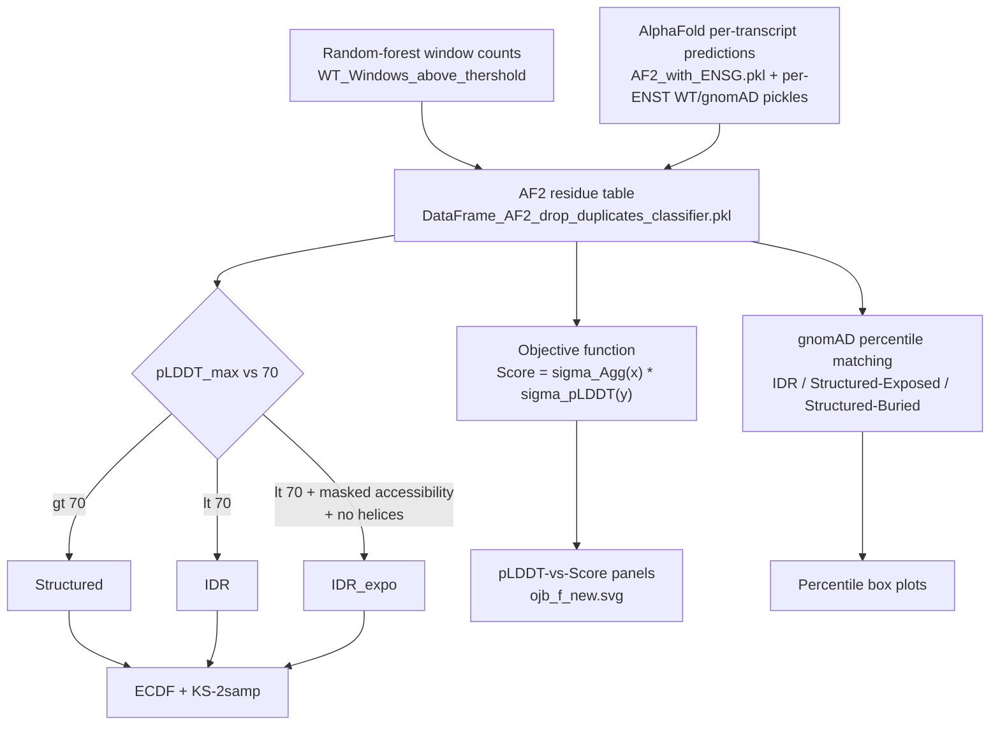

This page documents the AlphaFold-driven order/disorder stratification implemented in `02_alphafold_residue_table_and_early_plots.ipynb` — the computational stage that converts raw per-residue amyloidogenicity calls from the WALTZ-DB random-forest stage ([WALTZ-DB Random-Forest Classifier](6-waltz-db-random-forest-classifier)) into biophysically interpretable mdSAM candidates. The notebook's core contribution is threefold: a **three-class residue stratification** built on AlphaFold pLDDT confidence, a **two-factor objective function** that fuses amyloidogenic window counts with pLDDT, and a **matched-background validation layer** that benchmarks candidate segments against gnomAD allele-frequency distributions. All logic verified below resides in the single notebook file.

Sources: [02_alphafold_residue_table_and_early_plots.ipynb](notebooks/02_alphafold_residue_table_and_early_plots.ipynb#L8-L27)

## Position in the Discovery Pipeline

Notebook 02 is the *adjudication layer* of the mdSAM pipeline: notebook 01 produces per-residue counts of classifier windows above threshold (`WT_Windows_above_thershold`), and notebook 02 decides which of those residues actually live in protein contexts where amyloidogenicity is structurally plausible. The AlphaFold table (`DataFrame_AF2_drop_duplicates_classifier.pkl`) carries the per-residue features used for that decision — `AF2_pLDDT_max`, `AF2_accessibility`, and `AF2_SS_helix_count` — keyed by `ENSG`/`ENST`. From this one table, three independent analyses branch out: class stratification with KS-tested ECDFs, the objective-function scoring surface, and gnomAD percentile matching against IDR or structured backgrounds.



Sources: [02_alphafold_residue_table_and_early_plots.ipynb](notebooks/02_alphafold_residue_table_and_early_plots.ipynb#L289-L308), [02_alphafold_residue_table_and_early_plots.ipynb](notebooks/02_alphafold_residue_table_and_early_plots.ipynb#L1349-L1350)

## The Three-Class pLDDT Stratification

The notebook operationalizes disorder as a hard threshold on per-residue maximum pLDDT: **`AF2_pLDDT_max > 70` → `Structured`**, **`AF2_pLDDT_max < 70` → `IDR`**. A third, stricter class `IDR_expo` intersects the pLDDT condition with two structural guards: a fully masked accessibility string (`AF2_accessibility == '*********'`, nine wildcard characters) and absence of modeled helical secondary structure (`AF2_SS_helix_count < 1`). This stratification is immediately stress-tested: a Kolmogorov–Smirnov two-sample test compares `WT_Windows_above_thershold` distributions between the `Structured` and `IDR_expo` classes, and three overlaid ECDFs (blue/red/orange, `#04A1D5`/`r`/`#ED8453`) visualize the separation under the title "Human ORFs".

| Class | Mask (verbatim) | Biophysical reading |
|---|---|---|
| `Structured` | `df.AF2_pLDDT_max > 70` | residue sits in a well-resolved fold |
| `IDR` | `df.AF2_pLDDT_max < 70` | low-confidence, disordered context |
| `IDR_expo` | `accessibility=='*********'` **and** `pLDDT_max<70` **and** `SS_helix_count<1` | disordered with no modeled secondary structure and masked solvent-accessibility state |

The 70 boundary is used symmetrically elsewhere: the per-transcript loop selects IDR residues with `df_WT.AF2_pLDDT_max <= 70` (line 433) and background residues with `>= 70` (line 485), confirming that the same cutoff governs both candidate selection and matched-background construction. This mirrors AlphaFold's documented interpretation of pLDDT as a local-resolution/confidence proxy, applied here as the sole disorder oracle — no external disorder predictor is needed for the primary filtering (although IUPred2A is imported at module level for auxiliary sequence analyses).

Sources: [02_alphafold_residue_table_and_early_plots.ipynb](notebooks/02_alphafold_residue_table_and_early_plots.ipynb#L298-L326), [02_alphafold_residue_table_and_early_plots.ipynb](notebooks/02_alphafold_residue_table_and_early_plots.ipynb#L422-L433), [02_alphafold_residue_table_and_early_plots.ipynb](notebooks/02_alphafold_residue_table_and_early_plots.ipynb#L474-L485)

## The mdSAM Objective Function

The quantitative heart of the page is a closed-form objective function evaluated on every residue:

```
Score = 1 / (1 + exp(-2*(Agg_value - 2)))  ×  1 / (1 + exp(0.5*(pLDDT - 70)))
```

defined at lines 1349–1350 as `def f(pLDDT, Agg_value)`. Each factor is a logistic sigmoid, and their product yields a score in the open interval (0, 1):

| Factor | Formula | Midpoint | Slope behavior | Reward direction |
|---|---|---|---|---|
| Amyloidogenic support | `1/(1+e^(-2(x-2)))` | x = 2 windows | rising | ≥2 classifier windows per residue |
| Disorder weight | `1/(1+e^(0.5(y-70)))` | y = pLDDT 70 | falling (in y) | low pLDDT maximizes weight |

The notebook renders this surface twice: first as a 3D scatter over the meshgrid x∈[0,6], y∈[0,100] with the axes labeled "Windows classified as amyloidogenic", `pLDDT^max`, and `Score`, exported to `obj_f.svg`; then as 2D `pLDDT`-vs-`Score` scatter panels faceted by `Agg` count (0, 1, 2, 3, ≥4) with a `cividis_r` color ramp normalized to `hue_norm=(0,1)`, exported to `ojb_f_new.svg` with the ylabel "Objective function score".

> [!TIP]
> The sigmoid midpoint x = 2 is not arbitrary: the companion artifact `Agg_len_RF_at_least_2.pkl` is commented as "Agg = windows with at least 2 RF windows as classified; as used in the IDR search" (line 261). The objective function simply recodes that empirical ≥2-window rule into a differentiable form, so scoring and segment-calling share one consistent threshold.

Sources: [02_alphafold_residue_table_and_early_plots.ipynb](notebooks/02_alphafold_residue_table_and_early_plots.ipynb#L83-L149), [02_alphafold_residue_table_and_early_plots.ipynb](notebooks/02_alphafold_residue_table_and_early_plots.ipynb#L1348-L1350), [02_alphafold_residue_table_and_early_plots.ipynb](notebooks/02_alphafold_residue_table_and_early_plots.ipynb#L1384-L1474), [02_alphafold_residue_table_and_early_plots.ipynb](notebooks/02_alphafold_residue_table_and_early_plots.ipynb#L260-L281)

## Background Construction: WT and gnomAD per-Transcript Tables

To prove that amyloidogenic-in-disorder residues are not a trivial consequence of local sequence composition, the notebook builds matched null distributions from gnomAD variant annotations. For each transcript `ENST`, it loads a WT prediction pickle and a gnomAD variant pickle from the cluster paths `/home/aelazar/higher_order_assemblies/classifier/human_ORfs/AF2/WT_RFR/pkls_RandomForestClassifier_9_9_21/pkls/%s_WT.pkl` and `.../gnomAD_AF2/pkls/%s_gnomAD.pkl`. Candidate aggregate stretches are pulled from positions falling inside the IDR interval (`IDRs.loc[i,'start']` to `'end'`), filtered to `MUT_Windows_above_thershold < 2` so the query stretch is amyloidogenic while the background is not, then `stats.percentileofscore(..., 'weak')` ranks the candidate's summed `exome_af` against matched stretches sampled from the rest of the protein. Two structural guards discipline the match: the background pool must be at least twice the query length (`len(df_IDR) > 2 * len(pos)`), and only contiguous position runs of exactly `len(pos)` residues qualify.

The loop exists in two symmetric variants — `AF2_pLDDT_max <= 70` (IDR background) and `>= 70` (Structured background) — persisting results to `gnomAD_allele_count_new_v4.pkl` and `gnomAD_allele_count_new_v4_v_Structured.pkl` respectively. A later refinement (v5) splits the structured control by solvent exposure into `Structured^{Buried}` and `Structured^{Exposed}` pickles (`gnomAD_allele_count_new_v5_SB_random.pkl`, `..._SE_random.pkl`, `..._IDR*.pkl`), enabling the three-way IDR / Exposed / Buried box plots that anchor the disorder-specific enrichment claim.

> [!TIP]
> Both loops embed the class logic directly: changing the pLDDT comparison at lines 433/485 re-tasks the identical gnomAD machinery between disorder-enrichment and structured-control analyses. The buried/exposed split (v5) then reuses the same percentile pipeline a third time — one matching engine, three experimental arms.

Sources: [02_alphafold_residue_table_and_early_plots.ipynb](notebooks/02_alphafold_residue_table_and_early_plots.ipynb#L422-L465), [02_alphafold_residue_table_and_early_plots.ipynb](notebooks/02_alphafold_residue_table_and_early_plots.ipynb#L474-L517), [02_alphafold_residue_table_and_early_plots.ipynb](notebooks/02_alphafold_residue_table_and_early_plots.ipynb#L692-L708)

## Statistical Validation Layer

Every filtering decision in this notebook is paired with a falsification test. The validation battery operates at three levels:

| Level | Comparison | Method / statistic | Output artifact |
|---|---|---|---|
| Classifier sanity | RF classification vs ground truth | confusion-matrix bar chart (TN=160, FP=18, FN=26, TP=76 annotated at L158) | `RF_classifier_test_set_v2.svg` |
| Class separation | Structured vs IDR vs IDR_expo window counts | ECDF overlay + `stats.ks_2samp` (L308) | ECDF panels, "Human ORFs" |
| IDR vs Globular prior | fraction of residues by windows above RF threshold | grouped bar chart (Globular `#0088DC` vs IDR `#FF8B00`) | `Fraction_residues_IDR_V_Globular_AF2_RF_classifier.svg` |
| Evolutionary constraint (IDR) | aggregate stretch vs matched IDR stretches | percentile-of-score box plot, annotated p = 10⁻¹⁷⁵ | `gnomad_all.svg` |
| Evolutionary constraint (Structured) | same on structured background | annotated p = 6·10⁻³⁶ | `gnomad_all_structed.svg` |
| Exposure control | IDR / Structured^{Exposed} / Structured^{Buried} | three-way box plots of `percentileofscore` | `gnomad_new.svg`, `precentile_new.svg` (commented) |

Two supporting analyses round out the picture: a scatter of IDR length against aggregating-residue count (`Agg_len_RF_at_least_2.pkl`) reports Spearman r = 0.51 on a log-x axis, showing that aggregation propensity scales sub-linearly with IDR length; and the membrane-specific slice restricts the IDR arm to bitopic proteins via `ENSG_type.protein_type == 'Bitopic'` joined through `AF2_with_ENSG.pkl`, with CD22 (ENST00000085219) developed as the worked single-gene example in `gnomAD_CD22.svg`. Sequence-level redundancy of IDR stretches is additionally probed with a pairwise Levenshtein distance matrix over `AAseq` values.

Sources: [02_alphafold_residue_table_and_early_plots.ipynb](notebooks/02_alphafold_residue_table_and_early_plots.ipynb#L157-L207), [02_alphafold_residue_table_and_early_plots.ipynb](notebooks/02_alphafold_residue_table_and_early_plots.ipynb#L298-L326), [02_alphafold_residue_table_and_early_plots.ipynb](notebooks/02_alphafold_residue_table_and_early_plots.ipynb#L536-L585), [02_alphafold_residue_table_and_early_plots.ipynb](notebooks/02_alphafold_residue_table_and_early_plots.ipynb#L644-L685), [02_alphafold_residue_table_and_early_plots.ipynb](notebooks/02_alphafold_residue_table_and_early_plots.ipynb#L977-L979), [02_alphafold_residue_table_and_early_plots.ipynb](notebooks/02_alphafold_residue_table_and_early_plots.ipynb#L1492-L1499)

## Artifact Inventory and Reproducibility Notes

The notebook reads and writes a large artifact graph. The table below consolidates every verified path, its role in the disorder-filtering logic, and where it enters the code.

| Artifact | Role | Code anchor |
|---|---|---|
| `waltzdb_export.csv` (waltzdb.switchlab.org) | amyloid/non-amyloid labels for ΔG_β box plot (ΣMUNV940103, t-test p = 10⁻¹¹²) | L215–L253 |
| `Agg_len_RF_at_least_2.pkl` | residues with ≥2 classifier windows, IDR-search standard | L261 |
| `DataFrame_AF2_drop_duplicates_classifier.pkl` | central per-residue AF2 feature table | L290 |
| `../files/AF2_with_ENSG.pkl` | ENST↔ENSG join table for protein-type filtering | L403 |
| `%ENST_WT.pkl`, `%ENST_gnomAD.pkl` (cluster) | per-transcript WT and variant-level window predictions | L426–L431 |
| `gnomAD_allele_count_new_v4.pkl`, `_v_Structured.pkl`, `_v5_{IDR,SE,SB}*.pkl` | percentile-match results per background arm | L536, L645, L693–L702 |
| `obj_f.svg`, `ojb_f_new.svg`, `gnomad_*.svg` | figure exports for the reproducibility map | L149, L1473, L584, L684 |

Three reproducibility caveats follow directly from the code. First, data paths are split between relative (`../files/`), local-author (`/Users/aelazar/PycharmProjects/PhaseSep/...`), and cluster (`/home/aelazar/higher_order_assemblies/...`) locations, so a faithful re-run requires the cluster filesystem. Second, the environment appends a personal IUPred2A install to `sys.path` and imports `localcider`, `pyaaisc`, and `umap` beyond the scientific core stack. Third, the notebook uses the long-deprecated `DataFrame.append` idiom and mutates shared DataFrames in place (e.g., assigning `d1['type']='Structured'` on slices), meaning cells are order-sensitive and idempotent only when executed top-to-bottom — deviations will silently alter class membership in the stratification table.

Sources: [02_alphafold_residue_table_and_early_plots.ipynb](notebooks/02_alphafold_residue_table_and_early_plots.ipynb#L215-L253), [02_alphafold_residue_table_and_early_plots.ipynb](notebooks/02_alphafold_residue_table_and_early_plots.ipynb#L289-L291), [02_alphafold_residue_table_and_early_plots.ipynb](notebooks/02_alphafold_residue_table_and_early_plots.ipynb#L402-L404), [02_alphafold_residue_table_and_early_plots.ipynb](notebooks/02_alphafold_residue_table_and_early_plots.ipynb#L8-L27), [02_alphafold_residue_table_and_early_plots.ipynb](notebooks/02_alphafold_residue_table_and_early_plots.ipynb#L149-L149)

## Where This Fits and What to Read Next

Within the catalog, this page is the hinge between statistical discovery and biological interpretation. Upstream, the classifier mechanics and training set belong to [WALTZ-DB Random-Forest Classifier](6-waltz-db-random-forest-classifier); the exact provenance and schema of the pickle artifacts consumed here are catalogued in [Shared Data Tables Reference](8-shared-data-tables-reference), and the figure exports (`obj_f.svg`, `ojb_f_new.svg`, `gnomad_all.svg`, `Fraction_residues_IDR_V_Globular_AF2_RF_classifier.svg`) are traceable through [Figure-to-Notebook Reproducibility Map](9-figure-to-notebook-reproducibility-map). Downstream, the IDR/Structured classes defined here become the population frames for sequence-composition and enrichment analyses ([Sequence Logos and Composition](10-sequence-logos-and-composition), [UniProt Keyword Enrichment](13-uniprot-keyword-enrichment)), while the bitopic-membrane restriction of the gnomAD arm previews the topology analysis in [Topology and Membrane-Leaflet Distance](15-topology-and-membrane-leaflet-distance). The recommended reading order is classifier → this page → shared tables, then any domain-specific downstream page.
